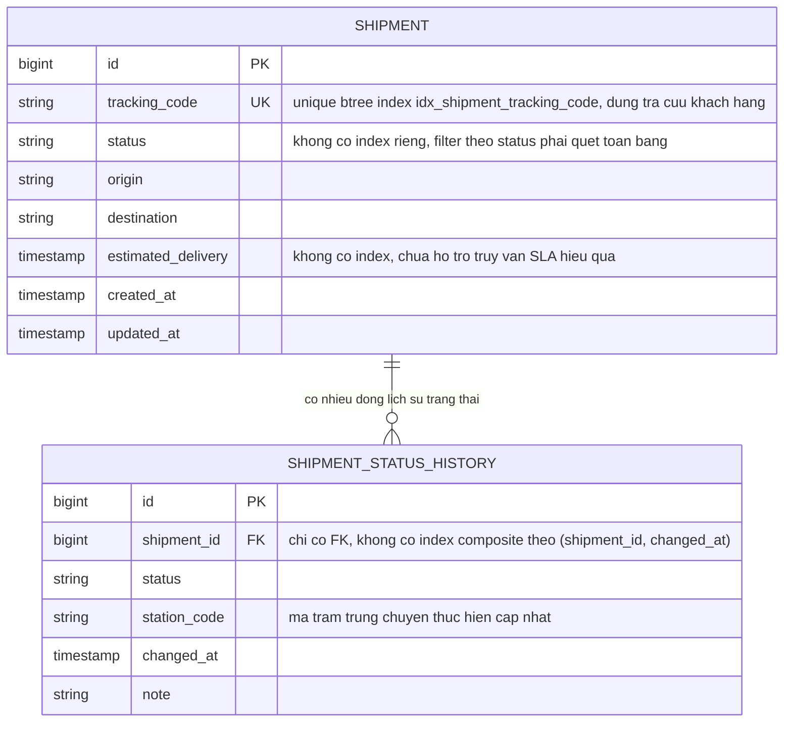
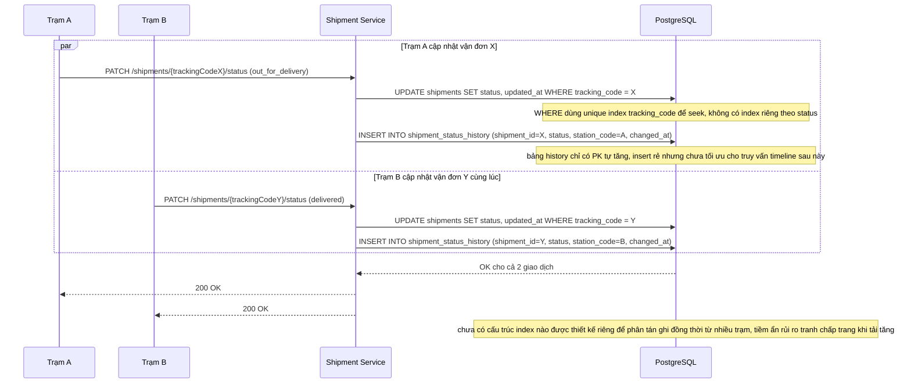
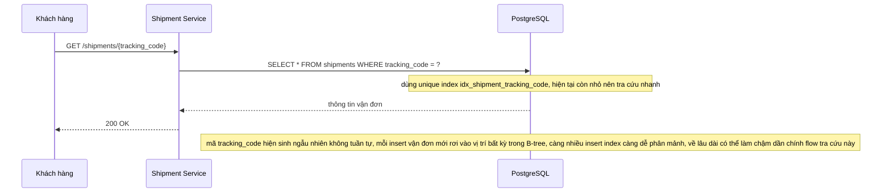
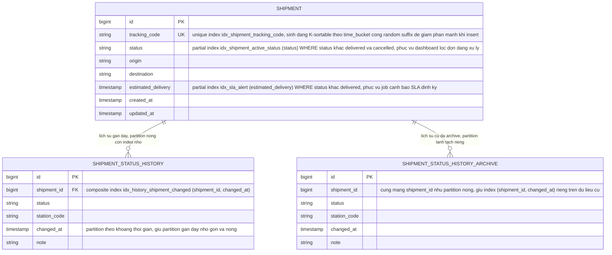
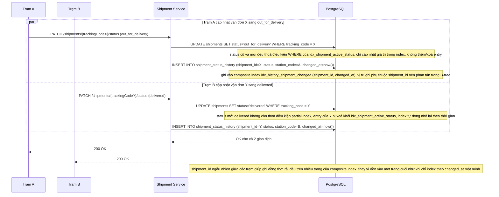
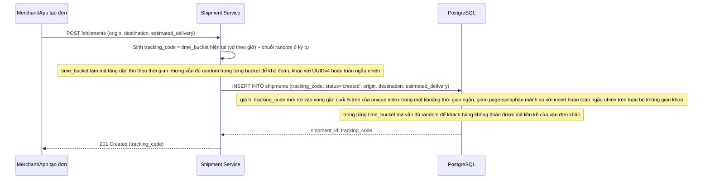
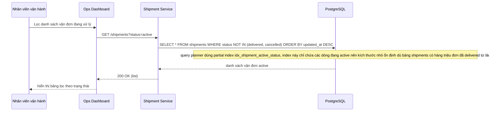
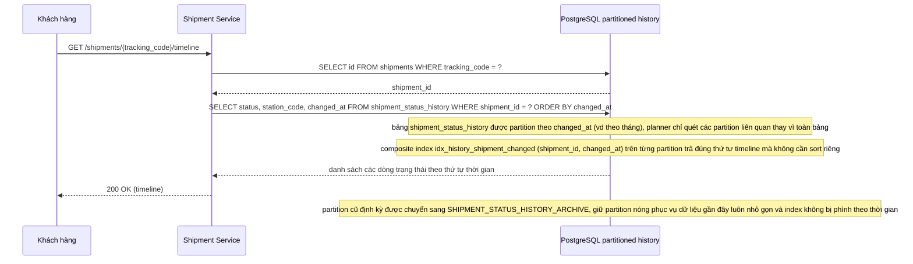
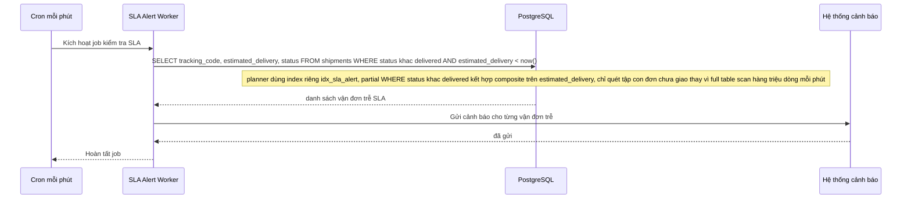

# Logistics tra cứu và theo dõi vận đơn với tần suất ghi trạng thái cao

**Hệ thống:** Nền tảng logistics quản lý vận đơn (shipment), mỗi vận đơn được cập nhật trạng thái liên tục nhiều lần trong ngày (pickup, in-transit, out-for-delivery, delivered...) qua nhiều trạm trung chuyển khác nhau.

**Vai trò của flow:** Cho phép khách hàng và bộ phận vận hành tra cứu nhanh theo mã vận đơn, theo trạng thái hiện tại, hoặc theo khoảng thời gian, trong khi bảng dữ liệu liên tục bị ghi cập nhật với tần suất cao.

**Yêu cầu cụ thể:**
- Unique index trên `tracking_code` phải đảm bảo khách hàng tra cứu tức thời, nhưng nếu mã vận đơn được sinh ngẫu nhiên không tuần tự, việc insert liên tục vận đơn mới có thể gây phân mảnh index nhanh hơn — cần cân nhắc cách sinh mã vừa đảm bảo tính duy nhất/khó đoán, vừa thân thiện với cấu trúc index.
- Dashboard vận hành cần lọc vận đơn theo trạng thái hiện tại, nhưng trạng thái đổi liên tục nghĩa là mỗi lần update phải xoá và chèn lại entry trong index theo status — với hàng triệu vận đơn đang active, chi phí ghi này rất lớn; cần cân nhắc partial index chỉ bao phủ các trạng thái "đang xử lý" thay vì index toàn bộ trạng thái kể cả các đơn đã delivered từ lâu.
- Lịch sử thay đổi trạng thái (nhiều dòng cho mỗi vận đơn) cần composite index (shipment_id, changed_at) để trả đúng thứ tự timeline cho khách xem, nhưng bảng lịch sử tăng vô hạn theo thời gian — cần có chiến lược archive/partition dữ liệu cũ mà không phá vỡ hiệu năng của index đang phục vụ dữ liệu gần đây.
- Hệ thống cần chạy định kỳ (vd mỗi phút) một truy vấn tìm các vận đơn trễ SLA (estimated_delivery đã qua nhưng status khác delivered) trên bảng có quy mô lớn — quét toàn bảng mỗi phút là không khả thi, cần thiết kế index (partial/composite) riêng tối ưu cho đúng dạng truy vấn cảnh báo này.
- Nhiều trạm trung chuyển ghi cập nhật trạng thái đồng thời cho các vận đơn khác nhau — cần chọn cấu trúc index/storage tránh việc nhiều ghi đồng thời dồn vào cùng vài trang index "nóng" (hot page), gây lock contention làm chậm toàn bộ hệ thống dù các vận đơn được cập nhật không liên quan tới nhau.

---

# Base ERD - Quản lý vận đơn cơ bản

Đây là **base**: trạng thái dữ liệu trước khi áp đề bài tối ưu index. Hệ thống đã có bảng `shipments` với unique index trên `tracking_code` để tra cứu tức thời, và bảng `shipment_status_history` lưu lịch sử thay đổi trạng thái, nhưng **chưa có** partial index cho status, chưa có composite index (shipment_id, changed_at) cho lịch sử, và chưa có index riêng phục vụ truy vấn cảnh báo SLA - đây chính là những khoảng trống mà enhance sẽ lấp vào.

---

# Base - Flow trạm cập nhật trạng thái vận đơn

Đây là **base**, sequence diagram cho flow **update-shipment-status**: một trạm trung chuyển ghi nhận thay đổi trạng thái cho vận đơn. Flow này được chọn vì đây chính là nguồn ghi tần suất cao mà đề bài tập trung tối ưu index xung quanh nó (partial index status, composite index history, tránh hot page khi nhiều trạm ghi đồng thời).

---

# Base - Flow khách tra cứu theo mã vận đơn

Đây là **base**, sequence diagram cho flow **lookup-by-tracking-code**: khách hàng tra cứu vận đơn bằng mã tracking_code. Flow này được chọn vì nó là lý do unique index trên `tracking_code` tồn tại ngay từ base, và là flow phải luôn giữ nhanh dù bảng bị ghi liên tục - chính là mối lo mà đề bài nêu ở yêu cầu sinh mã tracking_code thân thiện với index.

---

# Enhance ERD - Tối ưu index cho vận đơn tần suất ghi cao

Đây là **enhance**: cùng 2 bảng `shipments` và `shipment_status_history` như base, nhưng bổ sung: partial index cho status "đang xử lý" (thay vì index toàn bộ trạng thái), composite index (shipment_id, changed_at) cho lịch sử, index riêng phục vụ truy vấn cảnh báo SLA, chiến lược tracking_code thân thiện với index khi insert, và tách partition nóng/lạnh cho lịch sử để archive dữ liệu cũ mà không ảnh hưởng index đang phục vụ dữ liệu gần đây.

---

# Enhance - Flow trạm cập nhật trạng thái vận đơn

Đây là **enhance** của flow **update-shipment-status**. So với base, flow này thay đổi ở 3 điểm: (1) UPDATE status giờ tương tác với partial index idx_shipment_active_status - entry chỉ tồn tại khi status còn "đang xử lý" và tự động bị xoá khỏi index khi chuyển sang delivered, (2) INSERT lịch sử ghi vào composite index (shipment_id, changed_at) thay vì bảng không có index chuyên biệt, (3) vì shipment_id là cột dẫn đầu của composite index, các trạm khác nhau ghi vào các vị trí khác nhau trong B-tree, giảm tranh chấp trang nóng so với base.

---

# Enhance - Flow tạo vận đơn mới với tracking_code thân thiện index

Đây là **enhance**, sequence diagram cho flow mới **create-shipment**: tạo vận đơn và sinh mã tracking_code. Base đã có unique index trên tracking_code nhưng không mô tả cách sinh mã; flow này được thêm để làm rõ chiến lược sinh mã mới - vừa khó đoán vừa hạn chế phân mảnh index khi insert liên tục với tần suất cao, đúng yêu cầu đầu tiên của đề bài.

---

# Enhance - Flow dashboard vận hành lọc vận đơn theo trạng thái

Đây là **enhance**, sequence diagram cho flow mới **filter-active-shipments-dashboard**: bộ phận vận hành lọc danh sách vận đơn đang xử lý. Flow này hoàn toàn mới so với base (base chưa có index nào phục vụ lọc theo status), được thêm để minh hoạ trực tiếp partial index idx_shipment_active_status giải quyết yêu cầu thứ hai của đề bài.

---

# Enhance - Flow khách xem timeline lịch sử vận đơn

Đây là **enhance**, sequence diagram cho flow mới **view-shipment-timeline**: khách hàng xem toàn bộ lịch sử thay đổi trạng thái theo đúng thứ tự thời gian. Flow này hoàn toàn mới so với base (base chưa có index hỗ trợ truy vấn timeline hiệu quả), được thêm để minh hoạ composite index (shipment_id, changed_at) và chiến lược partition nóng/lạnh giải quyết yêu cầu thứ ba của đề bài.

---

# Enhance - Flow job định kỳ tìm vận đơn trễ SLA

Đây là **enhance**, sequence diagram cho flow mới **sla-alert-job**: job chạy định kỳ mỗi phút để tìm các vận đơn đã quá estimated_delivery nhưng chưa delivered. Flow này hoàn toàn mới so với base (base chưa có index nào phục vụ dạng truy vấn này), được thêm để minh hoạ index riêng cho cảnh báo SLA giải quyết yêu cầu thứ tư của đề bài.

