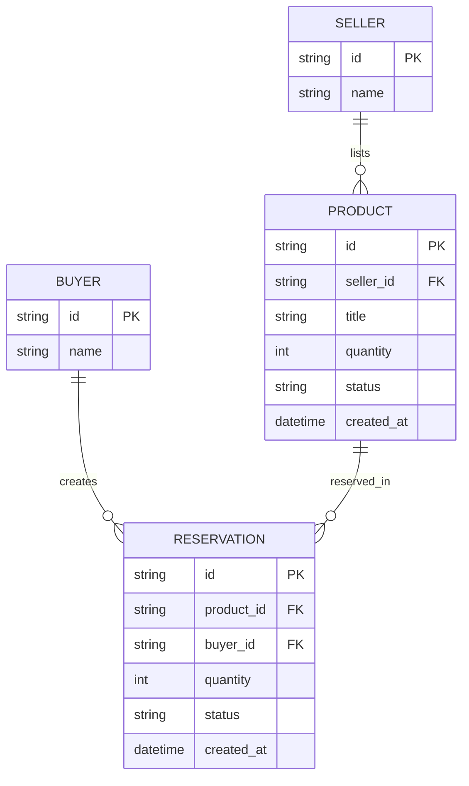
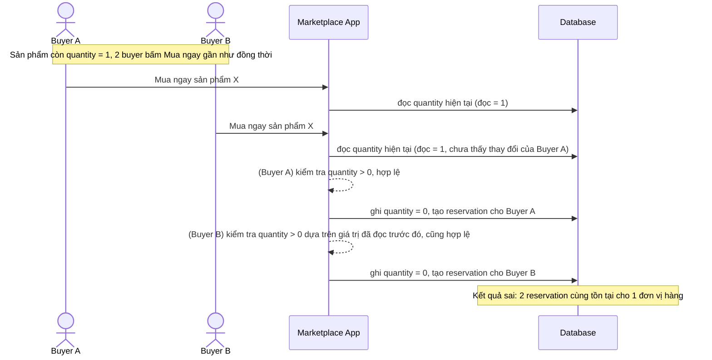
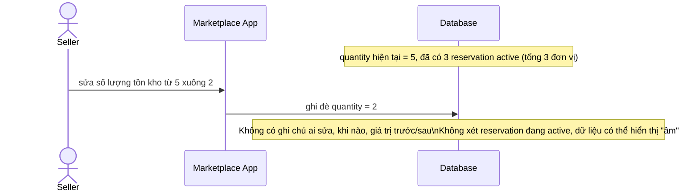
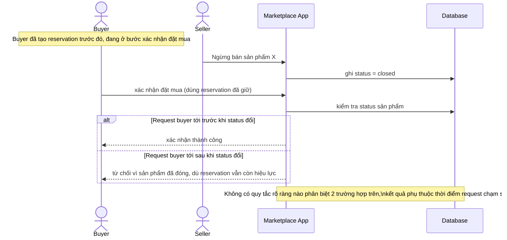
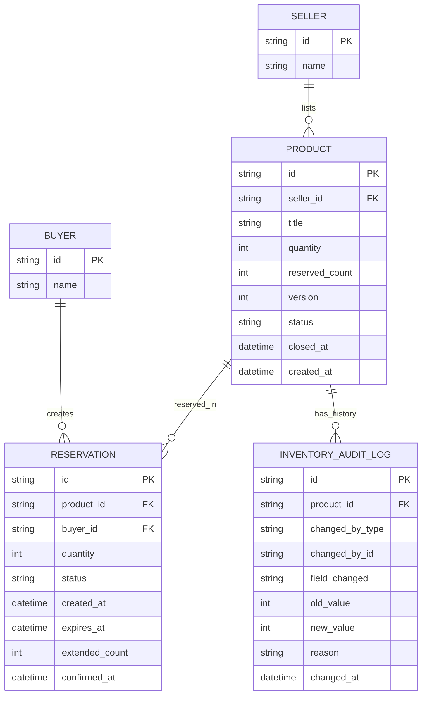
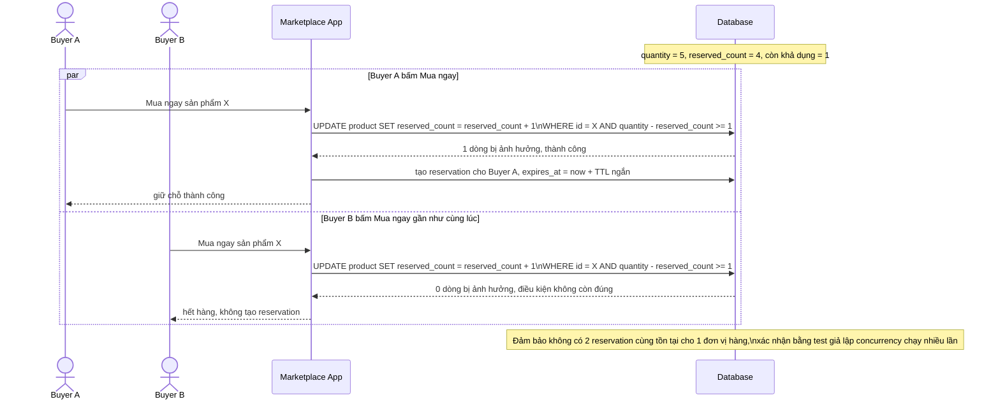
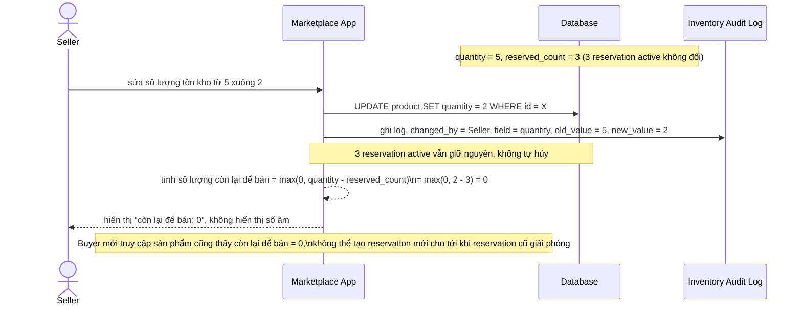
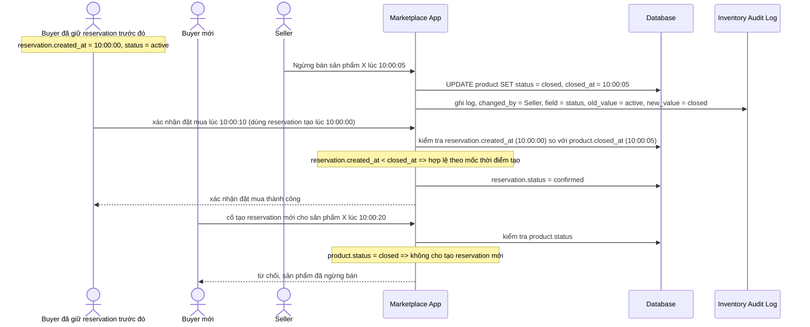
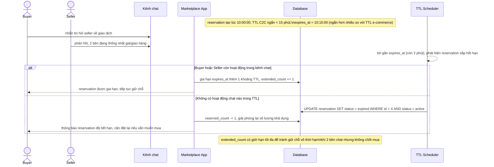

# Giữ tồn kho khi seller và buyer thao tác đồng thời trên marketplace C2C

**Hệ thống:** Một marketplace C2C (kiểu Facebook Marketplace) cho phép seller đăng nhiều sản phẩm với số lượng, buyer có thể đặt mua và seller cũng có thể tự sửa/xóa số lượng bất cứ lúc nào.

**Vai trò của flow:** Flow reservation phải xử lý được xung đột giữa hành động buyer (đặt mua, giữ tồn kho) và hành động seller (tự sửa số lượng, ngừng bán) xảy ra đồng thời trên cùng 1 sản phẩm.

**Yêu cầu cụ thể:**
- Khi seller sửa số lượng tồn kho từ 5 xuống 2 đúng lúc có 3 buyer khác nhau đang giữ reservation (tổng 3 đơn vị đã reserve), quy định rõ hành vi: các reservation đã tạo trước khi seller sửa vẫn hợp lệ (không tự hủy), chỉ số lượng còn lại để bán mới bị giới hạn theo giá trị mới — không để số liệu "âm" (reserved vượt tồn kho mới) gây lỗi hiển thị.
- Khi seller bấm "Ngừng bán" (đóng sản phẩm) đúng lúc buyer đang ở giữa bước xác nhận đặt mua đã giữ reservation trước đó, request xác nhận của buyer phải được xử lý dựa trên trạng thái tại thời điểm reservation được tạo (buyer đã giữ hợp lệ thì vẫn được mua), còn buyer mới sau khi sản phẩm đã đóng không thể tạo reservation mới — mô tả rõ ranh giới thời điểm nào được tính là "trước/sau".
- 2 buyer cùng bấm "Mua ngay" cho sản phẩm chỉ còn 1 số lượng gần như đồng thời: chỉ 1 người giữ được reservation, thiết kế bằng update nguyên tử trên cột tồn kho khả dụng, có test giả lập concurrency xác nhận không có 2 reservation cùng tồn tại cho 1 đơn vị hàng.
- Reservation của buyer phải có TTL ngắn hơn ở marketplace C2C so với e-commerce chính thức (vì tốc độ trao đổi/chat trước khi chốt mua có thể chậm), quy định giá trị TTL và cách gia hạn khi buyer và seller đang chat để thống nhất giao dịch.
- Có audit log cho mọi thay đổi tồn kho (ai sửa, khi nào, giá trị trước/sau) để xử lý tranh chấp khi buyer khiếu nại "đã đặt được hàng nhưng sau đó bị báo hết".

---

# ERD - Base (trước khi xử lý concurrency cho reservation C2C)

Đây là **base**: mô hình dữ liệu tối thiểu của một marketplace C2C, nơi seller đăng sản phẩm với số lượng, buyer đặt mua để giữ chỗ. Chỉ giữ `Seller`, `Buyer`, `Product`, `Reservation` - đủ để thấy vấn đề: `Product.quantity` là một con số đơn giản, còn `Reservation` chưa có TTL rõ ràng hay cơ chế atomic, chưa có audit log - đúng những gì enhance sẽ bổ sung.

---

# Sequence - Base - Flow "create-reservation"

Đây là **base**: cách buyer đặt mua (giữ reservation) trước khi có xử lý concurrency, dùng read-modify-write đơn giản trên `quantity`. Flow này được chọn vì nó chính là nơi race condition xảy ra khi enhance yêu cầu 2 buyer bấm "Mua ngay" gần như đồng thời cho sản phẩm chỉ còn 1 số lượng (yêu cầu 3).

---

# Sequence - Base - Flow "update-quantity"

Đây là **base**: cách seller sửa số lượng tồn kho trước khi có quy tắc phối hợp với reservation đang tồn tại - đơn giản là ghi đè `quantity` mới, không xét tới các reservation đã giữ trước đó. Flow này được chọn vì nó là tiền đề cho yêu cầu 1 (seller sửa số lượng khi buyer đang giữ reservation) và yêu cầu 5 (chưa có audit log nào ghi lại thay đổi).

---

# Sequence - Base - Flow "close-product"

Đây là **base**: cách seller ngừng bán một sản phẩm trước khi có quy định ranh giới thời điểm rõ ràng với buyer đang xác nhận đặt mua. Flow này được chọn vì nó là tiền đề cho yêu cầu 2 - đề bài yêu cầu định nghĩa rõ "trước/sau" thời điểm đóng sản phẩm, còn ở base thì hành vi mơ hồ, tùy thời điểm request buyer chạm tới app trước hay sau khi cờ status đổi.

---

# ERD - Enhance (reservation an toàn cho concurrency C2C)

Đây là **enhance**: mô hình dữ liệu sau khi thêm cơ chế xử lý concurrency giữa seller và buyer. So với base, các thay đổi là:

- `PRODUCT` có thêm `reserved_count` (tổng số lượng đang bị giữ bởi reservation active, tách khỏi `quantity` để không cần hủy reservation cũ khi seller giảm số lượng - yêu cầu 1), `version` (dùng cho update nguyên tử/optimistic lock trên tồn kho khả dụng - yêu cầu 3), và `closed_at` (mốc thời gian chính xác để phân biệt reservation "trước/sau" khi ngừng bán - yêu cầu 2).
- `RESERVATION` có thêm `expires_at`, `extended_count` (TTL ngắn và cơ chế gia hạn khi buyer/seller đang chat - yêu cầu 4), và `status` mở rộng (`active` / `confirmed` / `expired` / `cancelled`) để phân biệt trạng thái tại thời điểm reservation được tạo.
- `INVENTORY_AUDIT_LOG` (mới): 1 bản ghi cho mỗi lần `quantity` hoặc `reserved_count` thay đổi, lưu ai sửa, khi nào, giá trị trước/sau - phục vụ tra soát tranh chấp (yêu cầu 5).

---

# Sequence - Enhance - Flow "create-reservation"

Đây là **enhance**, cùng flow `create-reservation` như ở base nhưng thay update read-modify-write bằng update nguyên tử có điều kiện trên `reserved_count`, đáp ứng yêu cầu 3: 2 buyer bấm "Mua ngay" gần như đồng thời cho sản phẩm chỉ còn 1 số lượng khả dụng thì chỉ 1 người giữ được reservation. Flow cũng gán `expires_at` theo TTL ngắn của C2C ngay khi tạo, chuẩn bị cho yêu cầu 4.

---

# Sequence - Enhance - Flow "update-quantity"

Đây là **enhance**, cùng flow `update-quantity` như ở base nhưng thay đổi hành vi cốt lõi, đáp ứng yêu cầu 1 và yêu cầu 5: khi seller sửa `quantity` từ 5 xuống 2 lúc đang có 3 reservation active (tổng 3 đơn vị), các reservation cũ vẫn hợp lệ - không bị hủy tự động; chỉ số lượng còn lại để bán mới (`quantity - reserved_count`) bị giới hạn và được kẹp về 0 thay vì hiển thị số âm. Mọi thay đổi đều ghi audit log.

---

# Sequence - Enhance - Flow "close-product"

Đây là **enhance**, cùng flow `close-product` như ở base nhưng thay đổi hành vi cốt lõi, đáp ứng yêu cầu 2: ranh giới "trước/sau" được định nghĩa rõ bằng `reservation.created_at` so với `product.closed_at`, không phụ thuộc vào thời điểm request của buyer chạm tới server. Buyer đã giữ reservation hợp lệ trước mốc đóng vẫn được mua, buyer mới sau mốc đó không thể tạo reservation.

---

# Sequence - Enhance - Flow "reservation-ttl-extend"

Đây là **enhance**, flow hoàn toàn mới so với base, đáp ứng yêu cầu 4: reservation ở marketplace C2C có TTL ngắn hơn e-commerce chính thức (vì buyer/seller cần thời gian chat để thống nhất giao dịch), và có cơ chế gia hạn khi 2 bên vẫn đang trao đổi thay vì để reservation tự hết hạn giữa chừng.

