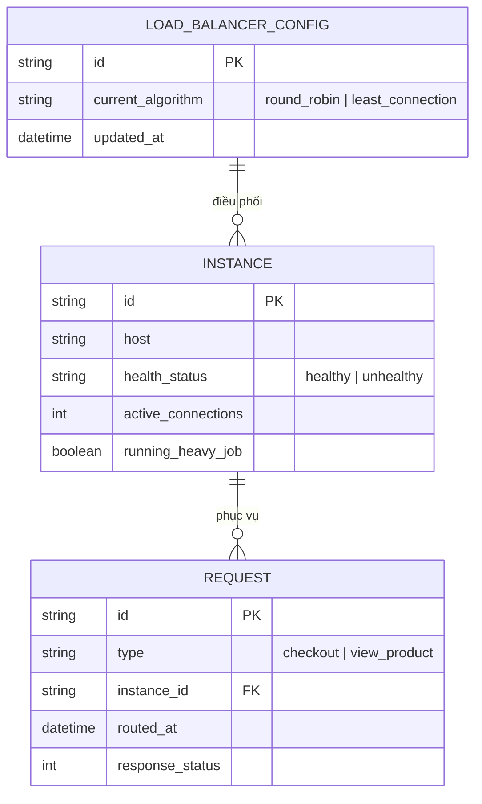
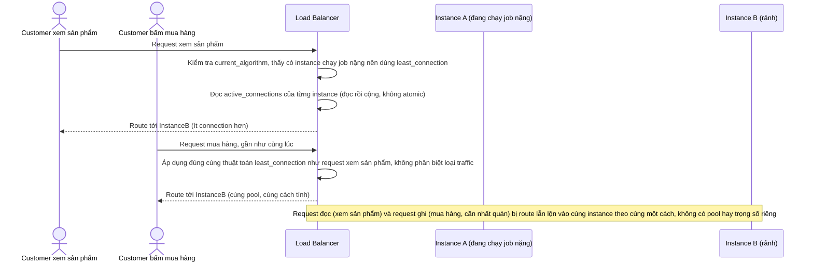
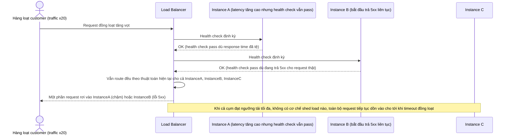
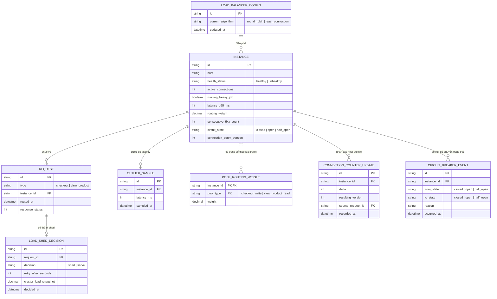
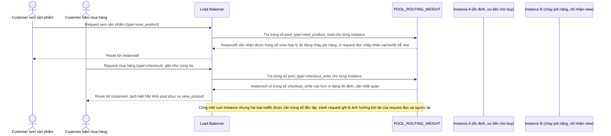
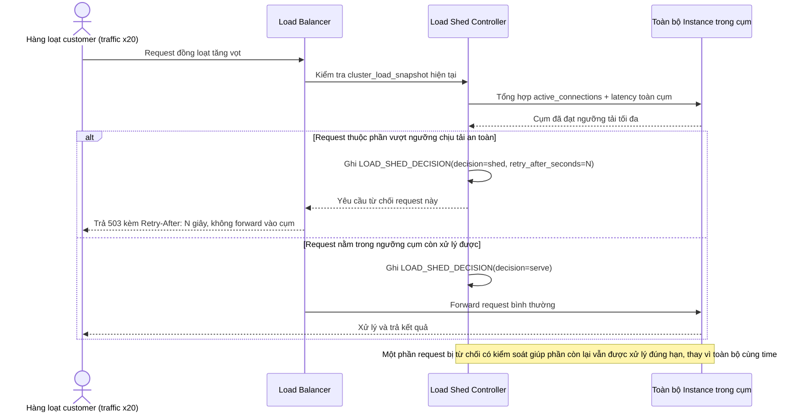
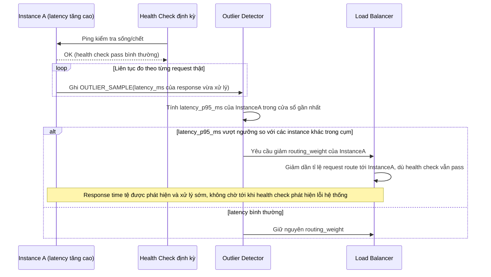
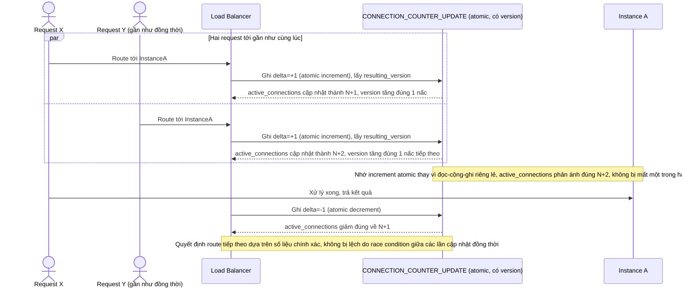
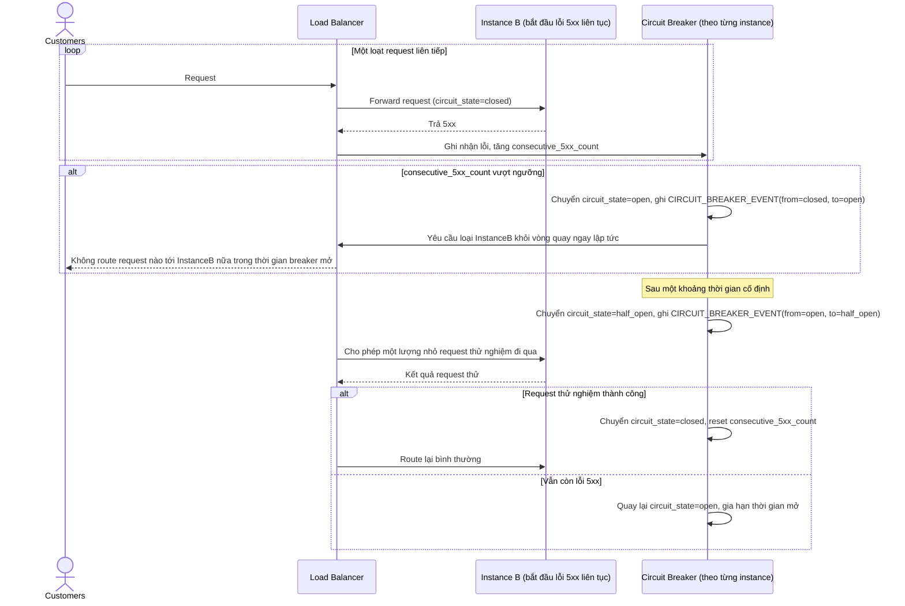

# E-commerce chịu tải đột biến trong flash sale

**Hệ thống:** Một sàn e-commerce có checkout service, trong sự kiện flash sale traffic có thể tăng 20 lần trong vài giây.

**Vai trò của flow:** Load balancer phải tự chuyển đổi hành vi giữa các thuật toán (round-robin lúc bình thường, least-connection khi có instance chạy job nặng) và bảo vệ backend khỏi bị sập toàn cụm.

**Yêu cầu cụ thể:**
- Thiết kế cơ chế phát hiện một instance "chậm" (latency tăng cao) dù vẫn healthy theo health check thông thường, và giảm trọng số route tới instance đó (outlier detection), tránh trường hợp health check pass nhưng response time đã tệ.
- Khi toàn bộ cluster đạt ngưỡng tải tối đa, phải có cơ chế shed load có kiểm soát (trả lỗi 503 kèm `Retry-After` cho một phần request) thay vì để tất cả request timeout đồng loạt.
- Đảm bảo thuật toán LB không route request "mua hàng" (ghi dữ liệu, cần nhất quán) và request "xem sản phẩm" (đọc, có thể cache) theo cùng một cách — phân tách được pool instance hoặc trọng số theo loại traffic.
- Test race condition: nhiều request cùng cập nhật bộ đếm connection/tải của một instance đồng thời — đảm bảo số liệu dùng để ra quyết định route không bị lệch do cập nhật không atomic.
- Có cơ chế circuit breaker phối hợp với LB: khi một instance liên tục trả lỗi 5xx, tự động loại khỏi vòng quay trong một khoảng thời gian rồi thử lại dần (half-open), không chờ health check thủ công.

---

# Base ERD — Load balancer checkout trước khi có outlier detection, shedding, pool tách biệt và circuit breaker

Đây là **base**: mô hình dữ liệu suy luận cho load balancer đứng trước checkout service của một sàn e-commerce, ở trạng thái **trước khi** áp các yêu cầu về outlier detection, shed load, tách pool theo loại traffic, chống race condition đếm tải, và circuit breaker phối hợp. Base chỉ cần đủ: cấu hình LB có thể tự chuyển giữa round-robin và least-connection (đúng như mô tả vai trò hiện tại của flow), một pool instance duy nhất phục vụ mọi loại request, và health check nhị phân đơn giản — đủ để các yêu cầu enhance "có nghĩa" khi so sánh.

---

# Base sequence — Request routing

Đây là **base**, flow "Định tuyến request" ở trạng thái hiện tại: LB tự chuyển giữa round-robin (bình thường) và least-connection (khi có instance đang chạy job nặng), nhưng đối xử với mọi loại request (xem sản phẩm lẫn mua hàng) hoàn toàn như nhau, và đọc/ghi `active_connections` một cách đơn giản không đảm bảo atomic. Flow này là tiền đề cho **yêu cầu 3** (tách pool/trọng số theo loại traffic) và **yêu cầu 4** (race condition khi cập nhật bộ đếm tải) vì cả hai đều tác động trực tiếp lên đúng bước ra quyết định này.

---

# Base sequence — Traffic spike handling

Đây là **base**, flow "Xử lý khi traffic tăng đột biến" ở trạng thái hiện tại: khi flash sale khiến traffic tăng 20 lần, LB tiếp tục route mọi request như bình thường, không có outlier detection, không shed load, không circuit breaker — cả cụm bị dồn tải tới khi sập. Flow này là tiền đề cho **yêu cầu 1** (outlier detection), **yêu cầu 2** (shed load có kiểm soát) và **yêu cầu 5** (circuit breaker) vì cả ba đều nhằm xử lý đúng tình huống này.

---

# Enhance ERD — sau khi bổ sung outlier detection, load shedding, tách pool, chống race condition và circuit breaker

Đây là ERD **sau khi** enhance được áp dụng lên base. So với base, có các entity/field mới, ứng trực tiếp với 5 yêu cầu trong đề bài:

- `INSTANCE` (sửa) — thêm `latency_p95_ms`, `routing_weight`, `consecutive_5xx_count`, `circuit_state`, `connection_count_version` (yêu cầu 1, 4, 5).
- `OUTLIER_SAMPLE` (mới) — mẫu latency đo định kỳ từng instance, dùng phát hiện instance chậm dù health check vẫn pass (yêu cầu 1).
- `POOL_ROUTING_WEIGHT` (mới) — trọng số route riêng theo từng loại traffic (buy/view) cho từng instance, tách biệt cách đối xử giữa request đọc và ghi (yêu cầu 3).
- `LOAD_SHED_DECISION` (mới) — ghi nhận quyết định shed load (trả 503 kèm Retry-After) khi cả cụm đạt ngưỡng tải, thay vì để tất cả cùng timeout (yêu cầu 2).
- `CONNECTION_COUNTER_UPDATE` (mới) — log mọi lần cập nhật `active_connections`, dùng `resulting_version` để đảm bảo cập nhật atomic, tránh race condition (yêu cầu 4).
- `CIRCUIT_BREAKER_EVENT` (mới) — ghi lại mỗi lần instance bị loại khỏi vòng quay do liên tục lỗi 5xx và các lần thử lại half-open (yêu cầu 5).

---

# Enhance sequence — Request routing (tách pool theo loại traffic)

Đây là **enhance** của flow đã có ở base "Request routing". So với base, LB tra `POOL_ROUTING_WEIGHT` để đối xử khác nhau giữa request đọc (xem sản phẩm, có thể cache, ưu tiên rải đều/ít quan tâm nhất quán) và request ghi (mua hàng, cần nhất quán, ưu tiên instance ổn định), đáp ứng **yêu cầu 3** (không route request "mua hàng" và "xem sản phẩm" theo cùng một cách).

---

# Enhance sequence — Traffic spike handling (shed load có kiểm soát)

Đây là **enhance** của flow đã có ở base "Traffic spike handling". So với base, khi toàn cụm đạt ngưỡng tải tối đa, LB chủ động trả lỗi 503 kèm `Retry-After` cho một phần request thay vì để tất cả cùng dồn vào và timeout đồng loạt, đáp ứng **yêu cầu 2** (cơ chế shed load có kiểm soát khi cluster đạt ngưỡng tải tối đa).

---

# Enhance sequence — Outlier detection

Đây là **enhance**, flow hoàn toàn mới, phát sinh từ enhance — base chỉ có health check nhị phân, không phát hiện được instance chậm. Đáp ứng **yêu cầu 1** (phát hiện instance "chậm" dù vẫn healthy theo health check thông thường, giảm trọng số route tới instance đó).

---

# Enhance sequence — Connection counter race condition

Đây là **enhance**, flow hoàn toàn mới, phát sinh từ enhance — base đọc/ghi `active_connections` một cách đơn giản không đảm bảo atomic. Đáp ứng **yêu cầu 4** (nhiều request cùng cập nhật bộ đếm connection/tải của một instance đồng thời, đảm bảo số liệu dùng để ra quyết định route không bị lệch do cập nhật không atomic).

---

# Enhance sequence — Circuit breaker phối hợp với LB

Đây là **enhance**, flow hoàn toàn mới, phát sinh từ enhance — base chỉ dựa vào health check thủ công để loại instance lỗi. Đáp ứng **yêu cầu 5** (circuit breaker phối hợp với LB: instance liên tục trả lỗi 5xx tự động bị loại khỏi vòng quay trong một khoảng thời gian rồi thử lại dần qua half-open, không chờ health check thủ công).

