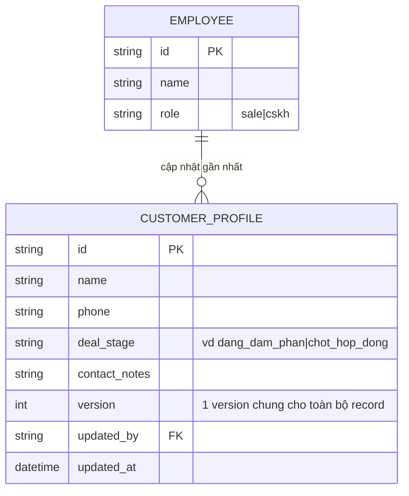
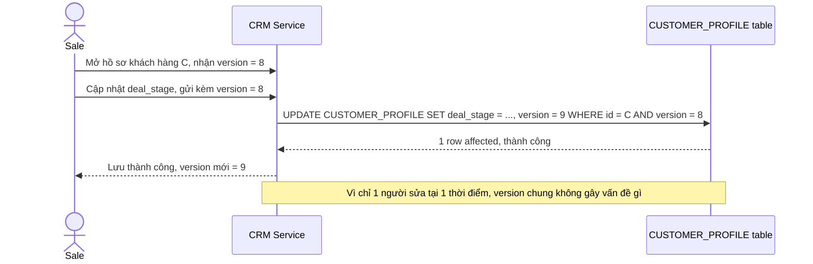
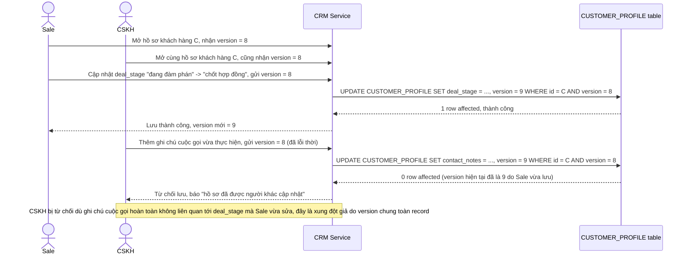
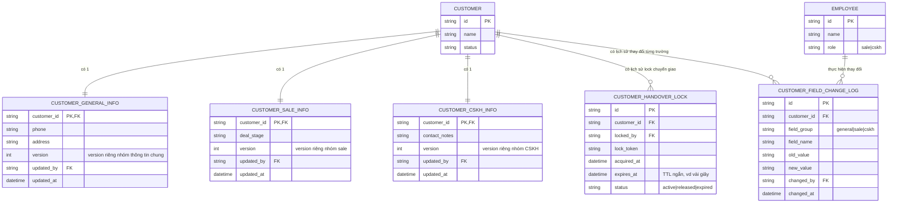
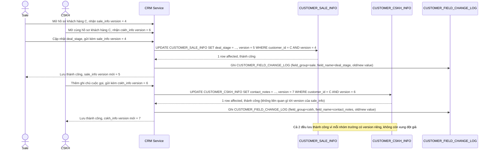
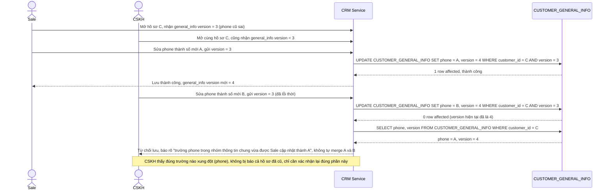
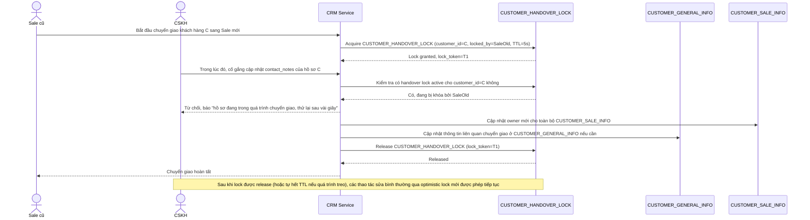
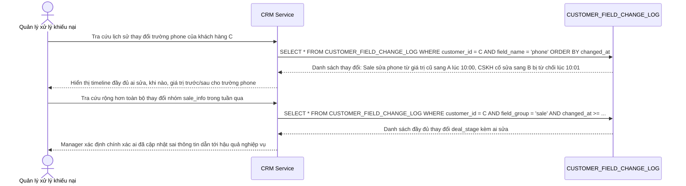

# Sale và chăm sóc khách hàng cùng sửa hồ sơ 1 khách hàng trên CRM

**Hệ thống:** Một hệ thống CRM quản lý khách hàng cho đội sale và đội chăm sóc khách hàng (CSKH), nhân viên sale cập nhật giai đoạn deal (pipeline stage), nhân viên CSKH cập nhật lịch sử liên hệ/ghi chú, cả 2 nhóm đều có thể mở cùng 1 hồ sơ khách hàng bất kỳ lúc nào.

**Vai trò của flow:** Vì tần suất 2 nhân viên cùng mở đúng 1 hồ sơ tại cùng thời điểm là thấp nhưng hồ sơ khách hàng có nhiều nhóm trường thuộc các nghiệp vụ khác nhau (sale, CSKH, thông tin liên hệ chung), flow lưu hồ sơ cần chọn chiến lược lock cân bằng giữa việc không mất dữ liệu do ghi đè và không gây khó chịu khi nhân viên bị từ chối lưu vì xung đột ở trường hoàn toàn không liên quan tới phần họ đang sửa.

**Yêu cầu cụ thể:**
- Mô tả cụ thể: nhân viên sale mở hồ sơ khách hàng C ở version 8, cập nhật giai đoạn deal từ "đang đàm phán" sang "chốt hợp đồng"; gần như cùng lúc nhân viên CSKH cũng mở hồ sơ C ở version 8, thêm 1 ghi chú cuộc gọi vừa thực hiện — nếu dùng optimistic lock ở cấp toàn bộ record, ai lưu sau sẽ bị từ chối dù 2 người sửa 2 nhóm trường hoàn toàn khác nhau; đánh giá phương án tách optimistic lock theo nhóm trường (version riêng cho nhóm "sale", nhóm "CSKH", nhóm "thông tin chung") để loại bỏ các xung đột giả kiểu này.
- Với trường hợp thực sự xung đột trên cùng 1 trường (ví dụ cả sale và CSKH cùng sửa số điện thoại liên hệ chính của khách hàng gần như đồng thời do phát hiện thông tin cũ sai), quy định rõ optimistic lock ở đúng cấp nhóm trường đó phải từ chối người lưu sau và hiển thị giá trị mới nhất vừa được lưu, không tự động merge 2 số điện thoại khác nhau thành 1 giá trị mơ hồ.
- Mô tả tình huống cần pessimistic lock: khi đang trong quy trình chuyển giao khách hàng từ nhân viên sale này sang nhân viên sale khác, cần khóa cứng toàn bộ hồ sơ trong vài giây để đảm bảo không ai (kể cả CSKH) sửa bất kỳ trường nào giữa chừng quá trình chuyển giao — quy định cơ chế khóa tường minh có timeout ngắn cho thao tác đặc biệt này, tách biệt rõ với cơ chế optimistic mặc định dùng cho các thao tác sửa thông thường hàng ngày.
- Khi nhân viên bị từ chối lưu do conflict, giao diện phải chỉ rõ đúng trường/nhóm trường nào đã bị người khác thay đổi (không coi toàn bộ hồ sơ là "đã cũ"), để họ chỉ cần xác nhận lại đúng phần liên quan thay vì phải đọc lại và nhập lại toàn bộ nội dung đã soạn.
- Mọi thay đổi hồ sơ khách hàng (theo từng nhóm trường) phải ghi lịch sử đầy đủ ai sửa, khi nào, giá trị trước/sau, để xử lý khiếu nại khi có tranh chấp nội bộ về việc ai đã cập nhật sai thông tin khách hàng dẫn đến hậu quả nghiệp vụ.

---

# Base ERD — CRM dùng optimistic lock ở cấp toàn bộ record

Đây là **base**: trạng thái CRM *trước khi* tách optimistic lock theo nhóm trường. Suy luận từ đề bài ("nếu dùng optimistic lock ở cấp toàn bộ record" được nêu như cách làm hiện tại), base đã có `EMPLOYEE` (sale hoặc CSKH) và `CUSTOMER_PROFILE` gộp chung mọi nhóm trường (thông tin chung, giai đoạn deal của sale, ghi chú của CSKH) trong 1 record với **1 cột `version` duy nhất cho toàn bộ hồ sơ**. Base chưa có lock riêng theo nhóm trường, chưa có pessimistic lock cho chuyển giao, và chưa ghi lịch sử chi tiết theo từng trường.

---

# Base sequence — Update profile (optimistic lock ở cấp toàn bộ record, thành công)

Đây là **base**, flow cập nhật hồ sơ khách hàng ở trạng thái hiện tại: optimistic lock áp dụng cho toàn bộ `CUSTOMER_PROFILE`, chỉ 1 cột `version` chung. Khi chỉ có 1 người sửa tại 1 thời điểm, flow hoạt động bình thường — đây là tiền đề để so sánh với flow tiếp theo khi 2 người sửa 2 nhóm trường khác nhau cùng lúc.

---

# Base sequence — Xung đột giả khi 2 người sửa 2 nhóm trường khác nhau

Đây là **base**, mô tả đúng kịch bản nêu ở yêu cầu 1 của đề bài: nhân viên sale mở hồ sơ C ở version 8, cập nhật giai đoạn deal; gần như cùng lúc nhân viên CSKH cũng mở hồ sơ C ở version 8, thêm ghi chú cuộc gọi. Vì optimistic lock ở cấp toàn bộ record, ai lưu sau sẽ bị từ chối dù 2 người sửa 2 nhóm trường hoàn toàn khác nhau — đây chính là vấn đề mà việc tách lock theo nhóm trường (enhance) phải giải quyết.

---

# Enhance ERD — Optimistic lock theo nhóm trường, pessimistic lock cho chuyển giao, audit log chi tiết

Đây là ERD **sau khi** enhance được áp dụng lên base. So với base (1 `version` chung cho toàn bộ record), thay đổi và bổ sung:

- Tách `CUSTOMER_PROFILE` thành 3 nhóm trường độc lập, mỗi nhóm có `version` riêng: `CUSTOMER_GENERAL_INFO` (thông tin chung, vd phone), `CUSTOMER_SALE_INFO` (deal_stage), `CUSTOMER_CSKH_INFO` (contact_notes) — đáp ứng yêu cầu 1 (loại bỏ xung đột giả) và là nền tảng cho yêu cầu 2 (vẫn phát hiện đúng xung đột thật khi cùng sửa 1 trường trong cùng 1 nhóm).
- Entity mới `CUSTOMER_HANDOVER_LOCK` (locked_by, lock_token, expires_at) — pessimistic lock có timeout ngắn cho thao tác chuyển giao khách hàng, tách biệt hoàn toàn với cơ chế optimistic mặc định, đáp ứng yêu cầu 3.
- Entity mới `CUSTOMER_FIELD_CHANGE_LOG` (field_group, field_name, old_value, new_value) — ghi lịch sử chi tiết theo từng trường, phục vụ yêu cầu 4 (chỉ rõ đúng trường/nhóm trường bị người khác thay đổi) và yêu cầu 5 (audit đầy đủ cho xử lý khiếu nại).

---

# Enhance sequence — Update profile (optimistic lock riêng theo nhóm trường, hết xung đột giả)

Đây là **enhance** của flow `update-profile`, áp dụng đúng lên kịch bản đã gây xung đột giả ở base (`concurrent-edit-false-conflict`). So với base (1 version chung), giờ Sale sửa `CUSTOMER_SALE_INFO` và CSKH sửa `CUSTOMER_CSKH_INFO` dùng 2 version độc lập, nên cả 2 đều lưu thành công. Đáp ứng trực tiếp yêu cầu 1 của đề bài.

---

# Enhance sequence — Xung đột thật khi cùng sửa 1 trường trong cùng nhóm

Đây là **enhance**, flow mới đáp ứng yêu cầu 2 của đề bài: cả sale và CSKH cùng sửa số điện thoại liên hệ chính (cùng thuộc `CUSTOMER_GENERAL_INFO`) gần như đồng thời. Vì cùng 1 nhóm trường, optimistic lock ở đúng cấp nhóm phải từ chối người lưu sau, hiển thị đúng giá trị mới nhất, không tự động merge 2 số điện thoại thành 1 giá trị mơ hồ — cũng minh hoạ yêu cầu 4 (chỉ rõ đúng trường/nhóm bị đổi).

---

# Enhance sequence — Pessimistic lock khi chuyển giao khách hàng

Đây là **enhance**, flow hoàn toàn mới đáp ứng yêu cầu 3 của đề bài: khi chuyển giao khách hàng từ sale này sang sale khác, cần khóa cứng toàn bộ hồ sơ trong vài giây để không ai (kể cả CSKH) sửa bất kỳ trường nào giữa chừng — cơ chế khóa tường minh có timeout ngắn, tách biệt hẳn với optimistic lock mặc định dùng cho sửa thông thường.

---

# Enhance sequence — Tra cứu lịch sử thay đổi từng trường để xử lý khiếu nại

Đây là **enhance**, flow hoàn toàn mới đáp ứng yêu cầu 5 của đề bài: mọi thay đổi hồ sơ khách hàng (theo từng nhóm trường) được ghi lịch sử đầy đủ ai sửa, khi nào, giá trị trước/sau, phục vụ tra cứu khi có tranh chấp nội bộ về việc ai đã cập nhật sai thông tin.

