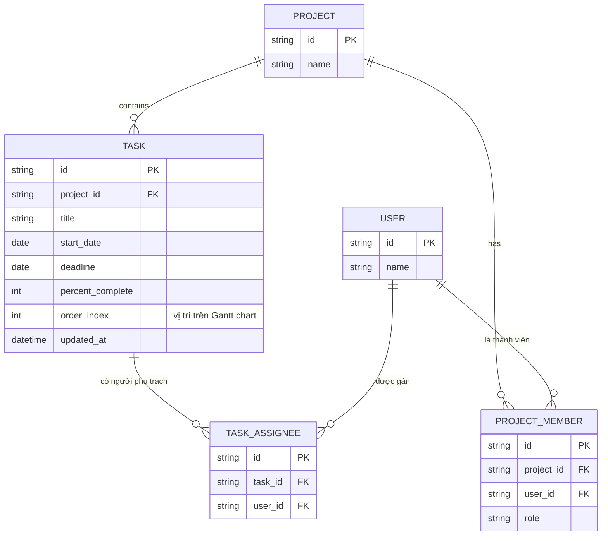
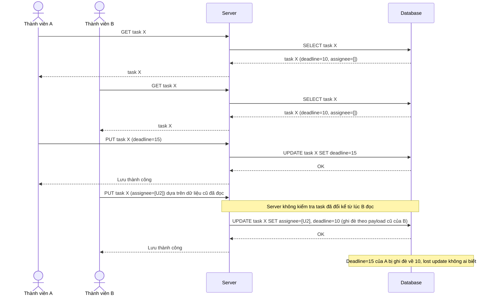
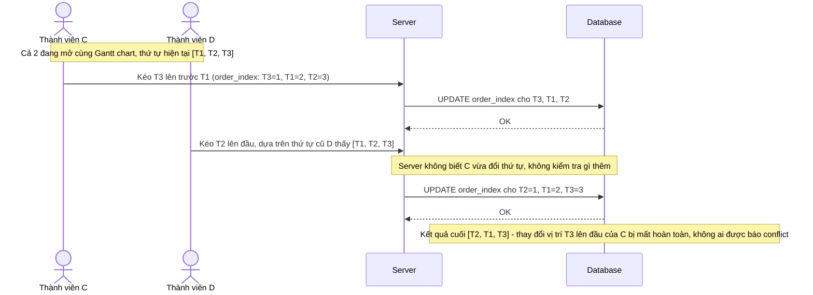
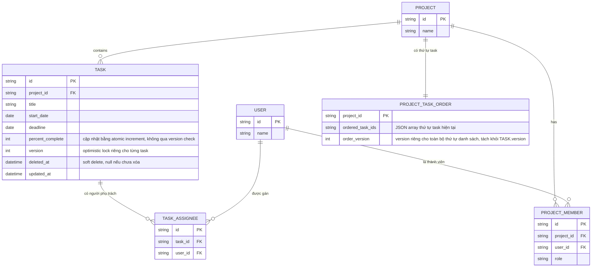
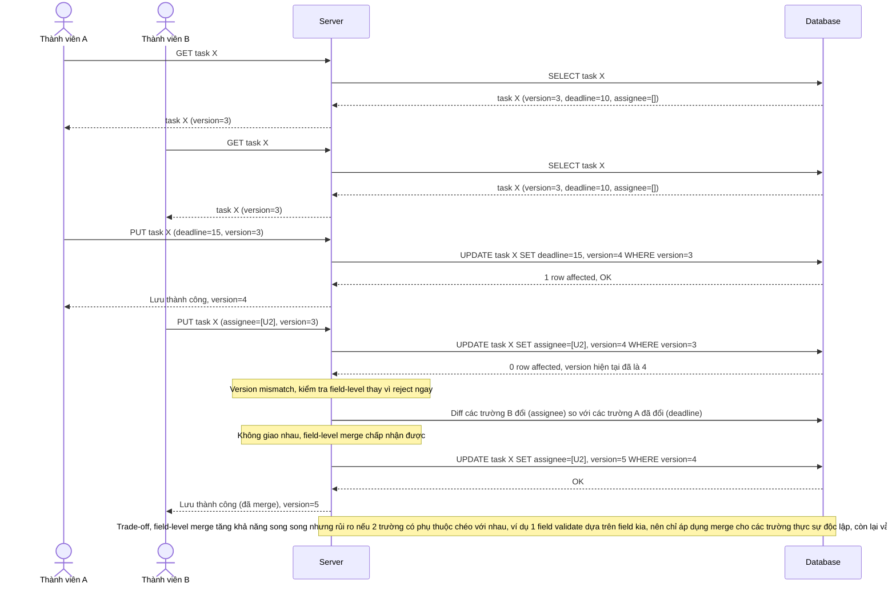
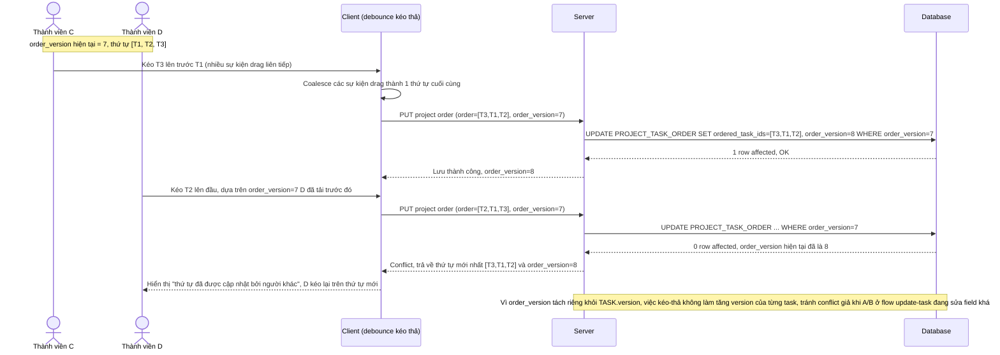
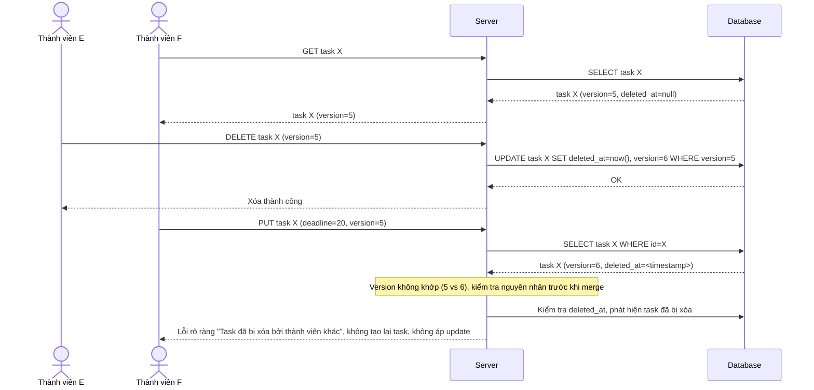
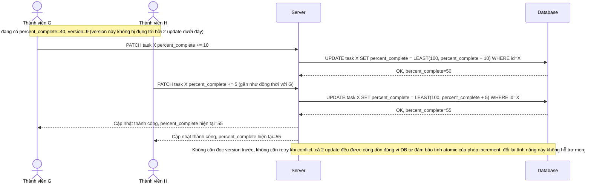

# Chỉnh sửa kế hoạch dự án (Gantt chart) trong tool quản lý dự án cộng tác

**Hệ thống:** Một tool quản lý dự án (kiểu Asana/Jira) cho phép nhiều thành viên cùng chỉnh sửa lịch trình task, gán người phụ trách, đổi ngày deadline trên cùng 1 dự án.

**Vai trò của flow:** Vì các thành viên thường sửa các task khác nhau (ít đụng cùng 1 task) nhưng đôi khi 2 người cùng sửa 1 task, flow nên dùng optimistic locking ở cấp độ từng task (không lock cả dự án) để tối đa hóa khả năng làm việc song song.

**Yêu cầu cụ thể:**
- Lock optimistic phải áp dụng ở cấp độ từng task (mỗi task có version riêng), không phải ở cấp độ toàn dự án — để thành viên A sửa task 1 và thành viên B sửa task 2 không bị chặn/xung đột lẫn nhau dù đang cùng mở dự án.
- Mô tả cụ thể: thành viên A đổi deadline task X từ ngày 10 sang ngày 15 (đọc task ở version 3), đồng thời thành viên B gán thêm người phụ trách cho cùng task X (cũng đọc ở version 3) — cả 2 đều sửa các trường khác nhau nhưng cùng version, ai lưu trước sẽ thắng và tăng version, người lưu sau bị từ chối theo optimistic lock thông thường; bàn về việc có nên áp dụng field-level merge (merge các trường không trùng nhau) thay vì từ chối toàn bộ, và ưu/nhược điểm của việc đó.
- Khi task đang được kéo-thả để đổi thứ tự trên Gantt chart (thao tác kéo thả có thể gửi nhiều update nhỏ liên tiếp trong thời gian ngắn), cần quy định rõ có nên coi mỗi lần kéo-thả là 1 version riêng (dễ tạo conflict giả nếu 2 người cùng kéo-thả các task khác nhau ảnh hưởng tới thứ tự chung) hay dùng cơ chế khác (ví dụ optimistic lock ở cấp "toàn bộ thứ tự danh sách task" thay vì từng task riêng khi liên quan tới sắp xếp).
- Nếu task bị xóa bởi 1 thành viên đúng lúc thành viên khác đang sửa task đó (gửi update dựa trên version cũ trước khi bị xóa), request update phải nhận lỗi rõ ràng "task đã bị xóa", không tạo lại task đã xóa hoặc gây lỗi không rõ nguyên nhân.
- Với các trường có tần suất tranh chấp cao hơn (ví dụ % hoàn thành task được nhiều người cùng cập nhật liên tục), đánh giá xem optimistic lock có phù hợp hay nên chuyển sang cơ chế khác (ví dụ increment atomic riêng cho trường đó) để giảm tỷ lệ conflict phải retry liên tục gây trải nghiệm khó chịu.

---

# Base ERD — Quản lý dự án chưa có cơ chế kiểm soát tương tranh

Đây là **base**: trạng thái tool quản lý dự án dạng Gantt chart *trước khi* áp dụng optimistic locking. Suy luận từ đề bài, base đã có `PROJECT` chứa nhiều `TASK`, mỗi task có thể có nhiều người phụ trách (`TASK_ASSIGNEE`), và `PROJECT_MEMBER` xác định ai là thành viên của dự án. Task đã có `deadline`, `percent_complete`, `order_index` để vẽ Gantt chart, nhưng chưa có trường `version` hay bất kỳ cơ chế phát hiện xung đột nào — hai người sửa cùng lúc sẽ ghi đè lẫn nhau (lost update).

---

# Base sequence — Update task (không có kiểm soát tương tranh, lost update)

Đây là **base**, flow chỉnh sửa task hiện tại: server ghi đè trực tiếp theo dữ liệu request gửi lên, không kiểm tra task đã bị người khác sửa từ lúc mình đọc hay chưa. Đây chính là tiền đề cho vấn đề nêu ở yêu cầu 1 và 2 của đề bài — thành viên A đổi deadline và thành viên B gán thêm người phụ trách cho cùng task X, ai lưu sau sẽ ghi đè mất thay đổi hợp lệ của người lưu trước.

---

# Base sequence — Reorder tasks drag-drop (mỗi lần kéo thả ghi đè trực tiếp order_index)

Đây là **base**, flow kéo thả sắp xếp lại task trên Gantt chart: mỗi lần kéo thả gửi thẳng `order_index` mới xuống DB, không có version hay coalescing gì cả. Đây là tiền đề cho yêu cầu 3 của đề bài — khi 2 thành viên cùng kéo thả các task khác nhau nhưng cùng ảnh hưởng tới thứ tự chung, việc ghi đè trực tiếp liên tục dễ làm thứ tự cuối cùng bị sai lệch ngoài ý muốn.

---

# Enhance ERD — Optimistic locking cấp task, order riêng cho danh sách, soft delete

Đây là ERD **sau khi** enhance được áp dụng lên base. So với base, thêm các trường/entity sau, ứng trực tiếp với từng yêu cầu:

- `TASK.version` — đáp ứng yêu cầu 1 (optimistic lock ở cấp độ từng task, không phải cấp dự án).
- `TASK.deleted_at` (soft delete thay vì xóa cứng) — đáp ứng yêu cầu 4 (phát hiện update lên task đã bị xóa để trả lỗi rõ ràng thay vì tạo lại hoặc lỗi mơ hồ).
- Entity mới `PROJECT_TASK_ORDER` với `order_version` riêng — đáp ứng yêu cầu 3 (tách version của "thứ tự toàn bộ danh sách" ra khỏi version của từng task, để kéo-thả không làm tăng version của task và không gây conflict giả khi 2 người kéo-thả các task khác nhau).
- `TASK.percent_complete` giữ nguyên kiểu, nhưng được cập nhật qua atomic increment ở DB thay vì qua optimistic lock — đáp ứng yêu cầu 5 (giảm tỷ lệ conflict phải retry cho trường bị tranh chấp cao). Không cần thêm cột mới, chỉ đổi cách ghi (xem sequence diagram tương ứng).

---

# Enhance sequence — Update task (optimistic lock cấp task + field-level merge)

Đây là **enhance** của flow `update-task` đã có ở base. So với base (ghi đè trực tiếp, lost update), nay mỗi update phải kèm `version` đã đọc; nếu version không khớp, hệ thống kiểm tra field-level thay vì từ chối toàn bộ ngay — nếu 2 request sửa các trường không giao nhau (A đổi deadline, B thêm assignee) thì merge cả hai vào bản ghi mới. Đáp ứng đúng kịch bản mô tả ở yêu cầu 1 và 2 của đề bài.

---

# Enhance sequence — Reorder tasks drag-drop (version riêng cho toàn bộ thứ tự danh sách)

Đây là **enhance** của flow `reorder-tasks-drag-drop` đã có ở base. So với base (mỗi lần kéo thả ghi đè `order_index` trực tiếp, không kiểm tra gì), nay toàn bộ thao tác kéo thả trong 1 phiên được coalesce thành 1 request cập nhật `ordered_task_ids` duy nhất, kiểm tra bằng `order_version` riêng biệt với `TASK.version` — không dùng optimistic lock ở cấp từng task cho việc sắp xếp. Đáp ứng yêu cầu 3 của đề bài.

---

# Enhance sequence — Update task đã bị xóa (conflict rõ ràng, không tạo lại nhầm)

Đây là **enhance**, flow mới phát sinh từ đề bài, chưa có ở base (base chưa hỗ trợ xóa task nên chưa có kịch bản này). Khi thành viên E xóa task X (soft delete) đúng lúc thành viên F đang sửa task X dựa trên version cũ trước khi bị xóa, request update phải nhận lỗi rõ ràng "task đã bị xóa" thay vì tạo lại task hoặc báo lỗi version mismatch mơ hồ. Đáp ứng yêu cầu 4 của đề bài.

---

# Enhance sequence — Update percent_complete (atomic increment, bỏ qua optimistic lock)

Đây là **enhance**, flow mới phát sinh từ đề bài cho riêng trường `percent_complete` — trường có tần suất tranh chấp cao hơn hẳn các trường khác vì nhiều thành viên cùng cập nhật liên tục. Thay vì dùng optimistic lock như flow `update-task` (sẽ gây tỷ lệ conflict/retry rất cao cho trường này), hệ thống dùng atomic increment ở tầng DB, bỏ qua hoàn toàn kiểm tra version cho riêng trường này. Đáp ứng yêu cầu 5 của đề bài.

