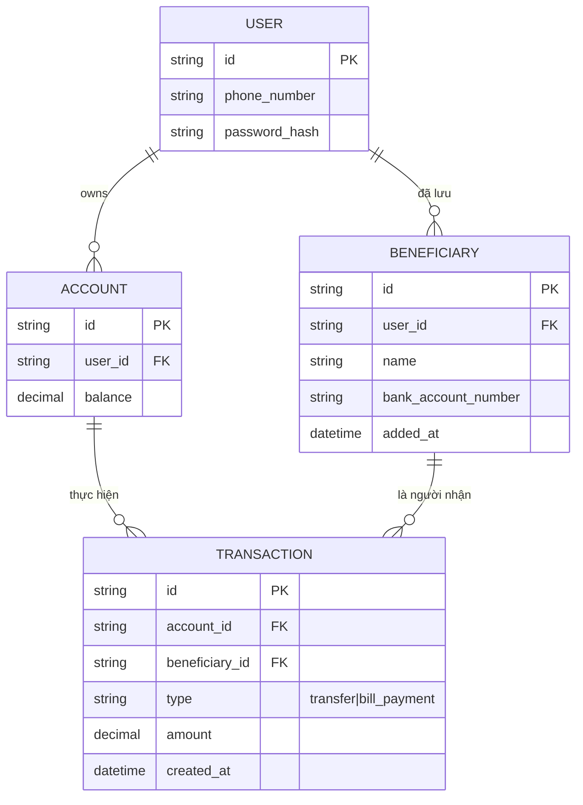
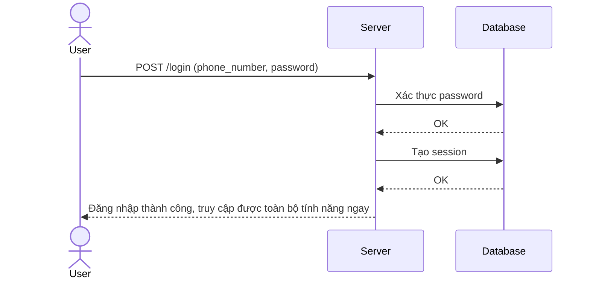
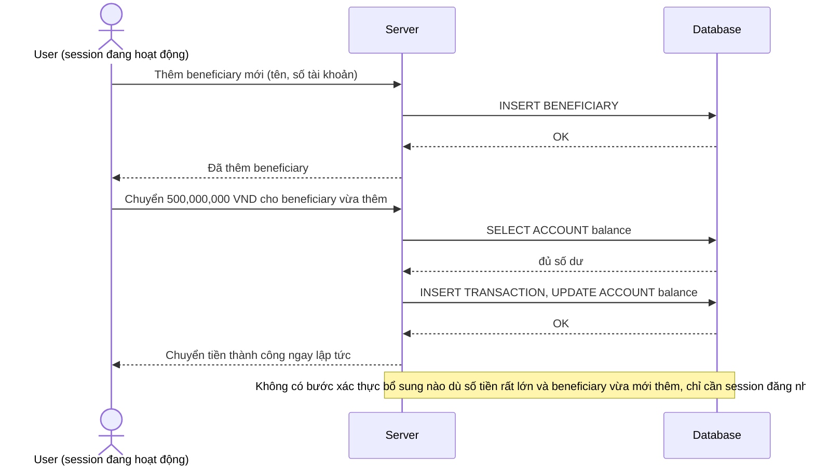
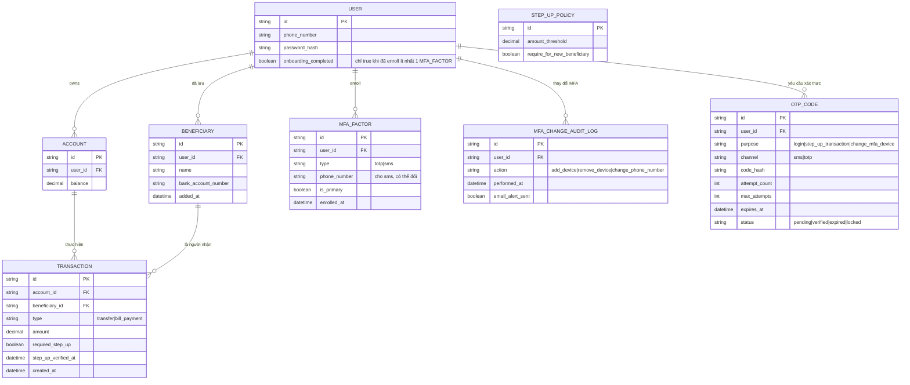
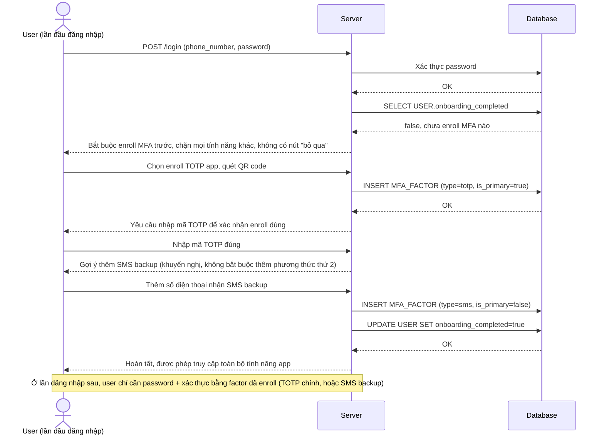
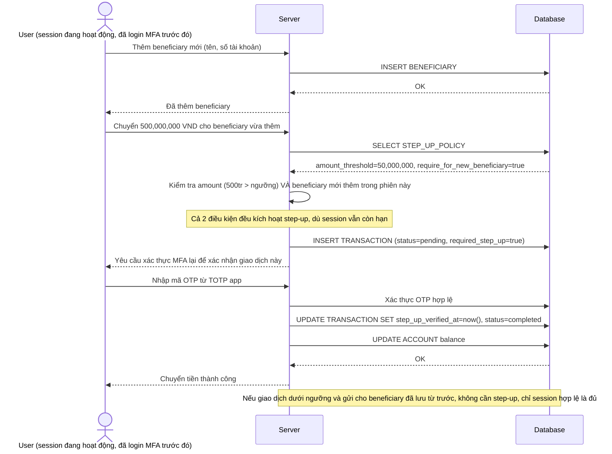
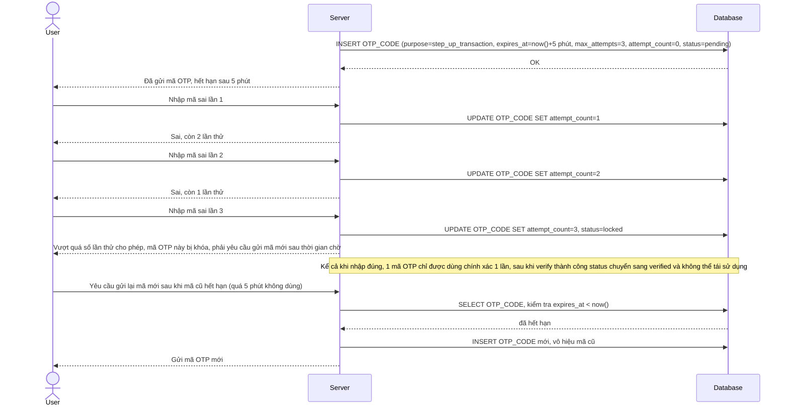
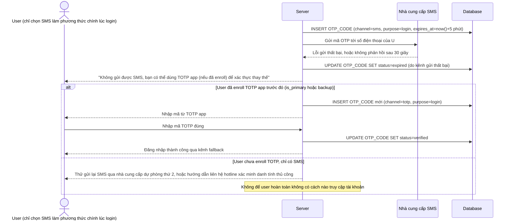
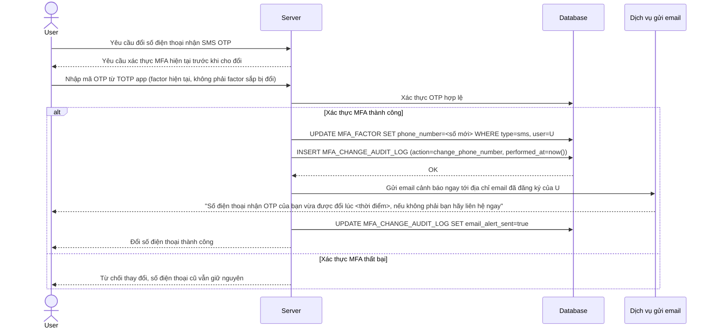

# Ngân hàng số bắt buộc MFA cho đăng nhập và giao dịch nhạy cảm

**Hệ thống:** Một app ngân hàng số cho phép chuyển tiền, thanh toán hóa đơn, xem sao kê.

**Vai trò của flow:** MFA bắt buộc ngay từ lần đăng nhập đầu tiên (TOTP app + SMS backup), và step-up MFA riêng cho các giao dịch có giá trị lớn hoặc thêm người thụ hưởng mới.

**Yêu cầu cụ thể:**
- Bắt buộc enroll ít nhất một phương thức MFA trước khi được sử dụng bất kỳ tính năng nào của app, không cho phép "bỏ qua để sau".
- Giao dịch vượt một ngưỡng số tiền hoặc thêm beneficiary mới phải yêu cầu xác thực MFA lại dù session đăng nhập còn hạn (step-up theo hành vi, không chỉ theo thời gian).
- Mã OTP (TOTP/SMS) chỉ dùng được một lần, hết hạn sau một khoảng thời gian ngắn, và phải giới hạn số lần thử sai trước khi tạm khóa xác thực.
- Nếu SMS gửi OTP thất bại hoặc chậm, phải có phương án fallback rõ ràng (ví dụ dùng TOTP app) mà không làm người dùng bị kẹt hoàn toàn ngoài tài khoản.
- Mọi thay đổi liên quan đến MFA (thêm/xóa thiết bị, đổi số điện thoại nhận OTP) phải tự nó yêu cầu xác thực MFA hiện tại, và gửi thông báo cảnh báo qua kênh khác (email) ngay khi thay đổi.

---

# Base ERD — App ngân hàng số chỉ đăng nhập bằng password, giao dịch không có xác thực thêm

Đây là **base**: trạng thái app ngân hàng số *trước khi* bắt buộc MFA. Suy luận từ đề bài, base đã có `USER`, `ACCOUNT` (số dư), `BENEFICIARY` (người thụ hưởng đã lưu), và `TRANSACTION` cho chuyển tiền/thanh toán hóa đơn. Đăng nhập chỉ cần password, giao dịch được thực hiện ngay sau khi đăng nhập mà không có bất kỳ xác thực bổ sung nào, bất kể số tiền lớn hay nhỏ, thêm beneficiary mới hay không.

---

# Base sequence — Login (chỉ password, không có MFA)

Đây là **base**, flow đăng nhập hiện tại: chỉ kiểm tra password, không có bước xác thực bổ sung nào, không có khái niệm enroll MFA. Đây là tiền đề cho yêu cầu 1 của đề bài — hiện tại user có thể dùng toàn bộ app chỉ với password.

---

# Base sequence — Transfer money (không có xác thực bổ sung dù số tiền lớn hay thêm beneficiary mới)

Đây là **base**, flow chuyển tiền hiện tại: giao dịch được thực hiện ngay sau khi user xác nhận trong app, không phân biệt số tiền lớn hay nhỏ, không phân biệt chuyển cho beneficiary đã lưu hay beneficiary mới thêm. Đây là tiền đề cho yêu cầu 2 của đề bài.

---

# Enhance ERD — MFA bắt buộc, step-up theo hành vi, OTP có giới hạn, audit thay đổi MFA

Đây là ERD **sau khi** enhance được áp dụng lên base. So với base, thêm các entity/trường sau, ứng trực tiếp với từng yêu cầu:

- `MFA_FACTOR` (mới, bắt buộc có ít nhất 1 trước khi `USER.onboarding_completed`) — đáp ứng yêu cầu 1 (bắt buộc enroll trước khi dùng bất kỳ tính năng nào).
- `STEP_UP_POLICY.amount_threshold` và `TRANSACTION.required_step_up`/`step_up_verified_at` — đáp ứng yêu cầu 2 (step-up MFA khi vượt ngưỡng số tiền hoặc thêm beneficiary mới, dù session còn hạn).
- `OTP_CODE` (mới) với `expires_at`, `attempt_count`, `max_attempts`, `status` — đáp ứng yêu cầu 3 (dùng 1 lần, hết hạn nhanh, giới hạn số lần thử sai).
- `OTP_CODE.channel` hỗ trợ chuyển kênh gửi (sms → totp) khi kênh chính lỗi — đáp ứng yêu cầu 4 (fallback rõ ràng khi SMS thất bại/chậm).
- `MFA_CHANGE_AUDIT_LOG` (mới) — đáp ứng yêu cầu 5 (mọi thay đổi liên quan MFA phải tự yêu cầu xác thực MFA hiện tại và gửi cảnh báo qua email).

---

# Enhance sequence — Login (bắt buộc enroll MFA trước khi dùng bất kỳ tính năng nào)

Đây là **enhance** của flow `login` đã có ở base. So với base (chỉ password, không MFA), nay user mới không được phép "bỏ qua để sau" — phải hoàn tất enroll ít nhất 1 phương thức MFA (TOTP hoặc SMS backup) ngay sau khi đăng nhập lần đầu, trước khi truy cập bất kỳ tính năng nào của app. Đáp ứng yêu cầu 1 của đề bài.

---

# Enhance sequence — Transfer money (step-up MFA khi vượt ngưỡng hoặc thêm beneficiary mới)

Đây là **enhance** của flow `transfer-money` đã có ở base. So với base (chuyển tiền ngay không cần xác thực thêm), nay giao dịch vượt ngưỡng số tiền hoặc chuyển cho beneficiary mới thêm phải yêu cầu xác thực MFA lại, dù session đăng nhập còn hạn. Đáp ứng yêu cầu 2 của đề bài.

---

# Enhance sequence — Verify OTP with retry limit (dùng 1 lần, hết hạn nhanh, giới hạn thử sai)

Đây là **enhance**, flow mới phát sinh từ đề bài mô tả chi tiết vòng đời của 1 mã OTP dùng chung cho cả `login` và `transfer-money` (step-up) — mã chỉ dùng được 1 lần, hết hạn sau thời gian ngắn, và bị tạm khóa nếu nhập sai quá số lần cho phép. Đáp ứng yêu cầu 3 của đề bài.

---

# Enhance sequence — SMS OTP fallback to TOTP (không để user bị kẹt ngoài tài khoản)

Đây là **enhance**, flow mới phát sinh từ đề bài — khi gửi OTP qua SMS thất bại hoặc chậm, hệ thống cung cấp phương án fallback rõ ràng sang TOTP app thay vì để user bị kẹt hoàn toàn ngoài tài khoản. Đáp ứng yêu cầu 4 của đề bài.

---

# Enhance sequence — Update MFA device (tự yêu cầu MFA hiện tại + cảnh báo email ngay)

Đây là **enhance**, flow mới phát sinh từ đề bài — mọi thay đổi liên quan tới MFA (thêm/xóa thiết bị, đổi số điện thoại nhận OTP) phải tự nó yêu cầu xác thực MFA hiện tại trước khi thực hiện, và gửi cảnh báo qua email ngay khi thay đổi hoàn tất. Đáp ứng yêu cầu 5 của đề bài.

