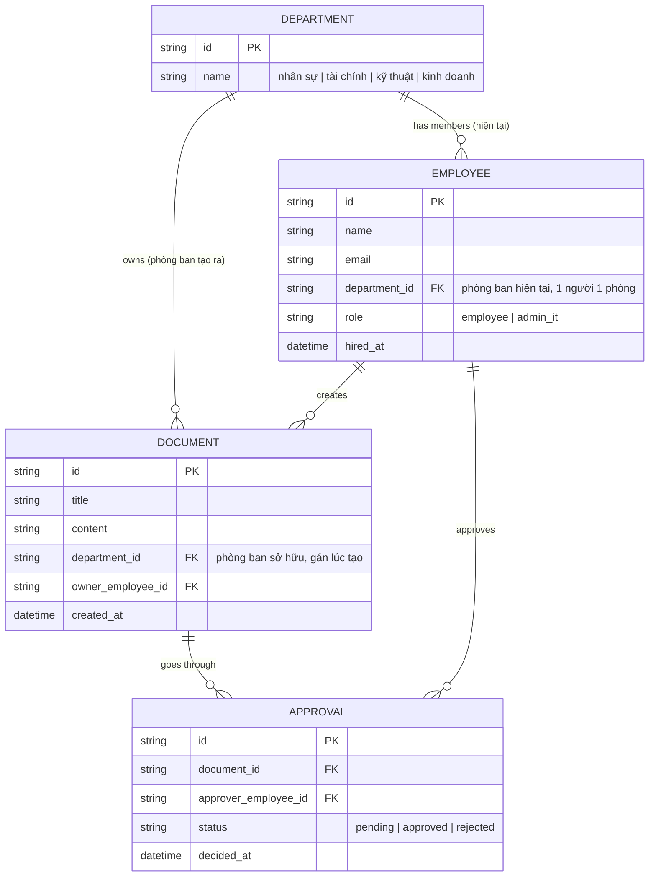
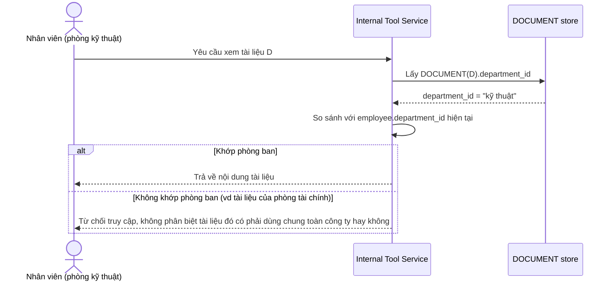
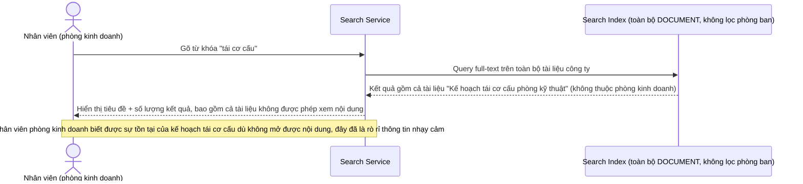
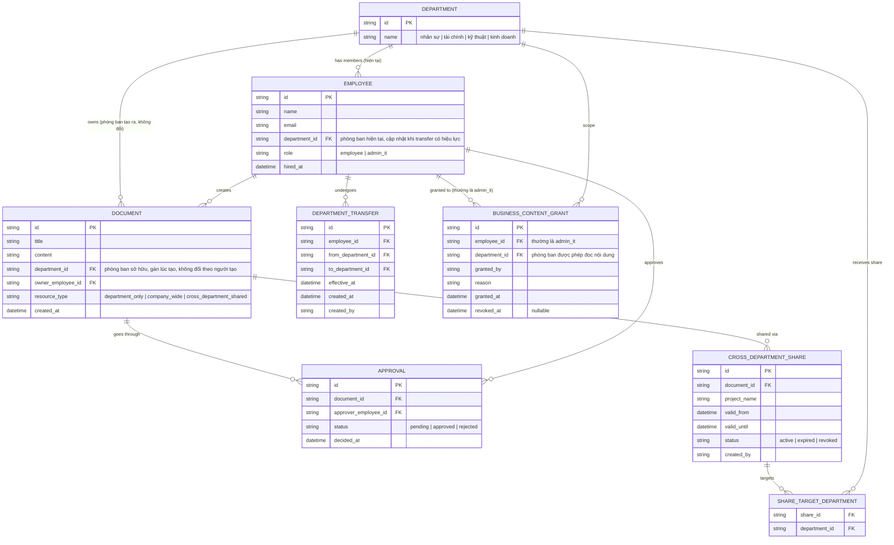
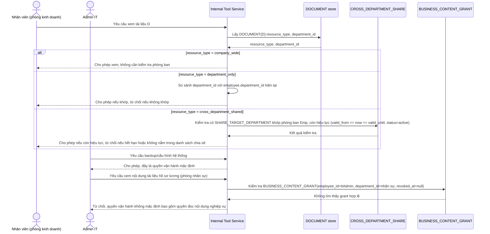
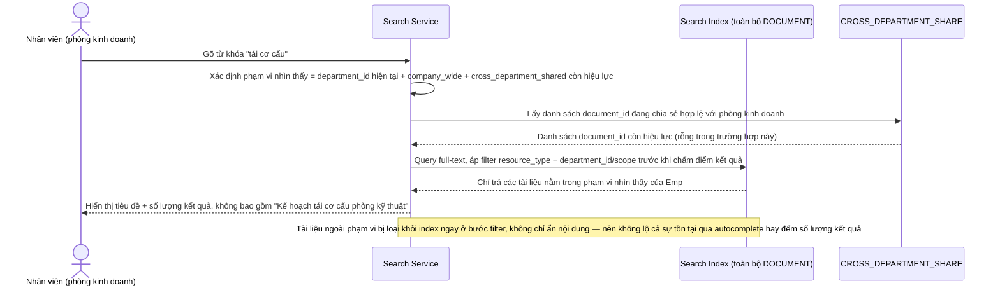
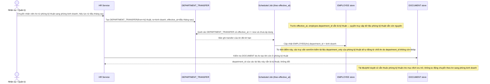
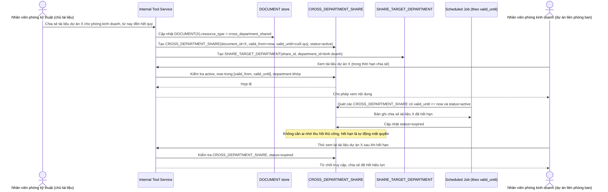

# Cách ly dữ liệu giữa các phòng ban dùng chung một công cụ nội bộ

**Hệ thống:** Một công cụ nội bộ (ví dụ hệ thống quản lý tài liệu/quy trình phê duyệt) được một công ty triển khai dùng chung cho nhiều phòng ban (nhân sự, tài chính, kỹ thuật, kinh doanh), trong đó mỗi phòng ban đóng vai trò như một "tenant" dù tất cả đều thuộc cùng một công ty.

**Vai trò của flow:** Khác với mô hình tenant=công ty khách hàng thông thường, ở đây ranh giới cách ly nằm trong nội bộ một tổ chức — độ khó nằm ở chỗ nhân viên vẫn cần một số dữ liệu dùng chung toàn công ty (thư mục nhân viên, thông báo chung) trong khi dữ liệu nghiệp vụ riêng của từng phòng ban (hồ sơ nhân sự, số liệu tài chính nội bộ) phải được cách ly chặt giữa các phòng, và một người có thể thuộc nhiều phòng ban hoặc đổi phòng ban theo thời gian.

**Yêu cầu cụ thể:**
- Thiết kế mô hình phân quyền phân biệt rõ ba loại tài nguyên: tài nguyên cách ly tuyệt đối theo phòng ban (không phòng ban nào khác được xem), tài nguyên dùng chung toàn công ty, và tài nguyên chia sẻ có chọn lọc giữa một số phòng ban cụ thể (dự án liên phòng ban) — mỗi loại cần cơ chế kiểm tra quyền khác nhau, không dùng chung một quy tắc cách ly cứng nhắc như mô hình tenant=công ty độc lập.
- Xử lý trường hợp một nhân viên đổi phòng ban (chuyển từ phòng kỹ thuật sang phòng kinh doanh) — quyền truy cập dữ liệu của phòng ban cũ phải được thu hồi đúng thời điểm chuyển đổi có hiệu lực, trong khi dữ liệu họ đã tạo ra khi còn ở phòng cũ (tài liệu, phê duyệt đã ký) vẫn cần giữ nguyên thuộc về phòng ban cũ cho mục đích lưu trữ, không tự động chuyển theo người.
- Đảm bảo vai trò quản trị viên hệ thống (admin IT phụ trách vận hành công cụ nội bộ) có quyền vận hành kỹ thuật (backup, cấu hình) nhưng không mặc định có quyền đọc nội dung dữ liệu nghiệp vụ nhạy cảm của từng phòng ban (ví dụ hồ sơ lương của phòng nhân sự) — tách bạch quyền vận hành hệ thống khỏi quyền truy cập nội dung nghiệp vụ.
- Xử lý đúng trường hợp dự án liên phòng ban cần chia sẻ có chọn lọc một phần dữ liệu giữa hai hoặc nhiều phòng ban trong một khoảng thời gian nhất định — quyền chia sẻ này phải có thời hạn rõ ràng và tự động thu hồi khi dự án kết thúc, không để việc chia sẻ tạm thời trở thành lỗ hổng truy cập vĩnh viễn giữa các phòng ban do quên thu hồi quyền.
- Đảm bảo tính năng tìm kiếm/gợi ý toàn công cụ (ví dụ tìm kiếm tài liệu, autocomplete) không vô tình làm lộ sự tồn tại của dữ liệu thuộc phòng ban khác qua kết quả gợi ý hoặc số lượng kết quả tìm kiếm trả về, dù nội dung chi tiết vẫn bị chặn — vì ngay cả việc biết "có một tài liệu tên X tồn tại" cũng có thể là rò rỉ thông tin nhạy cảm giữa các phòng ban đang cạnh tranh nội bộ (ví dụ tài liệu tái cơ cấu).

---

# Base ERD — Công cụ nội bộ trước khi có phân loại tài nguyên theo phòng ban

Đây là **base**: mô hình dữ liệu suy luận từ ngữ cảnh đề bài, thể hiện trạng thái hệ thống **trước khi** áp mô hình cách ly tinh vi theo phòng ban. Đề bài đối chiếu trực tiếp với "mô hình tenant=công ty độc lập" cứng nhắc — nên base được suy luận là một quy tắc cách ly đơn giản: mỗi tài liệu thuộc về đúng 1 phòng ban (`department_id` gán lúc tạo), nhân viên chỉ xem được tài liệu của phòng ban mình đang thuộc (`department_id` hiện tại), chưa phân biệt tài nguyên dùng chung toàn công ty hay chia sẻ liên phòng ban — mọi tài nguyên bị xử lý như nhau. Base **chưa có** cơ chế chuyển phòng ban có hiệu lực theo thời điểm, **chưa có** chia sẻ có thời hạn giữa các phòng, và **chưa** tách quyền vận hành hệ thống khỏi quyền đọc nội dung nghiệp vụ (admin IT mặc định có role riêng nhưng đề bài ngụ ý ranh giới này chưa rõ ràng) — những phần này là enhance.

---

# Base sequence — Xem tài liệu (quy tắc cách ly cứng nhắc, một loại tài nguyên duy nhất)

Đây là **base**, flow "Xem tài liệu" ở trạng thái hiện tại — chỉ có đúng 1 quy tắc: `document.department_id` phải khớp `employee.department_id` hiện tại, không có ngoại lệ cho tài nguyên dùng chung hay chia sẻ liên phòng ban. Flow này liên quan mật thiết tới enhance vì yêu cầu 1 của đề bài chính là thay quy tắc cứng nhắc này bằng 3 loại tài nguyên với cơ chế kiểm tra khác nhau.

---

# Base sequence — Tìm kiếm tài liệu (chưa lọc theo phòng ban, lộ sự tồn tại)

Đây là **base**, flow "Tìm kiếm/gợi ý tài liệu" ở trạng thái hiện tại — index tìm kiếm không áp cùng quy tắc cách ly như flow xem tài liệu, nên kết quả tìm kiếm (tiêu đề, số lượng kết quả) trả về xuyên phòng ban dù nội dung chi tiết vẫn bị chặn nếu nhân viên click vào xem. Flow này liên quan mật thiết tới enhance vì đây chính là lỗ hổng rò rỉ mà yêu cầu 4 của đề bài nhắm tới.

---

# Enhance ERD — sau khi có phân loại tài nguyên + chia sẻ có thời hạn + chuyển phòng ban

Đây là ERD **sau khi** enhance được áp dụng lên base. So với base, có 4 nhóm thay đổi/entity mới, ứng trực tiếp với 4 yêu cầu trong đề bài:

- `DOCUMENT` (sửa) — thêm `resource_type` phân biệt 3 loại: cách ly tuyệt đối theo phòng ban, dùng chung toàn công ty, chia sẻ có chọn lọc liên phòng ban.
- `DEPARTMENT_TRANSFER` (mới) — chuyển phòng ban có thời điểm hiệu lực rõ ràng, tách biệt với `EMPLOYEE.department_id` hiện tại; tài liệu cũ (`DOCUMENT.department_id`) không tự chuyển theo người.
- `BUSINESS_CONTENT_GRANT` (mới) — cấp quyền đọc nội dung nghiệp vụ tường minh, có audit, cho admin IT (mặc định admin IT không có quyền này, chỉ có quyền vận hành).
- `CROSS_DEPARTMENT_SHARE` + `SHARE_TARGET_DEPARTMENT` (mới) — chia sẻ tài liệu `cross_department_shared` cho một hoặc nhiều phòng ban cụ thể, có `valid_from`/`valid_until`, tự động hết hạn.

---

# Enhance sequence — Xem tài liệu (3 loại tài nguyên, tách quyền vận hành khỏi quyền đọc nội dung)

Đây là **enhance**, cùng flow "Xem tài liệu" đã có ở base nhưng nay thay đổi theo yêu cầu 1 và 3 của đề bài: không còn 1 quy tắc cứng nhắc duy nhất mà rẽ nhánh theo `resource_type` (cách ly tuyệt đối / dùng chung toàn công ty / chia sẻ liên phòng ban), đồng thời admin IT mặc định chỉ có quyền vận hành, muốn đọc nội dung nghiệp vụ phải có `BUSINESS_CONTENT_GRANT` tường minh.

---

# Enhance sequence — Tìm kiếm tài liệu (kết quả lọc theo phạm vi truy cập, không lộ tồn tại)

Đây là **enhance**, cùng flow "Tìm kiếm tài liệu" đã có ở base nhưng nay thay đổi theo yêu cầu 4 của đề bài: trước khi trả kết quả (kể cả tiêu đề và số lượng), hệ thống lọc chỉ giữ lại tài liệu nằm trong phạm vi nhìn thấy được của người tìm kiếm — department_only của chính phòng ban mình, company_wide, và cross_department_shared còn hiệu lực — nên tài liệu ngoài phạm vi không xuất hiện dưới bất kỳ hình thức nào, kể cả gợi ý autocomplete.

---

# Enhance sequence — Chuyển phòng ban có hiệu lực theo thời điểm

Đây là **enhance**, flow hoàn toàn mới, phát sinh từ enhance — base chỉ có `EMPLOYEE.department_id` tĩnh, chưa có quy trình chuyển đổi có kiểm soát thời điểm hiệu lực. Đáp ứng yêu cầu 2 của đề bài: quyền truy cập dữ liệu phòng ban cũ bị thu hồi đúng lúc chuyển đổi có hiệu lực, còn tài liệu nhân viên đã tạo khi ở phòng cũ vẫn giữ nguyên `department_id` cũ.

---

# Enhance sequence — Vòng đời chia sẻ liên phòng ban (tạo có thời hạn, tự động thu hồi)

Đây là **enhance**, flow hoàn toàn mới, phát sinh từ enhance — base không có khái niệm chia sẻ liên phòng ban, mọi tài liệu chỉ thuộc đúng 1 phòng. Đáp ứng yêu cầu 1 và 3 của đề bài: dự án liên phòng ban chia sẻ có chọn lọc một phần dữ liệu trong khoảng thời gian nhất định, và quyền này tự động thu hồi khi hết hạn thay vì phải nhớ thu hồi thủ công.

