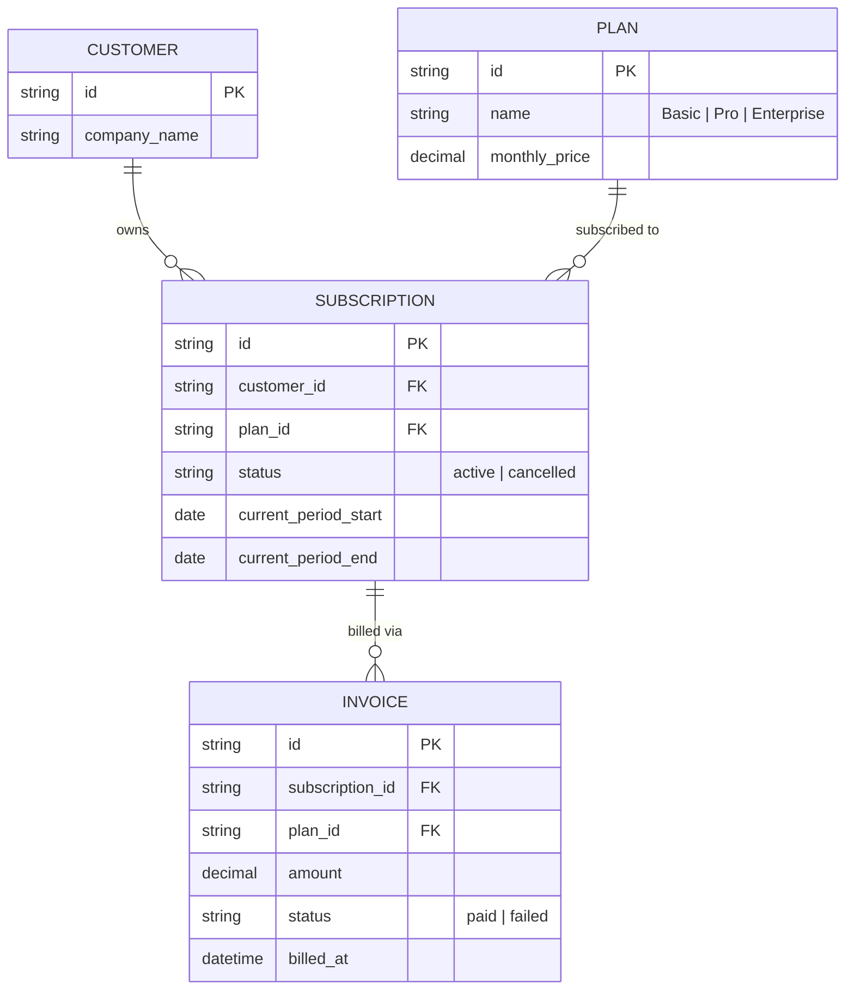
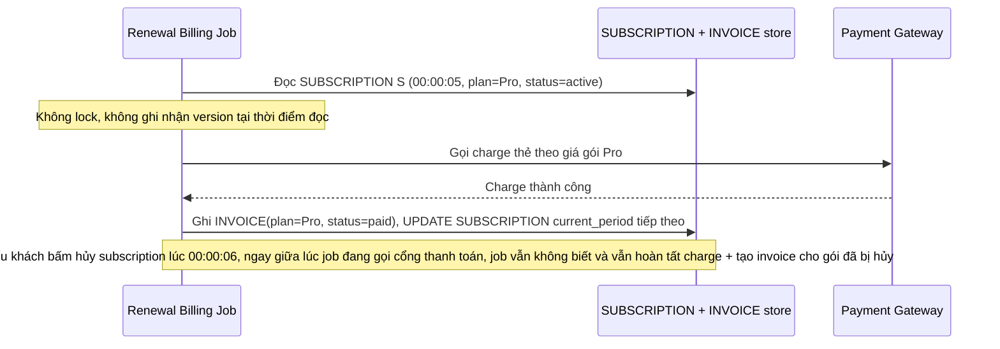
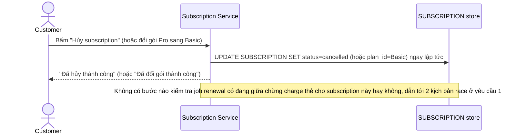
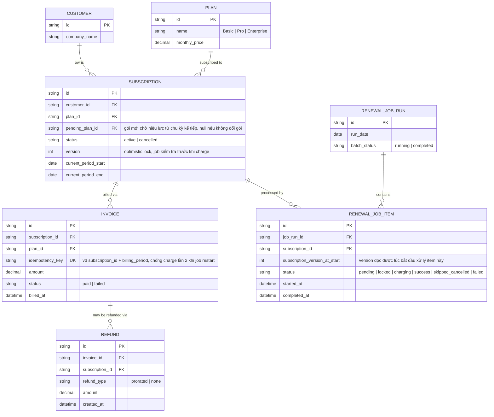
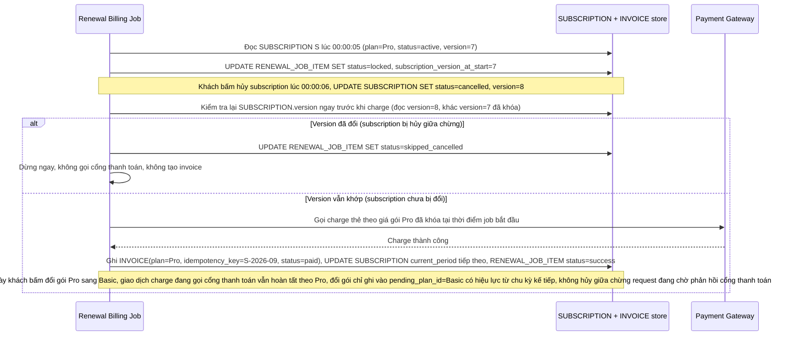
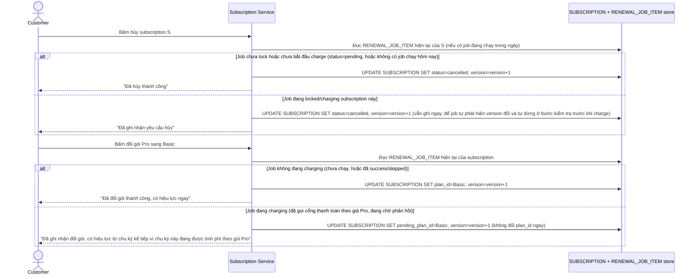
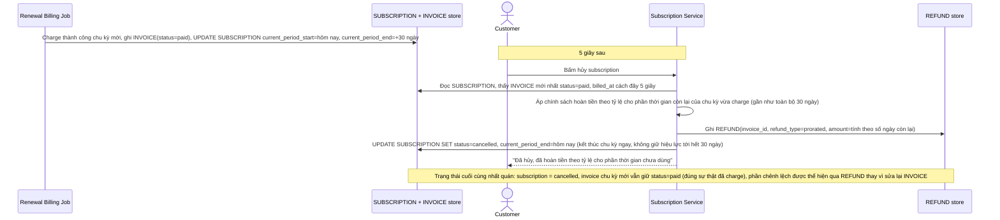
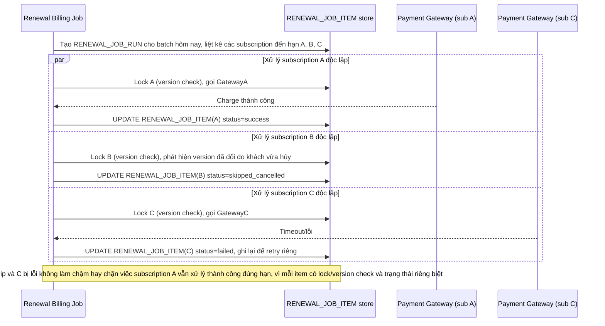
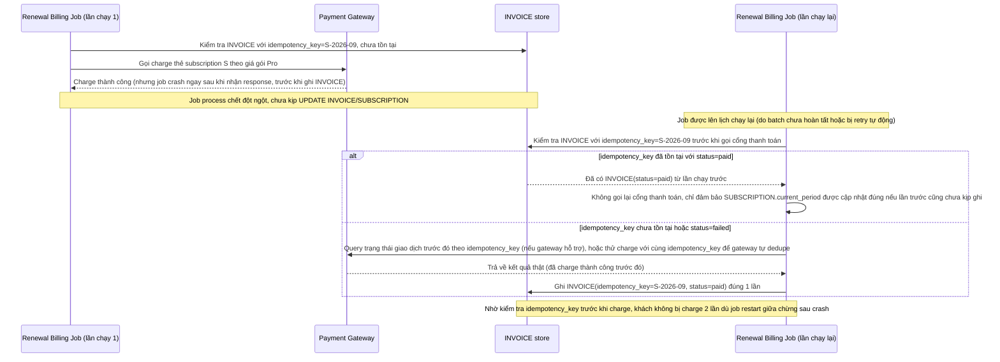

# Job tính phí renewal tự động chạy trùng lúc khách tự đổi gói/hủy gói trên subscription SaaS

**Hệ thống:** Một SaaS B2B tính phí theo subscription hàng tháng, có job billing tự động chạy vào đúng ngày renewal của mỗi khách để charge thẻ và gia hạn, khách hàng cũng có thể tự đổi gói hoặc hủy gói qua UI vào bất kỳ thời điểm nào.

**Vai trò của flow:** Flow phải xử lý đúng khi job billing tự động renewal và hành động thủ công của khách (đổi gói/hủy) chạm vào cùng 1 subscription gần như đồng thời, tránh charge sai gói hoặc charge sau khi khách đã hủy.

**Yêu cầu cụ thể:**
- Mô tả cụ thể: job billing bắt đầu xử lý renewal cho subscription S lúc 00:00:05 (đọc gói hiện tại là "Pro"), đúng lúc khách bấm hủy subscription lúc 00:00:06, trước khi job kịp charge thẻ — yêu cầu job phải lock (hoặc dùng version check) trên record subscription trước khi charge, nếu phát hiện trạng thái đã đổi so với lúc đọc ban đầu (đã bị hủy) thì dừng ngay lập tức, không charge, không tạo invoice mới.
- Mô tả race khi khách đổi gói (downgrade từ Pro sang Basic) đúng lúc job renewal đang giữa quá trình charge theo gói Pro (đã gọi tới cổng thanh toán, đang chờ phản hồi) — quy định rõ lần renewal này vẫn hoàn tất theo gói Pro với giá đã khóa tại thời điểm job bắt đầu xử lý, việc đổi gói mới chỉ có hiệu lực từ chu kỳ kế tiếp; không được hủy giữa chừng giao dịch đang gọi cổng thanh toán vì có thể phía cổng đã charge thành công dù hệ thống nội bộ chưa kịp ghi nhận.
- Mô tả cụ thể: khách bấm hủy subscription ngay 5 giây sau khi job billing đã charge thành công chu kỳ mới — quy định rõ chính sách hoàn tiền theo tỷ lệ hoặc không hoàn cho phần thời gian còn lại của chu kỳ, và đảm bảo trạng thái subscription cuối cùng nhất quán, không rơi vào tình trạng vừa "đã charge chu kỳ mới" vừa "đã hủy ngay lập tức" gây mâu thuẫn khi hiển thị cho khách.
- Job renewal chạy hàng loạt cho nhiều subscription trong cùng 1 batch theo ngày: đảm bảo mỗi subscription được xử lý độc lập với 1 lock/version check riêng, lỗi hoặc conflict xảy ra ở 1 subscription (do khách đang thao tác trùng lúc) không được làm chậm hoặc ảnh hưởng tới việc xử lý các subscription khác trong cùng batch.
- Đảm bảo idempotency của job renewal: nếu job bị crash giữa chừng sau khi đã charge thành công ở cổng thanh toán nhưng chưa kịp cập nhật trạng thái subscription (ví dụ crash ngay sau khi gọi cổng thanh toán, trước khi ghi nhận kết quả), lần chạy lại job cho cùng subscription trong cùng chu kỳ không được charge lần 2 — phải kiểm tra trạng thái/idempotency key trước khi gọi cổng thanh toán lại.

---

# Base ERD — Subscription billing chưa có lock/version check giữa job và thao tác khách

Đây là **base**: mô hình dữ liệu suy luận từ ngữ cảnh đề bài, thể hiện trạng thái hệ thống **trước khi** có cơ chế lock/version check và idempotency cho job renewal. Đề bài nói tới SaaS B2B tính phí theo subscription hàng tháng, có job billing tự động và khách tự đổi/hủy gói qua UI — nên base cần đủ: khách hàng, gói dịch vụ, subscription gắn 1 gói hiện tại, và hoá đơn mỗi lần charge thành công. Base **chưa có** version/lock trên subscription, chưa có idempotency key cho lần charge, chưa có cơ chế gói chờ hiệu lực chu kỳ sau, chưa có chính sách hoàn tiền theo tỷ lệ — những thứ đó là phần enhance.

---

# Base sequence — Job renewal charge thẻ (không lock, không version check)

Đây là **base**, flow "Job billing tự động renewal" ở trạng thái hiện tại — job đọc gói hiện tại của subscription, gọi cổng thanh toán charge theo gói đó, rồi ghi invoice và cập nhật chu kỳ mới, không kiểm tra lại subscription có bị đổi/hủy giữa chừng hay không, không có idempotency key. Flow này liên quan mật thiết tới enhance vì toàn bộ yêu cầu 1, 2 và 5 của đề bài đều nhằm sửa đúng các lỗ hổng race và crash-recovery ở đây.

---

# Base sequence — Khách tự đổi gói/hủy gói qua UI (ghi đè trực tiếp)

Đây là **base**, flow "Khách đổi gói/hủy gói" ở trạng thái hiện tại — khách thao tác qua UI, hệ thống ghi đè thẳng `plan_id`/`status` của subscription ngay lập tức, không biết và không quan tâm job renewal có đang xử lý song song subscription này hay không. Flow này liên quan mật thiết tới enhance vì đây chính là phía còn lại của race điều kiện mà đề bài mô tả ở yêu cầu 1 và 2.

---

# Enhance ERD — Thêm version lock, idempotency, gói chờ hiệu lực và hoàn tiền theo tỷ lệ

Đây là **enhance**, mô hình dữ liệu sau khi áp cơ chế lock/version check + idempotency lên base. So với base: `SUBSCRIPTION` thêm `version` (optimistic lock, job kiểm tra trước khi charge) và `pending_plan_id` (đổi gói chỉ có hiệu lực từ chu kỳ kế tiếp khi job đang giữa chừng charge). `INVOICE` thêm `idempotency_key` unique theo (subscription_id, kỳ billing) để job restart sau crash không charge lần 2. Thêm mới `RENEWAL_JOB_RUN` + `RENEWAL_JOB_ITEM` — mỗi subscription trong batch được xử lý độc lập với trạng thái/lock riêng, lỗi 1 item không ảnh hưởng item khác. Thêm mới `REFUND` — ghi nhận chính sách hoàn tiền theo tỷ lệ hoặc không hoàn khi khách hủy ngay sau khi đã charge thành công.

---

# Enhance sequence — Job renewal với version lock, dừng ngay nếu đã bị hủy

Đây là **enhance**, flow "Job billing tự động renewal" sau khi có version check trước khi charge. So với base, flow này thay đổi ở chỗ: job ghi nhận `version` tại thời điểm đọc subscription, và ngay trước khi gọi cổng thanh toán, job kiểm tra lại version/status 1 lần nữa — nếu subscription đã bị hủy (version thay đổi) thì dừng ngay, không charge, không tạo invoice. Nếu subscription vẫn active tại thời điểm khóa, job tiếp tục charge theo giá đã khóa dù ngay sau đó khách có đổi gói, việc đổi gói chỉ ghi vào `pending_plan_id` để có hiệu lực từ chu kỳ kế tiếp.

---

# Enhance sequence — Đổi gói/hủy gói biết trạng thái job renewal đang xử lý

Đây là **enhance**, flow "Khách đổi gói/hủy gói" sau khi phối hợp với version lock của job renewal. So với base (ghi đè trực tiếp không kiểm tra gì), flow này thay đổi ở chỗ: mọi thao tác đổi gói/hủy đều tăng `version` của subscription bất kể job có đang xử lý hay không (đây chính là tín hiệu để job phát hiện thay đổi ở file `5-enhance-renewal-billing-job-sqd.md`); riêng đổi gói (không phải hủy) khi job đang trong lúc `charging` sẽ ghi vào `pending_plan_id` thay vì đổi `plan_id` ngay, để tránh xung đột với giao dịch đang gọi cổng thanh toán.

---

# Enhance sequence — Hủy ngay sau khi charge thành công, áp chính sách hoàn tiền

Đây là **enhance**, flow mới phát sinh từ enhance — khách bấm hủy subscription 5 giây sau khi job billing đã charge thành công chu kỳ mới. Xử lý đúng yêu cầu 3 của đề bài: áp chính sách hoàn tiền theo tỷ lệ (hoặc không hoàn) cho phần thời gian còn lại của chu kỳ, và đảm bảo trạng thái subscription cuối cùng nhất quán, không mâu thuẫn giữa "đã charge chu kỳ mới" và "đã hủy ngay lập tức".

---

# Enhance sequence — Batch renewal xử lý độc lập, lỗi 1 subscription không lan sang subscription khác

Đây là **enhance**, flow mới phát sinh từ enhance — job renewal chạy hàng loạt cho nhiều subscription đến hạn trong ngày, mỗi subscription là 1 `RENEWAL_JOB_ITEM` độc lập với version lock riêng theo đúng flow ở file `5-enhance-renewal-billing-job-sqd.md`. Xử lý đúng yêu cầu 4 của đề bài: conflict hoặc lỗi ở 1 subscription không làm chậm hoặc ảnh hưởng tới việc xử lý các subscription khác trong cùng batch.

---

# Enhance sequence — Job crash giữa chừng, restart không charge lần 2

Đây là **enhance**, flow mới phát sinh từ enhance — xử lý đúng yêu cầu 5 của đề bài: job crash ngay sau khi đã charge thành công ở cổng thanh toán nhưng chưa kịp ghi nhận kết quả vào `INVOICE`, lần chạy lại cho cùng subscription trong cùng chu kỳ phải kiểm tra idempotency trước khi gọi cổng thanh toán lại, tránh charge lần 2.

