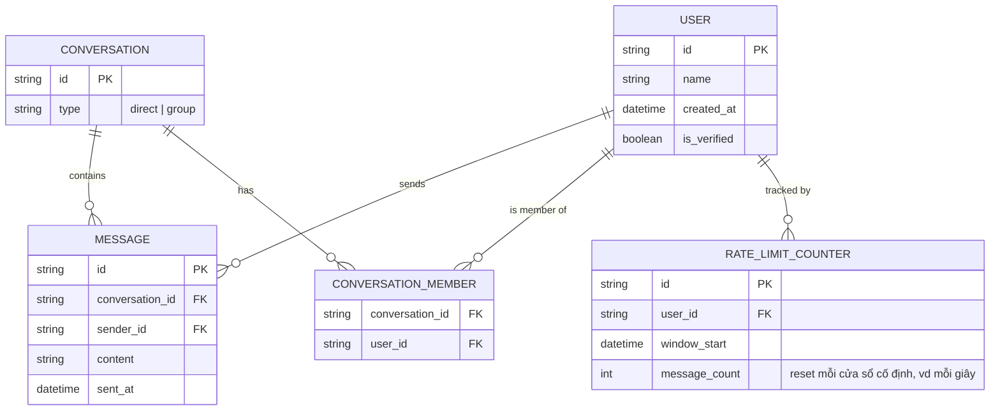
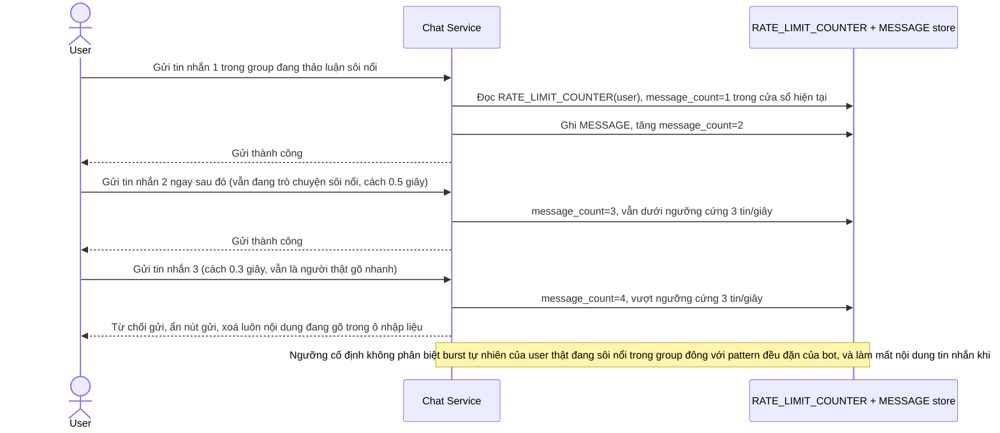
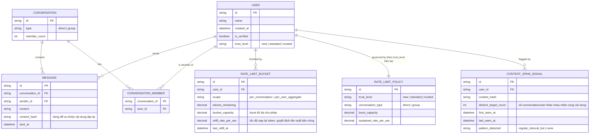
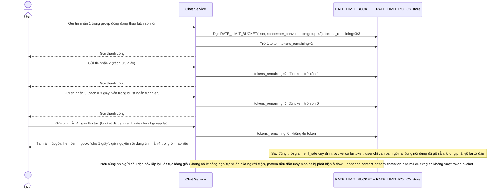
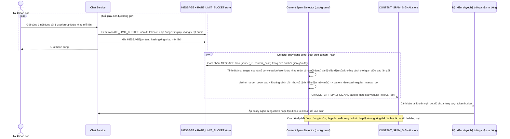
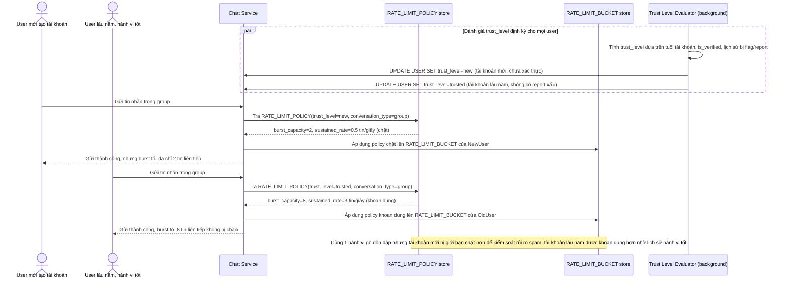

# Chống spam tin nhắn trong app chat/group

**Hệ thống:** Ứng dụng chat/group cho phép user gửi tin nhắn tự do, cần chặn bot/spam gửi hàng loạt tin nhắn mà không làm phiền user thật đang gõ nhanh trong cuộc trò chuyện sôi nổi.

**Vai trò của flow:** Rate limiting theo user/theo cuộc trò chuyện giới hạn tần suất gửi tin để phát hiện và chặn hành vi spam, đồng thời đủ khoan dung cho tốc độ gõ/gửi tự nhiên của người dùng bình thường.

**Yêu cầu cụ thể:**
- Ngưỡng rate limit cứng (ví dụ giới hạn tin/giây cố định) dễ chặn nhầm user thật đang nhắn tin dồn dập trong lúc trò chuyện sôi nổi — cần thuật toán cho phép burst ngắn tự nhiên (vài tin liên tiếp trong 1-2 giây) nhưng vẫn bắt được pattern đều đặn máy móc kéo dài của bot.
- Phân biệt rate limit theo từng cuộc trò chuyện một-một và theo group lớn (hàng trăm/nghìn thành viên) — cùng một user gửi nhanh trong group đông có thể là bình thường (đang thảo luận sôi nổi), trong khi cùng tần suất đó nhắm vào nhiều user khác nhau (spam hàng loạt) phải bị đánh dấu khác.
- Khi user bị giới hạn do gửi quá nhanh, phản hồi (ẩn tạm nút gửi, thông báo chờ vài giây) không được làm mất nội dung tin nhắn đang gõ dở — user không được yêu cầu gõ lại từ đầu chỉ vì bị rate limit tạm thời.
- Phát hiện spam không chỉ dựa vào tần suất mà còn pattern nội dung lặp lại (cùng một tin gửi liên tục tới nhiều group/user khác nhau trong thời gian ngắn) — một tài khoản gửi đúng nhịp một tin/giây liên tục hàng giờ tới nhiều đối tượng khác nhau là dấu hiệu bot dù tần suất từng tin không vượt ngưỡng cứng.
- Rate limit phải áp dụng được động theo uy tín tài khoản (tài khoản mới tạo/chưa xác thực bị giới hạn chặt hơn tài khoản lâu năm có lịch sử hành vi tốt), tránh chặn quá nghiêm với user thật lâu năm trong khi vẫn kiểm soát chặt tài khoản mới dễ bị lợi dụng để spam.

---

# Base ERD — Chat/group với rate limit ngưỡng cứng cố định

Đây là **base**: mô hình dữ liệu suy luận từ ngữ cảnh đề bài, thể hiện trạng thái hệ thống **trước khi** có thuật toán cho phép burst tự nhiên, phân biệt theo cuộc trò chuyện, phát hiện pattern nội dung, và điều chỉnh theo uy tín tài khoản. Đề bài nói tới ngưỡng rate limit cứng (giới hạn tin/giây cố định) đang gây chặn nhầm user thật — nên base cần đủ: user, cuộc trò chuyện (1-1 hoặc group), tin nhắn, và 1 bộ đếm rate limit đơn giản theo cửa sổ thời gian cố định áp dụng chung cho mọi user, không phân biệt loại cuộc trò chuyện hay uy tín tài khoản. Base **chưa có** token bucket cho phép burst, chưa có policy theo trust level, chưa có phát hiện pattern nội dung lặp lại — những thứ đó là phần enhance.

---

# Base sequence — Gửi tin nhắn với rate limit ngưỡng cứng, chặn nhầm khi gõ dồn dập

Đây là **base**, flow "Gửi tin nhắn" ở trạng thái hiện tại — mỗi lần gửi, app cộng dồn bộ đếm theo cửa sổ thời gian cố định (vd 1 giây) áp dụng chung cho mọi user, không phân biệt gửi trong group đông hay chat 1-1, vượt ngưỡng là chặn ngay và mất luôn nội dung đang gõ. Flow này liên quan mật thiết tới enhance vì toàn bộ 4 yêu cầu của đề bài đều nhằm sửa đúng các hạn chế ở đây.

---

# Enhance ERD — Token bucket theo scope, policy theo trust level, phát hiện pattern nội dung

Đây là **enhance**, mô hình dữ liệu sau khi áp thuật toán rate limit cho phép burst + phân biệt theo cuộc trò chuyện + phát hiện pattern nội dung + policy động theo uy tín tài khoản lên base. So với base: `RATE_LIMIT_COUNTER` (cửa sổ cố định) được thay bằng `RATE_LIMIT_BUCKET` (token bucket cho phép burst ngắn, tách theo `scope` — trong 1 conversation cụ thể hay tổng hợp toàn user). `USER` thêm `trust_level` (suy ra từ tuổi tài khoản + lịch sử hành vi), gắn với `RATE_LIMIT_POLICY` quy định `burst_capacity`/`sustained_rate` khác nhau theo `trust_level` và loại conversation. Thêm mới `CONTENT_SPAM_SIGNAL` — theo dõi nội dung lặp lại gửi tới nhiều đối tượng khác nhau trong thời gian ngắn, phát hiện bot dù tần suất từng tin không vượt ngưỡng cứng.

---

# Enhance sequence — Gửi tin nhắn với token bucket cho phép burst, giữ nguyên nội dung khi bị chặn tạm

Đây là **enhance**, flow "Gửi tin nhắn" sau khi áp token bucket theo scope. So với base (ngưỡng cứng, mất nội dung khi chặn), flow này thay đổi ở 3 điểm: (1) dùng token bucket cho phép burst ngắn (vài tin liên tiếp trong 1-2 giây) miễn còn token, chỉ bắt pattern đều đặn kéo dài khi bucket cạn và refill_rate không theo kịp, (2) scope tách theo conversation (`per_conversation:<id>`) để gửi nhanh trong 1 group đông không tính chung với gửi rải rác tới nhiều người khác, (3) khi bị chặn tạm, chỉ ẩn nút gửi + đếm ngược vài giây, nội dung đang gõ vẫn được giữ nguyên trong ô nhập liệu.

---

# Enhance sequence — Phát hiện bot qua nội dung lặp lại gửi tới nhiều đối tượng khác nhau

Đây là **enhance**, flow mới phát sinh từ enhance — phát hiện spam không chỉ dựa vào tần suất (vốn có thể luôn nằm dưới ngưỡng token bucket) mà còn dựa vào pattern nội dung: cùng 1 tin gửi liên tục tới nhiều group/user khác nhau trong thời gian ngắn với nhịp đều đặn máy móc. Đúng yêu cầu thứ 4 của đề bài — 1 tài khoản gửi đúng nhịp 1 tin/giây liên tục hàng giờ tới nhiều đối tượng khác nhau là dấu hiệu bot dù từng tin không vượt ngưỡng cứng.

---

# Enhance sequence — Rate limit động theo uy tín tài khoản

Đây là **enhance**, flow mới phát sinh từ enhance — chọn `RATE_LIMIT_POLICY` áp dụng cho token bucket của mỗi user dựa trên `trust_level`, đảm bảo tài khoản mới/chưa xác thực bị giới hạn chặt hơn trong khi tài khoản lâu năm có lịch sử hành vi tốt không bị chặn quá nghiêm. Đúng yêu cầu cuối của đề bài.

