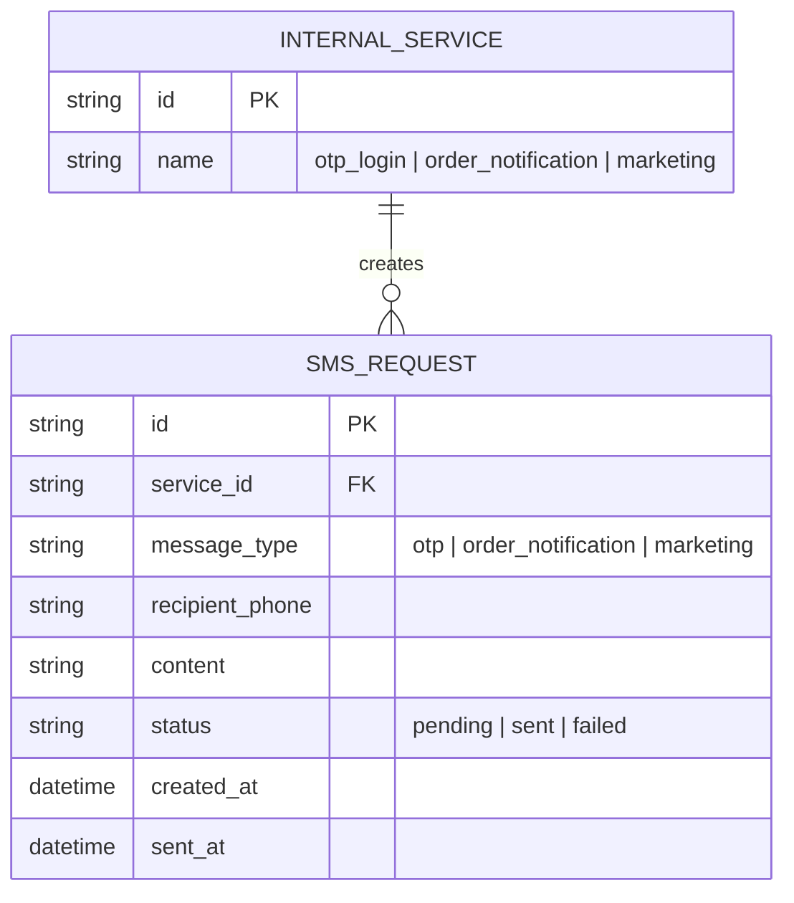
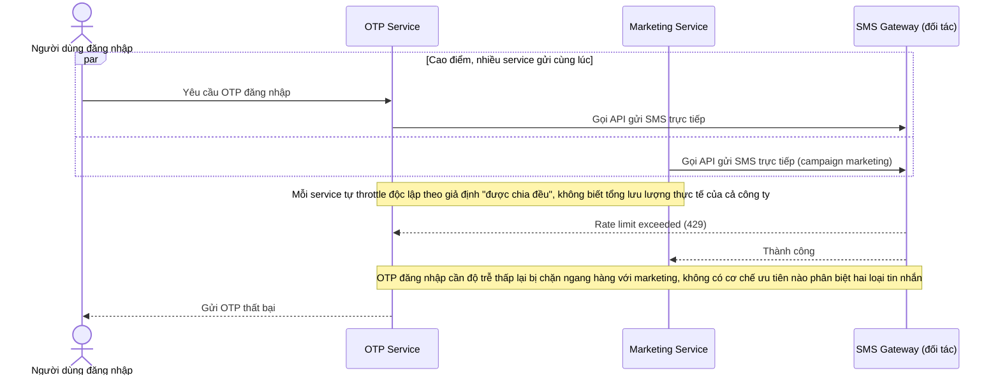
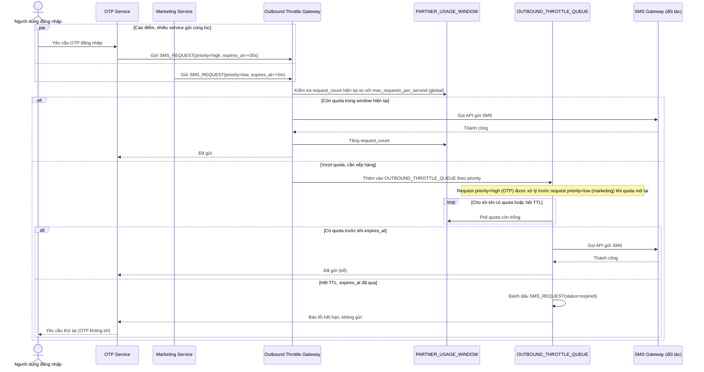
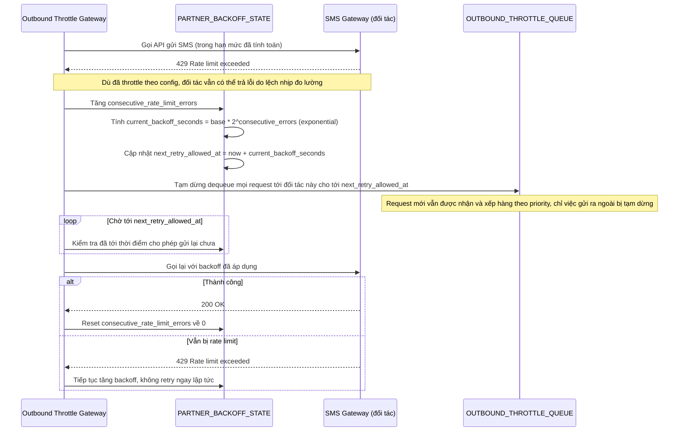
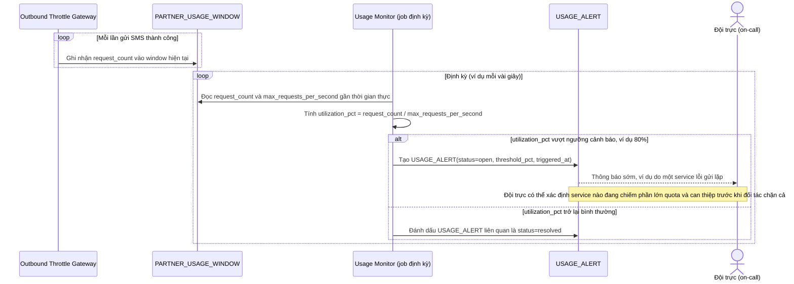

# Tôn trọng rate limit của đối tác bên ngoài khi gửi SMS/OTP

**Hệ thống:** Nhiều service nội bộ (OTP đăng nhập, thông báo đơn hàng, marketing) cùng gọi tới một đối tác SMS gateway bên ngoài có giới hạn rate nghiêm ngặt (request/giây) áp dụng chung cho toàn bộ tài khoản đối tác.

**Vai trò của flow:** Throttling ở tầng gọi ra (outbound) đảm bảo tổng lưu lượng từ tất cả service nội bộ cộng lại không vượt giới hạn của đối tác, tránh bị đối tác chặn/phạt hoặc rớt message.

**Yêu cầu cụ thể:**
- Giới hạn của đối tác là giới hạn tổng (global) áp dụng chung cho toàn công ty, không phải cho riêng từng service — nếu mỗi service tự throttle độc lập theo giả định "được chia đều" thì tổng thực tế vẫn có thể vượt ngưỡng khi nhiều service cùng gửi cao điểm cùng lúc; cần một điểm throttle tập trung (hoặc counter chia sẻ) mà mọi service phải đi qua.
- Khi tổng lưu lượng vượt giới hạn đối tác cho phép tại một thời điểm, phải có cơ chế ưu tiên rõ ràng giữa các loại tin nhắn (OTP đăng nhập cần độ trễ thấp, ưu tiên hơn SMS marketing có thể trì hoãn vài phút), tránh để OTP bị xếp hàng chung với marketing gây trải nghiệm đăng nhập tệ.
- Khi bị đối tác trả về lỗi rate limit dù đã throttle, phải có backoff tăng dần và không được retry ngay lập tức theo kiểu spam lại, vì retry dồn dập có thể khiến đối tác giảm hạn mức hoặc tạm khóa tài khoản của cả công ty.
- Request bị throttle chờ tới lượt gửi phải có hàng đợi có TTL/hết hạn hợp lý (ví dụ OTP hết hạn nếu chờ quá vài chục giây thì bỏ, báo lỗi cho user thử lại) thay vì giữ trong queue vô thời hạn khiến user chờ OTP không tới nhưng cũng không được báo lỗi.
- Phải giám sát được usage thực tế so với hạn mức đối tác theo thời gian gần thực, cảnh báo sớm khi xu hướng traffic đang tiến gần ngưỡng (ví dụ do một service lỗi gửi lặp) trước khi bị đối tác chặn hoàn toàn ảnh hưởng tất cả service khác dùng chung gateway.

---

# Base ERD — Các service nội bộ tự gửi SMS/OTP trực tiếp, chưa có throttle tập trung

Đây là **base**: mô hình dữ liệu suy luận từ ngữ cảnh đề bài, thể hiện trạng thái hệ thống **trước khi** có điểm throttle outbound tập trung. Đề bài nói nhiều service nội bộ (OTP đăng nhập, thông báo đơn hàng, marketing) cùng gọi một đối tác SMS gateway bên ngoài — nên base cần đủ: các service nội bộ và các request gửi SMS mà chúng tạo ra, không phân loại ưu tiên, không có hàng đợi/TTL, không có state backoff, không có theo dõi usage. Những entity đó là phần enhance.

---

# Base sequence — Gửi SMS (mỗi service tự gọi thẳng gateway)

Đây là **base**, flow "Gửi SMS" ở trạng thái hiện tại — mỗi service nội bộ tự gọi trực tiếp API của đối tác SMS gateway, không qua bất kỳ điểm kiểm soát chung nào. Flow này liên quan mật thiết tới enhance vì toàn bộ vấn đề của đề bài (vượt giới hạn tổng, không có ưu tiên, retry dồn dập, không giám sát) đều bắt nguồn từ việc thiếu một điểm throttle tập trung ở đây.

---

# Enhance ERD — sau khi có throttle outbound tập trung

Đây là ERD **sau khi** enhance được áp dụng lên base. So với base, có 4 nhóm entity mới, ứng trực tiếp với các yêu cầu trong đề bài:

- `SMS_REQUEST` bổ sung `priority` và `expires_at` — cơ sở để phân biệt OTP (ưu tiên cao, TTL ngắn) với marketing (ưu tiên thấp, TTL dài hơn).
- `OUTBOUND_THROTTLE_QUEUE` (mới) — hàng đợi có TTL cho request bị throttle chờ tới lượt, expire thay vì chờ vô thời hạn.
- `PARTNER_RATE_LIMIT_CONFIG` + `PARTNER_USAGE_WINDOW` (mới) — giới hạn tổng (global) của đối tác và usage thực tế theo từng window gần thời gian thực.
- `PARTNER_BACKOFF_STATE` (mới) — trạng thái backoff tăng dần khi đối tác trả lỗi rate limit.
- `USAGE_ALERT` (mới) — cảnh báo sớm khi usage tiến gần ngưỡng.

```mermaid
erDiagram
    INTERNAL_SERVICE ||--o{ SMS_REQUEST : creates
    SMS_REQUEST ||--o| OUTBOUND_THROTTLE_QUEUE : "waits in (nếu bị throttle)"
    PARTNER_RATE_LIMIT_CONFIG ||--o{ PARTNER_USAGE_WINDOW : tracks
    PARTNER_RATE_LIMIT_CONFIG ||--|| PARTNER_BACKOFF_STATE : "governs backoff for"
    PARTNER_USAGE_WINDOW ||--o{ USAGE_ALERT : "may trigger"

    INTERNAL_SERVICE {
        string id PK
        string name "otp_login | order_notification | marketing"
    }
    SMS_REQUEST {
        string id PK
        string service_id FK
        string message_type "otp | order_notification | marketing"
        string priority "high | normal | low"
        string recipient_phone
        string content
        string status "pending | queued | sent | failed | expired"
        datetime created_at
        datetime expires_at
        datetime sent_at
    }
    OUTBOUND_THROTTLE_QUEUE {
        string id PK
        string sms_request_id FK
        string priority "high | normal | low"
        datetime enqueued_at
        datetime expires_at
        string dequeue_status "queued | dequeued | expired"
    }
    PARTNER_RATE_LIMIT_CONFIG {
        string id PK
        string partner_name
        int max_requests_per_second
    }
    PARTNER_USAGE_WINDOW {
        string id PK
        string rate_limit_config_id FK
        datetime window_start
        datetime window_end
        int request_count
        decimal utilization_pct
    }
    PARTNER_BACKOFF_STATE {
        string id PK
        string rate_limit_config_id FK
        int consecutive_rate_limit_errors
        int current_backoff_seconds
        datetime next_retry_allowed_at
    }
    USAGE_ALERT {
        string id PK
        string usage_window_id FK
        decimal threshold_pct
        datetime triggered_at
        string status "open | resolved"
    }
```

---

# Enhance sequence — Gửi SMS (qua throttle gateway tập trung, có ưu tiên và TTL)

Đây là **enhance** của flow "Gửi SMS" đã có ở base. So với base, mọi service không còn gọi thẳng đối tác — toàn bộ request phải đi qua một Outbound Throttle Gateway dùng chung, kiểm tra usage window global trước khi quyết định gửi ngay hay xếp hàng theo priority, và request trong hàng đợi có TTL riêng theo loại tin nhắn (đáp ứng yêu cầu 1, 2 và 4 của đề bài).

---

# Enhance sequence — Backoff khi đối tác trả lỗi rate limit

Đây là **enhance**, flow hoàn toàn mới, phát sinh từ enhance — chưa tồn tại ở base (base không retry có kiểm soát, không có backoff). Đáp ứng yêu cầu 3 của đề bài: khi bị đối tác trả lỗi rate limit dù đã throttle, phải backoff tăng dần thay vì retry ngay lập tức.

---

# Enhance sequence — Giám sát usage gần thời gian thực và cảnh báo sớm

Đây là **enhance**, flow hoàn toàn mới, phát sinh từ enhance — chưa tồn tại ở base (base không đo lường usage tổng, mỗi service không biết tình trạng của các service khác). Đáp ứng yêu cầu 5 của đề bài: giám sát usage thực tế so với hạn mức đối tác, cảnh báo sớm khi xu hướng traffic tiến gần ngưỡng trước khi bị chặn hoàn toàn.

