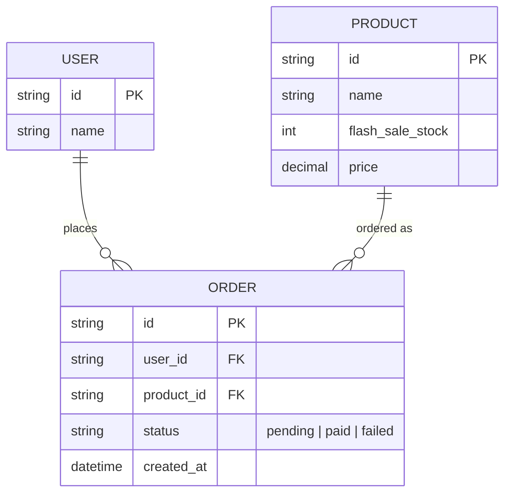
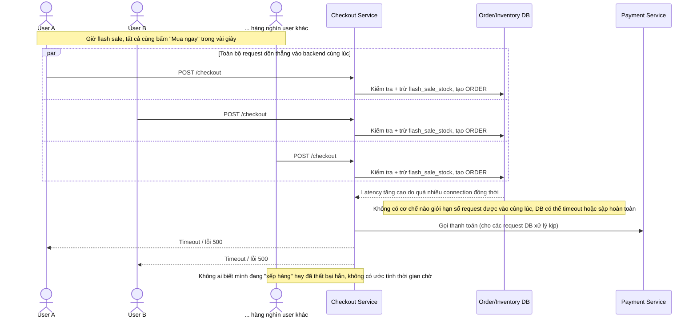
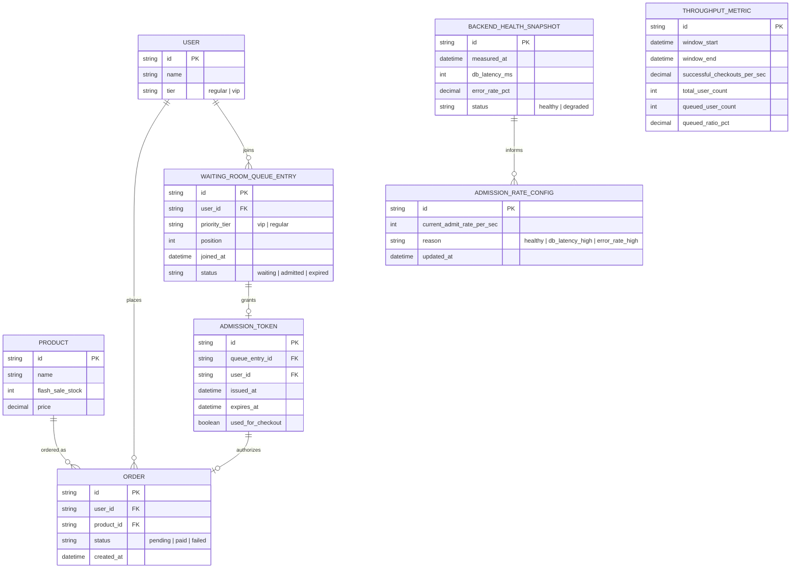
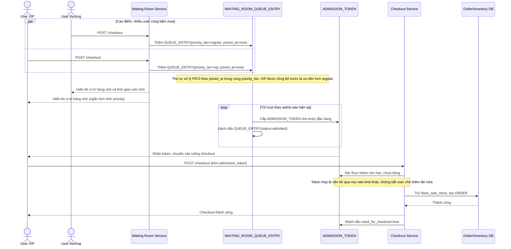
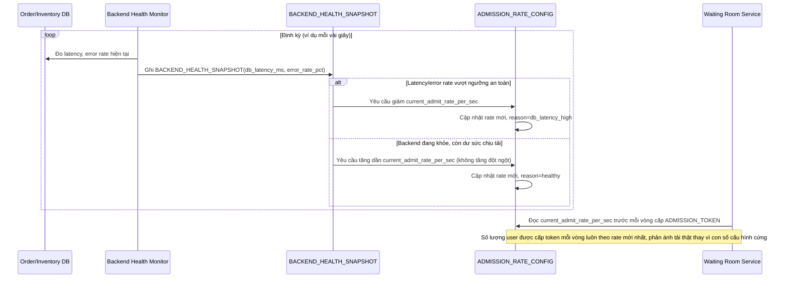
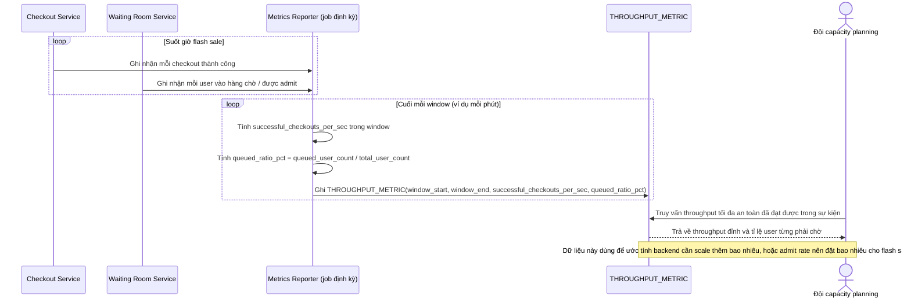

# Throttling request checkout trong flash sale để bảo vệ hệ thống backend

**Hệ thống:** E-commerce cần throttle lượng request checkout đồng thời trong giờ flash sale để tránh backend (DB, payment) bị quá tải sập hoàn toàn.

**Vai trò của flow:** Giới hạn số lượng request được xử lý đồng thời ở tầng vào (ví dụ qua hàng đợi ảo/virtual waiting room) để bảo vệ hệ thống, đổi lại một số user phải chờ theo lượt.

**Yêu cầu cụ thể:**
- Khi lượng request checkout vượt khả năng xử lý an toàn của backend, hệ thống phải chuyển user vào "phòng chờ" (queue) hiển thị vị trí/thời gian ước tính, không để request dồn thẳng vào backend gây sập.
- Thứ tự vào phòng chờ phải công bằng (FIFO theo thời điểm request tới) trừ khi có chính sách ưu tiên rõ ràng được công bố trước (ví dụ khách VIP), tránh cảm giác không công bằng cho user thường.
- Hệ thống throttle phải điều chỉnh động số lượng cho qua dựa trên tình trạng thực tế của backend (ví dụ giảm số cho qua nếu latency DB tăng cao), không dùng số cố định tĩnh không phản ánh tải thật.
- Đảm bảo user đã vào được luồng xử lý (qua khỏi hàng chờ) không bị rate limit lần nữa giữa đường gây trải nghiệm xấu (đã chờ xong lại bị chặn tiếp).
- Đo lường và báo cáo: throughput checkout thành công/giây tối đa hệ thống đạt được an toàn, và tỉ lệ user phải vào hàng chờ so với tổng traffic trong giờ flash sale, dùng để lên kế hoạch capacity cho các sự kiện sau.

---

# Base ERD — Checkout gọi thẳng backend, chưa có phòng chờ

Đây là **base**: mô hình dữ liệu suy luận từ ngữ cảnh đề bài, thể hiện trạng thái hệ thống **trước khi** có throttle ở tầng vào (virtual waiting room). Đề bài nói e-commerce có flash sale với sản phẩm giới hạn số lượng, user checkout trực tiếp — nên base cần đủ: user, sản phẩm flash sale, và order được tạo ngay khi checkout, không có khái niệm hàng chờ/priority/admission token/đo throughput. Những entity đó là phần enhance.

---

# Base sequence — Checkout (gọi thẳng backend, không có admission control)

Đây là **base**, flow "Checkout" ở trạng thái hiện tại — request đi thẳng từ client vào backend (DB, payment) không qua bất kỳ điểm kiểm soát lượng vào nào. Flow này liên quan mật thiết tới enhance vì toàn bộ vấn đề của đề bài (backend quá tải, không công bằng khi nghẽn, không đo lường được) đều bắt nguồn từ việc thiếu tầng throttle ở đây.

---

# Enhance ERD — sau khi có virtual waiting room + admission control

Đây là ERD **sau khi** enhance được áp dụng lên base. So với base, có 5 nhóm entity mới, ứng trực tiếp với các yêu cầu trong đề bài:

- `USER` bổ sung `tier` — cơ sở cho chính sách ưu tiên công bố trước (VIP) khi hàng chờ đông.
- `WAITING_ROOM_QUEUE_ENTRY` (mới) — vị trí, thời điểm vào hàng, trạng thái chờ/đã vào/hết hạn.
- `ADMISSION_TOKEN` (mới) — cấp cho user đã qua hàng chờ, dùng để checkout mà không bị throttle lại giữa đường.
- `ADMISSION_RATE_CONFIG` + `BACKEND_HEALTH_SNAPSHOT` (mới) — tốc độ cho qua hiện tại được điều chỉnh động theo sức khỏe backend thực tế, không dùng số tĩnh.
- `THROUGHPUT_METRIC` (mới) — throughput checkout thành công/giây và tỉ lệ user phải chờ, phục vụ lên kế hoạch capacity.

---

# Enhance sequence — Checkout (qua phòng chờ, admission token miễn throttle lại)

Đây là **enhance** của flow "Checkout" đã có ở base. So với base, request không còn đi thẳng vào backend — user bị chặn ở virtual waiting room theo thứ tự FIFO (trừ khi có priority tier công bố trước), chỉ khi tới lượt mới nhận admission token; sau khi cầm token, user checkout thẳng qua backend mà không bị rate limit lần nữa (đáp ứng yêu cầu 1, 2 và 4 của đề bài).

---

# Enhance sequence — Điều chỉnh admission rate động theo sức khỏe backend

Đây là **enhance**, flow hoàn toàn mới, phát sinh từ enhance — chưa tồn tại ở base (base không có khái niệm admit rate). Đáp ứng yêu cầu 3 của đề bài: tốc độ cho qua hàng chờ phải phản ánh tải thật của backend, không dùng số cố định tĩnh.

---

# Enhance sequence — Đo throughput và tỉ lệ user phải chờ để lên kế hoạch capacity

Đây là **enhance**, flow hoàn toàn mới, phát sinh từ enhance — chưa tồn tại ở base (base không đo lường throughput hay tỉ lệ user bị chặn). Đáp ứng yêu cầu 5 của đề bài: đo throughput checkout thành công/giây tối đa an toàn, và tỉ lệ user phải vào hàng chờ so với tổng traffic, phục vụ capacity planning cho các sự kiện sau.

