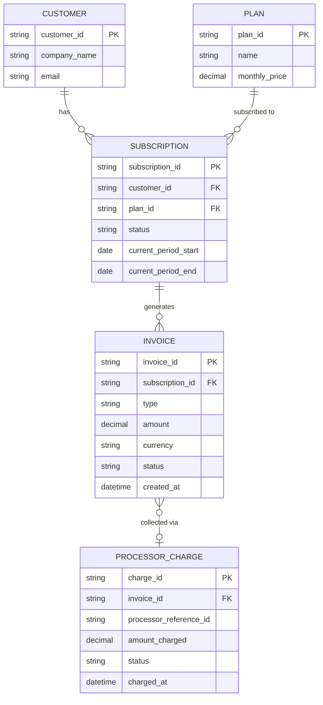
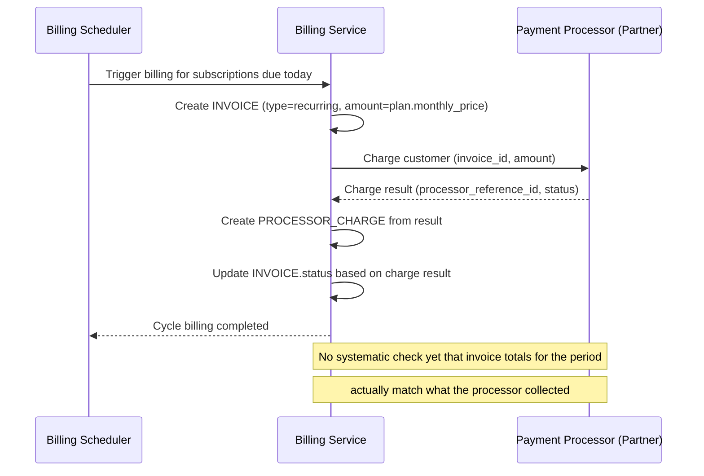
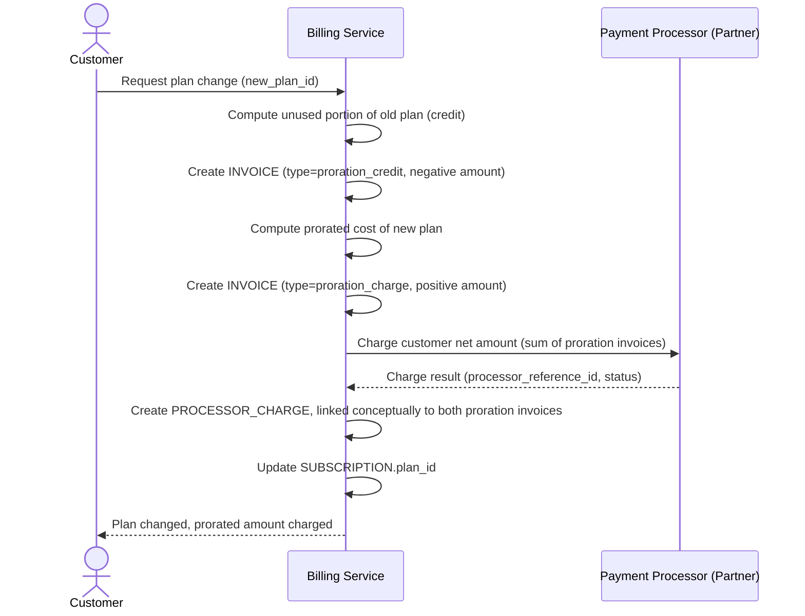
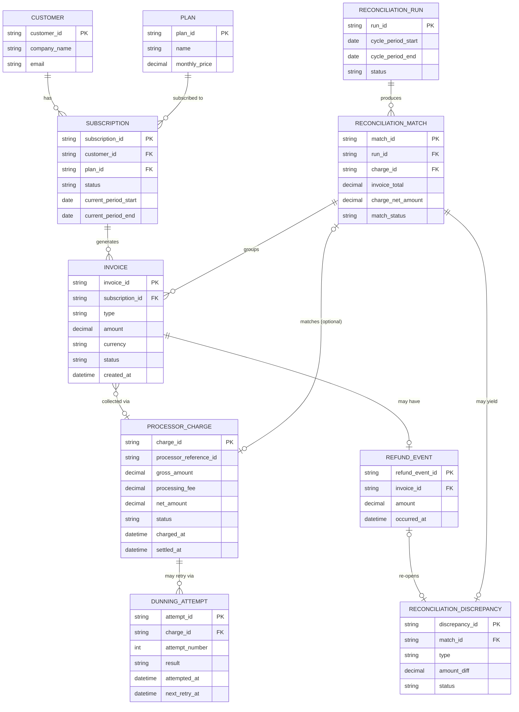
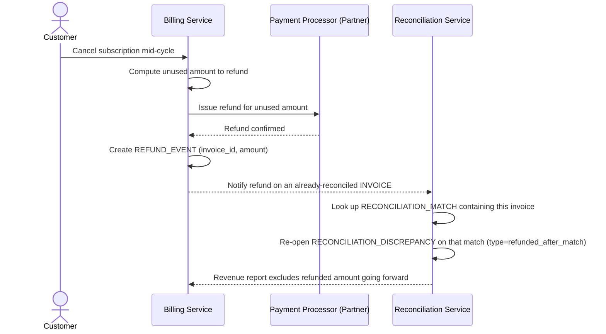

# SaaS thuê bao đối soát billing nội bộ với payment processor

**Hệ thống:** Một SaaS thu phí thuê bao định kỳ hàng tháng, khách hàng có thể nâng/hạ cấp gói giữa chu kỳ, thanh toán xử lý qua một payment processor bên ngoài.

**Vai trò của flow:** Đối soát giữa hệ thống billing nội bộ (invoice phát sinh, các khoản điều chỉnh proration khi đổi gói) và số tiền thực tế processor đã thu được/báo cáo lại theo từng chu kỳ thanh toán.

**Yêu cầu cụ thể:**
- Khi khách hàng đổi gói giữa chu kỳ, hệ thống billing nội bộ phát sinh nhiều invoice điều chỉnh nhỏ (giảm trừ phần chưa dùng của gói cũ, cộng thêm phần gói mới) trong cùng một khoảng thời gian ngắn — đối soát phải khớp đúng tổng các điều chỉnh này với đúng một lượt thu tiền tương ứng từ processor, tránh hiểu nhầm là nhiều giao dịch riêng lẻ không khớp.
- Processor có thể thử thu tiền thất bại rồi tự động retry theo lịch riêng của họ (dunning) trong vài ngày sau ngày đến hạn — đối soát phải xử lý được trạng thái "đang chờ retry" khác với "thất bại hẳn", không đóng sổ chu kỳ khi khoản thu vẫn còn khả năng thành công ở lần retry tiếp theo.
- Khách hàng hủy gói giữa chu kỳ có thể được hoàn lại phần tiền chưa dùng, khoản hoàn này phát sinh sau khi invoice gốc đã đối soát khớp từ trước — cần cập nhật lại trạng thái đối soát của invoice đó, không để hệ thống báo cáo doanh thu vẫn tính khoản đã hoàn là doanh thu thực.
- Số tiền processor thực báo cáo có thể đã trừ phí xử lý giao dịch trước khi ghi có, trong khi hệ thống billing nội bộ ghi nhận theo giá trị gộp trước phí — đối soát phải tách rõ hai luồng số liệu này để không nhầm chênh lệch phí xử lý thành sai lệch thực sự cần điều tra.
- Khi múi giờ đóng chu kỳ billing nội bộ không trùng khớp với thời điểm processor tổng hợp báo cáo theo lịch của họ, một số giao dịch cận ranh giới ngày có thể bị xếp lệch chu kỳ giữa hai bên — cần định nghĩa rõ quy tắc xếp chu kỳ thống nhất và có bước xử lý riêng cho các giao dịch cận biên này thay vì báo sai lệch giả mỗi tháng.

---

# ERD — Base (trước khi có đối soát billing với processor)

Đây là **base**: mô hình dữ liệu suy luận cho SaaS thuê bao *trước khi* có flow đối soát. Đề bài giả định hệ thống đã có billing nội bộ phát sinh invoice (kể cả invoice điều chỉnh proration khi đổi gói) và đã tích hợp payment processor để thu tiền — nếu không có sẵn `INVOICE` và `PROCESSOR_CHARGE` thì "đối soát billing nội bộ với số tiền processor báo cáo" sẽ không có nghĩa. ERD chỉ dựng phần lõi phục vụ billing + thu tiền, không suy diễn thêm các module không liên quan (support ticket, usage metering chi tiết...).

---

# Sequence Diagram — Base: Charge Subscription Cycle

Đây là **base**, flow "thu tiền định kỳ hàng tháng" — tiền đề bắt buộc cho đối soát: chính flow này tạo ra `INVOICE` (type=recurring) và `PROCESSOR_CHARGE` tương ứng, hai dữ liệu mà đối soát sau này phải khớp với nhau theo từng chu kỳ.

---

# Sequence Diagram — Base: Change Plan With Proration

Đây là **base**, flow "đổi gói giữa chu kỳ" — cũng là tiền đề cho đối soát vì đề bài mô tả đây là nguồn phát sinh "nhiều invoice điều chỉnh nhỏ trong cùng khoảng thời gian ngắn" mà đối soát phải khớp tổng lại với đúng một lượt thu tiền từ processor.

---

# ERD — Enhance (sau khi có đối soát billing với processor)

Đây là **enhance**: ERD base cộng với các entity phục vụ đúng 5 yêu cầu của đề bài — khớp nhóm invoice proration với đúng một lượt thu, phân biệt "đang retry" với "thất bại hẳn" ở dunning, cập nhật lại đối soát khi có hoàn tiền sau khớp, tách phí xử lý khỏi số tiền gộp, và xử lý riêng giao dịch cận ranh giới chu kỳ. So với base, `PROCESSOR_CHARGE` nay lưu thêm `processing_fee` và `net_amount`, và có thêm `DUNNING_ATTEMPT` để theo dõi lịch sử retry thay vì chỉ một status tĩnh.

---

# Sequence Diagram — Enhance: Reconcile Billing Cycle

Đây là **enhance**, flow chính hoàn toàn mới: đối soát giữa nhóm `INVOICE` (kể cả các invoice proration nhỏ phát sinh khi đổi gói, xem [3-base-change-plan-proration-sqd.md](#3-base-change-plan-proration-sqd)) với đúng một `PROCESSOR_CHARGE`. Flow thể hiện việc tách `processing_fee` khỏi `gross_amount` để so đúng `net_amount`, phân biệt trạng thái "đang chờ retry" (dunning) với "thất bại hẳn", và có bước xử lý riêng cho giao dịch cận ranh giới chu kỳ do lệch múi giờ.

```mermaid
sequenceDiagram
    actor Ops as Ops Team
    participant Recon as Reconciliation Service
    participant Billing as Billing Service
    participant Processor as Payment Processor (Partner)

    Ops->>Recon: Trigger reconciliation for cycle_period
    Recon->>Billing: Group INVOICE by subscription within cycle boundary (using unified cutoff rule)

    loop for each group of invoices tied to one charge attempt
        Recon->>Billing: Sum group invoice amounts (invoice_total)
        Recon->>Processor: Look up PROCESSOR_CHARGE by processor_reference_id
        Processor-->>Recon: gross_amount, processing_fee, net_amount, status

        alt charge status = succeeded and invoice_total equals net_amount
            Recon->>Recon: Create RECONCILIATION_MATCH (match_status=matched)
        else charge status = retrying (dunning in progress)
            Recon->>Processor: Check DUNNING_ATTEMPT history
            Processor-->>Recon: next_retry_at still in the future
            Recon->>Recon: Mark group as pending, exclude from discrepancy this run
            Note over Recon: Not closed yet, still eligible for a future successful retry
        else charge status = failed permanently
            Recon->>Recon: Create RECONCILIATION_DISCREPANCY (type=charge_failed)
        else invoice_total does not equal net_amount but charge succeeded
            Recon->>Recon: Create RECONCILIATION_DISCREPANCY (type=amount_mismatch)
        else transaction near cycle boundary (ambiguous cutoff)
            Recon->>Recon: Apply boundary rule, re-classify into correct cycle before comparing
        end
    end

    Recon-->>Ops: Reconciliation summary for the cycle
```

---

# Sequence Diagram — Enhance: Handle Post-Reconciliation Refund

Đây là **enhance**, flow mới xử lý trường hợp khách hủy gói giữa chu kỳ và được hoàn lại phần tiền chưa dùng *sau khi* invoice gốc đã đối soát khớp (xem [5-enhance-reconcile-billing-cycle-sqd.md](#5-enhance-reconcile-billing-cycle-sqd)). Flow này đảm bảo yêu cầu "không để hệ thống báo cáo doanh thu vẫn tính khoản đã hoàn là doanh thu thực" bằng cách mở lại đối soát cho match liên quan.

