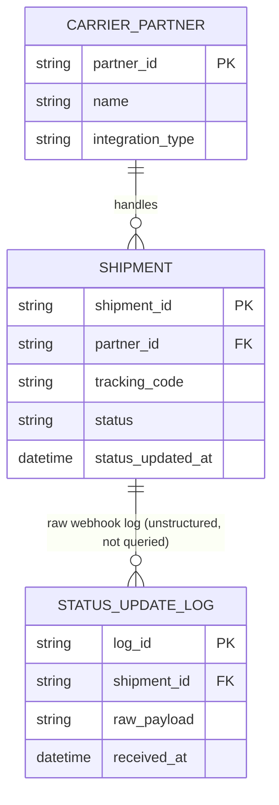
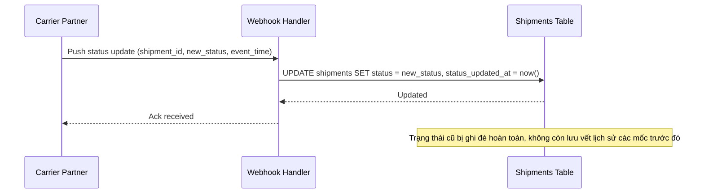
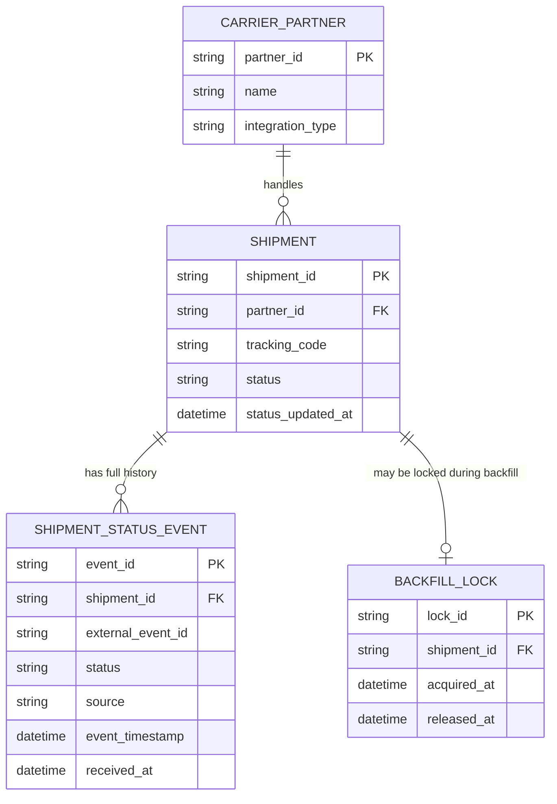
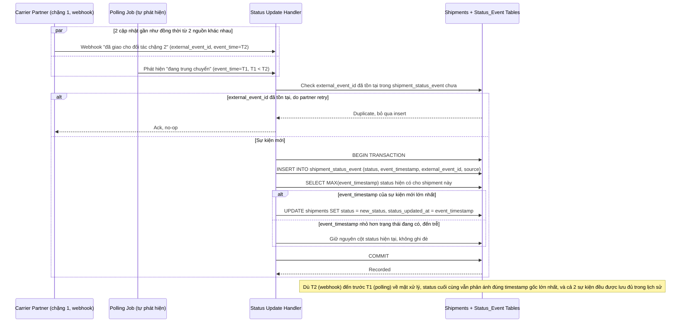
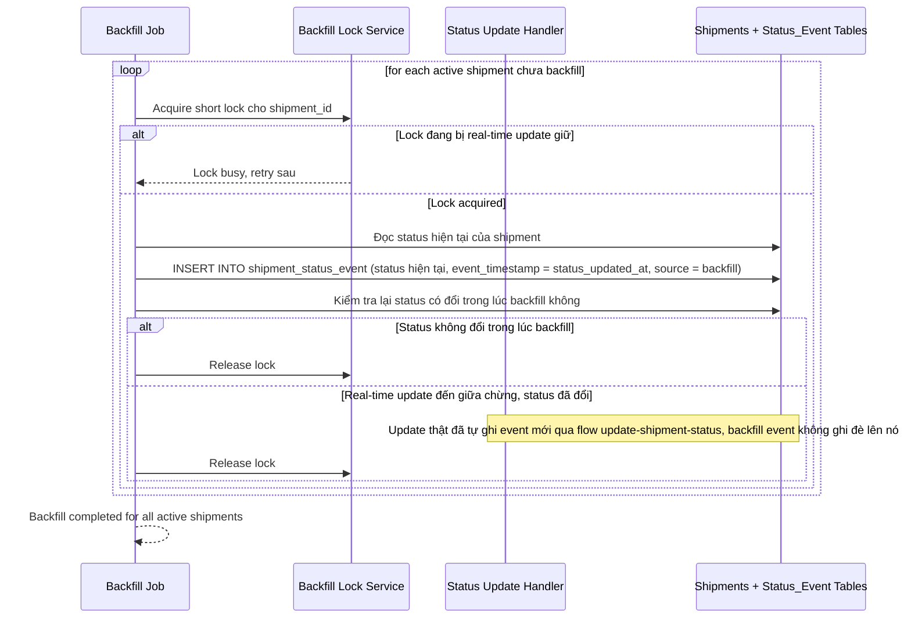

# Đổi cấu trúc lưu trạng thái vận đơn từ 1 cột status sang bảng lịch sử trạng thái (logistics)

**Hệ thống:** Một nền tảng logistics tổng hợp trạng thái vận đơn từ nhiều đối tác vận chuyển khác nhau, hiện lưu trạng thái vận đơn ở 1 cột `status` đơn trên bảng `shipments`, cần chuyển sang bảng `shipment_status_history` để lưu đầy đủ lịch sử các mốc trạng thái phục vụ tra cứu hành trình chi tiết, trong khi đơn hàng vẫn đang di chuyển và nhận cập nhật trạng thái liên tục qua nhiều đối tác vận chuyển.

**Vai trò của flow:** Flow dual-write phải ghi mọi cập nhật trạng thái mới vào cả cột `status` cũ và bảng lịch sử mới, xử lý đúng khi các cập nhật từ nhiều đối tác vận chuyển cho cùng 1 vận đơn đến gần như đồng thời hoặc không đúng thứ tự thời gian thực.

**Yêu cầu cụ thể:**
- Mô tả cụ thể: 2 cập nhật trạng thái cho cùng 1 vận đơn đến gần như đồng thời từ 2 nguồn khác nhau (webhook từ đối tác chặng đầu báo "đã giao cho đối tác chặng 2" và polling job tự phát hiện trạng thái "đang trung chuyển" cùng lúc) — yêu cầu ghi cột `status` cũ (chỉ giữ 1 giá trị cuối) và bảng lịch sử mới (insert thêm 1 dòng) trong cùng 1 transaction, xác định trạng thái nào là "mới nhất thật sự" dựa trên timestamp gốc của sự kiện (không phải thời điểm hệ thống nhận được), tránh cột `status` cũ bị ghi giá trị cũ hơn đè lên giá trị mới hơn do thứ tự xử lý ở tầng ứng dụng không khớp thứ tự thời gian thực.
- Trạng thái đến trễ/không đúng thứ tự là bình thường trong logistics do độ trễ khác nhau giữa các đối tác vận chuyển: bảng lịch sử mới phải chấp nhận insert mọi sự kiện theo đúng trình tự nhận được (không từ chối hay ghi đè), nhưng cột `status` cũ chỉ phản ánh trạng thái ứng với timestamp lớn nhất trong các sự kiện đã nhận — yêu cầu test cụ thể giả lập 3 cập nhật đến không đúng thứ tự thời gian, xác nhận `status` cuối cùng đúng và bảng lịch sử vẫn lưu đủ cả 3 sự kiện theo đúng trình tự thực.
- Xử lý webhook trùng lặp do đối tác vận chuyển retry (vì không nhận được ack kịp thời): idempotent theo mã sự kiện/mã trạng thái từ đối tác để không insert trùng dòng lịch sử khi cùng 1 webhook đến nhiều lần, trong khi vẫn đảm bảo webhook hợp lệ đầu tiên luôn được ghi dù đến đúng lúc đang có traffic cập nhật cao từ các vận đơn khác.
- Job backfill lịch sử cho các vận đơn đang active (chưa giao xong) phải chạy mà không làm mất các cập nhật trạng thái mới đến ngay trong lúc job đang backfill đúng vận đơn đó — quy định cơ chế khóa ngắn hoặc kiểm tra lại trạng thái sau khi backfill để không bị cập nhật real-time đến giữa chừng ghi đè mất.
- Chỉ chuyển toàn bộ luồng đọc (tra cứu hành trình cho khách, dashboard vận hành) sang bảng lịch sử mới sau khi đã backfill xong toàn bộ vận đơn đang active và dual-write chạy ổn định không lệch trong khoảng thời gian tối thiểu quy định, đặc biệt phải test kỹ các vận đơn có tần suất cập nhật trạng thái cao (đơn liên tỉnh qua nhiều chặng trung chuyển) trước khi áp dụng cho toàn hệ thống.

---

# ERD — Base (trước khi có bảng lịch sử trạng thái)

Đây là **base**: mô hình dữ liệu suy luận cho nền tảng logistics *trước khi* tách lịch sử trạng thái. Đề bài giả định đã có `SHIPMENT` với 1 cột `status` đơn, được nhiều `CARRIER_PARTNER` (đối tác vận chuyển) cập nhật qua webhook hoặc polling — nếu không có sẵn cột `status` đơn thì yêu cầu "chuyển sang bảng shipment_status_history" sẽ không có nghĩa. ERD chỉ dựng phần lõi phục vụ theo dõi trạng thái vận đơn, không suy diễn thêm định giá cước/thanh toán không liên quan.

---

# Sequence Diagram — Base: Update Shipment Status

Đây là **base**, flow "cập nhật trạng thái vận đơn" — tiền đề bắt buộc cho việc tách bảng lịch sử: chính flow này ghi đè trực tiếp lên cột `status` của `SHIPMENT` mỗi khi có cập nhật, không lưu vết các mốc trạng thái trước đó — đây chính là hạn chế mà enhance phải giải quyết.

---

# ERD — Enhance (sau khi có bảng lịch sử trạng thái)

Đây là **enhance**: ERD base cộng với `SHIPMENT_STATUS_EVENT` lưu đầy đủ mọi mốc trạng thái, khóa idempotent theo mã sự kiện từ đối tác, và cơ chế khóa/checkpoint cho backfill. So với base, cột `status` trên `SHIPMENT` không đổi ý nghĩa (vẫn là trạng thái mới nhất) nhưng nay được suy ra từ `SHIPMENT_STATUS_EVENT` có `event_timestamp` lớn nhất, thay vì chỉ đơn giản là giá trị ghi đè cuối cùng theo thứ tự xử lý.

---

# Sequence Diagram — Enhance: Update Shipment Status

Đây là **enhance**, flow "cập nhật trạng thái vận đơn" đã tồn tại ở base ([2-base-update-shipment-status-sqd.md](#2-base-update-shipment-status-sqd)) nay thay đổi lớn: mỗi cập nhật phải insert thêm 1 dòng vào `SHIPMENT_STATUS_EVENT` (dual-write cùng transaction với cột `status` cũ), cột `status` chỉ được ghi đè nếu `event_timestamp` mới lớn hơn timestamp hiện tại (không phải thời điểm hệ thống nhận được), và webhook trùng lặp phải idempotent theo `external_event_id`.

---

# Sequence Diagram — Enhance: Backfill Active Shipments

Đây là **enhance**, flow hoàn toàn mới: job backfill tạo `SHIPMENT_STATUS_EVENT` khởi tạo cho các vận đơn đang active từ trạng thái hiện có, dùng khóa ngắn trên từng vận đơn để không bị real-time update đến giữa chừng ghi đè mất.

