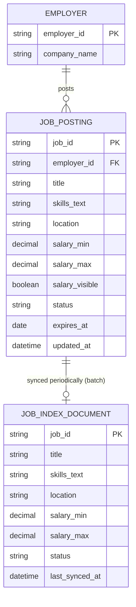
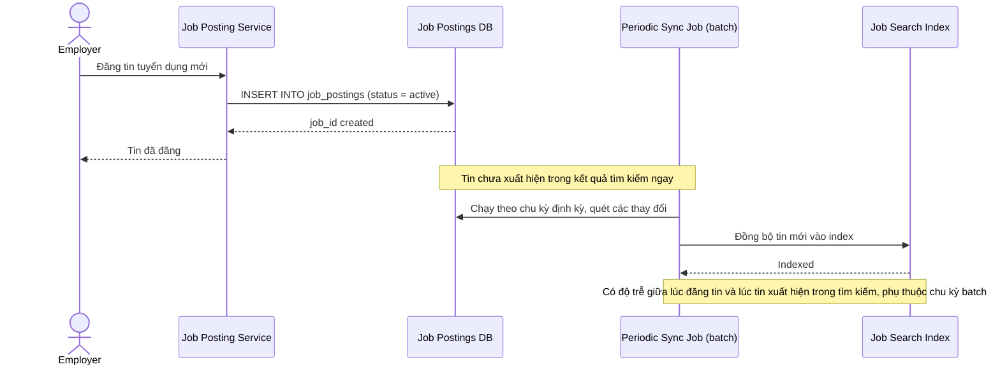
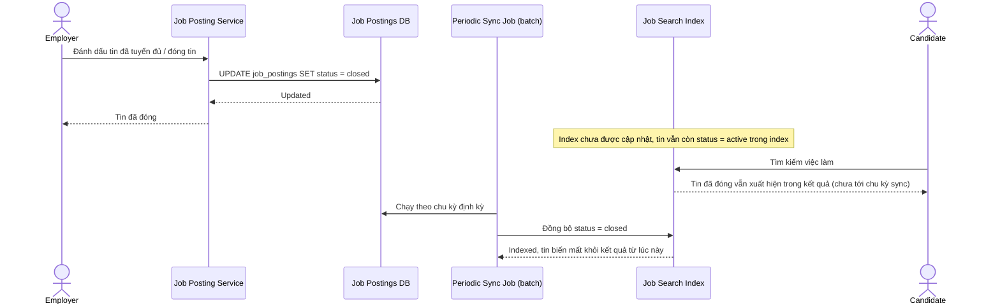
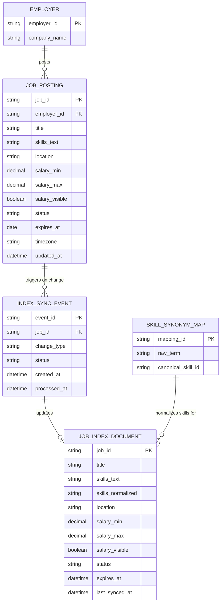
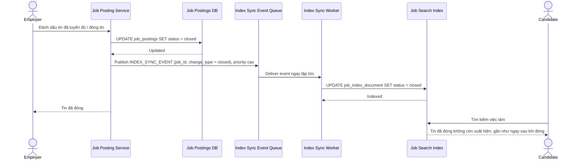
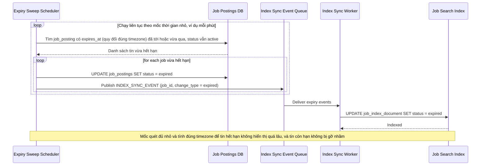
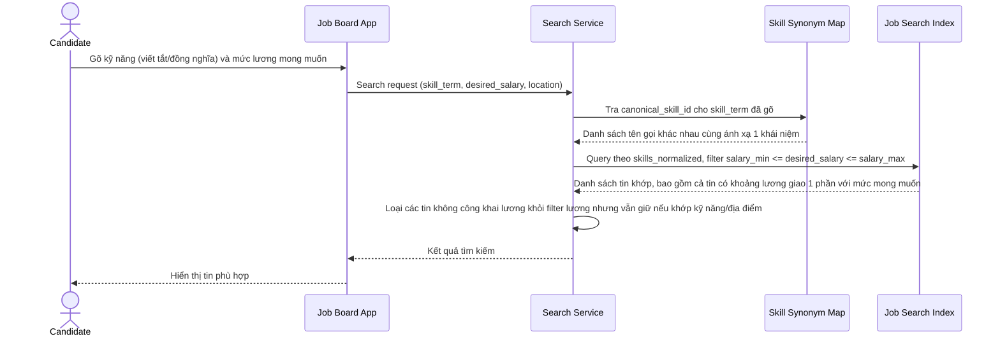
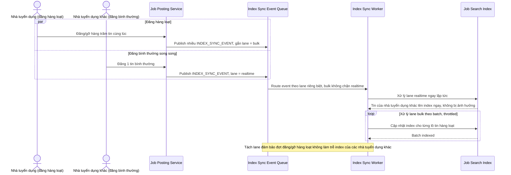

# Nền tảng tuyển dụng với yêu cầu độ tươi mới của tin đăng

**Hệ thống:** Một nền tảng tuyển dụng cho phép ứng viên tìm việc theo kỹ năng/địa điểm/mức lương, nhà tuyển dụng đăng tin và có thể đóng tin bất cứ lúc nào khi đã tuyển đủ.

**Vai trò của flow:** Lập chỉ mục tin tuyển dụng với các thuộc tính lọc (kỹ năng, địa điểm, mức lương), phục vụ tìm kiếm và đảm bảo tin hết hạn/đã tuyển đủ biến mất khỏi kết quả ngay lập tức.

**Yêu cầu cụ thể:**
- Khi nhà tuyển dụng đánh dấu tin đã tuyển đủ hoặc chủ động đóng tin, tin đó phải biến mất khỏi kết quả tìm kiếm ngay lập tức, không chờ tới chu kỳ đồng bộ định kỳ — vì ứng viên nộp hồ sơ vào tin đã đóng gây trải nghiệm xấu và tổn hại uy tín nền tảng nhiều hơn so với các loại nội dung khác chấp nhận độ trễ index cao hơn.
- Tin tuyển dụng có ngày hết hạn tự động phải được gỡ khỏi index đúng thời điểm hết hạn mà không cần nhà tuyển dụng chủ động thao tác, xử lý đúng múi giờ và không để lệch vài giờ khiến tin hết hạn vẫn hiển thị hoặc tin còn hạn bị gỡ nhầm.
- Tìm kiếm theo mức lương phải xử lý được các tin để khoảng lương (min-max) thay vì một con số cố định, và một số tin không công khai mức lương — bộ lọc phải trả kết quả đúng logic giao khoảng khi ứng viên lọc theo một mức lương mong muốn cụ thể, không loại nhầm các tin có khoảng lương chỉ giao một phần với tiêu chí lọc.
- Kỹ năng yêu cầu trong tin đăng thường được nhà tuyển dụng gõ tự do, trong khi ứng viên tìm theo tên kỹ năng chuẩn — autocomplete và index phải ánh xạ được các cách viết/tên gọi khác nhau của cùng một kỹ năng (viết tắt, đồng nghĩa) về cùng một khái niệm để không bỏ lỡ tin phù hợp chỉ vì khác cách gõ.
- Khi một công ty đăng số lượng lớn tin cùng lúc hoặc gỡ hàng loạt tin cùng lúc, pipeline index phải xử lý được đợt thay đổi hàng loạt này mà không tạo ra độ trễ lan sang việc cập nhật index cho các tin đăng bình thường khác của nhà tuyển dụng khác đang diễn ra song song.

---

# ERD — Base (trước khi cải thiện độ tươi mới)

Đây là **base**: mô hình dữ liệu suy luận cho nền tảng tuyển dụng *trước khi* cải thiện độ tươi mới của index. Đề bài mô tả nền tảng "đã cho phép" tìm việc theo kỹ năng/địa điểm/mức lương và nhà tuyển dụng đã đăng/đóng tin được — nghĩa là index tìm kiếm đã tồn tại, chỉ là đồng bộ theo chu kỳ định kỳ (batch), chưa tức thời. Đây là điểm base cần có để yêu cầu "tin đóng phải biến mất ngay lập tức" có nghĩa.

---

# Sequence Diagram — Base: Post Job

Đây là **base**, flow "đăng tin tuyển dụng" — cho thấy tin mới chỉ vào index sau chu kỳ đồng bộ định kỳ (batch), là tiền đề cho vấn đề độ trễ mà enhance phải giải quyết ở cả chiều đăng lẫn chiều đóng tin.

---

# Sequence Diagram — Base: Close Job

Đây là **base**, flow "đóng tin đã tuyển đủ" — vấn đề cốt lõi mà enhance phải giải quyết: tin bị đóng trong DB nhưng vẫn hiển thị trong kết quả tìm kiếm cho tới chu kỳ đồng bộ định kỳ kế tiếp, khiến ứng viên vẫn nộp hồ sơ vào tin đã đóng.

---

# ERD — Enhance (sau khi cải thiện độ tươi mới)

Đây là **enhance**: ERD base cộng với `SKILL_SYNONYM_MAP` để ánh xạ các cách gõ kỹ năng khác nhau về cùng khái niệm, và `JOB_INDEX_DOCUMENT` được bổ sung cơ chế đồng bộ sự kiện tức thời thay vì batch định kỳ. So với base, việc đồng bộ index không còn qua `Periodic Sync Job` mà qua `INDEX_SYNC_EVENT` được xử lý gần như ngay lập tức, và `JOB_INDEX_DOCUMENT` có thêm `skills_normalized` để phục vụ autocomplete theo tên kỹ năng chuẩn.

---

# Sequence Diagram — Enhance: Close Job

Đây là **enhance**, flow "đóng tin" đã tồn tại ở base ([3-base-close-job-sqd.md](#3-base-close-job-sqd)) nay thay đổi cốt lõi: thay vì chờ chu kỳ batch, việc đóng tin phát ngay `INDEX_SYNC_EVENT` và index được cập nhật tức thời, để tin biến mất khỏi kết quả tìm kiếm ngay lập tức.

---

# Sequence Diagram — Enhance: Job Expiry Sweep

Đây là **enhance**, flow hoàn toàn mới: tin có ngày hết hạn phải tự động bị gỡ khỏi index đúng thời điểm hết hạn, xử lý đúng múi giờ, mà không cần nhà tuyển dụng thao tác.

---

# Sequence Diagram — Enhance: Search Jobs

Đây là **enhance**, flow tìm kiếm việc làm hoàn toàn mới so với base (base chưa mô tả chi tiết cách lọc): xử lý lọc theo khoảng lương (giao khoảng, kể cả tin không công khai lương), và autocomplete kỹ năng ánh xạ qua `SKILL_SYNONYM_MAP` để không bỏ lỡ tin dùng cách gõ khác.

---

# Sequence Diagram — Enhance: Bulk Post Jobs

Đây là **enhance**, flow hoàn toàn mới: khi 1 công ty đăng hoặc gỡ hàng loạt tin cùng lúc, pipeline index phải xử lý đợt thay đổi lớn này mà không làm chậm việc cập nhật index cho các tin đăng bình thường của nhà tuyển dụng khác đang diễn ra song song.

