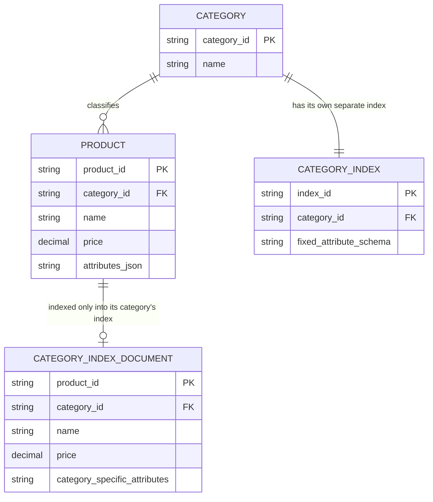
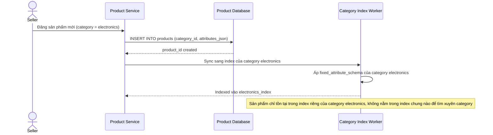
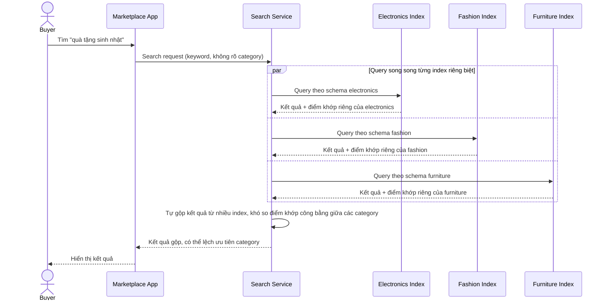
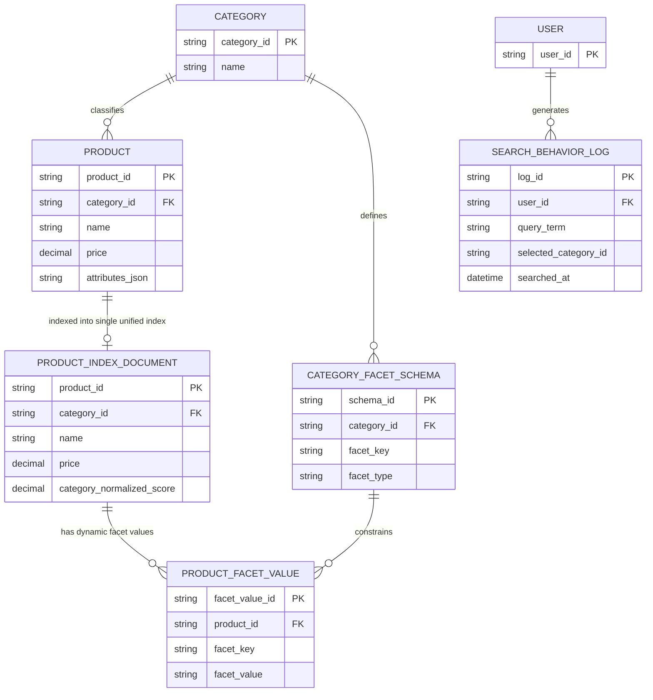
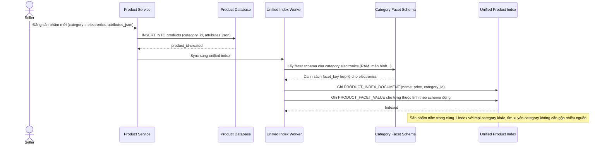
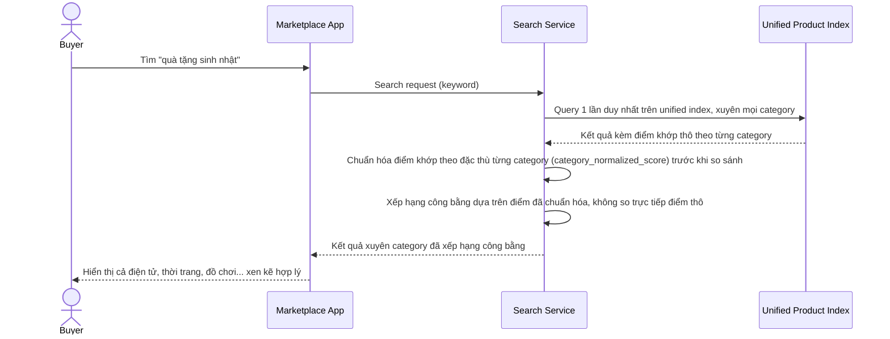
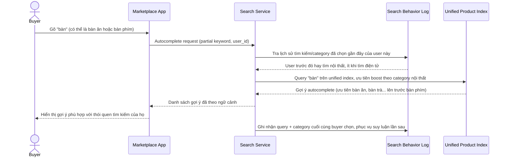
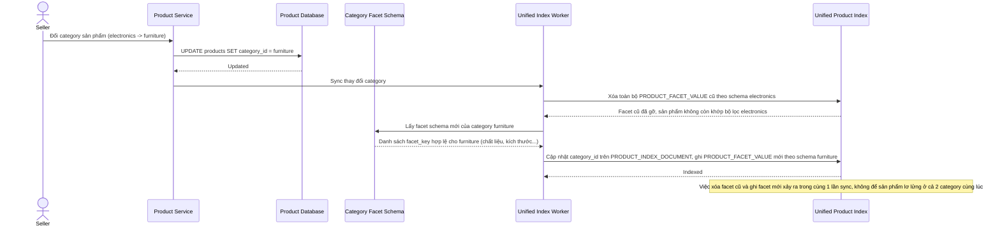

# Marketplace đa category với facet lọc khác biệt hoàn toàn

**Hệ thống:** Một marketplace bán hàng đa category hoàn toàn khác biệt (điện tử, thời trang, nội thất...), mỗi category có bộ thuộc tính/facet lọc riêng.

**Vai trò của flow:** Lập chỉ mục sản phẩm từ nhiều category với schema thuộc tính khác nhau, phục vụ tìm kiếm xuyên category và autocomplete gợi ý đúng theo ngữ cảnh category đang tìm.

**Yêu cầu cụ thể:**
- Mỗi category có bộ facet lọc riêng (điện tử có "dung lượng RAM", thời trang có "size/màu", nội thất có "chất liệu") — index phải lưu và truy vấn hiệu quả với schema thuộc tính động theo category mà không phải tạo index riêng biệt cho từng category gây khó khăn khi tìm xuyên category.
- Khi người dùng gõ một từ khóa mơ hồ có thể thuộc nhiều category (ví dụ "bàn" có thể là bàn ăn nội thất hoặc liên quan đến bàn phím máy tính), autocomplete phải suy luận được ngữ cảnh category phù hợp dựa trên hành vi tìm kiếm/lịch sử, tránh gợi ý lẫn lộn không liên quan gây khó chịu.
- Khi sản phẩm được người bán đổi category sau khi đã đăng, index phải cập nhật đồng thời cả danh mục lẫn bộ facet thuộc tính tương ứng, đảm bảo sản phẩm không còn xuất hiện ở bộ lọc facet của category cũ không còn phù hợp.
- Kết quả tìm kiếm xuyên category (ví dụ tìm "quà tặng sinh nhật" trả về cả điện tử, thời trang, đồ chơi) phải xếp hạng công bằng giữa các category khác nhau về bản chất — độ khớp từ khóa của một sản phẩm thời trang không thể so trực tiếp với một sản phẩm điện tử theo cùng công thức điểm số mà không tính đến đặc thù từng category.
- Khi thêm một category hoàn toàn mới vào hệ thống, việc bổ sung schema/facet mới cho category đó không được yêu cầu reindex toàn bộ dữ liệu các category hiện có đang phục vụ tìm kiếm sống.

---

# ERD — Base (trước khi hợp nhất index đa category)

Đây là **base**: mô hình dữ liệu suy luận cho marketplace *trước khi* hợp nhất facet đa category. Đề bài chỉ ra điểm cần tránh là "phải tạo index riêng biệt cho từng category gây khó khăn khi tìm xuyên category" — suy ra base chính là trạng thái đó: mỗi category có 1 index riêng với schema thuộc tính cố định cho category đó, khiến tìm xuyên category khó khăn. Đây là tiền đề để yêu cầu "index thống nhất, schema thuộc tính động" có nghĩa.

---

# Sequence Diagram — Base: Index Product

Đây là **base**, flow "lập chỉ mục sản phẩm" khi mỗi category có 1 index riêng biệt — tiền đề cho thấy hạn chế: sản phẩm chỉ được index vào đúng 1 index của category nó thuộc về, theo schema cố định của category đó.

---

# Sequence Diagram — Base: Search Product

Đây là **base**, flow "tìm kiếm sản phẩm" khi mỗi category có index riêng — cho thấy rõ vấn đề: tìm trong 1 category hoạt động tốt, nhưng tìm xuyên nhiều category (ví dụ "quà tặng sinh nhật") phải query nhiều index riêng lẻ rồi tự gộp kết quả, khó xếp hạng công bằng.

---

# ERD — Enhance (sau khi hợp nhất index đa category)

Đây là **enhance**: thay vì mỗi category 1 index riêng (base), nay chỉ còn 1 `PRODUCT_INDEX` thống nhất với schema thuộc tính động qua `PRODUCT_FACET_VALUE` (mô hình EAV), mỗi category định nghĩa facet của mình qua `CATEGORY_FACET_SCHEMA` mà không cần đổi cấu trúc index. Thêm `SEARCH_BEHAVIOR_LOG` phục vụ suy luận ngữ cảnh category cho autocomplete từ khóa mơ hồ.

---

# Sequence Diagram — Enhance: Index Product

Đây là **enhance**, flow "lập chỉ mục sản phẩm" đã tồn tại ở base ([2-base-index-product-sqd.md](#2-base-index-product-sqd)) nay thay đổi cốt lõi: sản phẩm được index vào duy nhất 1 `PRODUCT_INDEX` thống nhất, thuộc tính riêng của category được lưu dưới dạng `PRODUCT_FACET_VALUE` động tra theo `CATEGORY_FACET_SCHEMA`, không cần index riêng biệt cho từng category.

---

# Sequence Diagram — Enhance: Search Product

Đây là **enhance**, flow "tìm kiếm sản phẩm" đã tồn tại ở base ([3-base-search-product-sqd.md](#3-base-search-product-sqd)) nay thay đổi cốt lõi: chỉ 1 query duy nhất trên unified index thay vì query song song nhiều index riêng, và điểm khớp được chuẩn hóa theo đặc thù từng category trước khi so sánh, đảm bảo xếp hạng công bằng xuyên category.

---

# Sequence Diagram — Enhance: Autocomplete Ambiguous Term

Đây là **enhance**, flow hoàn toàn mới: khi từ khóa gõ vào có thể thuộc nhiều category (ví dụ "bàn"), autocomplete suy luận ngữ cảnh category phù hợp dựa trên hành vi tìm kiếm/lịch sử của người dùng, tránh gợi ý lẫn lộn.

---

# Sequence Diagram — Enhance: Change Product Category

Đây là **enhance**, flow hoàn toàn mới: khi người bán đổi category của sản phẩm sau khi đã đăng, index phải cập nhật đồng thời danh mục lẫn bộ facet thuộc tính tương ứng, đảm bảo sản phẩm không còn xuất hiện ở facet của category cũ.

