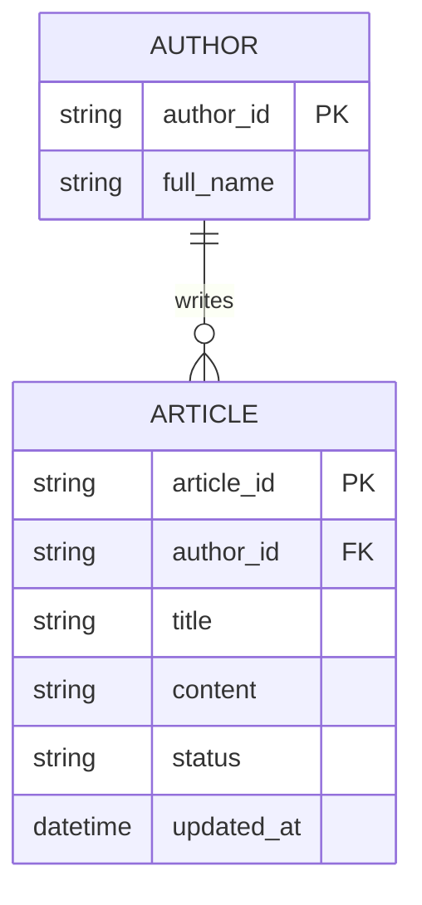
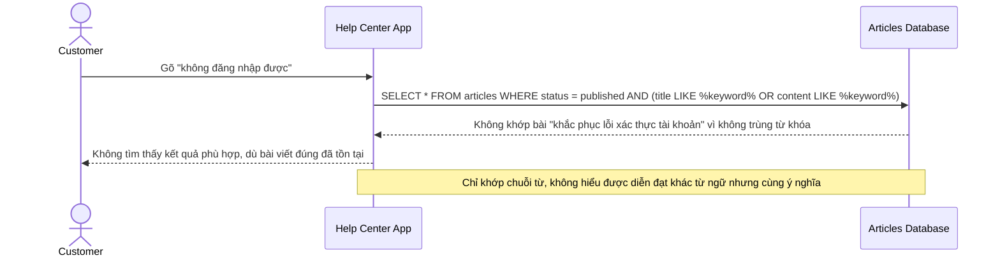
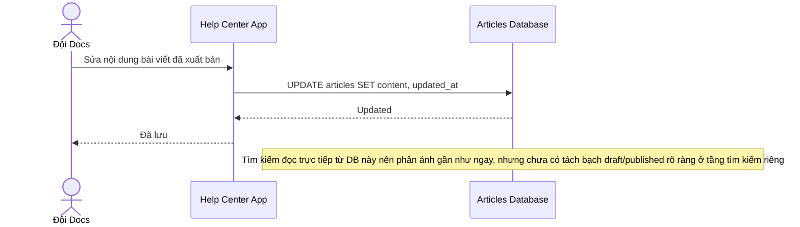
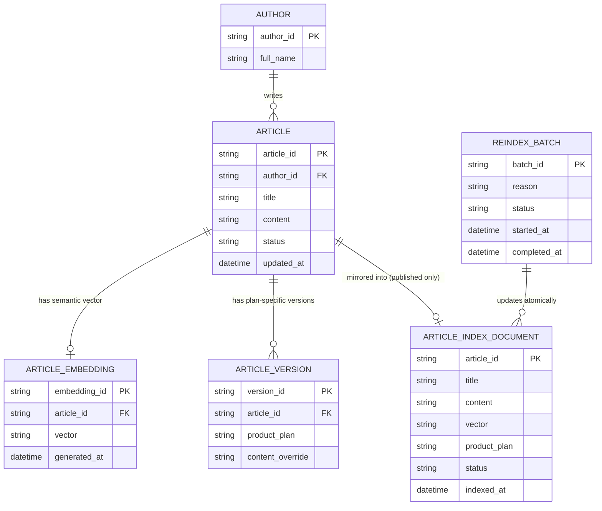
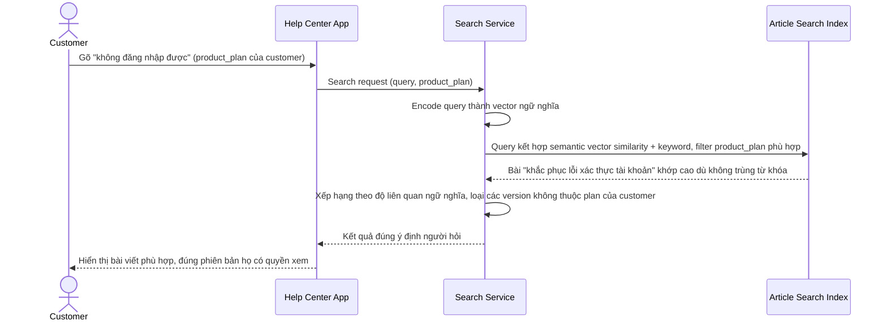
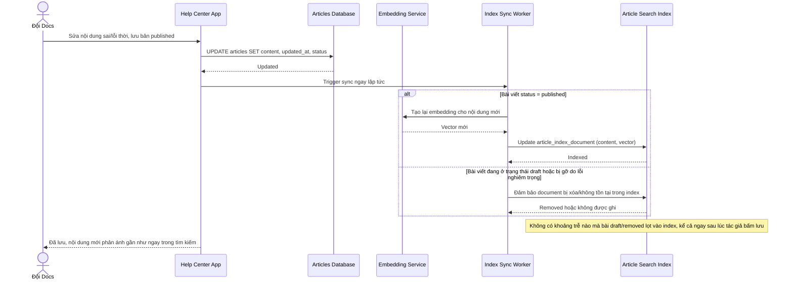
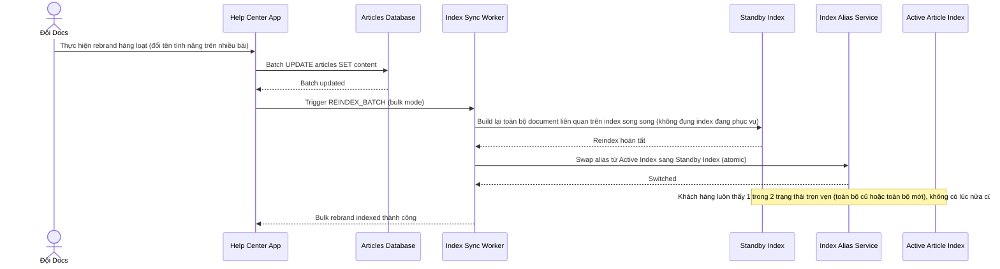

# SaaS help center tìm kiếm ngữ nghĩa tài liệu trợ giúp

**Hệ thống:** Một SaaS có help center/tài liệu kỹ thuật cho khách hàng tự tra cứu, nội dung được đội support/docs chỉnh sửa thường xuyên.

**Vai trò của flow:** Lập chỉ mục nội dung bài viết trợ giúp, phục vụ tìm kiếm xếp hạng theo mức độ liên quan ngữ nghĩa (không chỉ khớp từ khóa) và đảm bảo cập nhật ngay khi nội dung được sửa để tránh hiển thị thông tin lỗi thời.

**Yêu cầu cụ thể:**
- Kết quả tìm kiếm phải xếp hạng được các bài viết diễn đạt khác từ ngữ nhưng cùng ý nghĩa với câu hỏi người dùng gõ (ví dụ hỏi "không đăng nhập được" phải tìm ra bài viết tiêu đề "khắc phục lỗi xác thực tài khoản"), đòi hỏi cơ chế đánh giá liên quan vượt ra ngoài khớp từ khóa thuần túy, đồng thời không được làm chậm đáng kể thời gian trả kết quả so với tìm kiếm từ khóa thông thường.
- Khi một bài viết được đội docs chỉnh sửa để sửa thông tin sai/lỗi thời, index phải phản ánh nội dung mới gần như ngay lập tức — độ trễ cập nhật kéo dài có thể khiến khách hàng tra cứu ra hướng dẫn đã biết là sai, gây thêm ticket support thay vì giảm.
- Bài viết ở trạng thái nháp/chưa xuất bản hoặc đã bị gỡ do lỗi nghiêm trọng phải không xuất hiện trong kết quả tìm kiếm, kể cả trong khoảng thời gian ngắn giữa lúc tác giả bấm lưu nháp và lúc job index xử lý xong, tránh rò rỉ nội dung chưa hoàn chỉnh/sai ra khách hàng.
- Khi nhiều phiên bản của cùng một bài viết tồn tại cho các gói/phiên bản sản phẩm khác nhau, kết quả tìm kiếm phải trả đúng phiên bản phù hợp với ngữ cảnh khách hàng đang xem, tránh gợi ý bài hướng dẫn cho tính năng khách hàng không có quyền sử dụng.
- Việc đội docs sửa hàng loạt bài viết cùng lúc (ví dụ đổi tên tính năng, rebrand) phải được xử lý qua pipeline index mà không tạo ra khoảng thời gian index ở trạng thái nửa cũ nửa mới hiển thị lẫn lộn cho các khách hàng khác nhau tìm kiếm cùng lúc.

---

# ERD — Base (trước khi có tìm kiếm ngữ nghĩa)

Đây là **base**: mô hình dữ liệu suy luận cho help center *trước khi* có tìm kiếm ngữ nghĩa. Đề bài giả định đã có `ARTICLE` do đội support/docs chỉnh sửa, có trạng thái nháp/xuất bản, và tìm kiếm hiện tại chỉ khớp từ khóa thuần túy trên tiêu đề/nội dung — nếu không có sẵn các bài viết và cơ chế publish này thì yêu cầu "xếp hạng theo ngữ nghĩa" sẽ không có nghĩa.

---

# Sequence Diagram — Base: Search Articles

Đây là **base**, flow "tìm bài viết trợ giúp" bằng khớp từ khóa thuần túy — tiền đề cho thấy hạn chế: khách hỏi "không đăng nhập được" sẽ không tìm ra bài "khắc phục lỗi xác thực tài khoản" vì không có từ nào trùng khớp.

---

# Sequence Diagram — Base: Publish Article

Đây là **base**, flow "đội docs chỉnh sửa/xuất bản bài viết" — tiền đề cho enhance: mọi thay đổi nội dung diễn ra trên `ARTICLE`, và cần có index riêng đồng bộ gần như ngay lập tức từ đây để tránh hiển thị nội dung lỗi thời hoặc bài nháp.

---

# ERD — Enhance (sau khi có tìm kiếm ngữ nghĩa)

Đây là **enhance**: thêm `ARTICLE_EMBEDDING` (vector ngữ nghĩa) và `ARTICLE_INDEX_DOCUMENT` (index tìm kiếm riêng, tách khỏi DB nguồn) để trả kết quả nhanh mà vẫn xếp hạng theo ngữ nghĩa, `ARTICLE_VERSION` cho các phiên bản theo gói/sản phẩm khác nhau, và `REINDEX_BATCH` cho sửa hàng loạt. So với base, tìm kiếm không còn query trực tiếp DB mà qua `ARTICLE_INDEX_DOCUMENT`, và trạng thái draft/removed được lọc cứng ngay ở tầng ghi index chứ không chỉ ở tầng query.

---

# Sequence Diagram — Enhance: Search Articles

Đây là **enhance**, flow "tìm bài viết" đã tồn tại ở base ([2-base-search-articles-sqd.md](#2-base-search-articles-sqd)) nay thay đổi cốt lõi: query qua embedding để xếp hạng theo ngữ nghĩa thay vì chỉ khớp từ khóa, đồng thời lọc đúng phiên bản theo gói sản phẩm khách hàng đang dùng, mà không làm chậm đáng kể thời gian trả kết quả.

---

# Sequence Diagram — Enhance: Publish Article

Đây là **enhance**, flow "chỉnh sửa/xuất bản bài viết" đã tồn tại ở base ([3-base-publish-article-sqd.md](#3-base-publish-article-sqd)) nay thay đổi: mỗi thay đổi phát sinh cập nhật `ARTICLE_INDEX_DOCUMENT` gần như ngay lập tức, và bài nháp/bị gỡ do lỗi nghiêm trọng không bao giờ lọt vào index kể cả trong khoảng thời gian ngắn xử lý.

---

# Sequence Diagram — Enhance: Bulk Rebrand Articles

Đây là **enhance**, flow hoàn toàn mới: khi đội docs sửa hàng loạt bài viết cùng lúc (đổi tên tính năng, rebrand), pipeline index phải cập nhật atomic, không để khoảng thời gian index ở trạng thái nửa cũ nửa mới hiển thị lẫn lộn cho các khách hàng khác nhau.

