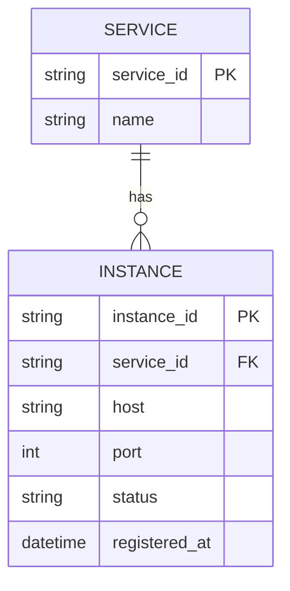
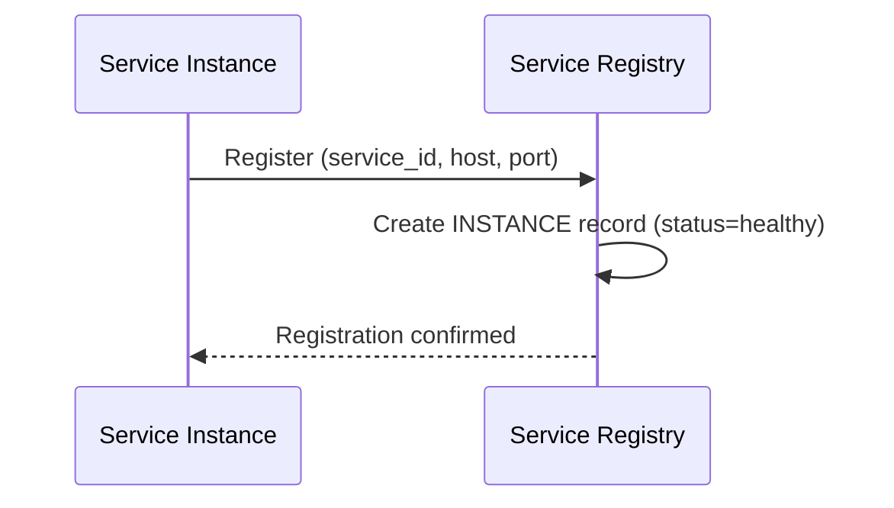
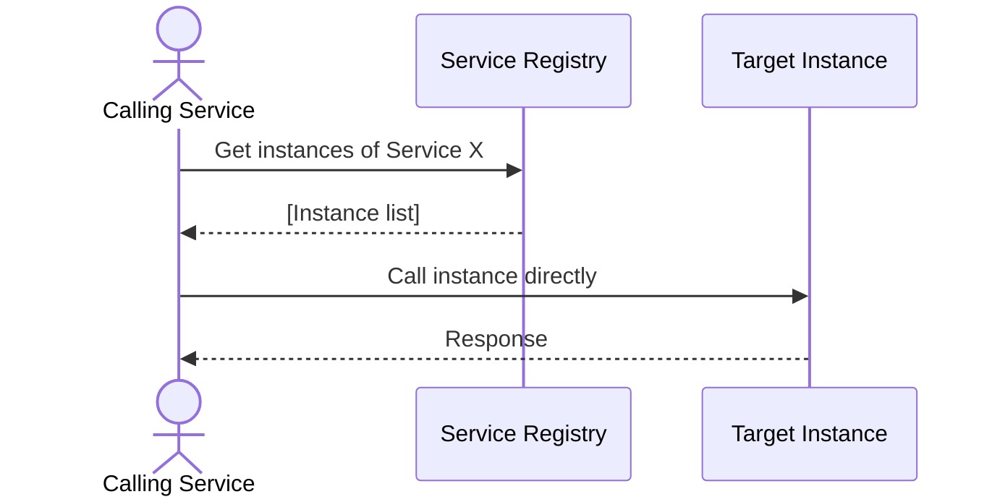
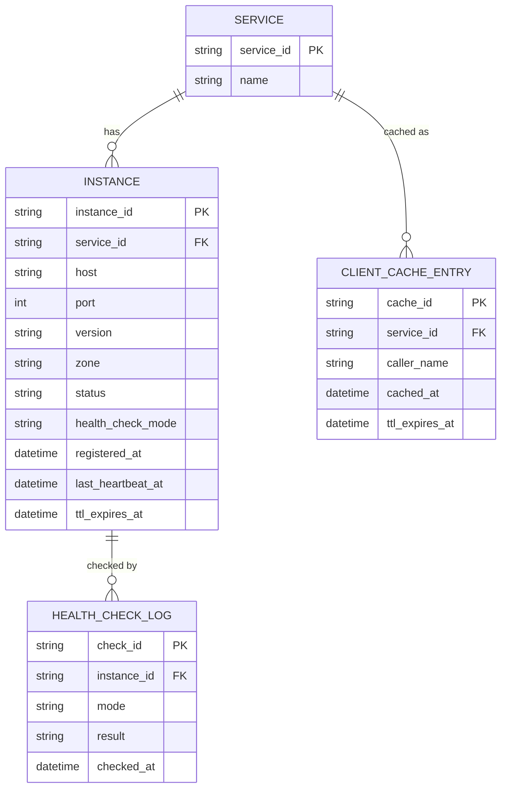
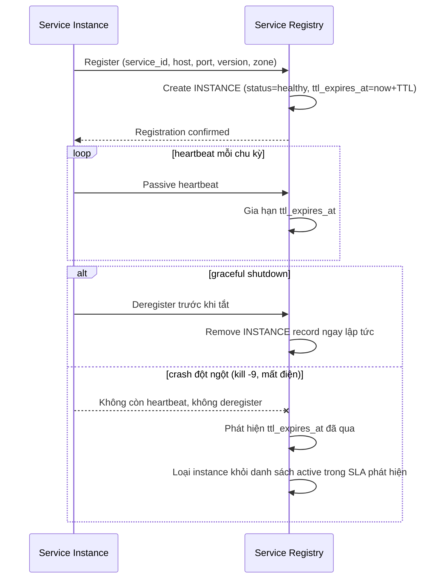
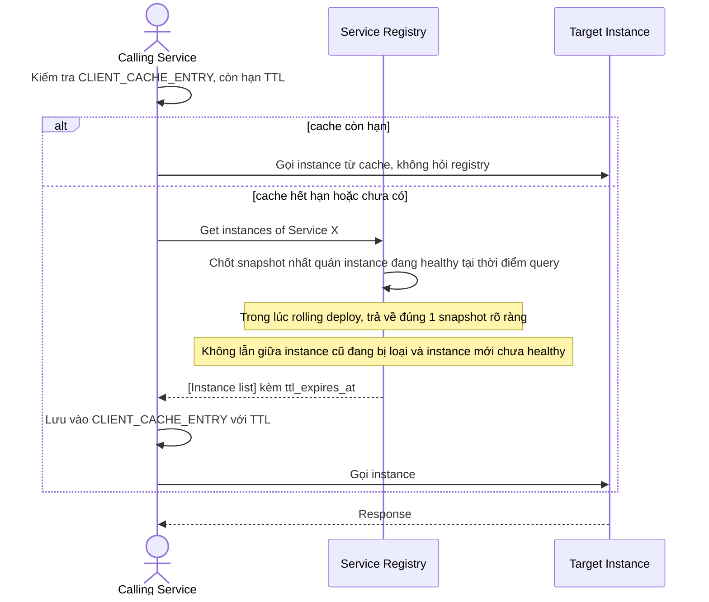

# Service registry cho nền tảng SaaS microservices

**Hệ thống:** Một nền tảng SaaS gồm khoảng 10 microservice (auth, billing, notification, ...) giao tiếp qua HTTP nội bộ, cần một registry trung tâm để các service tìm nhau.

**Vai trò của flow:** Mỗi service tự đăng ký khi khởi động và bị loại khỏi registry khi không còn healthy, để các service khác luôn gọi tới đúng instance đang sống.

**Yêu cầu cụ thể:**
- Mỗi instance khi start phải tự đăng ký vào registry kèm địa chỉ, port, version, và metadata (ví dụ zone/datacenter); khi nhận được shutdown signal phải tự deregister trước khi tắt.
- Registry phải phân biệt được health check "active" (registry tự ping endpoint `/health` định kỳ) và "passive" (instance tự gửi heartbeat) — chọn một chiến lược và giải thích trade-off, xử lý được trường hợp instance vẫn sống nhưng mạng tới registry bị nghẽn tạm thời (không được xóa nhầm).
- Nếu một instance crash mà không kịp deregister (kill -9, mất điện), registry phải tự phát hiện qua TTL/heartbeat timeout và loại nó ra trong một khoảng thời gian xác định (SLA phát hiện, ví dụ dưới 30 giây).
- Client (service gọi) phải cache danh sách instance để giảm tải cho registry, nhưng vẫn phải cập nhật kịp thời khi có thay đổi — định nghĩa rõ TTL cache và cơ chế invalidate.
- Xử lý race condition: hai instance cùng đăng ký gần như đồng thời với cùng service name nhưng version khác nhau trong lúc đang rolling deploy — client gọi phải nhận được danh sách nhất quán, không bị lẫn instance cũ/mới theo cách gây lỗi.

---

# ERD — Base (trước khi có registry với health check/cache/TTL đầy đủ)

Đây là **base**: mô hình dữ liệu suy luận cho nền tảng SaaS *trước khi* có các yêu cầu nâng cao về registry. Đề bài giả định đã có một registry trung tâm đơn giản và các service tự đăng ký/gọi lẫn nhau — nếu chưa có SERVICE/INSTANCE thì các yêu cầu về active/passive health check, TTL, cache phía client sẽ không có nghĩa. ERD base chưa có version, cache hay TTL.

---

# Sequence Diagram — Base: Register Instance

Đây là **base**, flow một instance tự đăng ký khi khởi động — tiền đề bắt buộc để sau này bổ sung metadata version/zone, cơ chế deregister khi shutdown, và phát hiện crash qua TTL.

---

# Sequence Diagram — Base: Discover Instance

Đây là **base**, flow một service khác gọi thẳng tới registry mỗi lần cần biết danh sách instance — chưa có cache, chưa có cơ chế TTL/invalidate, đây chính là điểm sẽ thay đổi ở enhance.

---

# ERD — Enhance (sau khi có health check/cache/TTL đầy đủ)

Đây là **enhance**: ERD base cộng với các entity phục vụ đúng yêu cầu đề bài — metadata version/zone khi đăng ký, active/passive health check log, TTL/heartbeat để phát hiện crash, và cache phía client với TTL/invalidate. So với base, `INSTANCE` nay có `version`, `zone`, `health_check_mode` và `ttl_expires_at` để registry tự loại instance chết mà không cần chờ deregister.

---

# Sequence Diagram — Enhance: Register Instance

Đây là **enhance**, flow đăng ký thay đổi so với base: instance nay gửi kèm version/zone, tự deregister khi nhận shutdown signal, và nếu crash không kịp deregister thì registry tự phát hiện qua TTL/heartbeat timeout trong SLA xác định (ví dụ dưới 30 giây) thay vì instance chết luôn nằm trong registry.

---

# Sequence Diagram — Enhance: Discover Instance

Đây là **enhance**, flow discover thay đổi so với base: caller nay dùng `CLIENT_CACHE_ENTRY` với TTL để giảm tải registry thay vì gọi trực tiếp mỗi lần, đồng thời trong lúc rolling deploy hai version cùng đăng ký gần như đồng thời thì caller vẫn phải nhận danh sách nhất quán, không bị lẫn instance cũ/mới gây lỗi.

