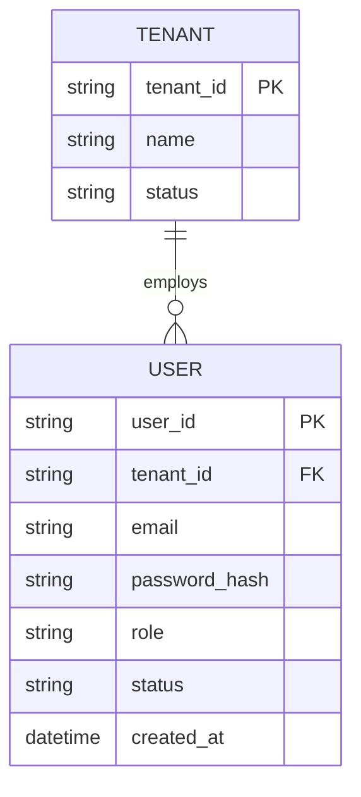
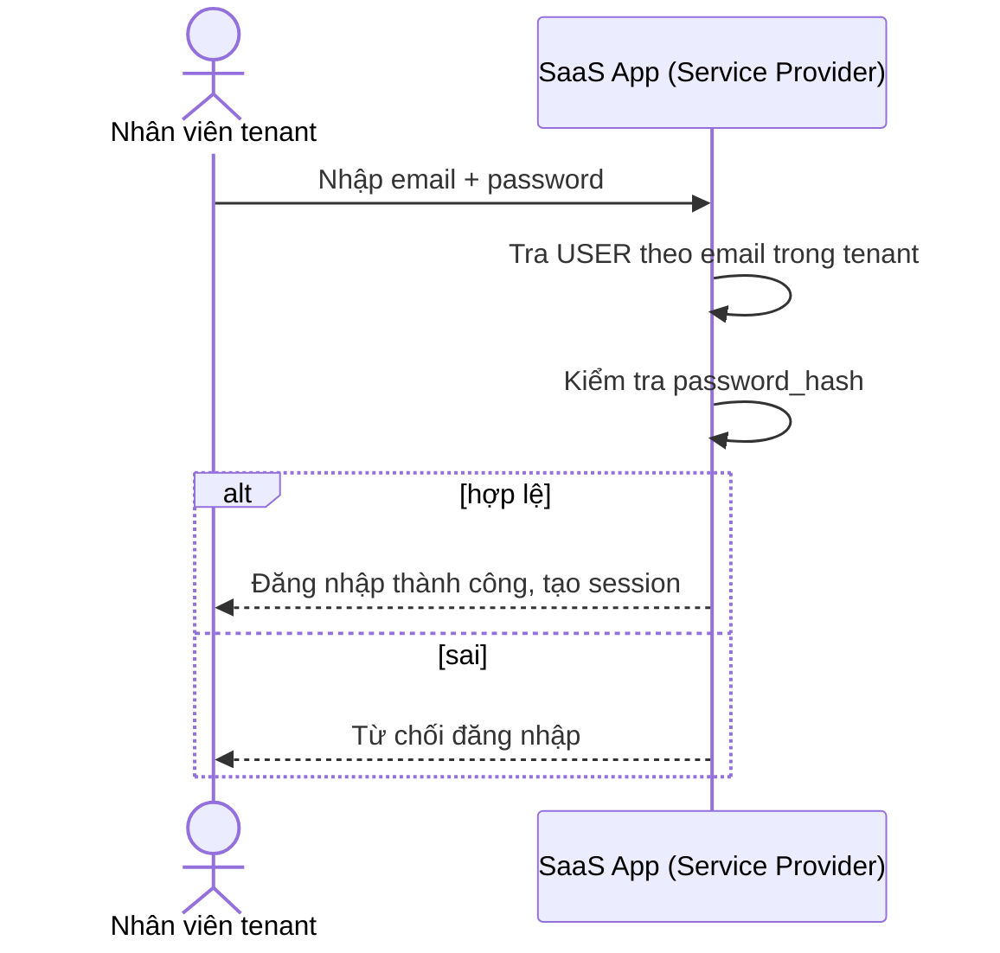
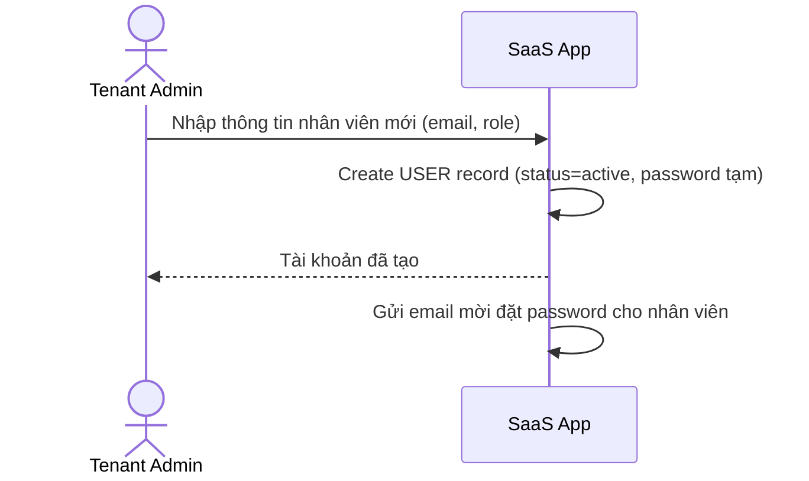
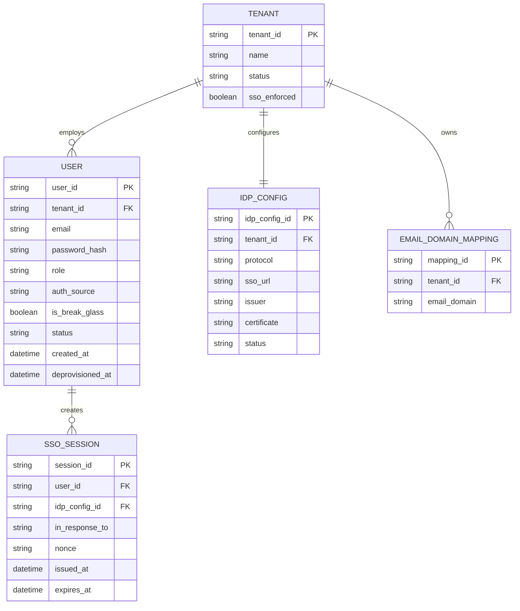
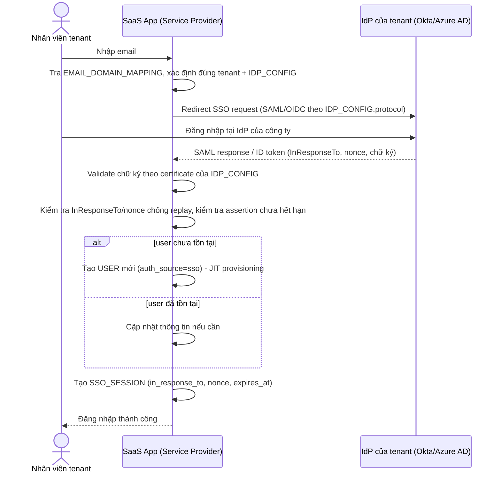
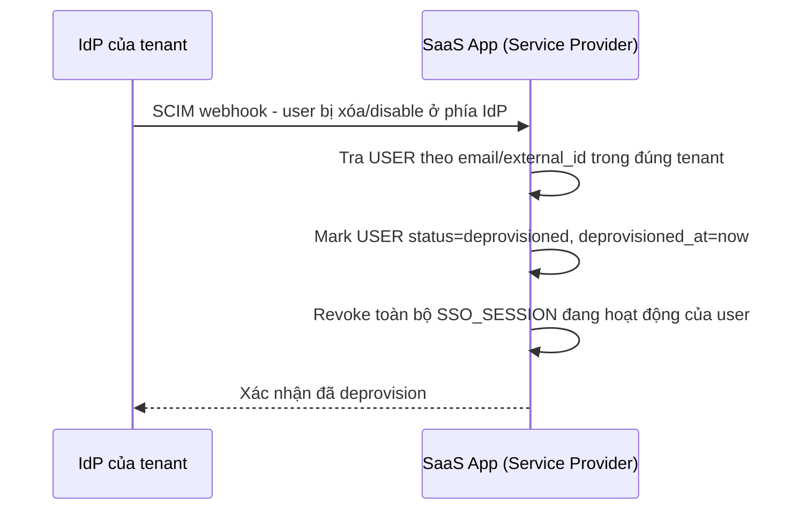
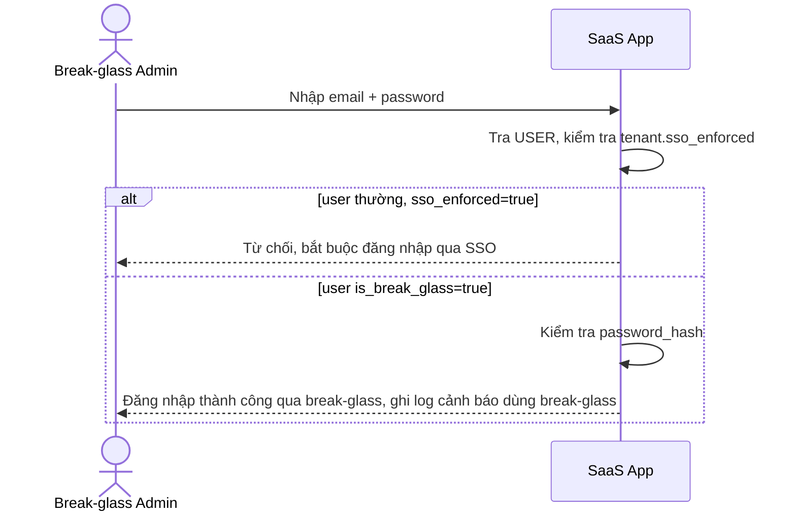

# B2B SaaS đa khách hàng tích hợp Okta/Azure AD của từng công ty

**Hệ thống:** Một SaaS quản lý dự án bán cho nhiều công ty khách hàng (multi-tenant), mỗi công ty có hệ thống IdP riêng (Okta, Azure AD, Google Workspace).

**Vai trò của flow:** App đóng vai trò Service Provider, cho phép mỗi tenant tự cấu hình SSO (SAML hoặc OIDC) với IdP của chính họ để nhân viên đăng nhập bằng tài khoản công ty.

**Yêu cầu cụ thể:**
- Mỗi tenant tự nhập metadata IdP (SSO URL, certificate/issuer) qua trang admin riêng, không hard-code cho một provider cụ thể — phải trừu tượng hóa được cả SAML và OIDC sau một interface chung.
- Xác định đúng tenant nào cần redirect tới IdP nào khi user chỉ nhập email (email domain discovery), tránh gửi user tới IdP sai công ty.
- Validate chữ ký SAML response / ID token đúng chuẩn (không tin tưởng field chưa verify), chống replay bằng kiểm tra `InResponseTo`/nonce và thời gian hết hạn của assertion.
- Xử lý case một công ty bắt buộc SSO (disable đăng nhập bằng password) nhưng vẫn cần tài khoản "break-glass" cho admin trong trường hợp IdP sập.
- Tự động provision user mới lần đầu đăng nhập qua SSO (JIT provisioning) và deprovision/khóa account khi IdP báo user bị xóa (SCIM hoặc webhook), không để tài khoản "mồ côi" còn quyền truy cập.

---

# ERD — Base (trước khi có SSO qua IdP của từng tenant)

Đây là **base**: mô hình dữ liệu suy luận cho SaaS quản lý dự án multi-tenant *trước khi* có yêu cầu tích hợp SSO. Đề bài giả định hệ thống đã có sẵn khái niệm tenant và user đăng nhập bằng email/password do admin tenant tự tạo — nếu chưa có TENANT/USER thì việc "mỗi tenant tự cấu hình SSO với IdP riêng" sẽ không có nghĩa. ERD base chưa có khái niệm IdP, JIT provisioning hay SCIM.

---

# Sequence Diagram — Base: Password Login

Đây là **base**, flow đăng nhập bằng email/password hiện tại của mỗi tenant — tiền đề bắt buộc vì SSO sẽ thay thế phần lớn flow này cho user thường, chỉ còn giữ lại cho tài khoản break-glass ở enhance.

---

# Sequence Diagram — Base: Admin Creates User Manually

Đây là **base**, flow admin tenant tự tạo tài khoản nhân viên thủ công — tiền đề để so sánh với JIT provisioning ở enhance, nơi tài khoản được tự động tạo ngay lần đầu đăng nhập SSO thay vì admin phải tạo tay từng người.

---

# ERD — Enhance (sau khi có SSO qua IdP của từng tenant)

Đây là **enhance**: ERD base cộng với các entity phục vụ đúng yêu cầu đề bài — cấu hình IdP trừu tượng hóa SAML/OIDC cho từng tenant, ánh xạ email domain sang tenant, phiên SSO chống replay, cờ break-glass, và JIT/SCIM provisioning. So với base, `USER` nay có `auth_source` và `is_break_glass`, còn việc tạo user không chỉ do admin tạo tay mà còn tự động qua SSO lần đầu.

---

# Sequence Diagram — Enhance: SSO Login JIT Provisioning

Đây là **enhance**, flow hoàn toàn mới thay thế phần lớn base: user chỉ nhập email, hệ thống tra `EMAIL_DOMAIN_MAPPING` để biết redirect tới IdP nào, validate chữ ký/chống replay, rồi tự động tạo `USER` ngay lần đầu đăng nhập (JIT) thay vì admin phải tạo tay như flow "admin-creates-user-manually" ở base.

---

# Sequence Diagram — Enhance: SCIM Deprovision User

Đây là **enhance**, flow hoàn toàn mới xử lý khi IdP báo user bị xóa — hệ thống phải khóa/deprovision tài khoản tương ứng qua SCIM hoặc webhook, tránh tài khoản "mồ côi" còn quyền truy cập sau khi đã bị xóa ở phía IdP.

---

# Sequence Diagram — Enhance: Break-Glass Login

Đây là **enhance**, biến thể của flow "password-login" ở base nhưng nay bị giới hạn chỉ cho tài khoản `is_break_glass=true` sử dụng khi tenant đã bật `sso_enforced` — mọi user thường khác bị chặn đăng nhập bằng password và buộc phải qua SSO, phòng trường hợp IdP của tenant sập hoàn toàn.

