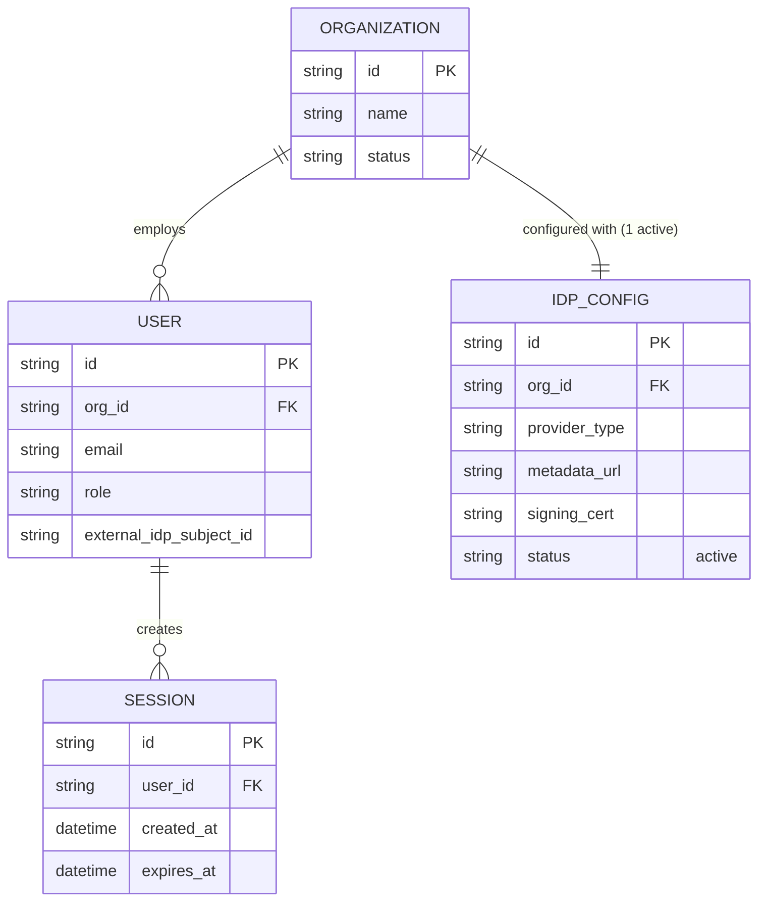
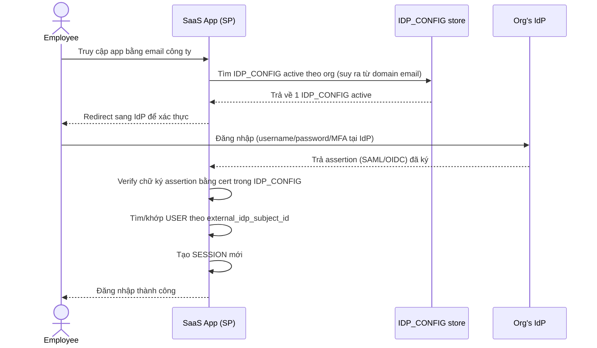
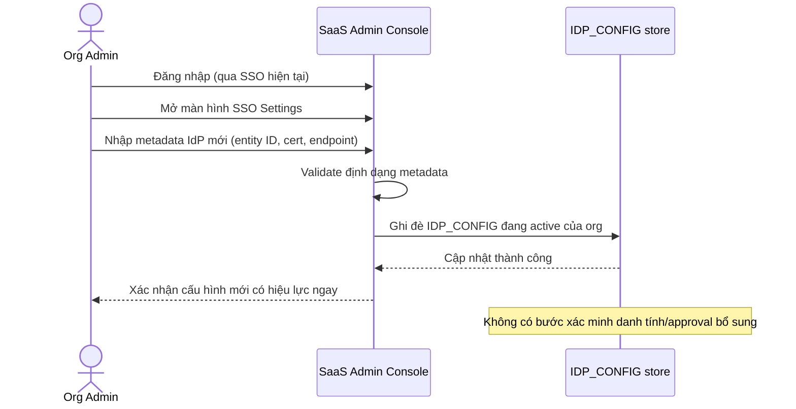
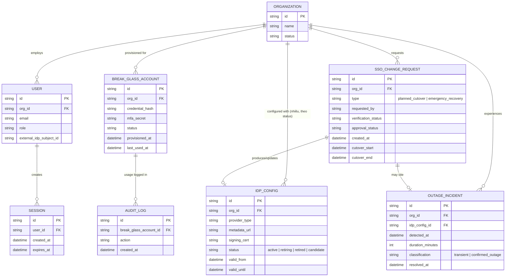
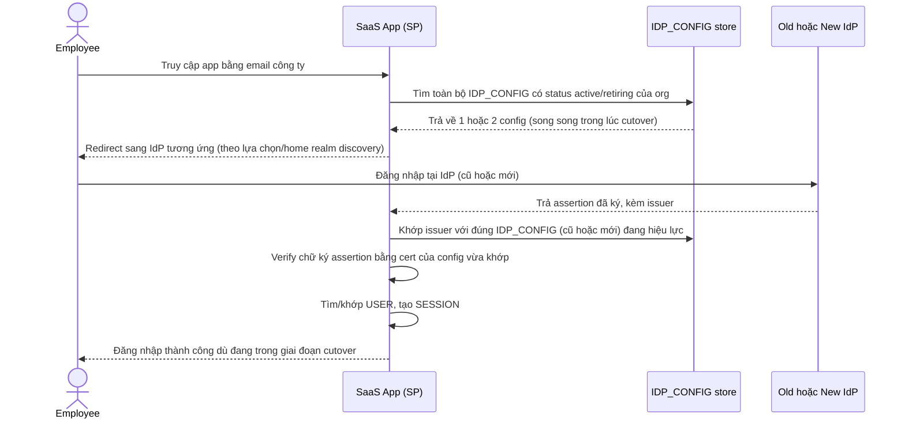
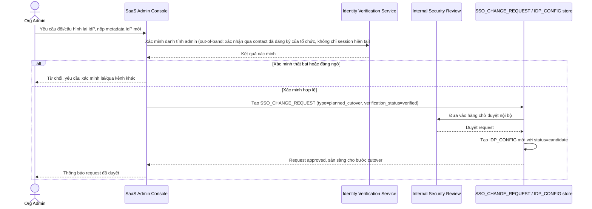
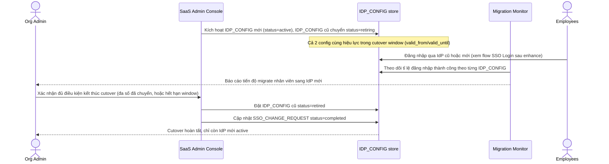
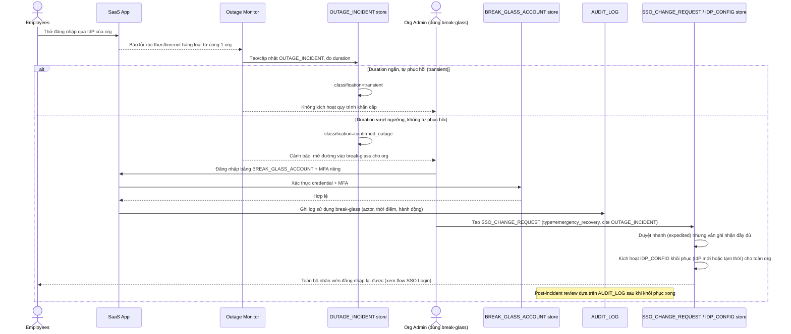

# SaaS B2B khôi phục quyền truy cập khi công ty khách hàng đổi hoặc mất Identity Provider

**Hệ thống:** Một SaaS doanh nghiệp mà phần lớn tài khoản đăng nhập qua SSO của công ty khách hàng (Okta/Azure AD...), không có mật khẩu riêng trên nền tảng.

**Vai trò của flow:** Xử lý tình huống công ty khách hàng đổi nhà cung cấp IdP, mất quyền quản trị IdP cũ, hoặc IdP cũ ngừng hoạt động — khiến toàn bộ nhân viên công ty đó không thể đăng nhập qua SSO như bình thường, cần một quy trình khôi phục quyền truy cập không phụ thuộc vào chính IdP đã hỏng.

**Yêu cầu cụ thể:**
- Vì tài khoản SSO-only không có mật khẩu, khi IdP của cả một tổ chức khách hàng ngừng hoạt động, toàn bộ nhân viên công ty đó bị khóa cùng lúc — cần một cơ chế khôi phục cấp tổ chức, không phải xử lý từng user riêng lẻ, để tránh hàng trăm ticket hỗ trợ cùng lúc và tránh gián đoạn nghiệp vụ kéo dài.
- Việc xác minh ai có quyền yêu cầu chuyển đổi hoặc cấu hình lại SSO cho một tổ chức phải chặt chẽ, để tránh kẻ tấn công giả danh admin công ty khách hàng nhằm chiếm quyền truy cập toàn bộ dữ liệu tổ chức đó thông qua việc trỏ SSO sang một IdP do chúng kiểm soát.
- Cần thiết lập sẵn từ trước một tài khoản break-glass cấp tổ chức cho ít nhất một admin của mỗi tổ chức khách hàng lớn, không phải tạo mới lúc khẩn cấp, để có đường vào dự phòng khi SSO chính hỏng hoàn toàn, kèm quy trình giám sát chặt việc sử dụng tài khoản này.
- Khi công ty khách hàng chủ động đổi IdP theo kế hoạch (không phải sự cố), quy trình cutover phải cho phép chạy song song cả IdP cũ và mới trong một khoảng thời gian chuyển tiếp, để tránh có khoảnh khắc không IdP nào hoạt động khiến toàn bộ nhân viên bị khóa giữa chừng.
- Phải phân biệt rõ giữa lỗi tạm thời của IdP (downtime ngắn, sự cố mạng) và việc tổ chức thực sự cần chuyển IdP, tránh kích hoạt quy trình khôi phục khẩn cấp cấp tổ chức — vốn có rủi ro bảo mật cao hơn — chỉ vì một sự cố ngắn hạn có thể tự phục hồi.

---

# Base ERD — SSO-only B2B SaaS trước khi có cơ chế khôi phục

Đây là **base**: mô hình dữ liệu suy luận từ ngữ cảnh đề bài, thể hiện trạng thái hệ thống **trước khi** có yêu cầu khôi phục quyền truy cập cấp tổ chức. Đề bài nói tài khoản "SSO-only, không có mật khẩu riêng" và mỗi công ty khách hàng dùng 1 IdP để đăng nhập — nên base chỉ cần đủ 4 entity nền tảng để việc "IdP hỏng → cả tổ chức bị khóa" có ý nghĩa: tổ chức, cấu hình IdP (đúng 1 cấu hình đang active mỗi tổ chức), user thuộc tổ chức, và session đăng nhập. Chưa có bất kỳ entity nào phục vụ khôi phục/break-glass/cutover — những thứ đó là phần enhance.

---

# Base sequence — SSO Login

Đây là **base**, flow "Đăng nhập qua SSO" — tiền đề trực tiếp cho enhance: chính vì mọi nhân viên chỉ đăng nhập được qua **đúng 1** IdP đang active của tổ chức, nên khi IdP đó hỏng, toàn bộ tổ chức bị khóa cùng lúc (vấn đề gốc mà đề bài yêu cầu giải quyết).

---

# Base sequence — Configure IdP

Đây là **base**, flow "Admin cấu hình lại IdP cho tổ chức" ở trạng thái hiện tại — chưa có xác minh chặt chẽ. Flow này liên quan mật thiết tới enhance vì yêu cầu thứ 2 của đề bài ("việc xác minh ai có quyền yêu cầu chuyển đổi/cấu hình lại SSO phải chặt chẽ") chính là siết lại flow này để tránh kẻ tấn công giả danh admin trỏ SSO sang IdP do chúng kiểm soát.

---

# Enhance ERD — sau khi có cơ chế khôi phục cấp tổ chức

Đây là ERD **sau khi** enhance được áp dụng lên base. So với base, có 4 thay đổi chính, ứng trực tiếp với 5 yêu cầu trong đề bài:

- `IDP_CONFIG` chuyển từ 1-1 (1 active/org) sang 1-N, thêm `status` (active/retiring/retired/candidate) và khoảng hiệu lực — để hỗ trợ chạy song song 2 IdP trong lúc cutover có kế hoạch.
- `BREAK_GLASS_ACCOUNT` (mới) — tài khoản cấp tổ chức được thiết lập sẵn từ trước, không tạo lúc khẩn cấp, có MFA riêng và theo dõi lần dùng gần nhất.
- `SSO_CHANGE_REQUEST` (mới) — mọi yêu cầu đổi/cấu hình lại IdP (dù chủ động hay khẩn cấp) đều phải đi qua 1 request có xác minh + trạng thái duyệt, thay vì ghi đè trực tiếp như base.
- `OUTAGE_INCIDENT` (mới) — ghi nhận và phân loại sự cố IdP (tạm thời hay thực sự cần chuyển) trước khi cho phép mở `SSO_CHANGE_REQUEST` loại khẩn cấp.
- `AUDIT_LOG` (mới) — giám sát chặt việc sử dụng break-glass account.

---

# Enhance sequence — SSO Login

Đây là **enhance**, cùng flow "SSO Login" đã có ở base nhưng nay thay đổi để hỗ trợ yêu cầu "chạy song song IdP cũ và mới trong thời gian chuyển tiếp": app không còn giả định org chỉ có đúng 1 `IDP_CONFIG` active, mà phải khớp assertion trả về với đúng cấu hình (cũ hoặc mới) đang hiệu lực tại thời điểm đó — nhờ vậy không có khoảnh khắc nào cả tổ chức bị khóa giữa chừng khi cutover có kế hoạch.

---

# Enhance sequence — Configure IdP

Đây là **enhance**, cùng flow "Admin cấu hình lại IdP" đã có ở base nhưng nay thay đổi hoàn toàn theo yêu cầu thứ 2 của đề bài: không còn ghi đè trực tiếp `IDP_CONFIG`, mà phải qua `SSO_CHANGE_REQUEST` với xác minh danh tính chặt chẽ + duyệt nội bộ, để tránh kẻ tấn công giả danh admin trỏ SSO sang IdP do chúng kiểm soát.

---

# Enhance sequence — Planned IdP cutover

Đây là **enhance**, flow hoàn toàn mới, phát sinh từ enhance — chưa tồn tại ở base. Đáp ứng yêu cầu thứ 4 của đề bài: khi tổ chức chủ động đổi IdP theo kế hoạch, cho phép chạy song song IdP cũ và mới trong 1 khoảng thời gian chuyển tiếp, để không có khoảnh khắc nào cả tổ chức bị khóa. Flow này tiếp nối ngay sau khi `SSO_CHANGE_REQUEST` được duyệt ở flow "Configure IdP".

---

# Enhance sequence — Emergency org-wide recovery (break-glass)

Đây là **enhance**, flow hoàn toàn mới, phát sinh từ enhance — chưa tồn tại ở base. Đây là flow trung tâm của đề bài, gộp 3 yêu cầu còn lại: (1) khôi phục cấp tổ chức thay vì xử lý từng user khi IdP hỏng hoàn toàn, (2) dùng `BREAK_GLASS_ACCOUNT` đã thiết lập sẵn từ trước kèm giám sát chặt (`AUDIT_LOG`), và (3) phải phân biệt sự cố tạm thời với việc thực sự cần khôi phục khẩn cấp trước khi kích hoạt quy trình rủi ro cao này.

