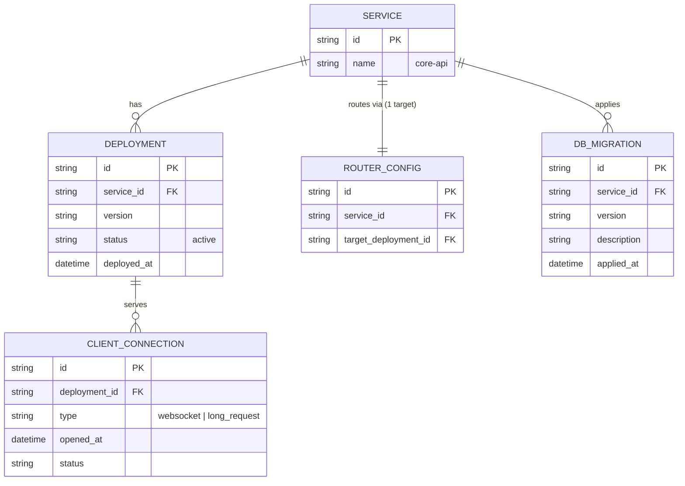
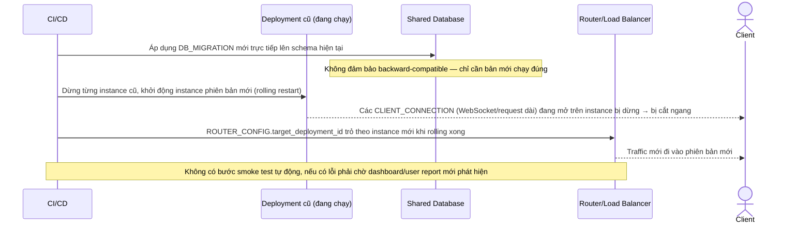
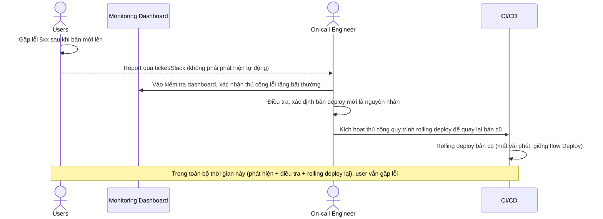
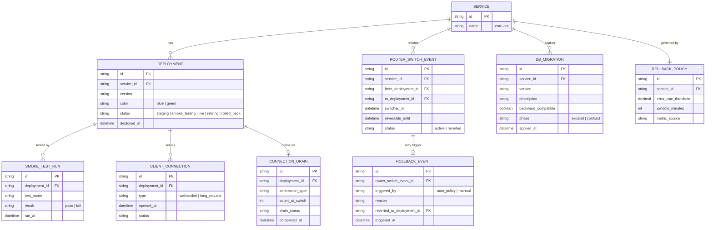
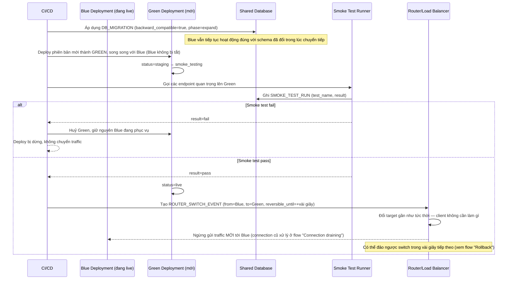
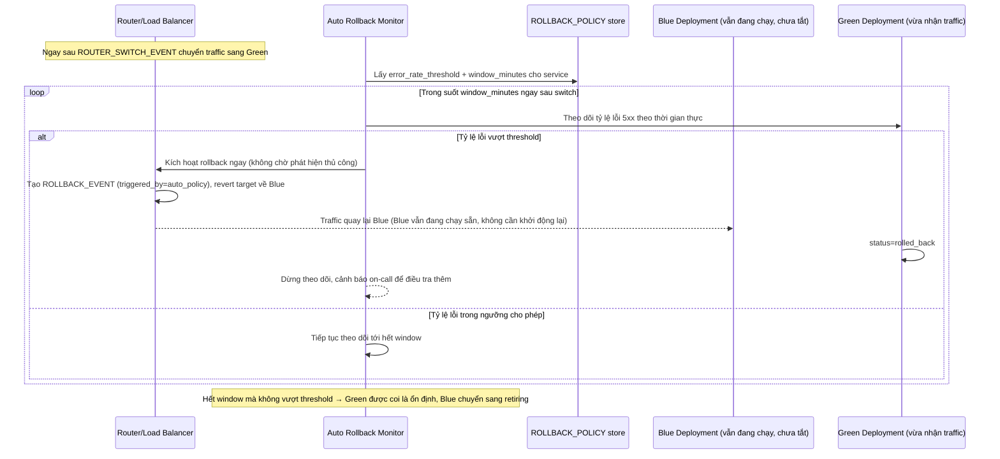
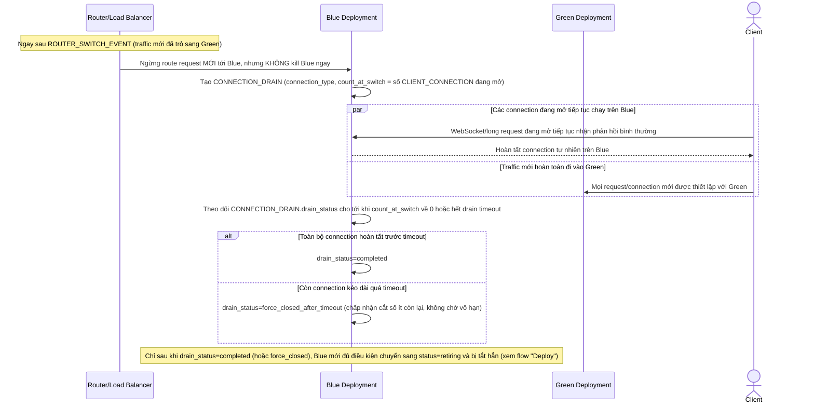

# Blue-green deployment cho service lõi của nền tảng SaaS multi-tenant

**Hệ thống:** Một nền tảng SaaS B2B phục vụ nhiều tenant (công ty khách hàng) dùng chung hạ tầng, service "core-api" được deploy nhiều lần mỗi tuần.

**Vai trò của flow:** Blue-green deployment cho phép chuyển toàn bộ traffic từ phiên bản cũ (blue) sang phiên bản mới (green) gần như ngay lập tức, và rollback tức thì nếu phát hiện sự cố sau khi chuyển.

**Yêu cầu cụ thể:**
- Trước khi chuyển traffic, phiên bản green phải được deploy đầy đủ song song với blue (không tắt blue), và trải qua bước smoke test tự động (gọi các endpoint quan trọng) xác nhận hoạt động đúng trước khi router bắt đầu chuyển traffic thật sang.
- Việc chuyển traffic từ blue sang green phải là một thao tác gần như tức thời ở tầng router/load balancer (đổi target), không yêu cầu client phải làm gì, và phải có khả năng đảo ngược (chuyển lại về blue) trong vài giây nếu phát hiện lỗi ngay sau khi chuyển.
- Xử lý đúng vấn đề tương thích dữ liệu khi có migration schema DB đi kèm bản deploy mới — phiên bản blue (cũ) vẫn đang chạy phải tiếp tục hoạt động đúng với schema đã thay đổi cho tới khi bị tắt hẳn (yêu cầu migration phải backward-compatible trong giai đoạn chuyển tiếp).
- Định nghĩa rõ tiêu chí tự động rollback (ví dụ tỷ lệ lỗi 5xx vượt ngưỡng X% trong Y phút đầu sau khi chuyển) và cơ chế giám sát phải chạy ngay sau khi chuyển traffic, không chờ phát hiện thủ công từ báo cáo người dùng.
- Đảm bảo các session/kết nối đang mở tại thời điểm chuyển đổi (ví dụ WebSocket, request dài) được xử lý đúng — không bị cắt ngang giữa lúc router đổi target, mà phải hoàn tất trên blue hoặc được chuyển tiếp một cách có kiểm soát.

---

# Base ERD — core-api trước khi có blue-green deployment

Đây là **base**: mô hình dữ liệu suy luận từ ngữ cảnh đề bài, thể hiện trạng thái hệ thống **trước khi** có blue-green deployment. Đề bài nói service "core-api" được deploy nhiều lần/tuần, có migration schema DB đi kèm, và có session/kết nối dài (WebSocket) đang mở — nên base cần đủ: service, deployment (chỉ 1 target đang chạy tại 1 thời điểm), router trỏ thẳng tới target đó, migration DB, và các connection đang mở trên deployment. Chưa có entity nào phục vụ smoke test/switch có thể đảo ngược/rollback policy tự động/connection draining — những thứ đó là phần enhance.

---

# Base sequence — Deploy (rolling, chưa có blue-green)

Đây là **base**, flow "Deploy phiên bản mới" ở trạng thái hiện tại — rolling deploy trực tiếp, không có bản song song để test trước. Flow này liên quan mật thiết tới enhance vì toàn bộ yêu cầu 1-3 của đề bài đều nhằm cải tổ lại đúng flow này.

---

# Base sequence — Rollback (thủ công, chưa có tiêu chí tự động)

Đây là **base**, flow "Xử lý khi bản deploy mới có lỗi" ở trạng thái hiện tại — hoàn toàn thủ công, phát hiện chậm. Flow này liên quan mật thiết tới enhance vì yêu cầu thứ 4 của đề bài chính là tự động hoá lại đúng flow này.

---

# Enhance ERD — sau khi có blue-green deployment

Đây là ERD **sau khi** enhance được áp dụng lên base. So với base, có 4 thay đổi chính, ứng trực tiếp với 5 yêu cầu trong đề bài:

- `DEPLOYMENT` thêm `color` (blue/green) và `status` mở rộng (staging/smoke_testing/live/retiring/rolled_back) — thay vì chỉ có đúng 1 deployment "active".
- `SMOKE_TEST_RUN` (mới) — bắt buộc pass trước khi router chuyển traffic thật.
- `ROUTER_SWITCH_EVENT` (mới) — thao tác chuyển traffic gần như tức thời và có thể đảo ngược (`reversible_until`), thay cho việc router chỉ đơn giản trỏ theo instance đang chạy như base.
- `DB_MIGRATION` thêm `backward_compatible` + `phase` (expand/contract) — đảm bảo blue vẫn chạy đúng trong giai đoạn chuyển tiếp.
- `ROLLBACK_POLICY` + `ROLLBACK_EVENT` (mới) — tiêu chí rollback tự động, không chờ phát hiện thủ công.
- `CONNECTION_DRAIN` (mới) — xử lý có kiểm soát các connection đang mở trên blue khi traffic đã chuyển sang green.

---

# Enhance sequence — Deploy (blue-green, smoke test, migration backward-compatible)

Đây là **enhance**, cùng flow "Deploy" đã có ở base nhưng nay thay đổi hoàn toàn theo yêu cầu 1-3 của đề bài: green được deploy song song (không tắt blue), migration phải backward-compatible để blue vẫn chạy đúng, smoke test bắt buộc pass trước khi router chuyển traffic thật, và việc chuyển traffic là thao tác tức thời ở router.

---

# Enhance sequence — Rollback (tự động, theo tiêu chí lỗi 5xx)

Đây là **enhance**, cùng flow "Rollback" đã có ở base nhưng nay thay đổi hoàn toàn theo yêu cầu thứ 4 của đề bài: có `ROLLBACK_POLICY` định nghĩa rõ tiêu chí (tỷ lệ lỗi 5xx vượt ngưỡng X% trong Y phút), và giám sát chạy tự động ngay sau khi router chuyển traffic — không chờ user report như base.

---

# Enhance sequence — Connection draining khi chuyển traffic

Đây là **enhance**, flow hoàn toàn mới, phát sinh từ enhance — chưa tồn tại ở base (ở base, connection bị cắt ngang thẳng khi instance cũ bị dừng). Đáp ứng yêu cầu thứ 5 của đề bài: session/kết nối đang mở (WebSocket, request dài) tại thời điểm chuyển đổi không bị cắt ngang, mà hoàn tất trên Blue hoặc được chuyển tiếp có kiểm soát.

