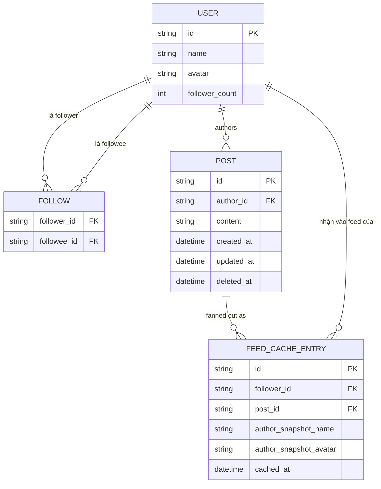
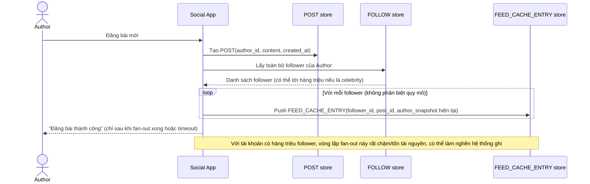
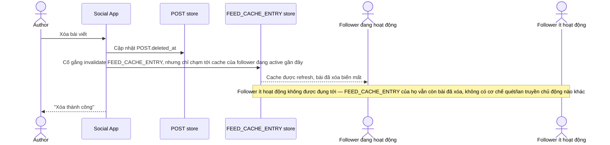
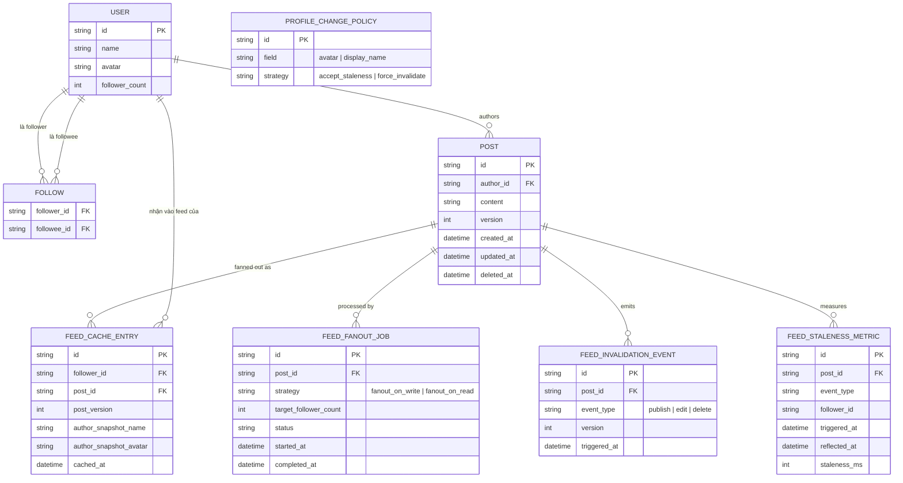
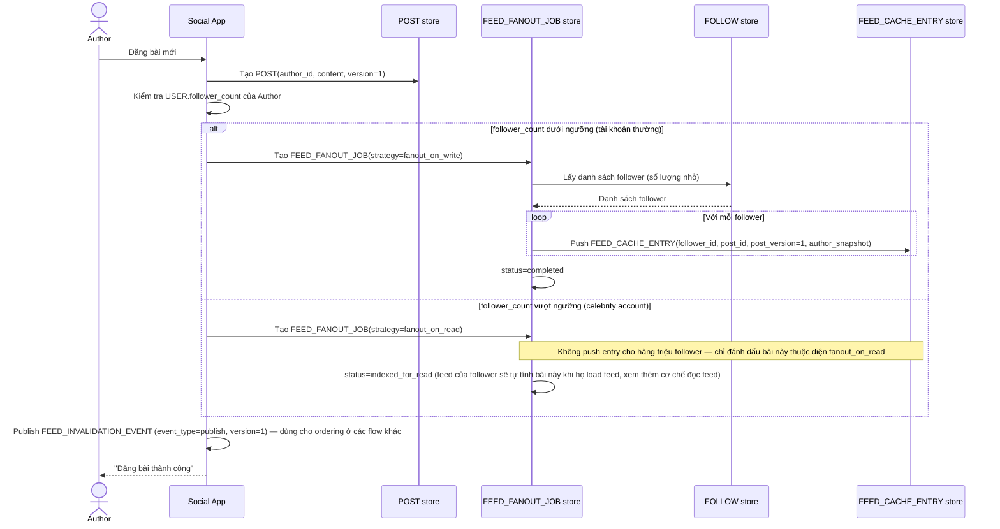
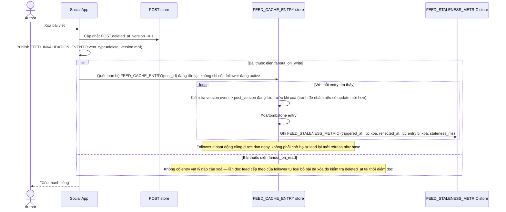
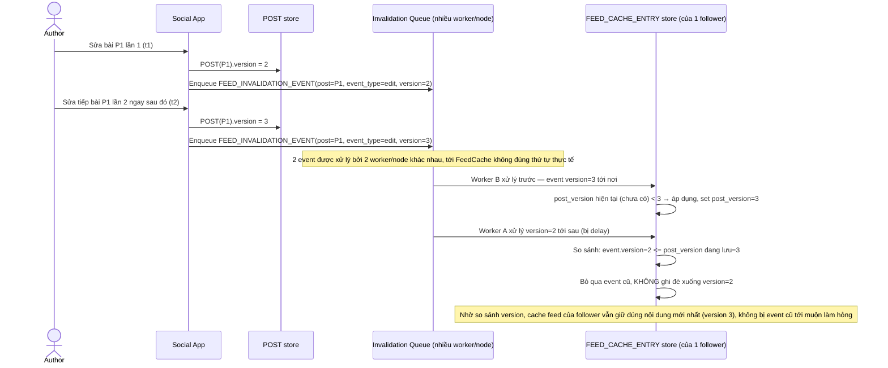
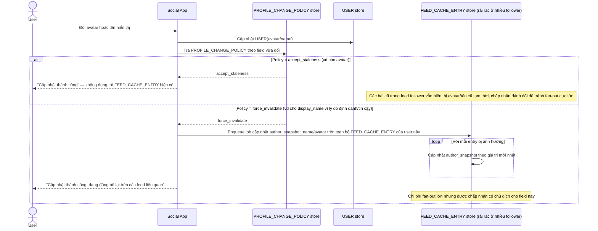

# Cache feed/trang cá nhân cho mạng xã hội

**Hệ thống:** Mạng xã hội cache feed trang chủ và trang cá nhân (profile) của user để giảm tải khi hiển thị bài viết, tránh phải chạy lại aggregation nặng mỗi lần load.

**Vai trò của flow:** Invalidate đúng cache khi user đăng bài mới, xóa bài, sửa bài, đổi thông tin profile — đặc biệt phải fan-out invalidate/refresh cho cache feed của tất cả follower đang xem nội dung của user đó.

**Yêu cầu cụ thể:**
- Khi user đăng bài mới, cache feed của chính họ (profile page) phải invalidate ngay, nhưng cache feed của hàng chục nghìn follower thì không thể invalidate đồng bộ tức thời — cần chiến lược phân biệt giữa fan-out-on-write (đẩy trước) cho user ít follower và fan-out-on-read (tính khi đọc) cho celebrity account có follower cực lớn, tránh nghẽn khi 1 bài đăng làm invalidate hàng triệu cache feed cùng lúc.
- Khi user xóa 1 bài viết, phải đảm bảo bài đó biến mất khỏi cache feed của follower trong thời gian hợp lý dù dùng fan-out-on-read hay pull — không được để bài đã xóa vẫn hiển thị dai dẳng do cache feed của follower ít khi active nên hiếm khi được refresh.
- Race condition: user vừa đăng bài mới vừa sửa bài cũ gần như đồng thời — invalidation event có thể tới cache theo thứ tự khác thứ tự thực tế (do khác hàng đợi/khác node xử lý), cần cơ chế đảm bảo thứ tự (version/timestamp) để cache feed không áp dụng nhầm invalidate cũ đè lên update mới.
- Khi user đổi avatar/tên hiển thị, các bài post cũ của họ đang nằm rải rác trong cache feed của follower khác vẫn hiển thị thông tin cũ (do cache feed thường lưu kèm snapshot info tác giả) — quyết định rõ có chấp nhận độ trễ hiển thị (denormalized data lệch tạm thời) hay bắt buộc phải invalidate toàn bộ cache liên quan, đánh đổi chi phí fan-out rất lớn.
- Đo lường: độ trễ trung bình và p99 từ lúc user đăng/xóa bài tới lúc feed của follower phản ánh đúng, và tỉ lệ follower vẫn thấy nội dung cũ quá X phút sau invalidation event, dùng để đánh giá hiệu quả chiến lược fan-out đang chọn.

---

# Base ERD — Cache feed trước khi có chiến lược fan-out phân biệt

Đây là **base**: mô hình dữ liệu suy luận từ ngữ cảnh đề bài, thể hiện trạng thái hệ thống **trước khi** có chiến lược fan-out phân biệt theo quy mô follower. Đề bài nói cache feed lưu kèm snapshot tác giả (denormalized) và được fan-out cho follower — nên base cần đủ: user (kèm follower_count), quan hệ follow, bài viết, và feed cache entry theo từng follower (fan-out-on-write áp dụng đồng loạt, không phân biệt quy mô). Chưa có entity nào phục vụ version/ordering, chiến lược fan-out kép, hay đo staleness — những thứ đó là phần enhance.

---

# Base sequence — Publish post (fan-out-on-write đồng loạt)

Đây là **base**, flow "Đăng bài mới" ở trạng thái hiện tại — fan-out-on-write cho toàn bộ follower, không phân biệt tài khoản có bao nhiêu follower. Flow này liên quan mật thiết tới enhance vì yêu cầu thứ 1 của đề bài chính là sửa đúng lỗ hổng "1 bài đăng làm invalidate hàng triệu cache feed cùng lúc" ở đây.

---

# Base sequence — Delete post (invalidate không đáng tin cậy)

Đây là **base**, flow "Xóa bài viết" ở trạng thái hiện tại — chỉ đụng tới cache của follower đang hoạt động, không chủ động lan tới toàn bộ. Flow này liên quan mật thiết tới enhance vì yêu cầu thứ 2 của đề bài chính là sửa đúng lỗ hổng "bài đã xóa vẫn hiển thị dai dẳng" ở đây.

---

# Enhance ERD — sau khi có chiến lược fan-out kép + ordering + đo lường

Đây là ERD **sau khi** enhance được áp dụng lên base. So với base, có 5 thay đổi chính, ứng trực tiếp với 5 yêu cầu trong đề bài:

- `POST` và `FEED_CACHE_ENTRY` thêm `version`/`post_version` — đảm bảo thứ tự, tránh invalidate cũ đè lên update mới.
- `FEED_FANOUT_JOB` (mới) — ghi rõ mỗi bài dùng chiến lược `fanout_on_write` (follower ít) hay `fanout_on_read` (celebrity), thay vì đồng loạt như base.
- `FEED_INVALIDATION_EVENT` (mới) — mang theo version, dùng để lan truyền publish/edit/delete có thứ tự.
- `PROFILE_CHANGE_POLICY` (mới) — quyết định rõ chấp nhận staleness hay force invalidate khi đổi avatar/tên hiển thị.
- `FEED_STALENESS_METRIC` (mới) — đo độ trễ trung bình/p99 và tỉ lệ follower còn thấy nội dung cũ.

---

# Enhance sequence — Publish post (fan-out-on-write vs fan-out-on-read)

Đây là **enhance**, cùng flow "Publish post" đã có ở base nhưng nay thay đổi theo yêu cầu thứ 1 của đề bài: phân biệt chiến lược theo follower_count thay vì fan-out đồng loạt cho tất cả.

---

# Enhance sequence — Delete post (tombstone chủ động + đo staleness)

Đây là **enhance**, cùng flow "Delete post" đã có ở base nhưng nay thay đổi theo yêu cầu 2 và 5 của đề bài: chủ động quét và xoá entry ở toàn bộ follower thuộc diện fanout_on_write (không chỉ follower đang hoạt động), và đo lại staleness thực tế cho từng follower.

---

# Enhance sequence — Concurrent publish/edit ordering

Đây là **enhance**, flow hoàn toàn mới, phát sinh từ enhance — chưa tồn tại ở base (base không có cơ chế ordering nào). Đáp ứng yêu cầu thứ 3 của đề bài: 2 invalidation event cho cùng 1 bài tới cache theo thứ tự khác thứ tự thực tế (do khác hàng đợi/khác node xử lý), phải dùng version để tránh event cũ đè nhầm lên update mới.

---

# Enhance sequence — Profile change propagation

Đây là **enhance**, flow hoàn toàn mới, phát sinh từ enhance — chưa tồn tại ở base (base không có quyết định rõ ràng nào cho trường hợp này). Đáp ứng yêu cầu thứ 4 của đề bài: khi đổi avatar/tên hiển thị, quyết định rõ chấp nhận staleness hay bắt buộc force invalidate toàn bộ snapshot cũ trong cache feed.

