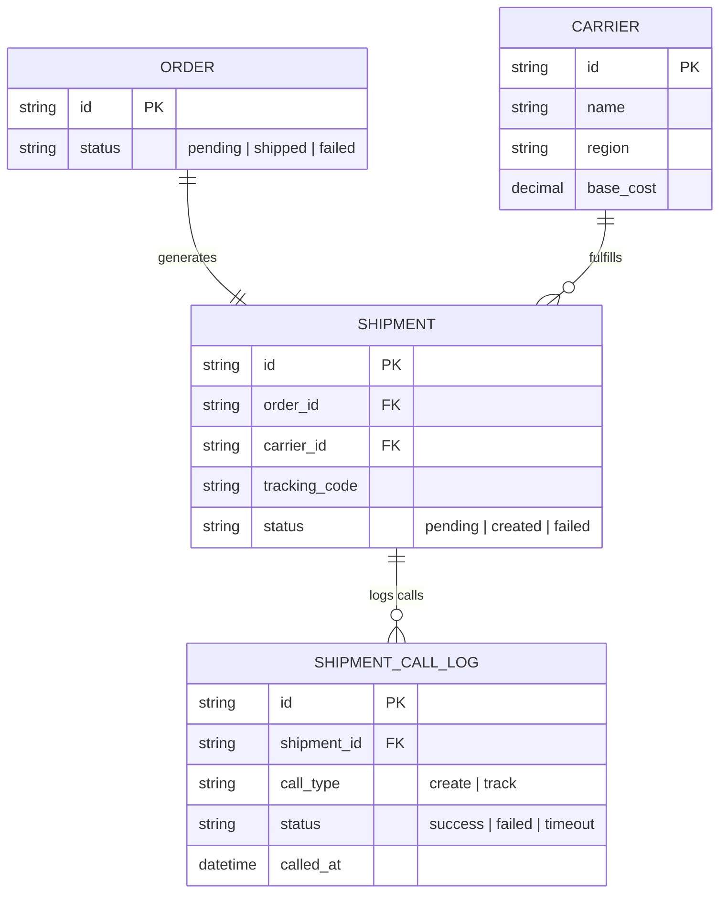
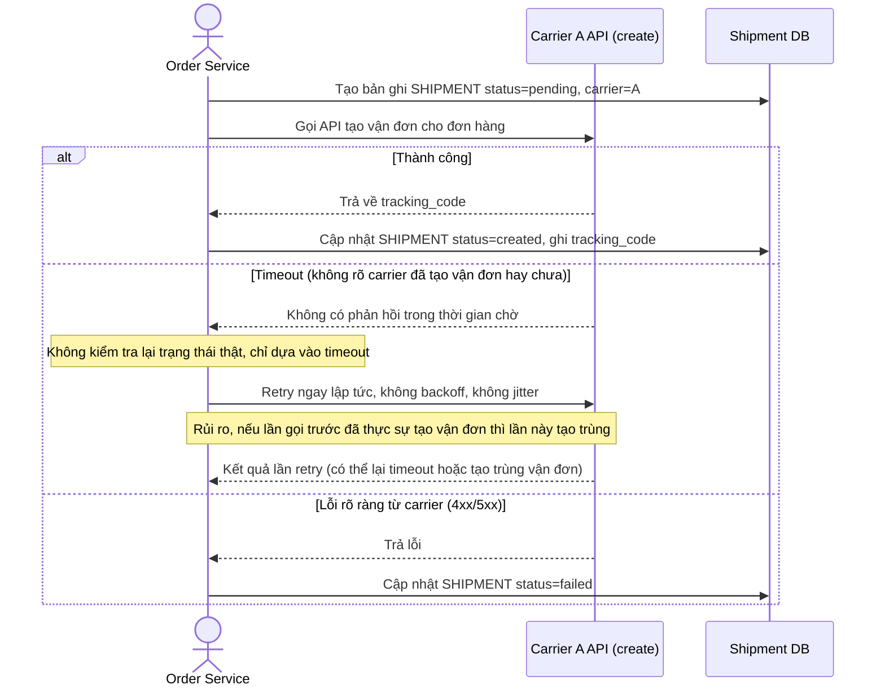
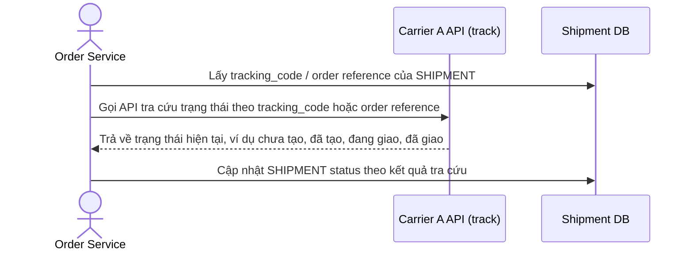
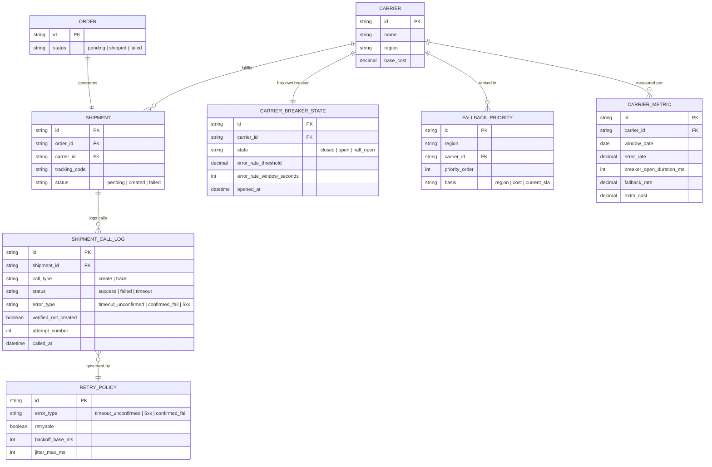
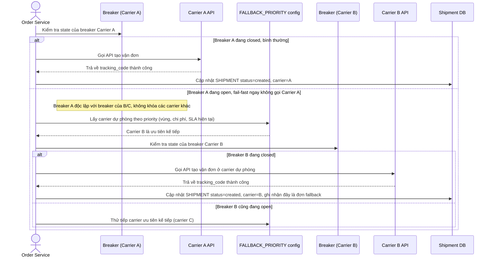
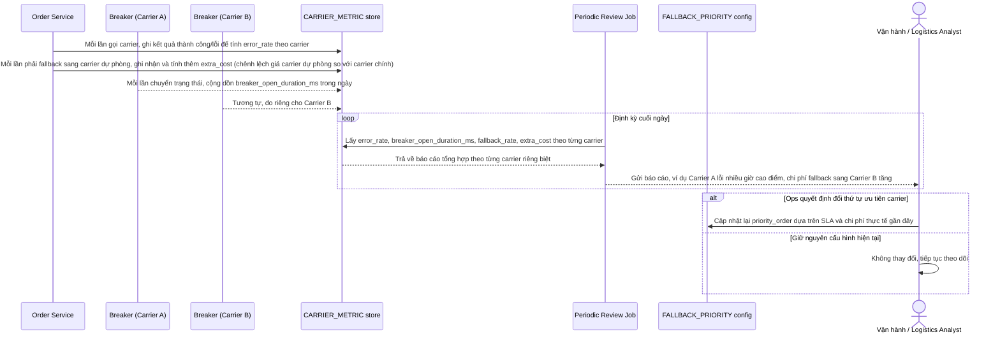

# Tạo vận đơn qua API đối tác vận chuyển (shipping carrier)

**Hệ thống:** Hệ thống logistics/e-commerce gọi API của nhiều đối tác vận chuyển (carrier) bên ngoài để tạo vận đơn, tra cứu trạng thái giao hàng, mỗi đối tác có SLA và độ ổn định khác nhau, đặc biệt kém vào giờ cao điểm.

**Vai trò của flow:** Circuit breaker riêng biệt cho từng đối tác vận chuyển (không dùng chung một breaker cho tất cả) để lỗi của một carrier không ảnh hưởng luồng gọi carrier khác, kèm fallback tự động chuyển đơn sang đối tác thay thế khi carrier chính đang gặp sự cố.

**Yêu cầu cụ thể:**
- Mỗi đối tác vận chuyển phải có circuit breaker độc lập với ngưỡng riêng (có thể khác nhau theo lịch sử SLA từng đối tác) — tuyệt đối không dùng chung một breaker toàn cục, vì như vậy một carrier bị lỗi nặng sẽ khóa luôn cả các carrier khác đang hoạt động bình thường.
- Khi breaker của carrier A mở, hệ thống phải tự động fallback sang carrier B/C theo thứ tự ưu tiên đã cấu hình (dựa trên vùng phục vụ, chi phí, hoặc SLA hiện tại), nhưng phải tránh trường hợp đơn hàng đã thực sự được tạo phía carrier A (do timeout khi đang chờ phản hồi, không phải lỗi thực sự) rồi lại bị tạo trùng lần nữa ở carrier B.
- Với API tạo vận đơn (ghi, có tác dụng phụ thật ngoài đời — carrier đã cấp mã vận đơn và lên lịch lấy hàng), retry chỉ được thực hiện sau khi xác minh qua API tra cứu trạng thái của chính carrier đó rằng vận đơn thực sự chưa được tạo, không retry mù dựa trên timeout đơn thuần.
- Giờ cao điểm là lúc carrier dễ chậm/lỗi nhất nhưng cũng là lúc lượng đơn cần xử lý cao nhất — backoff giữa các lần retry phải có jitter để tránh hàng loạt request retry cùng dồn vào carrier đúng lúc carrier đang phục hồi, càng làm carrier chậm phục hồi hơn.
- Đo lường riêng theo từng carrier: tỉ lệ lỗi, thời gian breaker mở trong ngày, tỉ lệ đơn phải fallback sang carrier dự phòng, và chi phí phát sinh do phải chuyển sang carrier dự phòng có giá cao hơn — dùng để đánh giá định kỳ có nên thay đổi thứ tự ưu tiên carrier hay không.

---

# Base ERD — Hệ thống tạo vận đơn qua API carrier trước khi có circuit breaker

Đây là **base**: mô hình dữ liệu suy luận từ ngữ cảnh đề bài, thể hiện trạng thái hệ thống **trước khi** có circuit breaker riêng biệt theo carrier. Đề bài giả định hệ thống logistics đã gọi API của nhiều đối tác vận chuyển để tạo vận đơn và tra cứu trạng thái, nên base cần đủ: danh sách carrier, đơn hàng, vận đơn, và log các lần gọi API (không phân loại lỗi, không breaker, không fallback, không đo lường riêng theo carrier — những thứ đó là phần enhance).

---

# Base sequence — Create shipment (chưa có circuit breaker, retry mù)

Đây là **base**, flow "tạo vận đơn" ở trạng thái trước enhance. Hệ thống chỉ gọi thẳng carrier được gán cho đơn hàng, không có breaker, không có carrier dự phòng, và khi timeout thì retry mù ngay lập tức mà không xác minh trạng thái thật ở phía carrier. Flow này là nền để so sánh với flow cùng tên ở enhance (per-carrier breaker, xác minh trước khi retry, fallback, jitter).

---

# Base sequence — Track shipment status

Đây là **base**, flow tra cứu trạng thái vận đơn qua API của chính carrier đã tạo đơn đó. Flow này vốn đã tồn tại độc lập (dùng để cập nhật trạng thái giao hàng cho khách/nội bộ) và ở base chưa được dùng cho mục đích nào khác. Flow này quan trọng vì ở enhance, chính API tra cứu này sẽ được tái sử dụng để xác minh trước khi quyết định retry (yêu cầu 3), thay vì retry mù như flow tạo vận đơn ở base.

---

# Enhance ERD — Circuit breaker độc lập theo carrier + fallback an toàn

Đây là ERD **sau khi** enhance được áp dụng lên base. So với base, có 4 nhóm entity mới, ứng trực tiếp với các yêu cầu trong đề bài:

- `CARRIER_BREAKER_STATE` (mới) — 1 breaker riêng cho mỗi carrier, ngưỡng lỗi/thời gian mở cấu hình độc lập theo từng carrier, không dùng chung 1 breaker toàn cục (yêu cầu 1).
- `FALLBACK_PRIORITY` (mới) — thứ tự ưu tiên carrier dự phòng theo vùng phục vụ, chi phí, hoặc SLA hiện tại, dùng khi breaker carrier chính mở (yêu cầu 2).
- `RETRY_POLICY` (mới) — phân loại lỗi nào được retry, có backoff_base_ms và jitter_max_ms để tránh dồn request vào carrier lúc cao điểm (yêu cầu 3, 4).
- `SHIPMENT_CALL_LOG` (sửa) — thêm `error_type` và `verified_not_created` để ghi rõ đã xác minh qua API tra cứu trước khi retry hay chưa (yêu cầu 3).
- `CARRIER_METRIC` (mới) — đo tỉ lệ lỗi, thời gian breaker mở trong ngày, tỉ lệ đơn phải fallback, và chi phí phát sinh do fallback, theo từng carrier (yêu cầu 5).

---

# Enhance sequence — Create shipment (breaker độc lập theo carrier + fallback)

Đây là **enhance**, cùng flow "create-shipment" như ở base nhưng thay đổi ở chỗ: mỗi carrier có breaker riêng nên breaker của carrier A mở không ảnh hưởng tới carrier B (yêu cầu 1), và khi breaker A mở hệ thống fail-fast rồi tự động chuyển sang carrier dự phòng theo thứ tự ưu tiên cấu hình sẵn (yêu cầu 2). So với base, request không còn gọi thẳng 1 carrier cố định mà luôn kiểm tra breaker riêng của carrier trước khi gọi.

---

# Enhance sequence — Retry an toàn sau timeout (xác minh trước khi retry, backoff có jitter)

Đây là **enhance**, flow hoàn toàn mới, mô tả chi tiết điều gì xảy ra khi một lần gọi API tạo vận đơn bị timeout (khác với trường hợp breaker đã mở ở flow create-shipment). Đáp ứng yêu cầu 2 (tránh tạo trùng vận đơn khi thực ra carrier A đã tạo thành công), yêu cầu 3 (chỉ retry sau khi xác minh qua API tra cứu của chính carrier đó rằng vận đơn thực sự chưa được tạo), và yêu cầu 4 (backoff giữa các lần retry có jitter để tránh dồn request vào carrier lúc cao điểm).

```mermaid
sequenceDiagram
    actor OrderSvc as Order Service
    participant CarrierA as Carrier A API (create)
    participant CarrierALookup as Carrier A API (track)
    participant BreakerA as Breaker (Carrier A)
    participant CarrierB as Carrier B API

    OrderSvc->>CarrierA: Gọi API tạo vận đơn
    CarrierA-->>OrderSvc: Timeout, không rõ đã tạo hay chưa
    Note over OrderSvc: Không retry mù, phải xác minh trước qua API tra cứu của chính Carrier A
    OrderSvc->>CarrierALookup: Tra cứu trạng thái vận đơn theo order reference

    alt Vận đơn ĐÃ thực sự được tạo (timeout chỉ là phản hồi chậm)
        CarrierALookup-->>OrderSvc: Đã tồn tại, kèm tracking_code
        OrderSvc->>OrderSvc: Ghi nhận thành công với tracking_code đã có, không tạo lại
    else Vận đơn CHƯA được tạo, xác nhận an toàn để retry
        CarrierALookup-->>OrderSvc: Chưa tồn tại
        OrderSvc->>OrderSvc: Tính thời gian chờ = backoff_base_ms nhân theo số lần thử, cộng thêm jitter ngẫu nhiên
        Note over OrderSvc: Jitter giúp tránh nhiều request retry cùng dồn vào Carrier A đúng lúc carrier đang cao điểm hoặc mới phục hồi
        OrderSvc->>CarrierA: Retry gọi API tạo vận đơn sau khi chờ đủ thời gian backoff có jitter
        alt Retry thành công
            CarrierA-->>OrderSvc: Trả về tracking_code
        else Vẫn timeout hoặc lỗi liên tiếp vượt ngưỡng
            OrderSvc->>BreakerA: Ghi nhận lỗi liên tiếp, breaker Carrier A chuyển sang open
            OrderSvc->>CarrierALookup: Xác minh lần cuối, chắc chắn Carrier A chưa tạo vận đơn
            CarrierALookup-->>OrderSvc: Xác nhận chưa tạo
            OrderSvc->>CarrierB: Chuyển sang tạo vận đơn ở carrier dự phòng, an toàn vì đã xác minh không trùng đơn
        end
    end
```

---

# Enhance sequence — Đo lường và đánh giá định kỳ theo từng carrier

Đây là **enhance**, flow hoàn toàn mới, đáp ứng yêu cầu 5 của đề bài: đo lường riêng theo từng carrier gồm tỉ lệ lỗi, thời gian breaker mở trong ngày, tỉ lệ đơn phải fallback sang carrier dự phòng, và chi phí phát sinh do fallback, dùng để đánh giá định kỳ có nên đổi thứ tự ưu tiên carrier hay không.

