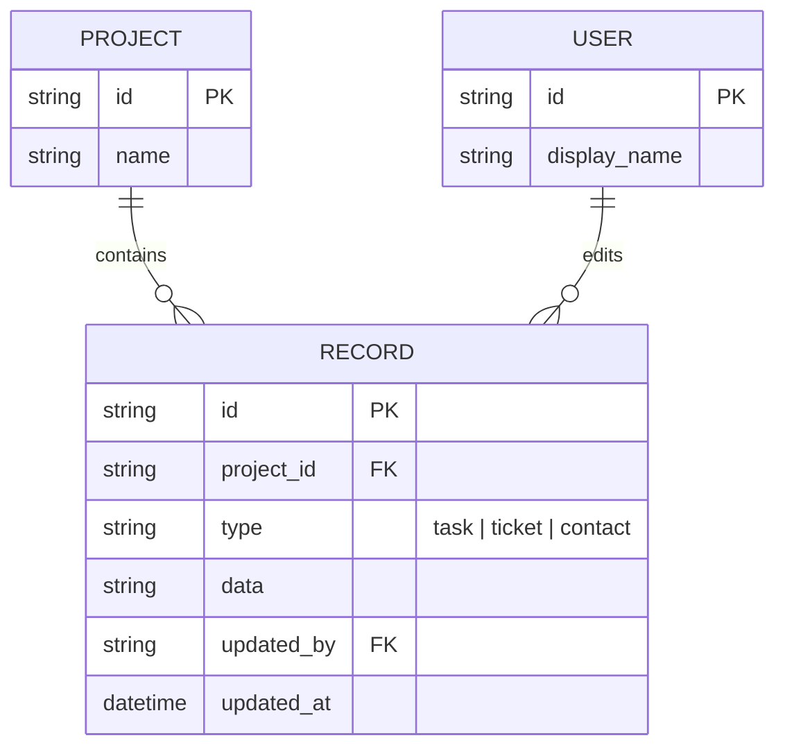
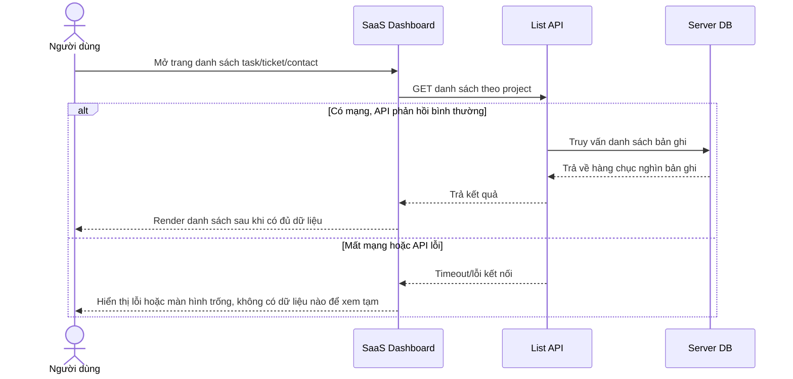
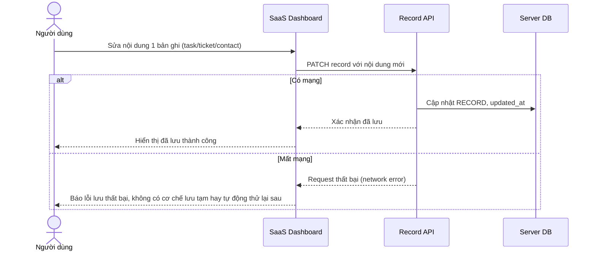
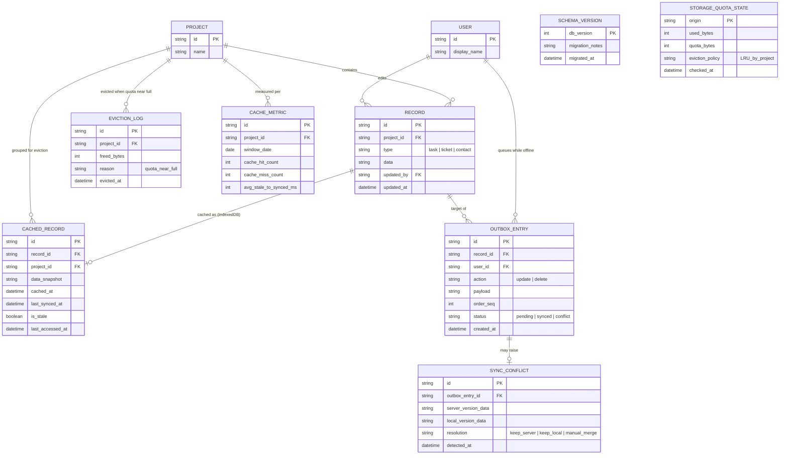
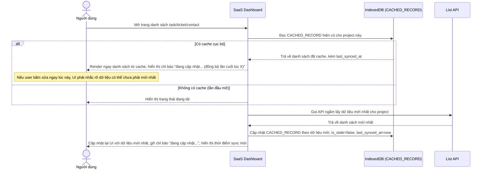
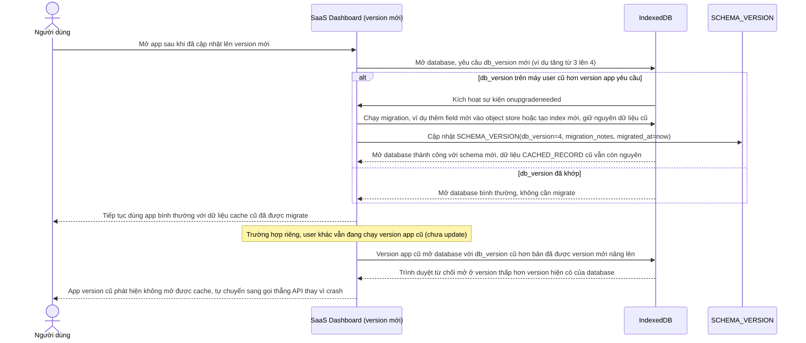
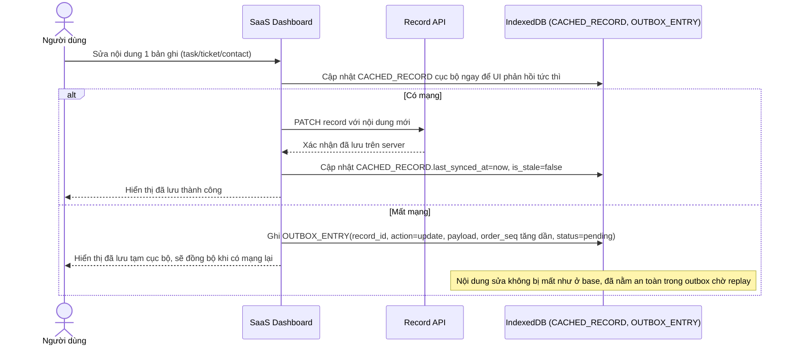
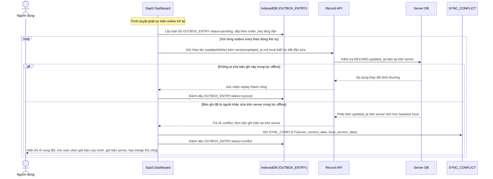
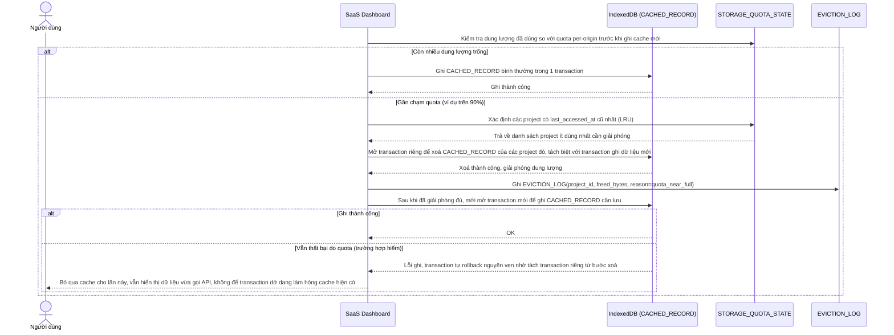
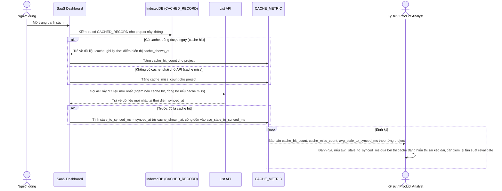

# Cache danh sách lớn offline-first bằng IndexedDB cho SaaS dashboard

**Hệ thống:** SaaS B2B dashboard hiển thị danh sách lớn (hàng chục nghìn bản ghi: task, ticket, contact) cần hoạt động mượt và vẫn xem được dữ liệu gần nhất khi mất mạng tạm thời, dùng IndexedDB làm cache tầng client song song với gọi API.

**Vai trò của flow:** Giữ app "cảm giác nhanh" (đọc từ IndexedDB trước, render ngay) đồng thời đồng bộ đúng khi có mạng trở lại và khi mạng không ổn định.

**Yêu cầu cụ thể:**
- Chiến lược cache: đọc từ IndexedDB hiển thị ngay (stale-while-revalidate), gọi API ngầm để lấy bản mới nhất và cập nhật lại UI + IndexedDB — không được để user chỉnh sửa dựa trên dữ liệu stale mà tưởng là mới nhất, phải có chỉ báo rõ ("đang cập nhật..." / thời điểm sync gần nhất).
- Đổi schema lưu trong IndexedDB giữa các version app (thêm field, đổi cấu trúc object store) — phải có cơ chế migration (`onupgradeneeded`) không làm mất dữ liệu cache cũ hoặc crash app cho user đang chạy version cũ chưa update.
- Ghi nhận thao tác user khi offline (sửa/xóa record) vào một "outbox" trong IndexedDB, replay đúng thứ tự lên server khi có mạng lại; xử lý conflict khi bản ghi đó đã bị người khác sửa trên server trong lúc offline.
- Giới hạn dung lượng IndexedDB (quota per-origin của trình duyệt) — có chiến lược eviction (LRU theo bảng/dự án ít dùng nhất) khi gần chạm quota, tránh lỗi ghi thất bại giữa chừng làm hỏng transaction đang dở.
- Đo lường: tỷ lệ cache hit của IndexedDB so với phải gọi API, và độ trễ giữa "hiển thị từ cache" tới "đồng bộ xong dữ liệu mới nhất", để biết cache có thực sự giúp ích hay đang gây hiển thị sai kéo dài.

---

# Base ERD — SaaS dashboard trước khi có cache IndexedDB offline-first

Đây là **base**: mô hình dữ liệu suy luận từ ngữ cảnh đề bài, mô tả trạng thái hệ thống **trước khi** có cache tầng client bằng IndexedDB. Đề bài nói tới dashboard hiển thị danh sách lớn task/ticket/contact, nên base chỉ cần đủ Organization/Project và Record (gộp chung task/ticket/contact) ở phía server, đọc/ghi trực tiếp qua API mỗi lần. Chưa có bất kỳ entity nào phía client (cache, outbox, schema version, quota, metric) — toàn bộ phần đó là enhance.

---

# Base sequence — Load list (luôn gọi API trực tiếp, không có cache)

Đây là **base**, flow tải danh sách bản ghi (task/ticket/contact) ở trạng thái trước enhance. Mỗi lần vào trang, dashboard gọi thẳng API lấy dữ liệu, chờ phản hồi rồi mới render, không có bất kỳ cache cục bộ nào. Nếu mất mạng, người dùng chỉ thấy lỗi hoặc màn hình trống. Flow này là nền để so sánh với flow cùng tên ở enhance, nơi IndexedDB được đọc trước để hiển thị ngay.

---

# Base sequence — Edit record (ghi thẳng server, thất bại ngay khi offline)

Đây là **base**, flow chỉnh sửa 1 bản ghi ở trạng thái trước enhance. Mọi thao tác sửa/xoá đều gọi thẳng API, không có bước lưu tạm cục bộ nào. Khi mất mạng, thao tác thất bại ngay lập tức và có thể mất nội dung vừa sửa. Flow này là nền để so sánh với flow cùng tên ở enhance, nơi thao tác offline được ghi vào outbox để replay sau.

---

# Enhance ERD — Cache offline-first bằng IndexedDB

Đây là ERD **sau khi** enhance được áp dụng lên base. So với base (chỉ có PROJECT/RECORD ở server), phần enhance thêm 6 nhóm entity mới ở phía client (IndexedDB) và đo lường, ứng trực tiếp với các yêu cầu trong đề bài:

- `CACHED_RECORD` (mới, IndexedDB) — bản snapshot record để hiển thị ngay, kèm `last_synced_at` và `is_stale` để biết đang hiển thị dữ liệu cũ hay đã đồng bộ — yêu cầu 1.
- `SCHEMA_VERSION` (mới, meta trong IndexedDB) — theo dõi version schema hiện tại của database cục bộ, phục vụ `onupgradeneeded` migration — yêu cầu 2.
- `OUTBOX_ENTRY` (mới, IndexedDB) — hàng đợi thao tác sửa/xoá thực hiện lúc offline, có `order_seq` để replay đúng thứ tự — yêu cầu 3.
- `SYNC_CONFLICT` (mới) — ghi nhận khi 1 outbox entry replay lên server nhưng bản ghi đã bị người khác sửa trong lúc offline — yêu cầu 3.
- `STORAGE_QUOTA_STATE` + `EVICTION_LOG` (mới) — theo dõi dung lượng IndexedDB đã dùng so với quota per-origin, và lịch sử eviction theo project ít dùng nhất (LRU) — yêu cầu 4.
- `CACHE_METRIC` (mới) — tỉ lệ cache hit so với phải gọi API, và độ trễ từ lúc hiển thị cache tới lúc đồng bộ xong dữ liệu mới nhất — yêu cầu 5.

---

# Enhance sequence — Load list (stale-while-revalidate, có chỉ báo trạng thái sync)

Đây là **enhance**, cùng flow "load-list" như ở base nhưng thay đổi chiến lược: đọc từ IndexedDB hiển thị ngay lập tức, đồng thời gọi API ngầm để lấy bản mới nhất rồi cập nhật lại UI + IndexedDB. Vì dữ liệu hiển thị ban đầu có thể là stale, hệ thống phải có chỉ báo rõ ràng ("đang cập nhật..." hoặc thời điểm sync gần nhất) để user không nhầm tưởng đây là dữ liệu mới nhất. Đáp ứng yêu cầu 1 của đề bài.

---

# Enhance sequence — Migration schema IndexedDB giữa các version app

Đây là **enhance**, flow hoàn toàn mới, xử lý việc đổi schema lưu trong IndexedDB giữa các version app (thêm field, đổi cấu trúc object store). Phải dùng cơ chế `onupgradeneeded` để migrate mà không làm mất dữ liệu cache cũ, và không được crash app cho user đang chạy version cũ chưa kịp cập nhật. Đáp ứng yêu cầu 2 của đề bài.

---

# Enhance sequence — Edit record (ghi vào outbox khi offline thay vì thất bại ngay)

Đây là **enhance**, cùng flow "edit-record" như ở base nhưng thay đổi hành vi khi mất mạng: thay vì thất bại ngay, thao tác sửa/xoá được ghi vào outbox trong IndexedDB kèm thứ tự thực hiện, để replay lên server khi có mạng lại (chi tiết replay và xử lý conflict ở flow outbox-replay-conflict riêng). Đáp ứng phần đầu của yêu cầu 3 của đề bài.

---

# Enhance sequence — Replay outbox khi có mạng lại, xử lý conflict

Đây là **enhance**, flow hoàn toàn mới, tiếp nối flow "edit-record" khi mạng có lại. Các thao tác offline đã ghi trong outbox phải được replay đúng thứ tự (`order_seq`) lên server, và phải xử lý rõ trường hợp bản ghi đó đã bị người khác sửa trên server trong lúc offline. Đáp ứng phần sau của yêu cầu 3 của đề bài.

---

# Enhance sequence — Eviction khi gần chạm quota IndexedDB

Đây là **enhance**, flow hoàn toàn mới, xử lý giới hạn dung lượng IndexedDB theo quota per-origin của trình duyệt. Khi gần chạm quota, hệ thống phải áp dụng chiến lược eviction LRU theo project ít dùng nhất, và tránh để lỗi ghi thất bại giữa chừng làm hỏng transaction đang dở. Đáp ứng yêu cầu 4 của đề bài.

---

# Enhance sequence — Đo cache hit rate và độ trễ đồng bộ

Đây là **enhance**, flow hoàn toàn mới, đáp ứng yêu cầu 5 của đề bài: đo tỉ lệ cache hit của IndexedDB so với phải gọi API, và độ trễ giữa lúc hiển thị từ cache tới lúc đồng bộ xong dữ liệu mới nhất, để biết cache có thực sự giúp ích hay đang gây hiển thị sai kéo dài.

