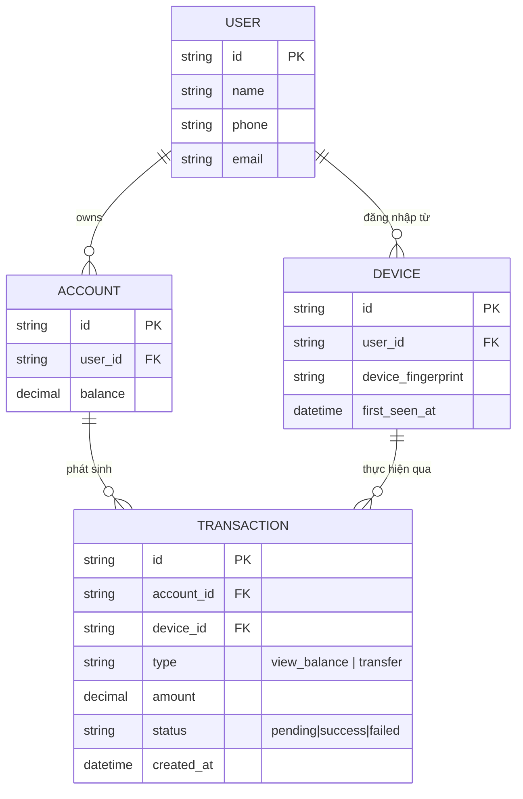
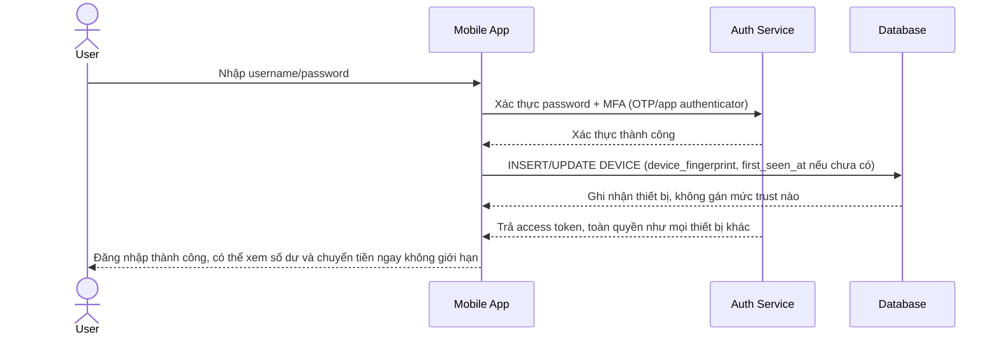
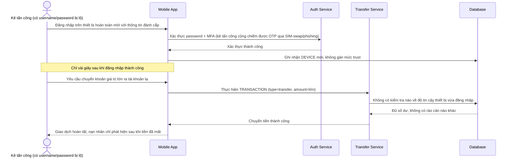
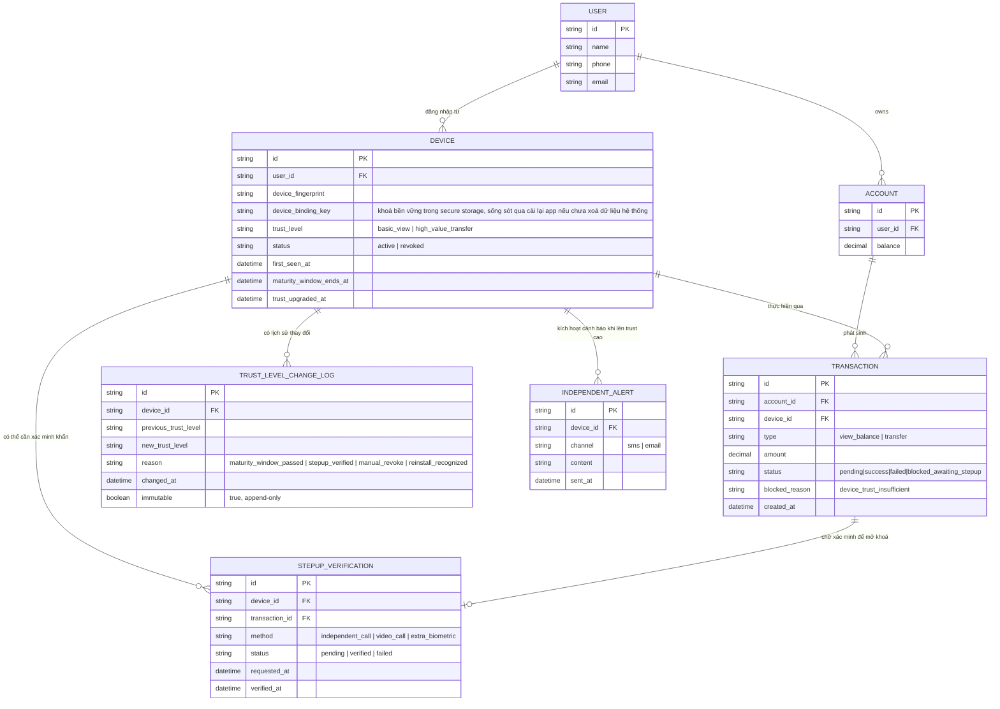
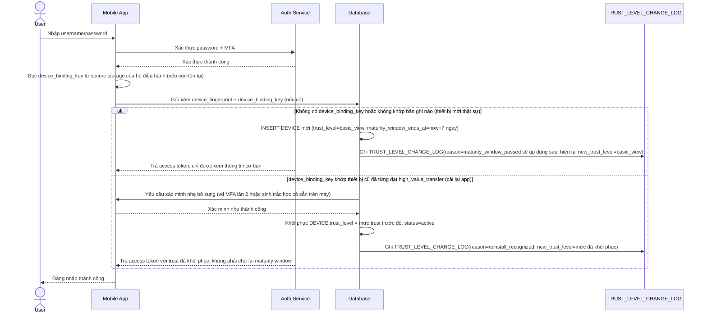
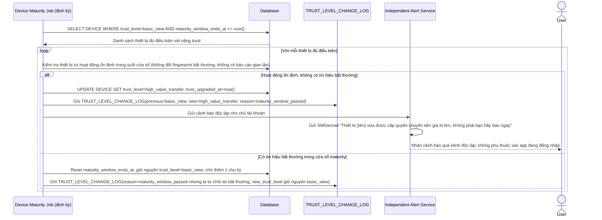
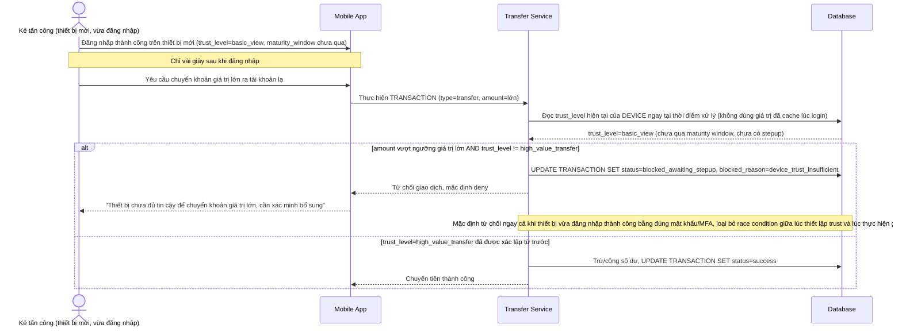
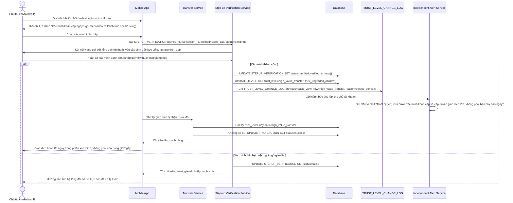

# Ngân hàng số quản lý device trust cho giao dịch chuyển tiền giá trị lớn

**Hệ thống:** Một app ngân hàng số cho phép chuyển tiền, mở tài khoản tiết kiệm, và thực hiện các giao dịch tài chính giá trị lớn.

**Vai trò của flow:** Thiết bị mới phải qua xác minh bổ sung trước khi được thực hiện giao dịch giá trị cao, dù đã đăng nhập thành công bằng mật khẩu/MFA thông thường — tách biệt rõ "trust để đăng nhập xem thông tin" và "trust để thực hiện giao dịch lớn".

**Yêu cầu cụ thể:**
- Thiết bị đăng nhập lần đầu chỉ được cấp trust ở mức xem thông tin cơ bản; muốn chuyển khoản vượt một ngưỡng giá trị phải trải qua một cửa sổ "device maturity" (ví dụ thiết bị phải hoạt động ổn định qua một khoảng thời gian, hoặc hoàn tất xác minh bổ sung) trước khi được nâng lên mức trust cho phép giao dịch lớn.
- Phải chặn được kịch bản kẻ tấn công vừa chiếm được thông tin đăng nhập, đăng nhập trên thiết bị mới rồi cố chuyển tiền lớn ngay trong vài giây — tức là race condition giữa việc thiết lập trust thiết bị mới và việc thực hiện giao dịch giá trị cao gần như tức thời sau đó phải được xử lý an toàn theo hướng mặc định từ chối.
- Cần phân biệt hợp lý giữa "thiết bị thực sự mới lạ" và "thiết bị cũ bị cài lại app/xóa dữ liệu" của chính chủ tài khoản, để tránh làm phiền người dùng hợp lệ mỗi lần họ cài lại app trong khi vẫn giữ được mức bảo vệ cần thiết cho trường hợp thật sự đáng ngờ.
- Khi giao dịch bị chặn vì thiết bị chưa đủ trust, phải có luồng step-up rõ ràng và tức thời (ví dụ xác minh qua kênh độc lập như gọi điện, video call, hoặc sinh trắc học bổ sung) cho các trường hợp hợp lệ nhưng cần gấp, thay vì bắt người dùng chờ hàng giờ/ngày một cách cứng nhắc.
- Mọi thay đổi trust level của thiết bị (nâng lên, hạ xuống, revoke) phải có audit trail không thể chỉnh sửa, và phải cảnh báo ngay qua kênh độc lập (SMS/email) mỗi khi có thiết bị mới đạt được mức trust cho phép giao dịch lớn, để chủ tài khoản phát hiện sớm nếu không phải do chính họ thực hiện.

---

# Base ERD — Ngân hàng số chưa phân biệt mức độ tin cậy thiết bị

Đây là **base**: trạng thái hệ thống ngân hàng số *trước khi* có cơ chế device trust theo tầng. Suy luận từ đề bài, base đã có `USER` sở hữu nhiều `ACCOUNT`, đăng nhập từ các `DEVICE` khác nhau (ghi nhận fingerprint, lần đầu thấy), và mỗi `TRANSACTION` (xem số dư hoặc chuyển tiền) được thực hiện qua 1 thiết bị cụ thể. Base chưa phân biệt thiết bị mới hay cũ, chưa có khái niệm mức trust, nên bất kỳ thiết bị nào đăng nhập thành công (đúng mật khẩu/MFA) đều có toàn quyền thực hiện mọi giao dịch kể cả chuyển tiền giá trị lớn ngay lập tức.

---

# Base sequence — Login (không phân biệt mức trust thiết bị)

Đây là **base**, flow đăng nhập ở trạng thái hiện tại: sau khi xác thực đúng mật khẩu/MFA, thiết bị (mới hay cũ) đều được cấp toàn quyền truy cập như nhau, hệ thống chỉ ghi nhận fingerprint thiết bị mà không gán mức trust nào. Đây là nền để so sánh với yêu cầu 1 và 3 của đề bài (cần phân tầng trust và phân biệt thiết bị mới thật sự với thiết bị cài lại app).

---

# Base sequence — Transfer money (không kiểm tra trust thiết bị, lộ rủi ro kẻ tấn công)

Đây là **base**, flow chuyển tiền ở trạng thái hiện tại: sau khi đăng nhập thành công, thiết bị được phép chuyển tiền với bất kỳ số tiền nào ngay lập tức, không có bước kiểm tra mức độ tin cậy thiết bị. Sơ đồ minh hoạ đúng kịch bản rủi ro nêu ở yêu cầu 2 của đề bài: kẻ tấn công chiếm được thông tin đăng nhập, đăng nhập trên thiết bị mới rồi chuyển tiền lớn thành công chỉ trong vài giây.

---

# Enhance ERD — Device trust theo tầng, cửa sổ maturity, step-up khẩn cấp, audit trail và cảnh báo độc lập

Đây là ERD **sau khi** enhance được áp dụng lên base. So với base, `DEVICE` được bổ sung nhiều trường theo dõi mức trust, và có 3 entity mới, ứng trực tiếp với các yêu cầu:

- `DEVICE.trust_level`, `device_binding_key`, `maturity_window_ends_at` — đáp ứng yêu cầu 1 (thiết bị mới chỉ ở `basic_view`, phải qua cửa sổ maturity mới lên `high_value_transfer`) và yêu cầu 3 (`device_binding_key` là khoá bền vững lưu ở secure storage của hệ điều hành, dùng để nhận diện thiết bị cũ cài lại app thay vì coi là thiết bị hoàn toàn mới).
- `TRUST_LEVEL_CHANGE_LOG` (mới) — ghi lại mọi lần nâng/hạ/thu hồi trust, không thể sửa đổi — đáp ứng vế đầu yêu cầu 5 (audit trail).
- `STEPUP_VERIFICATION` (mới) — gắn với `TRANSACTION` bị chặn vì thiết bị chưa đủ trust, cho phép xác minh khẩn cấp qua kênh độc lập để nâng trust ngay, bỏ qua thời gian chờ maturity — đáp ứng yêu cầu 4.
- `INDEPENDENT_ALERT` (mới) — gửi SMS/email độc lập mỗi khi thiết bị đạt mức trust cho giao dịch lớn — đáp ứng vế sau yêu cầu 5.
- `TRANSACTION.blocked_reason` — đáp ứng yêu cầu 2 (mặc định từ chối giao dịch lớn khi trust chưa đủ, kể cả ngay sau khi vừa đăng nhập).

---

# Enhance sequence — Login (phân biệt thiết bị mới thật sự với thiết bị cũ cài lại app)

Đây là **enhance** của flow `login` đã có ở base. So với base (mọi thiết bị đăng nhập thành công đều có toàn quyền như nhau), nay thiết bị mới được gán `trust_level=basic_view` mặc định, còn nếu hệ thống nhận diện được `device_binding_key` khớp với thiết bị đã từng đạt trust cao trước đó (cài lại app, chưa xoá secure storage), trust được khôi phục sau một bước xác minh nhẹ thay vì reset về mức thấp nhất. Đáp ứng yêu cầu 1 và 3 của đề bài.

---

# Enhance sequence — Nâng trust thiết bị sau cửa sổ maturity, cảnh báo qua kênh độc lập

Đây là **enhance**, flow hoàn toàn mới, chưa tồn tại ở base. Một job định kỳ kiểm tra các thiết bị đã hoạt động ổn định qua đủ thời gian maturity window để nâng trust lên `high_value_transfer`, ghi audit trail bất biến và gửi cảnh báo ngay qua kênh độc lập (SMS/email) cho chủ tài khoản. Đáp ứng yêu cầu 1 (cửa sổ maturity) và yêu cầu 5 (audit trail + cảnh báo độc lập) của đề bài.

---

# Enhance sequence — Transfer money (kiểm tra trust thiết bị, mặc định từ chối khi chưa đủ, chặn race condition)

Đây là **enhance** của flow `transfer-money` đã có ở base. So với base (chuyển tiền không kiểm tra gì), nay mọi giao dịch vượt ngưỡng giá trị lớn bắt buộc kiểm tra `DEVICE.trust_level=high_value_transfer` ngay tại thời điểm xử lý giao dịch (không dựa vào trạng thái đã cache lúc login), mặc định từ chối nếu thiết bị chưa đạt mức trust này — kể cả khi vừa đăng nhập xong vài giây trước. Đáp ứng yêu cầu 2 của đề bài, tái hiện đúng kịch bản tấn công ở base nhưng lần này bị chặn.

---

# Enhance sequence — Step-up khẩn cấp qua kênh độc lập cho giao dịch gấp hợp lệ

Đây là **enhance**, flow hoàn toàn mới, chưa tồn tại ở base. Khi giao dịch bị chặn vì thiết bị chưa đủ trust nhưng người dùng hợp lệ thực sự cần gấp, họ có thể yêu cầu xác minh bổ sung qua kênh độc lập (gọi điện, video call, sinh trắc học bổ sung) để nâng trust ngay lập tức thay vì chờ hết maturity window. Đáp ứng yêu cầu 4, đồng thời vẫn đảm bảo audit trail và cảnh báo độc lập theo yêu cầu 5.

