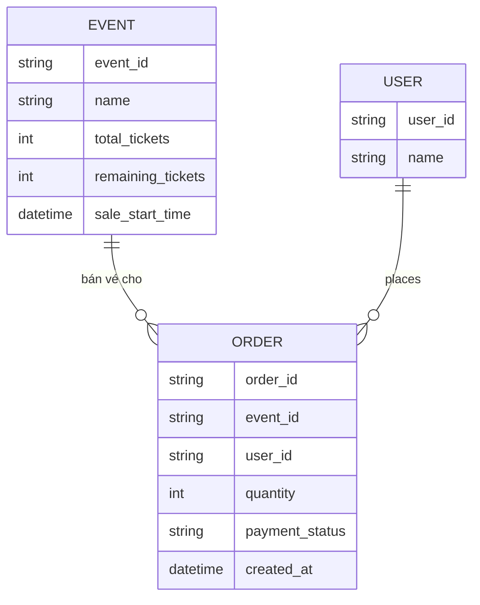
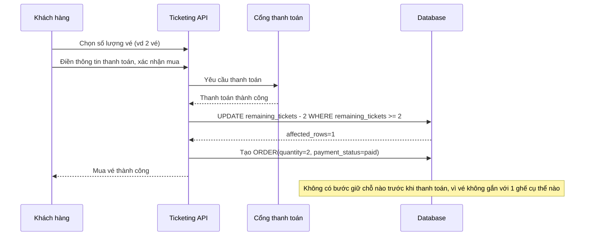
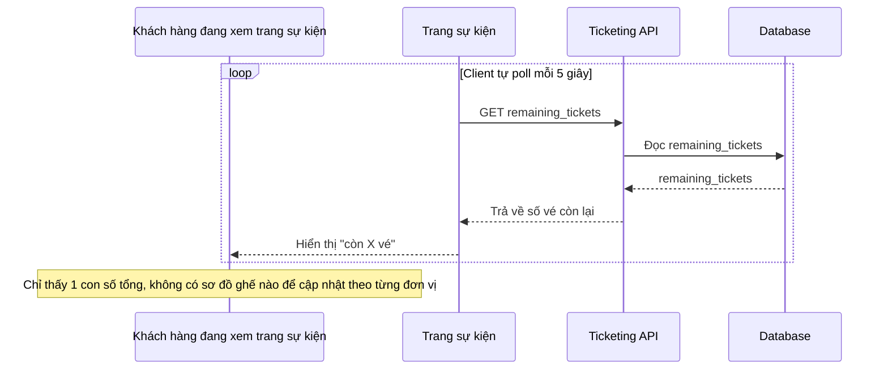
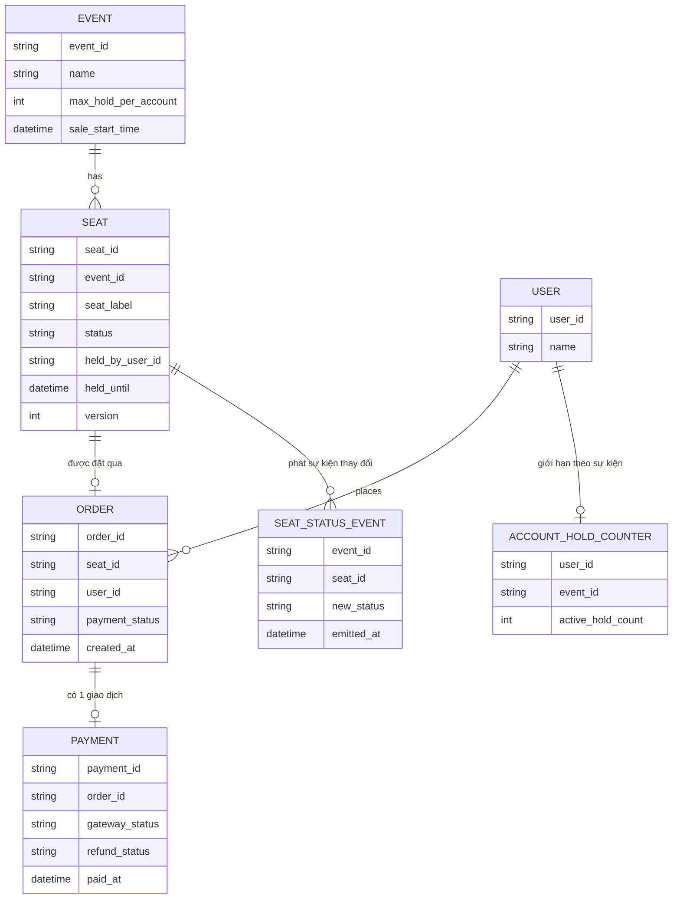
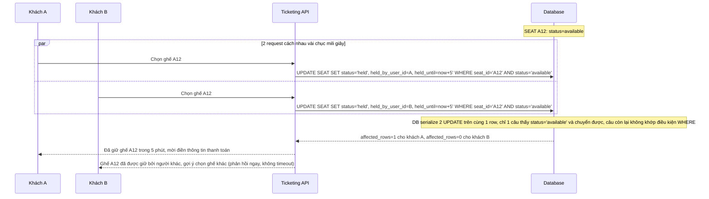
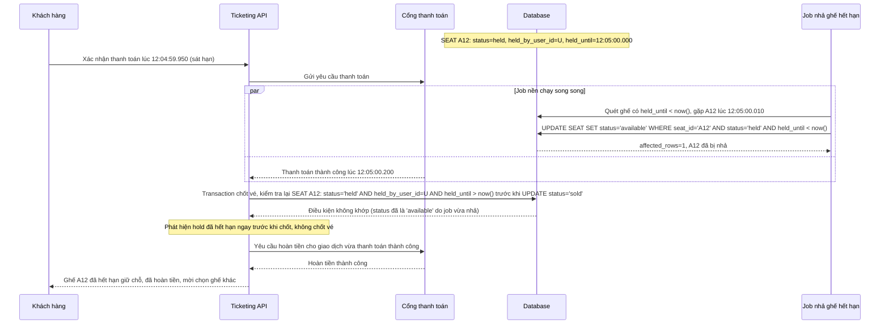
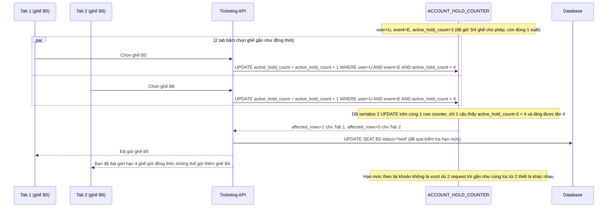
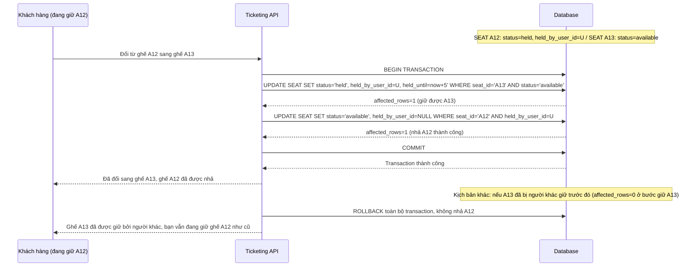
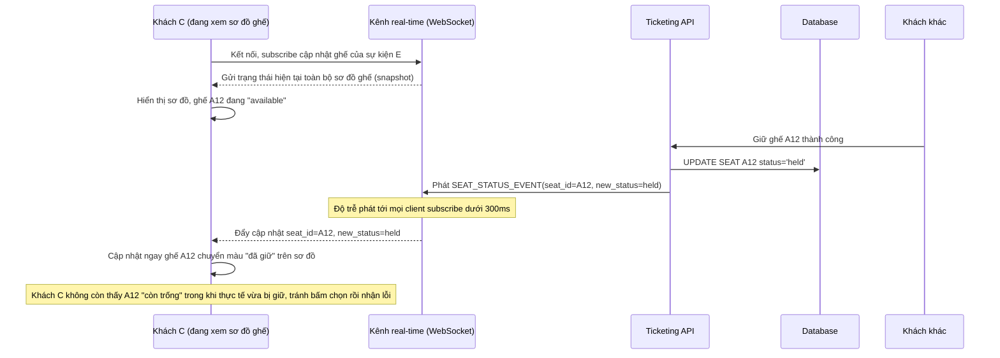

# Mở bán vé concert số lượng giới hạn với chọn ghế cụ thể

**Hệ thống:** Một nền tảng bán vé sự kiện mở bán vé cho 1 concert hot, khách hàng chọn ghế cụ thể trên sơ đồ hội trường (không chỉ chọn số lượng chung như flash sale sản phẩm thông thường).

**Vai trò của flow:** Flow phải giữ ghế tạm thời (hold) ngay khi khách chọn ghế trong lúc khách điền thông tin thanh toán, đảm bảo không 2 khách cùng giữ/mua trùng 1 ghế, và nhả ghế đúng hạn nếu khách không hoàn tất thanh toán kịp thời gian quy định.

**Yêu cầu cụ thể:**
- Mô tả cụ thể: 2 khách cùng bấm chọn ghế A12 gần như đồng thời (chênh nhau vài chục mili giây) — yêu cầu dùng update nguyên tử có điều kiện chuyển trạng thái ghế từ "available" sang "held" (kiểu `UPDATE seats SET status = 'held' WHERE seat_id = ? AND status = 'available'`), chỉ 1 request thành công; request thua phải nhận phản hồi ngay "ghế đã được giữ bởi người khác" và được gợi ý chọn ghế khác, không phải chờ timeout mới biết kết quả.
- Ghế được giữ tạm trong 1 khoảng thời gian cố định (ví dụ 5-10 phút) để khách điền thông tin thanh toán; mô tả cụ thể race giữa job tự động nhả ghế hết hạn và request xác nhận thanh toán đến ngay sát thời điểm hết hạn — transaction xác nhận thanh toán phải kiểm tra hold vẫn còn hiệu lực (chưa bị job nhả) ngay trước khi chốt vé, nếu đã hết hạn phải từ chối rõ ràng và tự động hoàn tiền nếu thao tác thanh toán ở cổng bên ngoài đã thành công trước khi hệ thống kịp phát hiện hết hạn.
- Khi khách mở nhiều tab/thiết bị bằng cùng 1 tài khoản để chọn nhiều ghế khác nhau cho cùng sự kiện, quy định giới hạn số ghế/vé tối đa mỗi tài khoản được giữ cùng lúc, và kiểm tra giới hạn này phải atomic để không bị vượt khi nhiều request giữ ghế từ cùng tài khoản gửi lên gần như đồng thời.
- Khi khách đổi sang ghế khác sau khi đã giữ 1 ghế (ví dụ nhận ra ghế đã chọn không ưng ý), thao tác đổi ghế phải là 1 transaction atomic gồm nhả ghế cũ và giữ ghế mới, không được để khoảng hở giữa 2 bước khiến ghế mới bị người khác cướp mất ngay sau khi ghế cũ vừa nhả ra, hoặc để khách vô tình giữ đồng thời cả 2 ghế nếu bước giữ ghế mới thất bại giữa chừng.
- Sơ đồ ghế hiển thị real-time cho tất cả khách đang xem cùng sự kiện: quy định độ trễ cập nhật trạng thái ghế (available/held/sold) chấp nhận được giữa các client, tránh hiển thị 1 ghế "còn trống" trong khi thực tế vừa bị giữ bởi người khác vài trăm mili giây trước, gây khách bấm chọn liên tục rồi nhận lỗi.

---

# ERD - Base: Bán vé theo số lượng, không có ghế cụ thể

Đây là trạng thái **base**, trước khi áp đề bài. Nền tảng bán vé sự kiện hiện đã có, nhưng khách chỉ chọn **số lượng vé** (giống flash sale sản phẩm thông thường), không chọn ghế cụ thể trên sơ đồ hội trường. Vé được xác nhận ngay sau khi thanh toán thành công, trừ trực tiếp vào số lượng còn lại — không có khái niệm "giữ chỗ tạm thời" (hold) vì không có 1 đơn vị ghế riêng lẻ nào cần khoá trước khi thanh toán. Đây là nền tảng để đề bài (chọn ghế cụ thể, giữ ghế tạm, hết hạn hold, giới hạn hold theo tài khoản, đổi ghế atomic, sơ đồ real-time) có ý nghĩa khi so sánh.

Lưu ý: không có entity `SEAT` đại diện cho từng ghế cụ thể với trạng thái `available/held/sold`, không có field nào lưu thời hạn giữ chỗ (`held_until`), và không có giới hạn số ghế được giữ đồng thời theo tài khoản — đây chính là các khoảng trống mà enhance sẽ lấp.

---

# Sequence - Base: Mua vé theo số lượng (không chọn ghế, không giữ chỗ)

Đây là flow **base**: khách chọn số lượng vé muốn mua, điền thông tin thanh toán và thanh toán ngay trong 1 luồng liên tục, vé chỉ được trừ vào `remaining_tickets` sau khi thanh toán thành công. Vì không có ghế cụ thể, không cần bước "giữ chỗ tạm thời" nào cả — đây chính là điểm khác biệt nền tảng mà đề bài sẽ thay đổi khi thêm chọn ghế cụ thể.

---

# Sequence - Base: Xem số vé còn lại (poll định kỳ, không real-time)

Đây là flow **base**: khách xem trang sự kiện, giao diện chỉ hiển thị 1 con số tổng "còn X vé", được client tự poll lại mỗi vài giây, không có cơ chế đẩy cập nhật real-time. Vì không có ghế cụ thể, không cần đồng bộ trạng thái từng ghế theo thời gian thực — đây là tiền đề cho yêu cầu 5 của đề bài, khi ghế cụ thể xuất hiện thì việc đồng bộ trạng thái từng ghế real-time trở nên cần thiết.

---

# ERD - Enhance: Ghế cụ thể với hold tạm thời, giới hạn theo tài khoản, real-time

Đây là trạng thái **enhance**, sau khi áp toàn bộ đề bài lên base. So với base, các thay đổi chính:

- Thêm entity `SEAT` đại diện cho từng ghế cụ thể trên sơ đồ, với `status` (`available`/`held`/`sold`), `held_by_user_id`, `held_until`, và `version` để chuyển trạng thái bằng update nguyên tử có điều kiện — đáp ứng **yêu cầu 1**.
- `SEAT.held_until` kết hợp với 1 job nền tự động nhả ghế hết hạn, và `ORDER`/`PAYMENT` có bước kiểm tra hold còn hiệu lực ngay trước khi chốt vé — đáp ứng **yêu cầu 2**.
- Thêm entity `ACCOUNT_HOLD_COUNTER` — đếm atomic số ghế đang giữ đồng thời theo `user_id` + `event_id`, so với `max_hold_per_account` — đáp ứng **yêu cầu 3**.
- Thao tác đổi ghế là 1 transaction gồm nhả `SEAT` cũ và giữ `SEAT` mới, không entity mới nhưng ràng buộc atomic xuyên 2 dòng `SEAT` — đáp ứng **yêu cầu 4**.
- `SEAT` phát sự kiện thay đổi trạng thái qua `SEAT_STATUS_EVENT` để mọi client xem cùng sự kiện nhận cập nhật gần real-time — đáp ứng **yêu cầu 5**.
- `PAYMENT` có thêm `refund_status` để xử lý trường hợp thanh toán ở cổng ngoài đã thành công nhưng hold đã hết hạn.

---

# Sequence - Enhance: Chọn ghế A12, giữ chỗ atomic

Đây là flow **enhance hoàn toàn mới**, minh hoạ đúng kịch bản nêu trong đề bài: 2 khách cùng bấm chọn ghế A12 gần như đồng thời (chênh nhau vài chục mili giây). Dùng update nguyên tử có điều kiện `UPDATE seats SET status='held' WHERE seat_id=? AND status='available'`, chỉ 1 request thành công; request thua nhận phản hồi ngay "ghế đã được giữ bởi người khác" và được gợi ý chọn ghế khác, không phải chờ timeout. Đáp ứng **yêu cầu 1** của đề bài.

---

# Sequence - Enhance: Xác nhận thanh toán sát thời điểm hold hết hạn

Đây là flow **enhance hoàn toàn mới**, mô tả race giữa job tự động nhả ghế hết hạn và request xác nhận thanh toán đến ngay sát thời điểm hết hạn. Transaction xác nhận thanh toán phải kiểm tra hold vẫn còn hiệu lực (`held_by_user_id` khớp và chưa quá `held_until`) ngay trước khi chốt vé; nếu đã hết hạn phải từ chối rõ ràng và tự động hoàn tiền nếu cổng thanh toán bên ngoài đã báo thành công trước khi hệ thống kịp phát hiện hết hạn. Đáp ứng **yêu cầu 2** của đề bài.

---

# Sequence - Enhance: Giới hạn số ghế giữ đồng thời theo tài khoản (atomic)

Đây là flow **enhance hoàn toàn mới**, mô tả trường hợp khách mở nhiều tab/thiết bị bằng cùng 1 tài khoản để chọn nhiều ghế khác nhau cho cùng sự kiện gần như đồng thời. Mỗi tài khoản chỉ được giữ tối đa `max_hold_per_account` ghế cùng lúc (vd 4 ghế), việc kiểm tra và tăng `active_hold_count` phải atomic để không bị vượt hạn mức khi nhiều request giữ ghế gửi lên gần như đồng thời từ cùng tài khoản. Đáp ứng **yêu cầu 3** của đề bài.

---

# Sequence - Enhance: Đổi ghế đã giữ sang ghế khác (transaction atomic)

Đây là flow **enhance hoàn toàn mới**, mô tả khách đã giữ ghế A12 nhưng đổi ý muốn chuyển sang ghế A13. Thao tác nhả ghế cũ và giữ ghế mới phải nằm trong 1 transaction atomic — không được để khoảng hở giữa 2 bước khiến ghế mới bị người khác cướp mất ngay sau khi ghế cũ vừa nhả, và nếu bước giữ ghế mới thất bại thì toàn bộ transaction rollback, ghế cũ vẫn được giữ nguyên chứ không bị nhả oan. Đáp ứng **yêu cầu 4** của đề bài.

---

# Sequence - Enhance: Sơ đồ ghế cập nhật real-time cho mọi khách đang xem

Đây là flow **enhance** của `view-ticket-availability` (so với base). Khác biệt so với base: thay vì client tự poll 1 con số tổng mỗi vài giây, mỗi thay đổi trạng thái ghế (`available`/`held`/`sold`) được phát ngay qua kênh real-time (WebSocket/SSE) tới mọi client đang xem sơ đồ ghế của cùng sự kiện, với độ trễ chấp nhận được (vd dưới 300ms), tránh hiển thị 1 ghế "còn trống" trong khi thực tế vừa bị giữ vài trăm mili giây trước. Đáp ứng **yêu cầu 5** của đề bài.

