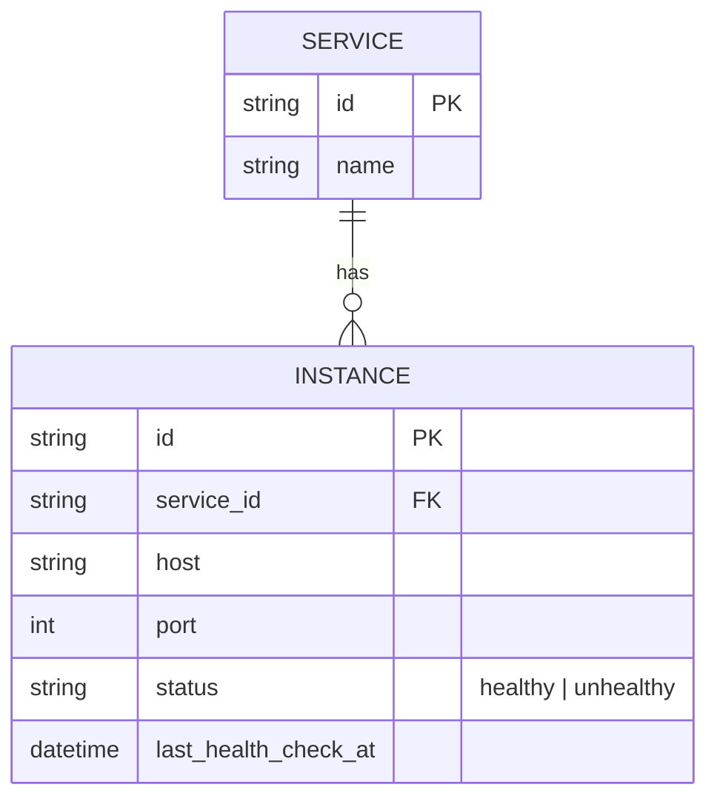
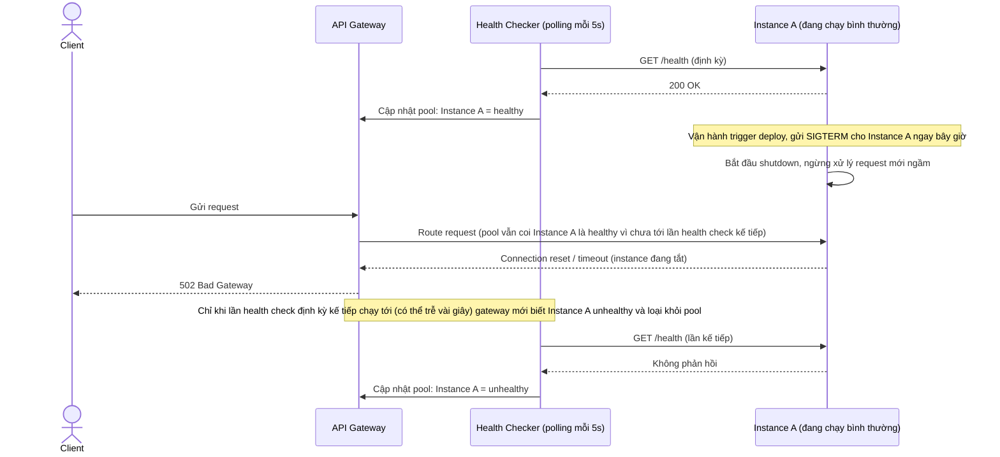
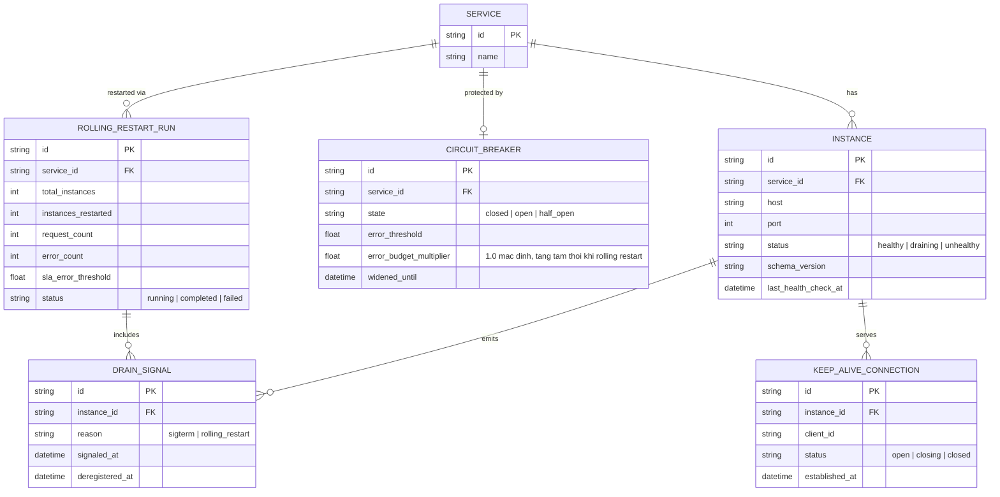
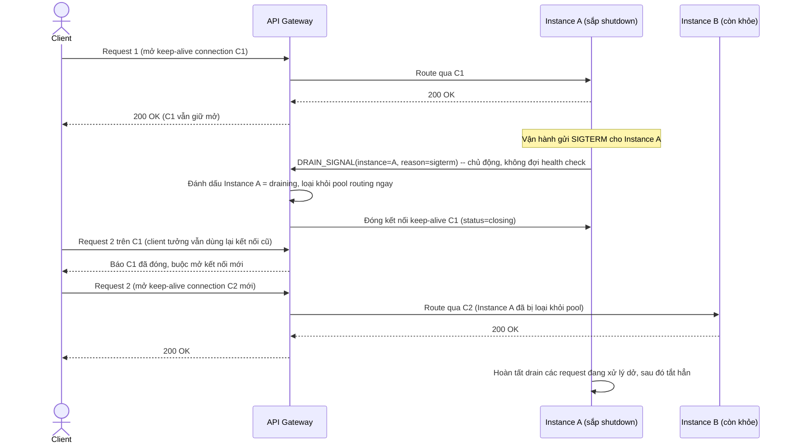
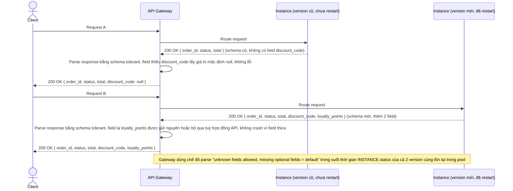
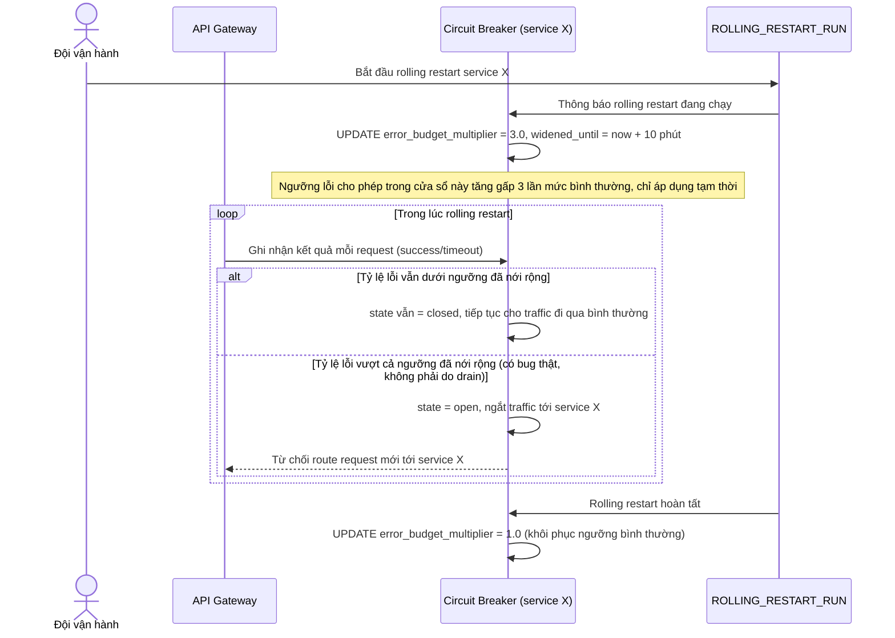
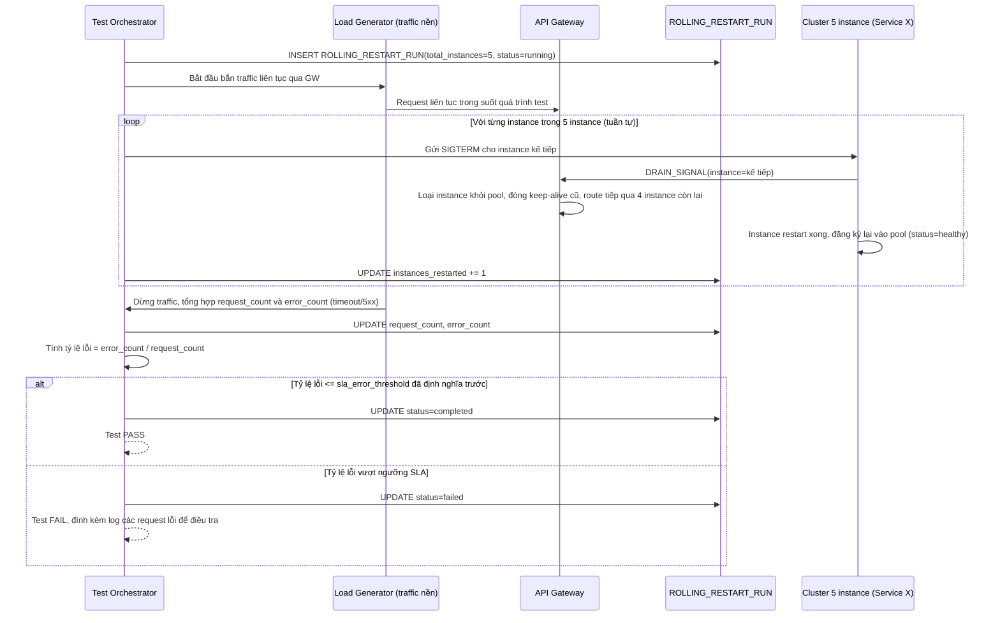

# API Gateway thực hiện rolling restart toàn cụm backend

**Hệ thống:** Một API Gateway đứng trước nhiều microservice của một nền tảng SaaS, cần rolling restart lần lượt các service trong giờ ít traffic mà không gây downtime cho khách hàng.

**Vai trò của flow:** Gateway phải phối hợp với connection draining của từng service để đảm bảo không có request nào bị route tới instance đang trong quá trình tắt.

**Yêu cầu cụ thể:**
- Gateway phải nhận được tín hiệu "instance X sắp shutdown" trước khi instance đó thực sự ngừng nhận connection (không dựa hoàn toàn vào health check polling định kỳ vốn có độ trễ phát hiện), để loại instance ra khỏi pool routing ngay lập tức.
- Với các kết nối HTTP keep-alive đang mở tới instance sắp tắt, gateway phải đảm bảo request tiếp theo trên kết nối đó (nếu có) được route sang instance khác, không tái sử dụng kết nối cũ tới instance đang chết.
- Trong lúc một service đang rolling restart (một số instance đã restart, một số chưa), phải xử lý được trường hợp version mới và version cũ trả về response có schema khác nhau nhẹ — gateway hoặc client không được crash vì field mới thiếu/thừa.
- Đặt cơ chế circuit breaker tạm thời tăng ngưỡng chịu lỗi (error budget) trong lúc rolling restart đang diễn ra, để tránh gateway hoảng loạn ngắt toàn bộ traffic chỉ vì vài request timeout do đúng lúc instance đang drain.
- Viết test toàn trình: rolling restart lần lượt 5 instance của một service trong lúc có traffic liên tục chạy nền, đo tỷ lệ lỗi/timeout trong toàn bộ quá trình phải bằng 0 hoặc dưới một ngưỡng SLA đã định nghĩa trước.

---

# Base ERD — API Gateway trước khi phối hợp graceful shutdown với backend

Đây là **base**: mô hình dữ liệu suy luận từ ngữ cảnh đề bài, thể hiện trạng thái hệ thống **trước khi** gateway biết phối hợp connection draining với từng service. Đề bài nói gateway đứng trước nhiều microservice, route request dựa trên trạng thái instance — nên base chỉ cần đủ: các service, các instance của từng service, và trạng thái healthy/unhealthy được cập nhật qua health check định kỳ. Chưa có tín hiệu shutdown chủ động, chưa có theo dõi kết nối keep-alive theo instance, chưa có circuit breaker điều chỉnh động, chưa có khái niệm rolling restart run — tất cả những thứ đó là phần enhance.

---

# Base sequence — Route request (chỉ dựa vào health check định kỳ)

Đây là **base**, flow "Gateway route request tới instance" ở trạng thái hiện tại — pool instance chỉ được cập nhật qua health check polling định kỳ (ví dụ mỗi 5 giây), gateway không có cách nào biết instance sắp tắt trước khi health check tự phát hiện. Flow này liên quan mật thiết tới enhance vì toàn bộ 5 yêu cầu của đề bài đều nhằm rút ngắn/loại bỏ khoảng trễ phát hiện này và các hệ quả của nó.

---

# Enhance ERD — Thêm tín hiệu drain, theo dõi connection, circuit breaker động, rolling restart run

Đây là **enhance**, mô hình dữ liệu sau khi áp toàn bộ đề bài lên base. So với base, các thay đổi:
- `INSTANCE` có thêm trạng thái `draining` và cột `schema_version` — đáp ứng yêu cầu 1 (tín hiệu shutdown chủ động) và yêu cầu 3 (nhận biết version khác nhau giữa các instance khi rolling restart đang chạy dở).
- Entity mới `DRAIN_SIGNAL` — sự kiện instance chủ động báo "sắp shutdown" gửi tới gateway trước khi ngừng nhận connection, độc lập với health check polling — đáp ứng yêu cầu 1.
- Entity mới `KEEP_ALIVE_CONNECTION` — theo dõi từng kết nối keep-alive đang mở gắn với instance nào, để gateway biết kết nối nào cần bị đóng/không tái sử dụng khi instance đó drain — đáp ứng yêu cầu 2.
- Entity mới `CIRCUIT_BREAKER` gắn theo service, có `error_budget_multiplier` được nới rộng tạm thời trong lúc rolling restart — đáp ứng yêu cầu 4.
- Entity mới `ROLLING_RESTART_RUN` — ghi nhận 1 lần rolling restart của 1 service (đang restart instance nào, đã xong bao nhiêu, số request/lỗi quan sát được) — làm nền cho bài test toàn trình đo tỷ lệ lỗi — đáp ứng yêu cầu 5.

---

# Enhance sequence — Route request (drain signal chủ động, không tái dùng keep-alive cũ)

Đây là **enhance** của flow `route-request` đã có ở base, đáp ứng **yêu cầu 1 và 2** của đề bài. So với base: instance chủ động gửi `DRAIN_SIGNAL` cho gateway ngay khi nhận SIGTERM (không đợi health check polling phát hiện), gateway loại instance khỏi pool routing ngay lập tức. Với các kết nối HTTP keep-alive đang mở tới instance đó, gateway đóng kết nối (hoặc đánh dấu closing) để request tiếp theo trên client bắt buộc mở kết nối mới tới instance khác, không bao giờ tái sử dụng kết nối cũ tới instance đang chết.

---

# Enhance sequence — Chịu đựng schema khác nhau giữa version cũ và mới khi rolling restart dở dang

Đây là flow **enhance** hoàn toàn mới so với base, đáp ứng **yêu cầu 3** của đề bài: trong lúc rolling restart, một phần instance đã lên version mới (schema response có thêm/bớt field), phần còn lại vẫn version cũ — gateway và client không được crash vì sự khác biệt này.

---

# Enhance sequence — Nới error budget circuit breaker tạm thời trong lúc rolling restart

Đây là flow **enhance** hoàn toàn mới so với base, đáp ứng **yêu cầu 4** của đề bài: khi rolling restart đang diễn ra, một vài request timeout do đúng lúc instance đang drain là chuyện bình thường và có thể dự đoán trước — circuit breaker phải tạm nới ngưỡng chịu lỗi trong cửa sổ thời gian đó, tránh ngắt toàn bộ traffic của service chỉ vì vài lỗi tạm thời.

---

# Enhance sequence — Test toàn trình rolling restart 5 instance dưới traffic liên tục

Đây là flow **enhance** hoàn toàn mới so với base, đáp ứng **yêu cầu 5** của đề bài: kịch bản test tự động rolling restart lần lượt 5 instance của một service trong lúc có traffic liên tục chạy nền, đo tỷ lệ lỗi/timeout toàn bộ quá trình và so sánh với ngưỡng SLA đã định nghĩa trước.

