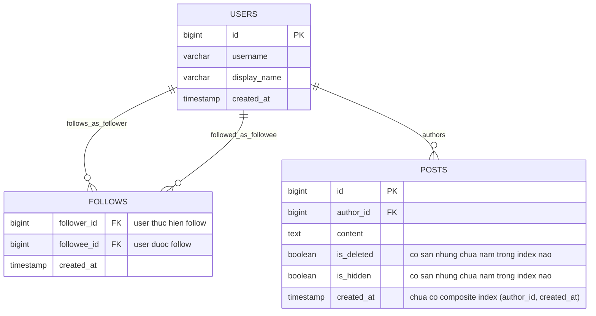
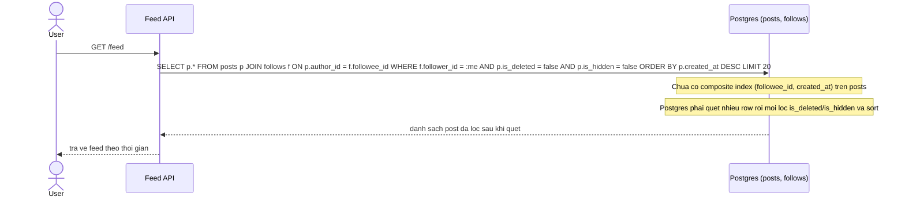
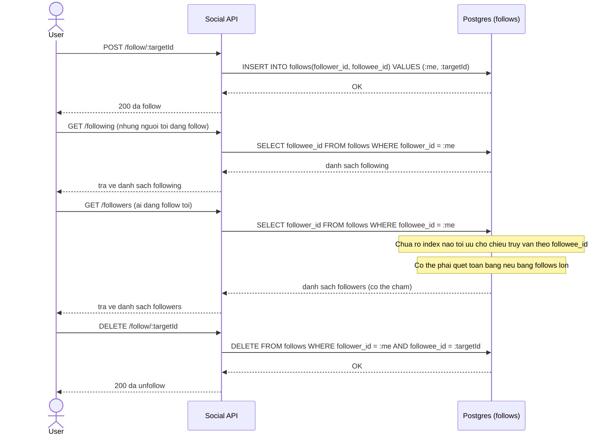
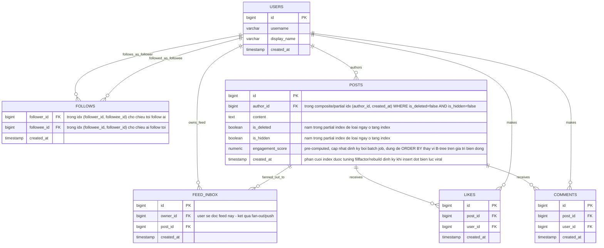
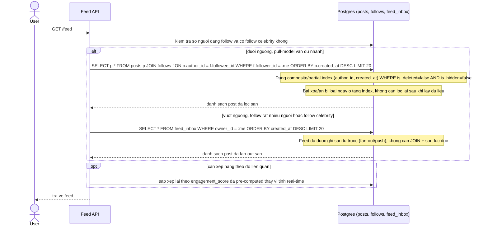
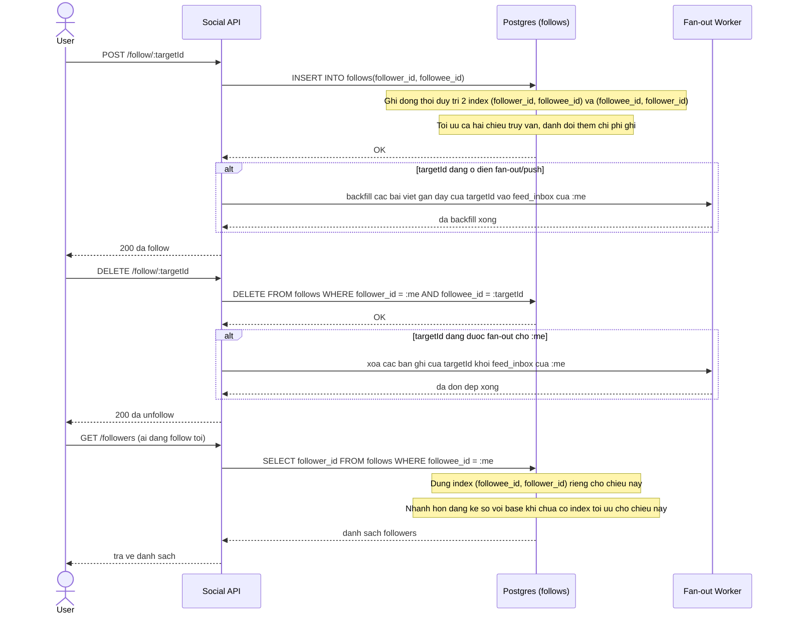
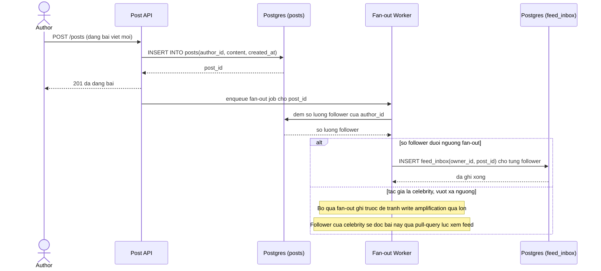
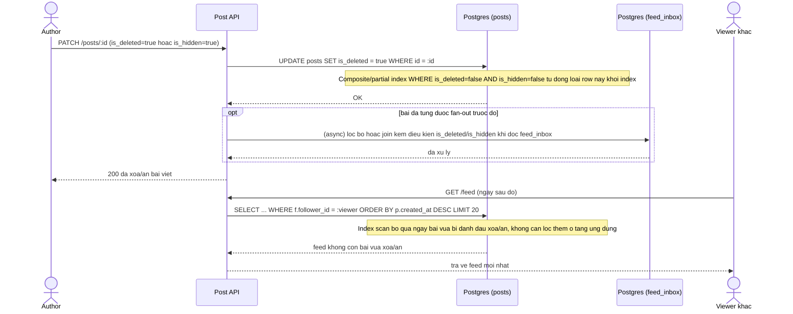
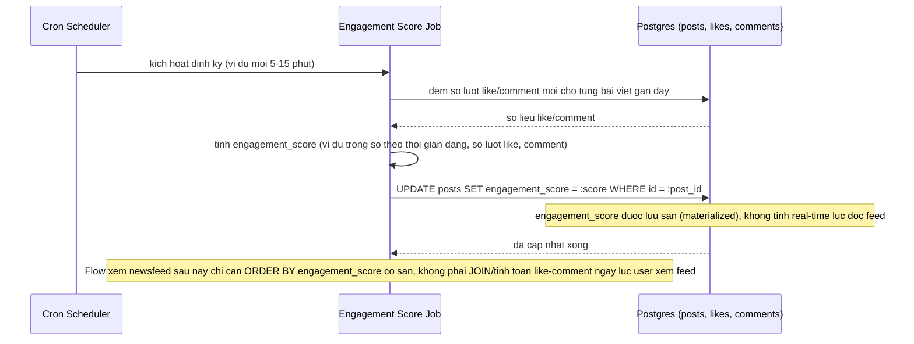
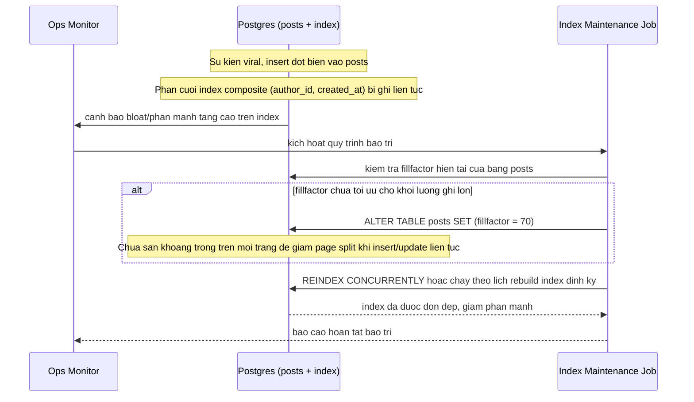

# Mạng xã hội tối ưu truy vấn newsfeed theo follow và thời gian

**Hệ thống:** Mạng xã hội hiển thị newsfeed gồm bài viết từ những người user đang follow, sắp xếp theo thời gian đăng và/hoặc mức độ liên quan.

**Vai trò của flow:** Chọn đúng chiến lược index (và ranh giới khi nào chuyển từ pull-query sang fan-out/push) để trả feed nhanh dù số lượng người follow và tổng số bài viết tăng lớn.

**Yêu cầu cụ thể:**
- Cách tiếp cận pull (JOIN bảng follows với posts, ORDER BY created_at) cần composite index (followee_id, created_at) trên bảng posts, nhưng với user follow rất nhiều tài khoản hoặc follow một celebrity có lượng bài viết khổng lồ, JOIN + index vẫn không đủ nhanh — cần xác định ngưỡng khi nào nên chuyển sang mô hình fan-out/push (ghi sẵn feed) thay vì tiếp tục tối ưu index cho pull-query.
- Bài viết bị xoá hoặc ẩn phải biến mất khỏi feed ngay lập tức, nhưng nếu chỉ dựa vào cột `is_deleted`/`is_hidden` không nằm trong index thì mỗi lần lọc vẫn phải quét thêm — cần đưa các cột trạng thái này vào composite/partial index để loại bỏ ngay ở tầng index thay vì lọc sau khi đã lấy dữ liệu.
- Khi feed cần xếp hạng theo độ liên quan (kết hợp engagement score, không chỉ theo thời gian đăng), điểm số này thay đổi liên tục theo lượt like/comment mới — B-tree index không tối ưu để sort theo một giá trị luôn biến động, cần cân nhắc pre-computed/materialized ranking được cập nhật định kỳ thay vì tính và sort real-time trên index thời gian.
- Ở các sự kiện viral, lượng bài viết mới insert tăng đột biến khiến index trên bảng posts (đặc biệt phần cuối theo created_at) bị ghi liên tục dẫn tới page split và phân mảnh — cần tính tới việc tuning fillfactor hoặc lịch bảo trì/rebuild index định kỳ để giữ hiệu năng ổn định.
- Danh sách follow/unfollow của user thay đổi liên tục, và bảng follows được truy vấn theo cả hai chiều (tìm những người tôi follow, và tìm những ai đang follow tôi) — cần quyết định thứ tự cột index (follower_id, followee_id) hay ngược lại dựa trên chiều truy vấn nào phổ biến hơn trong hệ thống, hoặc chấp nhận tạo cả hai index đánh đổi lấy overhead ghi.

---

# ERD - Base (trước khi tối ưu index cho newsfeed)

Đây là trạng thái **base**: mô hình dữ liệu tối thiểu để một mạng xã hội có newsfeed theo follow tồn tại, trước khi áp bất kỳ tối ưu index nào. Chỉ gồm `users`, `follows` (quan hệ hai chiều) và `posts` với các cột trạng thái `is_deleted`/`is_hidden` cơ bản (đã có nhưng chưa được đưa vào index) - đây chính là phần dữ liệu mà đề bài (enhance) sẽ tác động trực tiếp.

---

# Sequence Diagram - Base: Xem newsfeed

Đây là trạng thái **base**, flow "xem newsfeed" bằng pull-query đơn giản: JOIN `follows` với `posts`, lọc `is_deleted`/`is_hidden` và sắp xếp theo `created_at` mà chưa có composite/partial index hỗ trợ. Flow này được chọn vì đây chính là truy vấn mà toàn bộ đề bài (enhance) nhắm tới tối ưu.

---

# Sequence Diagram - Base: Follow / Unfollow

Đây là trạng thái **base**, flow "follow/unfollow" và truy vấn bảng `follows` theo cả hai chiều (tôi follow ai, ai follow tôi) khi chưa quyết định thứ tự cột index. Flow này được chọn vì đề bài đặt thẳng câu hỏi nên đánh index `(follower_id, followee_id)` hay ngược lại, và base cần cho thấy vấn đề khi chỉ có (hoặc chưa có) index tối ưu cho một chiều.

---

# ERD - Enhance (sau khi tối ưu index cho newsfeed)

Đây là trạng thái **enhance**: giữ nguyên `users`, `follows`, `posts` từ base, cộng thêm những gì đề bài yêu cầu - composite/partial index trên `posts` gồm cả `is_deleted`/`is_hidden`, index cho cả hai chiều của `follows`, cột `engagement_score` pre-computed thay vì sort real-time, và bảng `feed_inbox` phục vụ mô hình fan-out/push khi pull-query không còn đủ nhanh (follow quá nhiều người hoặc theo dõi celebrity). `likes`/`comments` chỉ được thêm ở mức tối thiểu vì là nguồn dữ liệu đầu vào để tính `engagement_score`.

So với base: `posts` thêm cột `engagement_score` và được đánh composite/partial index gồm cả `is_deleted`/`is_hidden`; `follows` được đánh index cho cả hai chiều; thêm mới `feed_inbox` (mô hình push cho trường hợp vượt ngưỡng pull-query) và `likes`/`comments` (nguồn tính engagement score).

---

# Sequence Diagram - Enhance: Xem newsfeed

Đây là trạng thái **enhance** của flow "xem newsfeed" đã có ở base. So với base, flow này thay đổi ở: (1) dùng composite/partial index `(author_id, created_at) WHERE is_deleted=false AND is_hidden=false` nên bài xoá/ẩn bị loại ngay ở tầng index thay vì lọc sau khi quét, (2) có nhánh kiểm tra ngưỡng để quyết định tiếp tục pull-query hay đọc từ `feed_inbox` đã fan-out sẵn khi user follow quá nhiều người hoặc follow celebrity, (3) có thể sắp theo `engagement_score` pre-computed thay vì tính real-time.

---

# Sequence Diagram - Enhance: Follow / Unfollow

Đây là trạng thái **enhance** của flow "follow/unfollow" đã có ở base. So với base, flow này thay đổi ở: bảng `follows` nay duy trì index cho cả hai chiều `(follower_id, followee_id)` và `(followee_id, follower_id)` đánh đổi lấy chi phí ghi, đồng thời nếu người được follow đang ở diện fan-out/push thì follow/unfollow còn phải backfill hoặc dọn dẹp `feed_inbox` tương ứng.

---

# Sequence Diagram - Enhance: Đăng bài và fan-out ghi feed

Đây là flow hoàn toàn mới phát sinh từ enhance, chưa tồn tại ở base. Flow này thể hiện ngưỡng chuyển từ pull-query sang mô hình fan-out/push mà đề bài đặt ra: khi số follower dưới ngưỡng, hệ thống ghi sẵn bài viết vào `feed_inbox` của từng follower ngay lúc đăng bài (đánh đổi write amplification để đọc feed nhanh); khi tác giả là celebrity có quá nhiều follower, bỏ qua fan-out ghi trước và để pull-query xử lý lúc đọc (mô hình hybrid).

---

# Sequence Diagram - Enhance: Xoá / ẩn bài viết

Đây là flow hoàn toàn mới phát sinh từ enhance, chưa được vẽ riêng ở base. Flow này thể hiện trực tiếp yêu cầu "bài viết bị xoá hoặc ẩn phải biến mất khỏi feed ngay lập tức" nhờ `is_deleted`/`is_hidden` đã nằm trong composite/partial index, nên không còn phải lọc lại sau khi quét dữ liệu như ở base.

---

# Sequence Diagram - Enhance: Batch job tính engagement score

Đây là flow hoàn toàn mới phát sinh từ enhance, chưa tồn tại ở base. Flow này giải quyết vấn đề đề bài nêu: khi feed cần xếp hạng theo mức độ liên quan, điểm số biến động liên tục theo like/comment mới khiến B-tree index không tối ưu để sort real-time, nên cần một batch job định kỳ pre-computed `engagement_score` thay vì tính lúc đọc feed.

---

# Sequence Diagram - Enhance: Bảo trì index khi sự kiện viral

Đây là flow hoàn toàn mới phát sinh từ enhance, chưa tồn tại ở base. Flow này giải quyết vấn đề đề bài nêu: ở các sự kiện viral, lượng insert đột biến vào `posts` khiến phần cuối index theo `created_at` bị ghi liên tục dẫn tới page split và phân mảnh, nên cần tuning `fillfactor` và/hoặc lịch bảo trì/rebuild index định kỳ.

