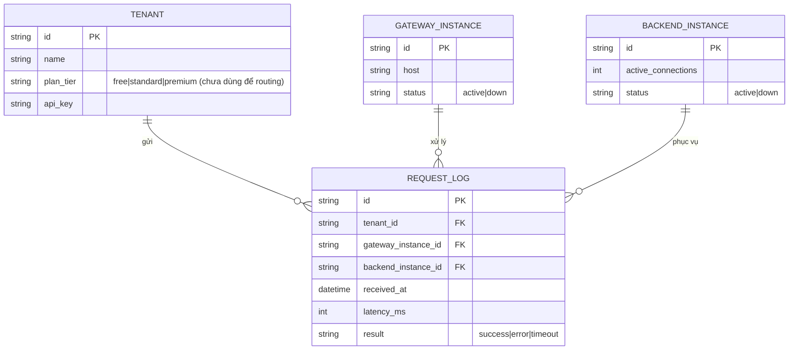
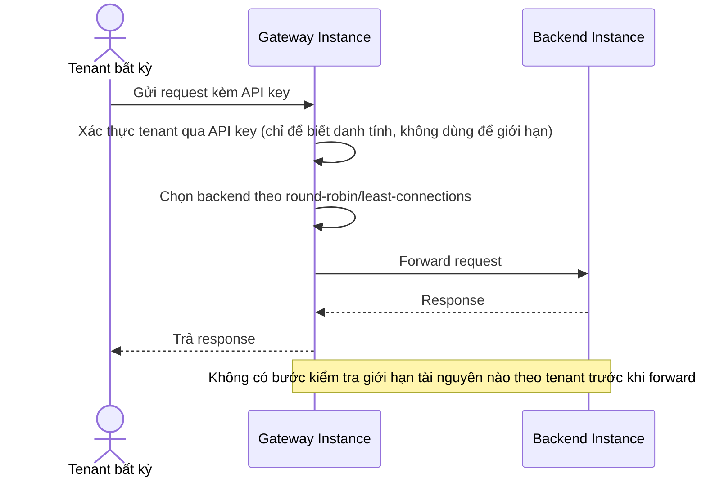
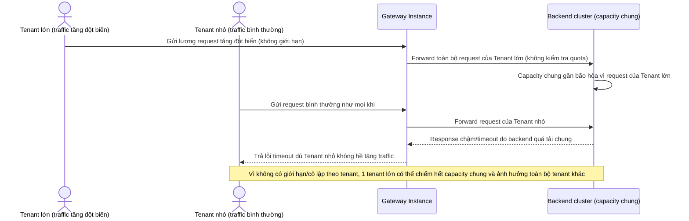
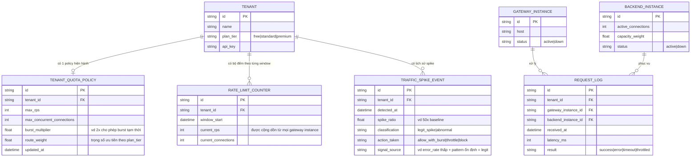
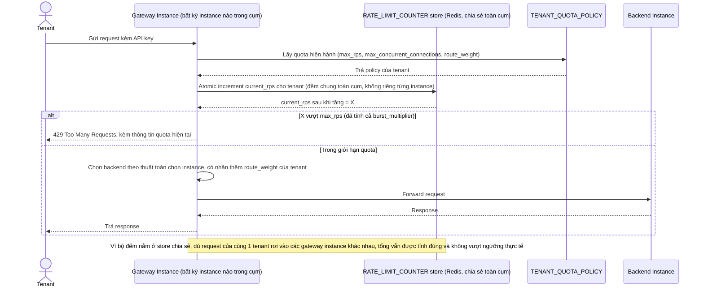
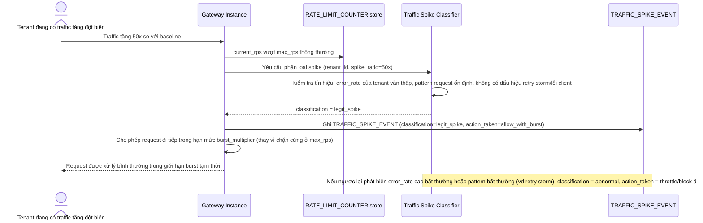
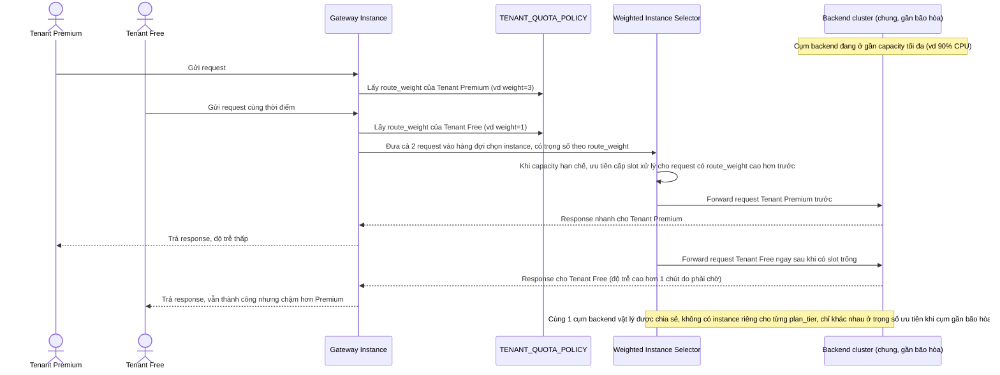
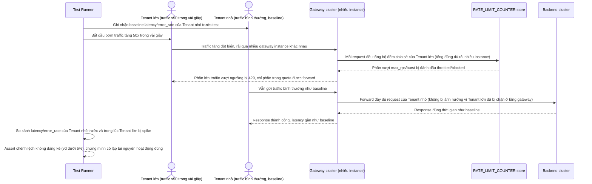

# API gateway route theo tenant có trọng số cho nền tảng SaaS B2B

**Hệ thống:** Một API gateway đứng trước các service backend của nền tảng SaaS B2B, phục vụ nhiều tenant (công ty khách hàng) có quy mô rất khác nhau — một số tenant lớn gửi lượng request gấp hàng trăm lần tenant nhỏ.

**Vai trò của flow:** Load balancing ở đây không chỉ phân phối request đều tới các instance backend, mà còn phải đảm bảo công bằng tài nguyên giữa các tenant — một tenant lớn đột biến traffic không được phép chiếm hết capacity chung khiến các tenant nhỏ hơn bị chậm hoặc timeout.

**Yêu cầu cụ thể:**
- Thiết kế cơ chế giới hạn tài nguyên theo tenant (ví dụ số connection đồng thời hoặc số request/giây tối đa mà một tenant được phép chiếm trên tổng capacity cụm) độc lập với thuật toán chọn instance, để một tenant có traffic bất thường bị giới hạn ở tầng gateway trước khi kịp làm nghẽn backend chung.
- Xử lý trường hợp một tenant lớn đang có traffic đột biến hợp lệ (không phải tấn công, ví dụ họ đang chạy chiến dịch của riêng họ) — phân biệt được với traffic bất thường/lỗi client để không chặn nhầm nhu cầu chính đáng, đồng thời vẫn bảo vệ được tenant khác.
- Đảm bảo việc đếm và giới hạn traffic theo tenant hoạt động đúng khi có nhiều instance gateway chạy song song (bộ đếm phải chia sẻ trạng thái giữa các instance gateway, không phải đếm riêng độc lập từng instance rồi mỗi instance tự cho qua một phần giới hạn dẫn đến tổng vượt ngưỡng thực tế).
- Cho phép cấu hình trọng số route khác nhau theo gói dịch vụ của tenant (tenant trả phí cao hơn được ưu tiên nhiều tài nguyên hơn khi cụm gần đạt tải tối đa) mà không cần phải tách riêng instance backend vật lý cho từng nhóm tenant, tránh lãng phí tài nguyên khi tenant lớn đang rảnh.
- Thiết kế test mô phỏng một tenant gửi traffic tăng đột biến 50 lần trong vài giây, đo độ trễ và tỷ lệ lỗi của các tenant khác trong cùng cụm — phải chứng minh được các tenant khác gần như không bị ảnh hưởng nhờ giới hạn tài nguyên theo tenant đã thiết kế.

---

# Base ERD — API gateway chưa có giới hạn/tách biệt tài nguyên theo tenant

Đây là **base**: trạng thái API gateway *trước khi* áp dụng giới hạn tài nguyên và routing có trọng số theo tenant. Suy luận từ đề bài, base đã có `TENANT` (công ty khách hàng, xác định qua API key/JWT khi gọi request), nhiều `GATEWAY_INSTANCE` chạy song song đứng trước `BACKEND_INSTANCE`, và gateway chọn backend bằng thuật toán đơn giản (round-robin/least-connections) không quan tâm tenant nào đang gửi request. Base chưa có bất kỳ khái niệm quota, bộ đếm chia sẻ, hay trọng số theo gói dịch vụ nào.

---

# Base sequence — Route request (round-robin, không phân biệt tenant)

Đây là **base**, flow route request hiện tại: gateway chọn backend instance bằng round-robin/least-connections, hoàn toàn không biết và không quan tâm request đến từ tenant nào. Flow này là tiền đề để so sánh với yêu cầu 1 và yêu cầu 4 của đề bài (giới hạn và trọng số theo tenant).

---

# Base sequence — Sự cố 1 tenant lớn làm nghẽn tenant khác (chưa có cô lập tài nguyên)

Đây là **base**, mô tả sự cố xảy ra khi chưa có giới hạn theo tenant: một tenant lớn tăng traffic đột biến, chiếm hết capacity chung của backend, khiến các tenant nhỏ khác cũng bị chậm/timeout dù họ không hề tăng traffic. Đây chính là vấn đề gốc mà toàn bộ đề bài (giới hạn, phân loại traffic, trọng số theo gói) phải giải quyết.

---

# Enhance ERD — Quota theo tenant, bộ đếm chia sẻ, trọng số theo gói dịch vụ

Đây là ERD **sau khi** enhance được áp dụng lên base. So với base, thêm mới:

- `TENANT_QUOTA_POLICY` (max_rps, max_concurrent_connections, route_weight theo `plan_tier`) — đáp ứng yêu cầu 1 (giới hạn tài nguyên độc lập với thuật toán chọn instance) và yêu cầu 4 (trọng số route theo gói dịch vụ, không cần tách backend vật lý riêng).
- `RATE_LIMIT_COUNTER` — bộ đếm request/connection theo tenant, đặt trong 1 store chia sẻ (vd Redis) chứ không lưu cục bộ ở từng `GATEWAY_INSTANCE`, đáp ứng yêu cầu 3 (đếm đúng khi có nhiều gateway instance chạy song song).
- `TRAFFIC_SPIKE_EVENT` — ghi nhận mỗi lần phát hiện traffic tăng đột biến của 1 tenant, kèm phân loại (legit_spike/abnormal) và action đã áp dụng, đáp ứng yêu cầu 2 (phân biệt spike hợp lệ với traffic bất thường).
- `BACKEND_INSTANCE.capacity_weight` — dùng cùng `TENANT_QUOTA_POLICY.route_weight` để phân bổ tài nguyên linh hoạt trên cùng 1 cụm backend, không tách instance riêng theo nhóm tenant.

---

# Enhance sequence — Route request (kiểm tra quota qua bộ đếm chia sẻ trước khi chọn backend)

Đây là **enhance** của flow `route-request` đã có ở base. So với base (chỉ round-robin, không biết tenant), giờ gateway phải: (1) đọc `TENANT_QUOTA_POLICY` để biết giới hạn và trọng số, (2) tăng/kiểm tra `RATE_LIMIT_COUNTER` trong store chia sẻ (không lưu cục bộ) để đếm đúng dù có nhiều gateway instance chạy song song, và (3) chọn backend có tính tới `route_weight` của tenant. Đáp ứng yêu cầu 1, yêu cầu 3, và một phần yêu cầu 4.

---

# Enhance sequence — Phân loại traffic spike hợp lệ vs bất thường

Đây là **enhance**, flow hoàn toàn mới xử lý khi 1 tenant vượt ngưỡng `max_rps` bình thường. Đáp ứng yêu cầu 2 của đề bài: phân biệt spike hợp lệ (tenant đang chạy chiến dịch riêng của họ) với traffic bất thường/lỗi client, để không chặn nhầm nhu cầu chính đáng nhưng vẫn bảo vệ tenant khác.

---

# Enhance sequence — Route có trọng số theo gói dịch vụ khi cụm gần bão hòa

Đây là **enhance**, flow mới tập trung vào yêu cầu 4 của đề bài: khi cụm backend gần đạt tải tối đa, tenant trả phí cao hơn (`plan_tier` = premium) được ưu tiên nhiều tài nguyên hơn qua `route_weight`, mà không cần tách riêng instance backend vật lý cho từng nhóm tenant.

---

# Enhance sequence — Test 1 tenant tăng traffic 50x, đo ảnh hưởng tới tenant khác

Đây là **enhance**, flow test mô tả ở yêu cầu 5 của đề bài: mô phỏng 1 tenant tăng traffic đột biến 50 lần trong vài giây, đo độ trễ và tỷ lệ lỗi của các tenant khác trong cùng cụm, chứng minh giới hạn tài nguyên theo tenant (yêu cầu 1, 3) đã cô lập được ảnh hưởng. Đối lập trực tiếp với flow base `tenant-overload-incident` — cùng kịch bản traffic nhưng kết quả khác hẳn nhờ enhance.

