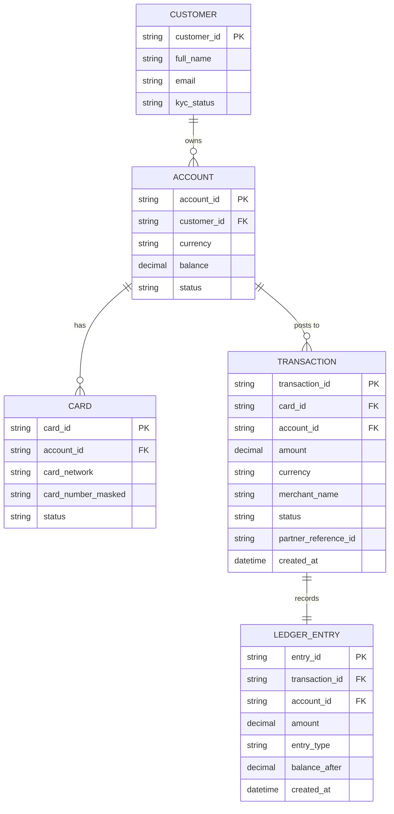
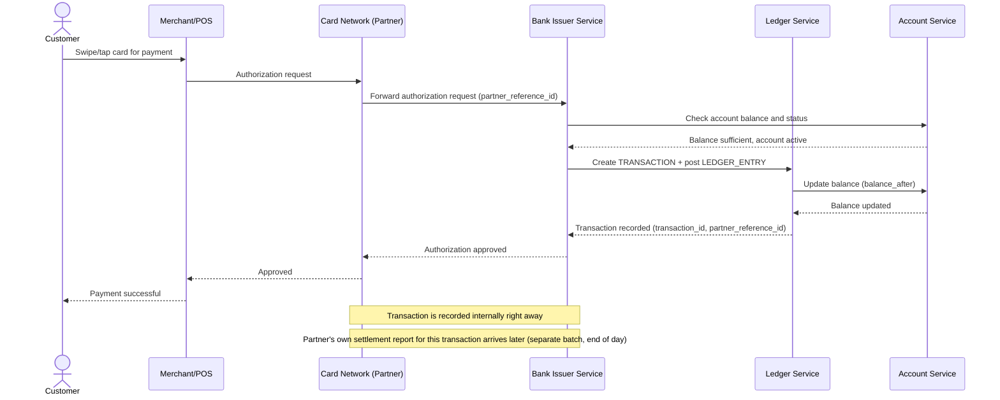
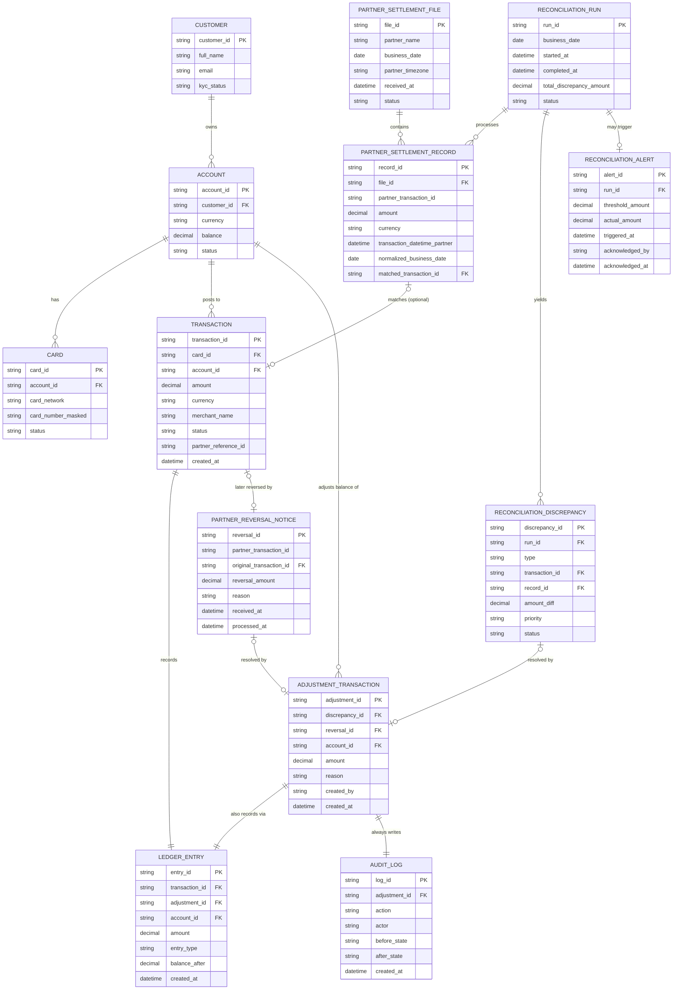
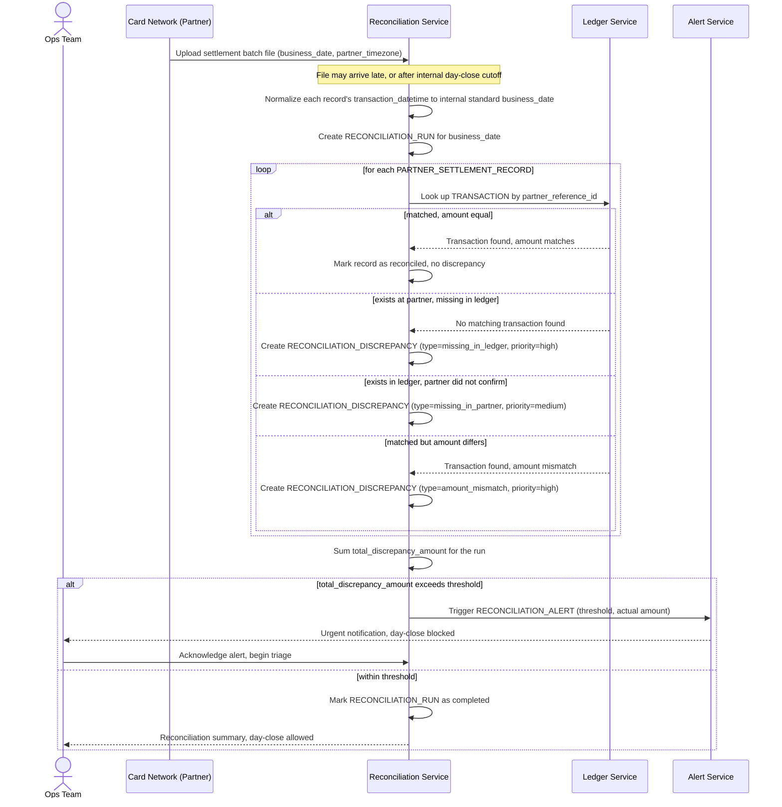
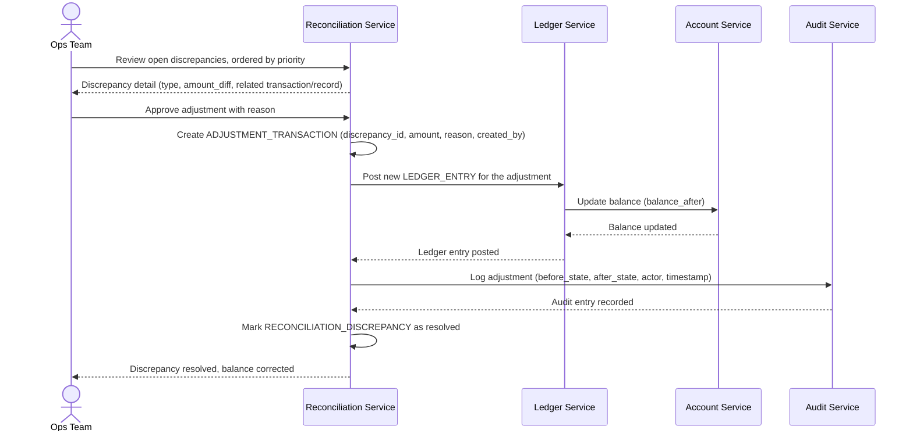
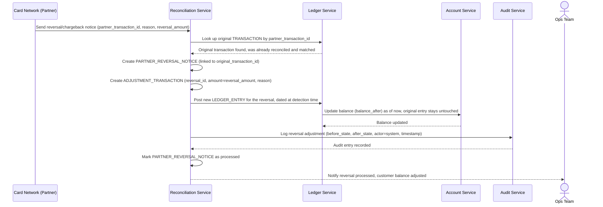

# Ngân hàng số đối soát giao dịch với đối tác thanh toán/mạng thẻ

**Hệ thống:** Một ngân hàng số (neobank) xử lý giao dịch thẻ và chuyển tiền qua các đối tác bên ngoài (mạng thẻ, cổng chuyển mạch liên ngân hàng).

**Vai trò của flow:** Đối soát cuối ngày giữa sổ cái (ledger) nội bộ của ngân hàng và file/báo cáo giao dịch nhận từ đối tác thanh toán để đảm bảo mọi giao dịch được ghi nhận đúng và số dư khách hàng chính xác.

**Yêu cầu cụ thể:**
- Đối soát phải xử lý được file batch từ đối tác thanh toán có thể đến muộn hoặc theo múi giờ khác với hệ thống nội bộ — phải định nghĩa rõ "ngày giao dịch" theo cùng một chuẩn giữa hai bên để tránh lệch ngày khi đối soát.
- Phát hiện chính xác các loại sai lệch khác nhau: giao dịch có ở đối tác nhưng thiếu trong ledger nội bộ, giao dịch có trong ledger nhưng đối tác không xác nhận, và giao dịch khớp nhưng sai số tiền — mỗi loại phải có quy trình xử lý và mức độ ưu tiên khác nhau vì đây là tiền thật của khách hàng.
- Giao dịch bị đối tác báo hoàn/đảo sau một khoảng thời gian (ví dụ tranh chấp thẻ) phải được xử lý đúng dù giao dịch gốc đã đối soát khớp từ trước, và số dư khách hàng phải được điều chỉnh đúng thời điểm phát hiện.
- Toàn bộ quy trình đối soát và mọi điều chỉnh số dư phát sinh từ đó phải có audit trail đầy đủ, không thể sửa trực tiếp số dư mà không qua bước ghi nhận giao dịch điều chỉnh tương ứng, để đáp ứng yêu cầu kiểm toán ngân hàng.
- Phải có ngưỡng cảnh báo tự động khi tổng sai lệch chưa xử lý trong ngày vượt quá một số tiền nhất định, yêu cầu can thiệp khẩn của đội vận hành trước khi đóng sổ ngày đó.

---

# ERD — Base (trước khi có đối soát cuối ngày)

Đây là **base**: mô hình dữ liệu suy luận cho hệ thống ngân hàng số *trước khi* có flow đối soát. Đề bài giả định ngân hàng đã xử lý giao dịch thẻ qua đối tác (mạng thẻ) và ghi sổ cái nội bộ — nếu không có sẵn Account/Transaction/Ledger thì "đối soát ledger nội bộ với báo cáo đối tác" sẽ không có nghĩa. ERD chỉ dựng phần lõi phục vụ giao dịch thẻ + ghi sổ, không suy diễn thêm các module không liên quan (chuyển khoản nội địa, tiết kiệm, thẻ tín dụng...).

---

# Sequence Diagram — Base: Process Card Transaction

Đây là **base**, flow "xử lý giao dịch thẻ" — tiền đề bắt buộc cho đối soát: chính flow này tạo ra các `TRANSACTION` và `LEDGER_ENTRY` mà cuối ngày phải được đối chiếu với báo cáo của đối tác mạng thẻ. Đặc biệt, `partner_reference_id` được sinh ra ở bước này là khóa nối giữa hai phía khi đối soát.

---

# ERD — Enhance (sau khi có đối soát cuối ngày)

Đây là **enhance**: ERD base cộng với các entity phục vụ đúng 5 yêu cầu của đề bài — nhận file batch đối tác (có thể trễ/khác múi giờ), phân loại 3 loại sai lệch, xử lý giao dịch bị đối tác báo hoàn sau khi đã khớp, audit trail cho mọi điều chỉnh số dư, và ngưỡng cảnh báo tự động. So với base, `LEDGER_ENTRY` không đổi cấu trúc nhưng nay còn được tạo bởi `ADJUSTMENT_TRANSACTION` (không chỉ bởi `TRANSACTION` gốc) — đây là cách duy nhất để sửa số dư, không sửa trực tiếp.

---

# Sequence Diagram — Enhance: Daily Reconciliation

Đây là **enhance**, flow chính hoàn toàn mới mà đề bài yêu cầu: đối soát cuối ngày giữa ledger nội bộ và file batch từ đối tác mạng thẻ. Flow này thể hiện yêu cầu chuẩn hóa "ngày giao dịch" giữa hai múi giờ, phân loại 3 loại sai lệch với mức ưu tiên khác nhau, và ngưỡng cảnh báo tự động khi tổng sai lệch vượt mức — tất cả chưa tồn tại ở base.

---

# Sequence Diagram — Enhance: Handle Discrepancy

Đây là **enhance**, flow mới xử lý một `RECONCILIATION_DISCREPANCY` được tạo ra từ flow đối soát ([4-enhance-daily-reconciliation-sqd.md](#4-enhance-daily-reconciliation-sqd)). Flow này thể hiện yêu cầu "không thể sửa trực tiếp số dư mà không qua bước ghi nhận giao dịch điều chỉnh tương ứng" và audit trail đầy đủ — số dư khách hàng (vốn chỉ được cập nhật qua LEDGER_ENTRY ở base) nay chỉ có thể thay đổi thêm qua một ADJUSTMENT_TRANSACTION được audit.

---

# Sequence Diagram — Enhance: Handle Partner Reversal

Đây là **enhance**, flow mới xử lý trường hợp đối tác báo hoàn/đảo một giao dịch (ví dụ tranh chấp thẻ) sau một khoảng thời gian, kể cả khi giao dịch gốc đã đối soát khớp từ trước ở flow [4-enhance-daily-reconciliation-sqd.md](#4-enhance-daily-reconciliation-sqd). Flow này tái sử dụng cơ chế điều chỉnh có audit trail giống [5-enhance-handle-discrepancy-sqd.md](#5-enhance-handle-discrepancy-sqd), nhưng khởi phát từ thông báo của đối tác thay vì từ chạy đối soát, và số dư phải được điều chỉnh đúng tại thời điểm phát hiện chứ không lùi lại ngày giao dịch gốc.

