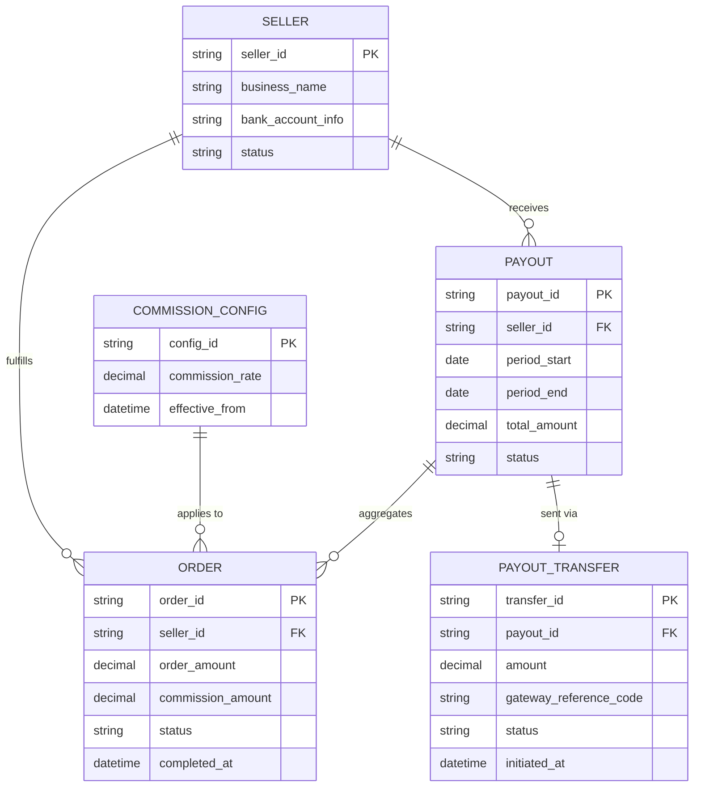
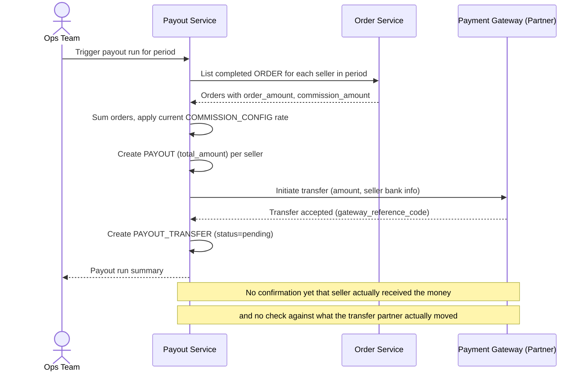
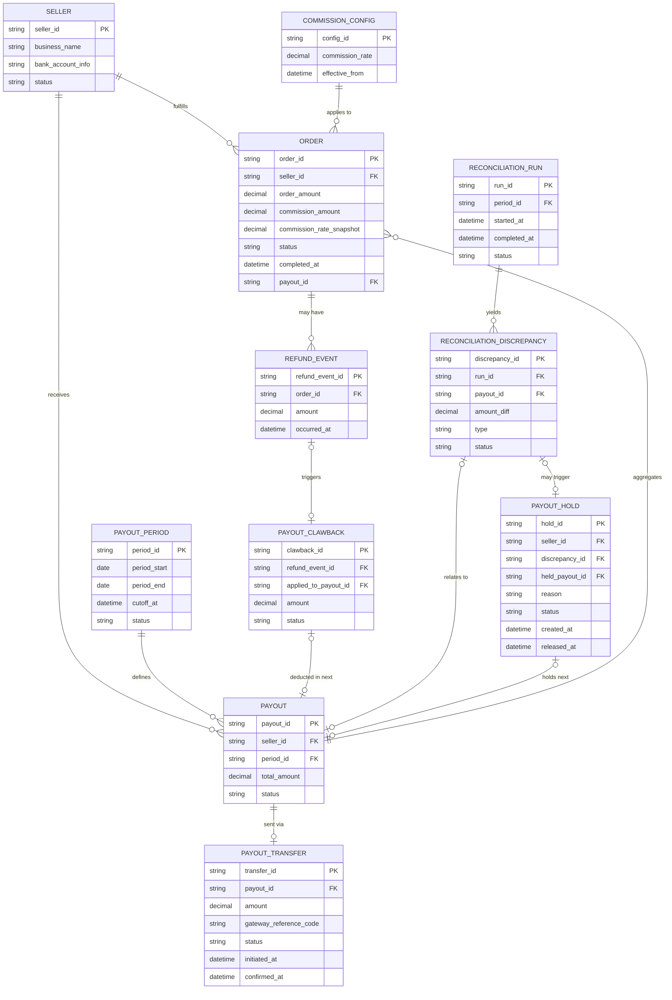
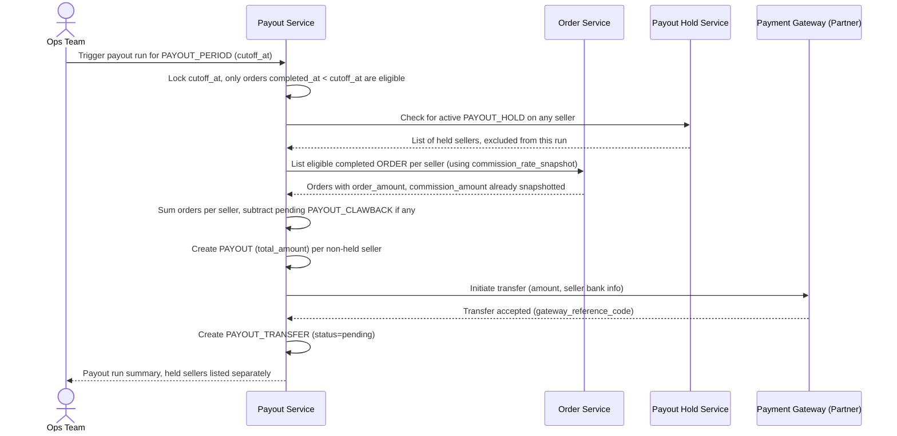
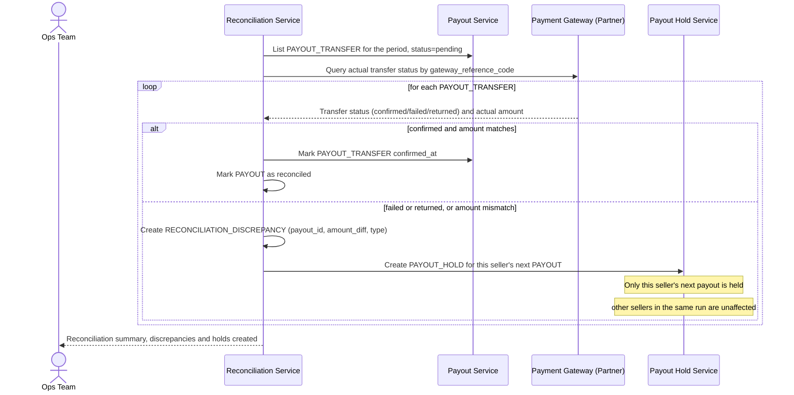
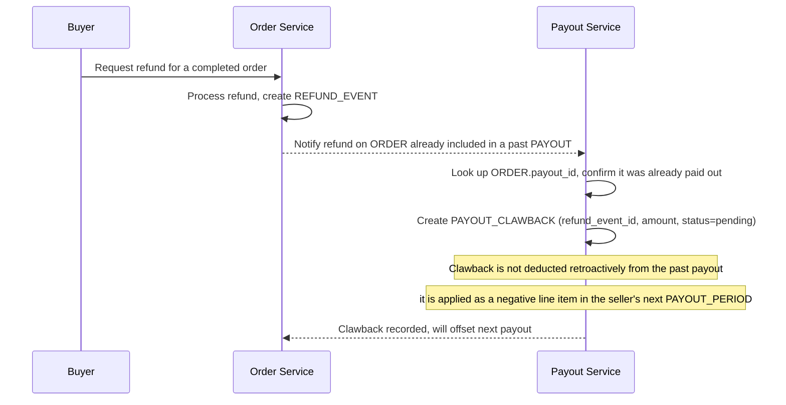

# Marketplace đa seller đối soát payout cho người bán

**Hệ thống:** Một marketplace đa seller, sàn thu tiền từ người mua rồi định kỳ trả (payout) cho từng seller sau khi trừ phí hoa hồng sàn và các khoản hoàn tiền phát sinh.

**Vai trò của flow:** Đối soát giữa số tiền hệ thống nội bộ tính seller được nhận (sau phí, sau hoàn tiền) và số tiền thực tế đã được chuyển ra ngoài qua cổng thanh toán cho từng seller.

**Yêu cầu cụ thể:**
- Một seller có thể có hàng trăm đơn hàng hoàn tất trong kỳ, một số đơn bị hoàn tiền/khiếu nại xử lý sau khi đã tính vào kỳ payout — cần xác định rõ mốc thời gian cắt (cutoff) nhất quán cho từng kỳ, tránh trường hợp đơn vừa hoàn tất bị tính hai lần vào hai kỳ khác nhau hoặc bị bỏ sót không kỳ nào tính tới.
- Khi một đơn hàng đã được tính vào payout đã chuyển tiền cho seller, nhưng sau đó phát sinh hoàn tiền cho người mua, hệ thống phải xử lý đúng việc thu hồi/trừ vào kỳ payout tiếp theo của seller đó — đối soát phải phát hiện được các khoản âm này thay vì chỉ xử lý cộng dồn một chiều.
- Lệnh chuyển tiền ra ngoài cho seller qua cổng thanh toán có thể ở trạng thái pending/thất bại/bị trả lại (ví dụ tài khoản ngân hàng seller sai thông tin) — đối soát phải phân biệt rõ "đã lên lệnh chuyển" và "seller thực nhận được tiền", không đóng kỳ payout khi còn lệnh chuyển chưa xác nhận thành công.
- Phí hoa hồng sàn được tính tại thời điểm đơn hàng hoàn tất có thể khác với mức phí áp dụng tại thời điểm đối soát nếu chính sách phí thay đổi giữa chừng — đối soát phải dùng đúng mức phí đã chốt tại thời điểm phát sinh giao dịch, không tính lại theo cấu hình phí hiện tại gây sai lệch số liệu lịch sử.
- Khi phát hiện sai lệch giữa số tiền sàn tính seller được nhận và số tiền thực đã chuyển, cần có cơ chế giữ (hold) kỳ payout tiếp theo của seller đó lại để điều chỉnh, thay vì tiếp tục chuyển tiền theo số liệu có khả năng sai, đồng thời không làm ảnh hưởng payout của các seller khác không liên quan.

---

# ERD — Base (trước khi có đối soát payout seller)

Đây là **base**: mô hình dữ liệu suy luận cho marketplace đa seller *trước khi* có flow đối soát payout. Đề bài giả định sàn đã thu tiền từ người mua, đã tính hoa hồng theo cấu hình phí, và đã có cơ chế tính/chuyển tiền định kỳ cho seller — nếu không có sẵn `ORDER`, `COMMISSION_CONFIG` và `PAYOUT` thì "đối soát số tiền tính toán với số tiền thực chuyển" sẽ không có nghĩa. ERD chỉ dựng phần lõi phục vụ payout, không suy diễn thêm các module không liên quan (catalog, review...).

---

# Sequence Diagram — Base: Calculate Payout

Đây là **base**, flow "tính và chuyển payout cho seller" theo kỳ — tiền đề bắt buộc cho đối soát: chính flow này tạo ra `PAYOUT` (số tiền sàn tính seller được nhận) và `PAYOUT_TRANSFER` (lệnh chuyển tiền thực), hai con số mà đối soát sau này phải khớp với nhau. Ở base, flow này còn đơn giản, chưa xử lý cutoff nhất quán hay lịch sử phí.

---

# ERD — Enhance (sau khi có đối soát payout seller)

Đây là **enhance**: ERD base cộng với các entity phục vụ đúng 4 yêu cầu của đề bài — cutoff nhất quán theo kỳ, xử lý hoàn tiền phát sinh sau payout (clawback), phân biệt "đã lên lệnh chuyển" với "seller thực nhận", và hold kỳ payout tiếp theo khi phát hiện sai lệch. So với base, `ORDER` nay lưu thêm `commission_rate_snapshot` chốt tại thời điểm hoàn tất (không tính lại theo cấu hình hiện tại), và `PAYOUT_TRANSFER` có thêm trạng thái xác nhận rõ ràng.

---

# Sequence Diagram — Enhance: Calculate Payout

Đây là **enhance**, flow "tính payout" đã có ở base ([2-base-calculate-payout-sqd.md](#2-base-calculate-payout-sqd)) nhưng nay thay đổi ở hai điểm: (1) dùng `PAYOUT_PERIOD.cutoff_at` cố định để xác định đơn nào thuộc kỳ nào thay vì mốc thời gian ngầm định, tránh tính trùng/bỏ sót; (2) mỗi `ORDER` dùng đúng `commission_rate_snapshot` đã chốt tại thời điểm hoàn tất thay vì `COMMISSION_CONFIG` hiện hành.

---

# Sequence Diagram — Enhance: Reconcile Payout

Đây là **enhance**, flow mới hoàn toàn: đối soát giữa `PAYOUT.total_amount` (số tiền sàn tính) và trạng thái thực tế của `PAYOUT_TRANSFER`. Flow này thể hiện yêu cầu phân biệt "đã lên lệnh chuyển" với "seller thực nhận" — chỉ coi kỳ đã đóng khi transfer được đối tác xác nhận thành công — và tạo `PAYOUT_HOLD` cho seller có sai lệch mà không ảnh hưởng các seller khác.

---

# Sequence Diagram — Enhance: Handle Refund Clawback

Đây là **enhance**, flow mới xử lý trường hợp một `ORDER` đã được tính vào `PAYOUT` đã chuyển tiền, nhưng sau đó phát sinh hoàn tiền cho người mua. Flow này thể hiện yêu cầu "phát hiện được các khoản âm" thay vì chỉ cộng dồn một chiều, bằng cách tạo `PAYOUT_CLAWBACK` để trừ vào kỳ payout tiếp theo của đúng seller đó.

