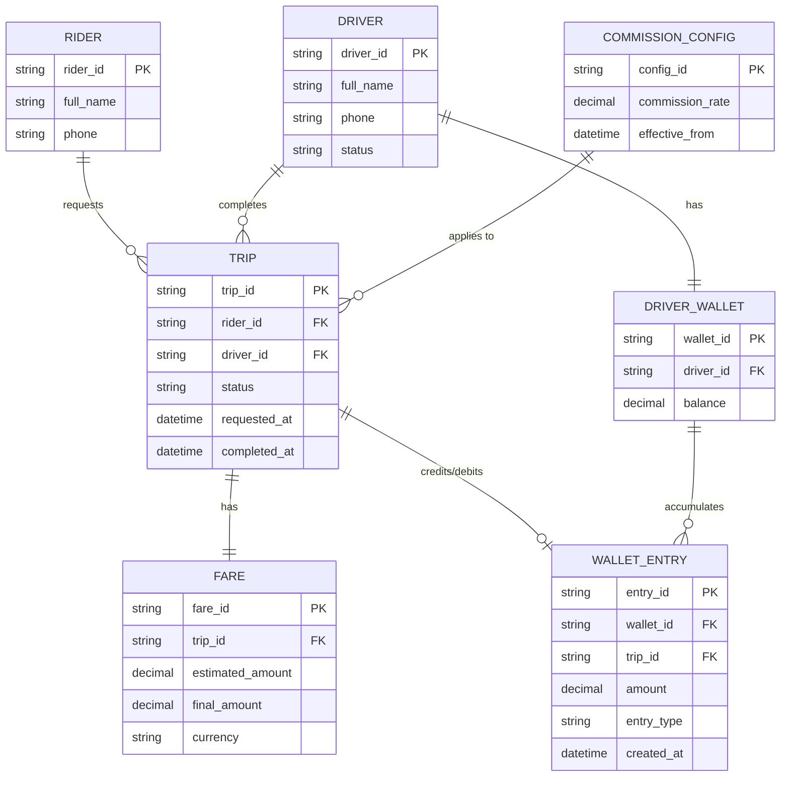
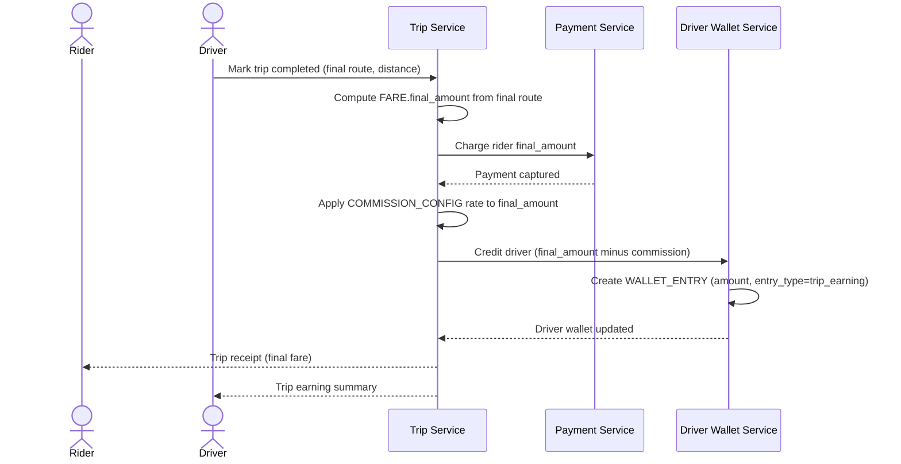
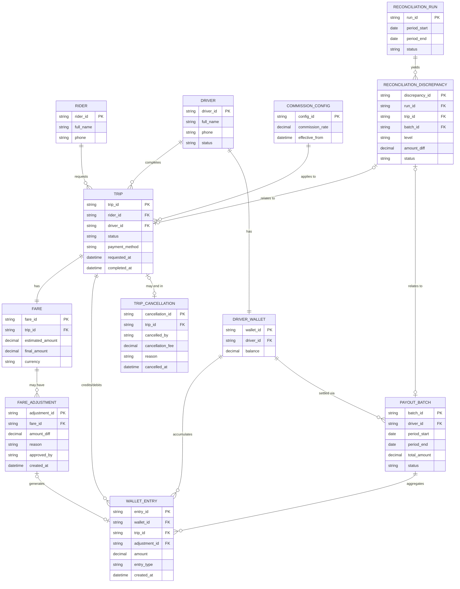
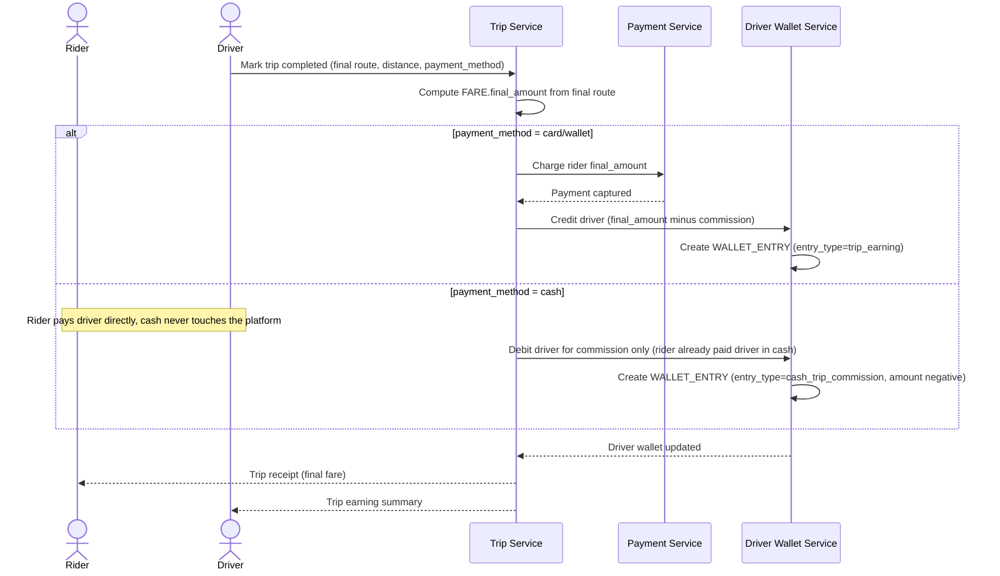
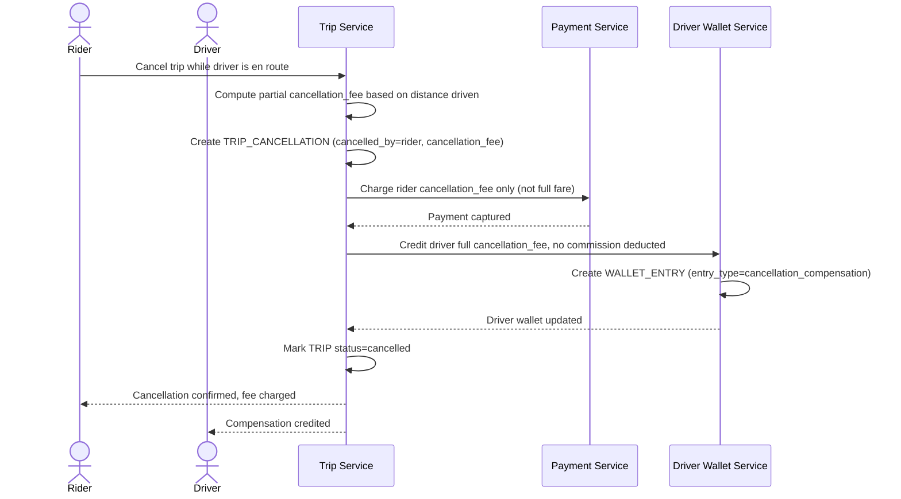
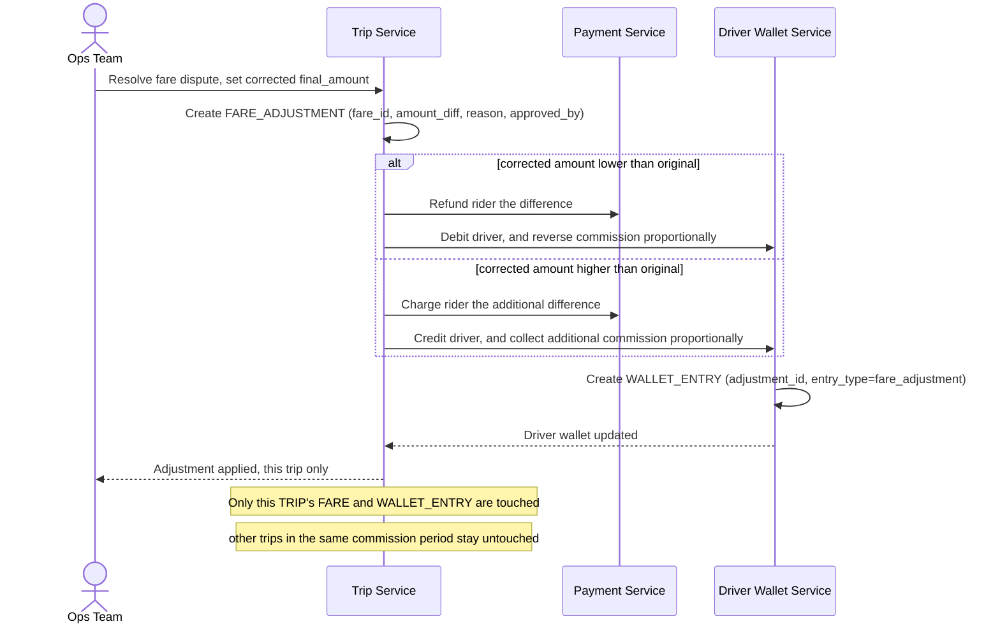
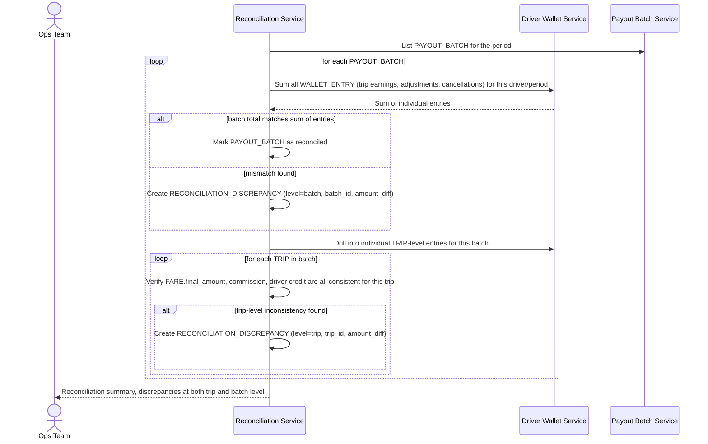

# Ứng dụng gọi xe đối soát cuốc xe, tiền tài xế và hoa hồng

**Hệ thống:** Một ứng dụng gọi xe, khách đặt xe, tài xế hoàn tất cuốc, nền tảng thu tiền và chia lại cho tài xế sau khi trừ hoa hồng, một số cuốc bị hủy giữa chừng hoặc phát sinh tranh chấp giá.

**Vai trò của flow:** Đối soát giữa số tiền khách trả, số tiền tài xế được nhận, và hoa hồng nền tảng giữ lại, đảm bảo ba khoản này khớp đúng cho từng cuốc xe và không có cuốc nào bị tính sai/bỏ sót.

**Yêu cầu cụ thể:**
- Cuốc xe bị hủy giữa chừng sau khi tài xế đã di chuyển một đoạn có thể phát sinh phí hủy một phần cho tài xế nhưng không phải giá cuốc đầy đủ — đối soát phải phân biệt rõ luồng tiền của cuốc hoàn tất và cuốc hủy có phí bồi thường, không gộp chung logic tính hoa hồng như cuốc bình thường.
- Giá cuốc thực tế cuối cùng có thể khác giá ước tính ban đầu hiển thị cho khách (do đổi lộ trình giữa đường, chờ đợi phát sinh, tranh chấp về quãng đường) — đối soát phải dùng đúng giá đã chốt cuối cùng làm cơ sở tính hoa hồng và tiền tài xế, xử lý được trường hợp giá bị điều chỉnh lại sau khi cuốc đã kết thúc và tiền đã tạm ghi nhận.
- Tài xế nhận tiền mặt trực tiếp từ khách cho một số cuốc trong khi hoa hồng nền tảng vẫn phải được thu lại từ tài xế theo cách khác (trừ vào ví/đợt thanh toán sau) — đối soát phải theo dõi riêng luồng tiền mặt này để không nhầm là "tiền chưa về" khi thực chất khách đã trả trực tiếp cho tài xế.
- Khi có tranh chấp giá giữa khách và tài xế được xử lý sau khi cuốc đã kết thúc và tiền đã được chia, khoản điều chỉnh phát sinh sau phải được đối soát lại đúng cho cả ba bên mà không làm sai lệch báo cáo hoa hồng của các cuốc khác không liên quan trong cùng kỳ.
- Với tài xế có khối lượng cuốc lớn mỗi ngày, tổng tiền tài xế nhận được tổng hợp theo đợt thanh toán định kỳ phải khớp chính xác với tổng từng cuốc riêng lẻ cộng lại trừ các khoản điều chỉnh phát sinh trong kỳ — cần cơ chế đối soát ở cả mức chi tiết từng cuốc và mức tổng hợp theo đợt để phát hiện sai lệch dù nhỏ không bị pha loãng/che khuất khi chỉ nhìn tổng số cuối kỳ.

---

# ERD — Base (trước khi có đối soát cuốc xe/tài xế/hoa hồng)

Đây là **base**: mô hình dữ liệu suy luận cho ứng dụng gọi xe *trước khi* có flow đối soát ba chiều (khách trả - tài xế nhận - hoa hồng nền tảng). Đề bài giả định hệ thống đã có cuốc xe với giá cước, đã tính hoa hồng và đã chia tiền cho tài xế qua ví — nếu không có sẵn `TRIP`, `FARE` và `DRIVER_WALLET` thì "đối soát ba khoản khớp đúng cho từng cuốc" sẽ không có nghĩa. ERD chỉ dựng phần lõi phục vụ cuốc xe + chia tiền, không suy diễn thêm các module không liên quan (khuyến mãi, đánh giá tài xế...).

---

# Sequence Diagram — Base: Complete Trip and Split Payment

Đây là **base**, flow "hoàn tất cuốc xe và chia tiền" — tiền đề bắt buộc cho đối soát: chính flow này chốt `FARE.final_amount`, tính hoa hồng theo `COMMISSION_CONFIG`, và ghi `WALLET_ENTRY` cho tài xế. Ba con số (khách trả, tài xế nhận, hoa hồng giữ lại) sinh ra ở đây chính là ba khoản mà đối soát sau này phải khớp với nhau cho từng cuốc.

---

# ERD — Enhance (sau khi có đối soát cuốc xe/tài xế/hoa hồng)

Đây là **enhance**: ERD base cộng với các entity phục vụ đúng 5 yêu cầu của đề bài — cuốc bị hủy giữa chừng có phí một phần, giá cước điều chỉnh sau khi cuốc kết thúc, thanh toán tiền mặt theo dõi riêng, điều chỉnh phát sinh từ tranh chấp giá, và đối soát ở cả mức cuốc lẫn mức đợt thanh toán. So với base, `WALLET_ENTRY` nay còn được tạo bởi `FARE_ADJUSTMENT` và `TRIP_CANCELLATION` (không chỉ bởi cuốc hoàn tất bình thường), và `TRIP` có thêm cờ `payment_method` để phân biệt tiền mặt.

---

# Sequence Diagram — Enhance: Complete Trip and Split Payment

Đây là **enhance**, flow "hoàn tất cuốc và chia tiền" đã có ở base ([2-base-complete-trip-payment-sqd.md](#2-base-complete-trip-payment-sqd)) nhưng nay thay đổi ở chỗ: cuốc trả tiền mặt không đi qua Payment Service để thu tiền từ khách, nhưng hoa hồng vẫn phải bị trừ vào ví tài xế theo hướng ngược lại, thay vì chỉ cộng dồn một chiều như base.

---

# Sequence Diagram — Enhance: Cancel Trip With Partial Fee

Đây là **enhance**, flow mới xử lý cuốc bị hủy giữa chừng sau khi tài xế đã di chuyển một đoạn. Flow này thể hiện yêu cầu "phân biệt rõ luồng tiền của cuốc hoàn tất và cuốc hủy có phí bồi thường" — không tính hoa hồng theo logic cuốc bình thường, mà tạo `TRIP_CANCELLATION` với phí hủy một phần riêng.

---

# Sequence Diagram — Enhance: Fare Adjustment After Dispute

Đây là **enhance**, flow mới xử lý tranh chấp giá giữa khách và tài xế được giải quyết *sau khi* cuốc đã kết thúc và tiền đã chia (theo [4-enhance-complete-trip-payment-sqd.md](#4-enhance-complete-trip-payment-sqd)). Flow này thể hiện yêu cầu điều chỉnh đúng cho cả ba bên (khách, tài xế, hoa hồng) mà không làm sai lệch báo cáo của các cuốc khác trong cùng kỳ.

---

# Sequence Diagram — Enhance: Driver Payout Reconciliation

Đây là **enhance**, flow mới đối soát ở cả mức chi tiết từng cuốc lẫn mức tổng hợp theo đợt thanh toán (`PAYOUT_BATCH`). Flow này thể hiện yêu cầu "đối soát ở cả mức chi tiết và mức tổng hợp để phát hiện sai lệch dù nhỏ không bị pha loãng" khi tài xế có khối lượng cuốc lớn mỗi ngày.

