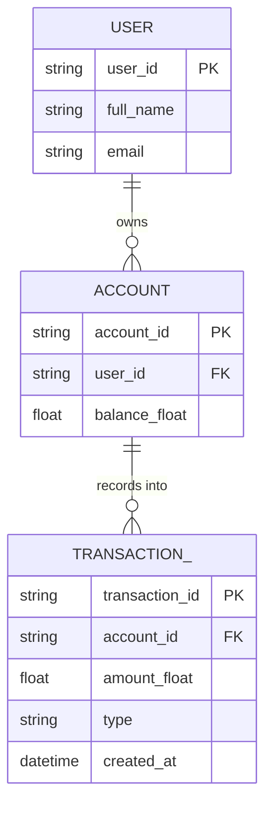
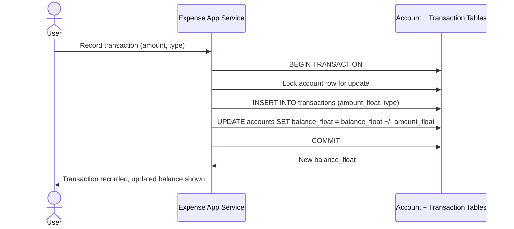
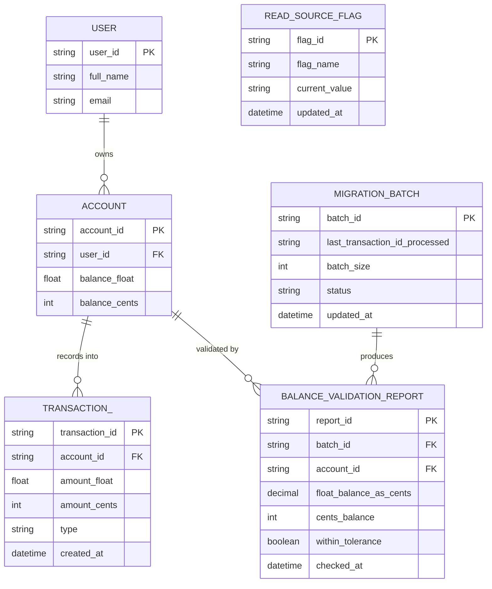
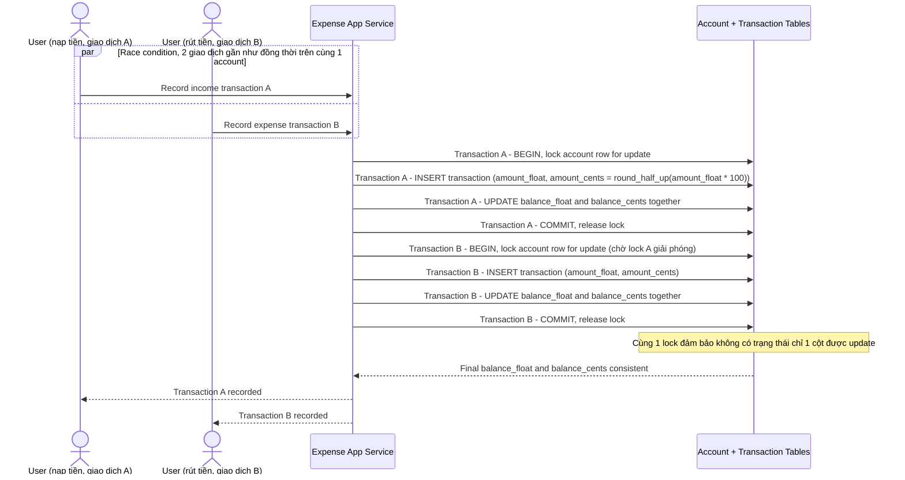
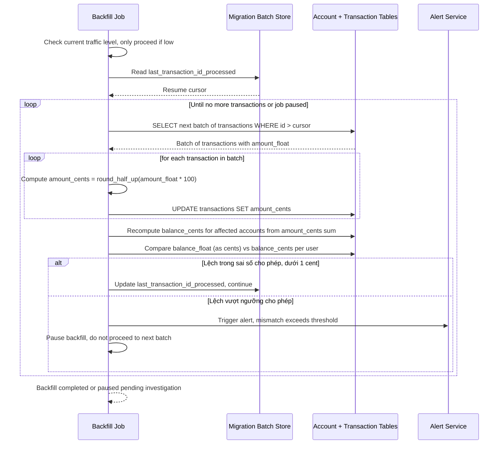
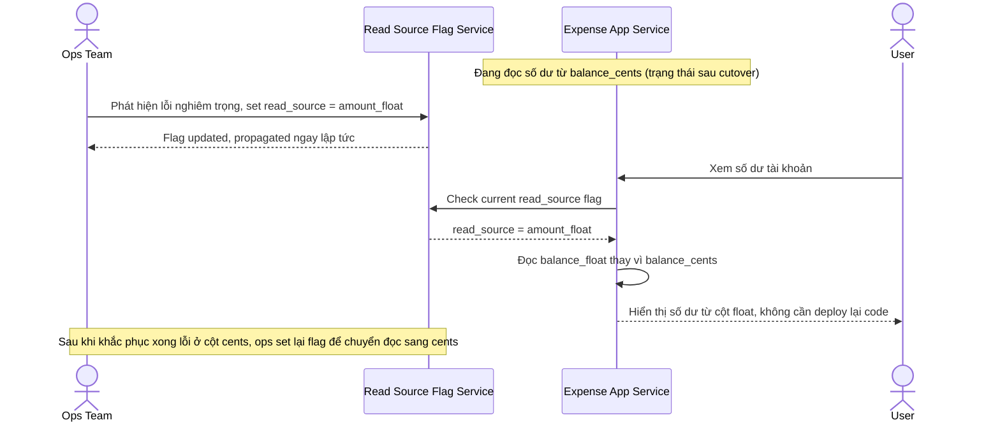

# Đổi đơn vị tiền tệ lưu trữ từ float sang integer (cents) trong hệ thống fintech

**Hệ thống:** Một app quản lý chi tiêu cá nhân đang lưu số tiền dạng `float` (dễ sai số làm tròn), cần migrate toàn bộ sang lưu `integer` (đơn vị cents) mà không làm sai lệch số dư của user nào trong lúc migrate.

**Vai trò của flow:** Flow dual-write phải đảm bảo mọi giao dịch mới trong lúc migrate được ghi đúng ở cả cột `amount_float` (cũ) và `amount_cents` (mới), với công thức chuyển đổi nhất quán, để không tạo ra sai số dồn tích ảnh hưởng đến số dư hiển thị cho user.

**Yêu cầu cụ thể:**
- Quy định công thức chuyển đổi cụ thể (ví dụ round-half-up ở đơn vị cents) và bắt buộc áp dụng đồng nhất ở cả chiều ghi mới và chiều backfill dữ liệu cũ, để tránh 2 cách round khác nhau tạo lệch số dư giữa 2 cột.
- Mô tả race condition: giao dịch A (ghi tiền vào) và giao dịch B (rút tiền ra) xảy ra gần như đồng thời trên cùng 1 tài khoản trong giai đoạn dual-write — yêu cầu cả 2 cột `amount_float` và `amount_cents` phải được cập nhật trong cùng transaction với cùng 1 lock trên dòng số dư, không cho phép trạng thái chỉ 1 cột được update.
- Job backfill lịch sử giao dịch phải tính lại `amount_cents` từ `amount_float` gốc (không phải từ số dư đã tính toán ngược), và phải chạy khi hệ thống ở mức traffic thấp theo batch, có cơ chế tạm dừng nếu phát hiện tỷ lệ lệch số dư vượt ngưỡng.
- Có bước validate: sau khi backfill xong mỗi batch, tổng số dư tính theo cột cũ và cột mới của từng user phải khớp trong sai số cho phép (ví dụ dưới 1 cent do rounding), nếu lệch phải chặn không cho tiếp tục sang batch kế và cảnh báo ngay.
- Định nghĩa rollback plan cụ thể: nếu phát hiện lỗi nghiêm trọng sau khi đã chuyển đọc sang cột mới, phải có cách quay lại đọc cột cũ ngay lập tức (feature flag) mà không cần deploy lại code.

---

# ERD — Base (trước khi đổi sang lưu cents)

Đây là **base**: mô hình dữ liệu suy luận cho app quản lý chi tiêu cá nhân *trước khi* đổi đơn vị lưu trữ tiền tệ. Đề bài giả định đã có `USER` với 1 `ACCOUNT` lưu số dư dạng `float` và các `TRANSACTION` (giao dịch thu/chi) ghi nhận vào tài khoản đó — nếu không có sẵn cột `amount_float` thì yêu cầu "migrate sang amount_cents" sẽ không có nghĩa. ERD chỉ dựng phần lõi phục vụ giao dịch và số dư, không suy diễn thêm ngân sách/báo cáo/nhắc nhở không liên quan.

---

# Sequence Diagram — Base: Create Transaction

Đây là **base**, flow "tạo giao dịch thu/chi" — tiền đề bắt buộc cho việc đổi đơn vị lưu trữ: chính flow này ghi `amount_float` vào `TRANSACTION` và cập nhật `balance_float` của `ACCOUNT`, là nguồn dữ liệu phải được dual-write sang `amount_cents`/`balance_cents` ở enhance.

---

# ERD — Enhance (sau khi thêm cột cents)

Đây là **enhance**: ERD base cộng với cột `amount_cents`/`balance_cents` dual-write song song cột `float` cũ, checkpoint backfill, báo cáo validate từng batch, và feature flag cho phép rollback đọc ngay lập tức. So với base, `ACCOUNT` và `TRANSACTION_` không đổi cấu trúc bảng gốc nhưng có thêm cột `_cents`, và `READ_SOURCE_FLAG` là entity hoàn toàn mới quyết định hệ thống đang đọc từ cột nào.

---

# Sequence Diagram — Enhance: Create Transaction

Đây là **enhance**, flow "tạo giao dịch" đã tồn tại ở base ([2-base-create-transaction-sqd.md](#2-base-create-transaction-sqd)) nay thay đổi: mọi giao dịch mới phải ghi đồng thời `amount_float` và `amount_cents` (round-half-up) trong cùng 1 transaction, dùng cùng 1 lock trên dòng số dư, để race condition giữa giao dịch nạp tiền và rút tiền gần như đồng thời không làm lệch 2 cột.

---

# Sequence Diagram — Enhance: Backfill Historical Transactions

Đây là **enhance**, flow hoàn toàn mới: job backfill tính lại `amount_cents` từ `amount_float` gốc theo batch ở giờ traffic thấp, validate tổng số dư sau mỗi batch và tự tạm dừng nếu tỷ lệ lệch vượt ngưỡng thay vì chạy tiếp và làm sai lệch số dư hàng loạt.

---

# Sequence Diagram — Enhance: Rollback via Feature Flag

Đây là **enhance**, flow hoàn toàn mới: khi hệ thống đã chuyển đọc số dư sang `balance_cents` nhưng phát hiện lỗi nghiêm trọng, ops phải có cách quay lại đọc `balance_float` ngay lập tức bằng feature flag, không cần deploy lại code.

