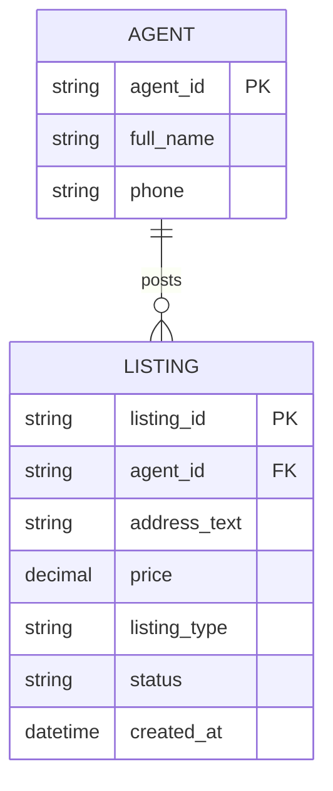
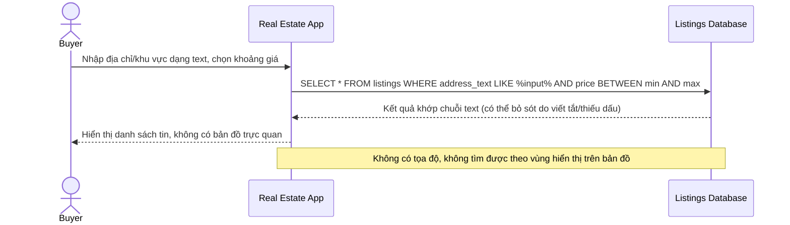
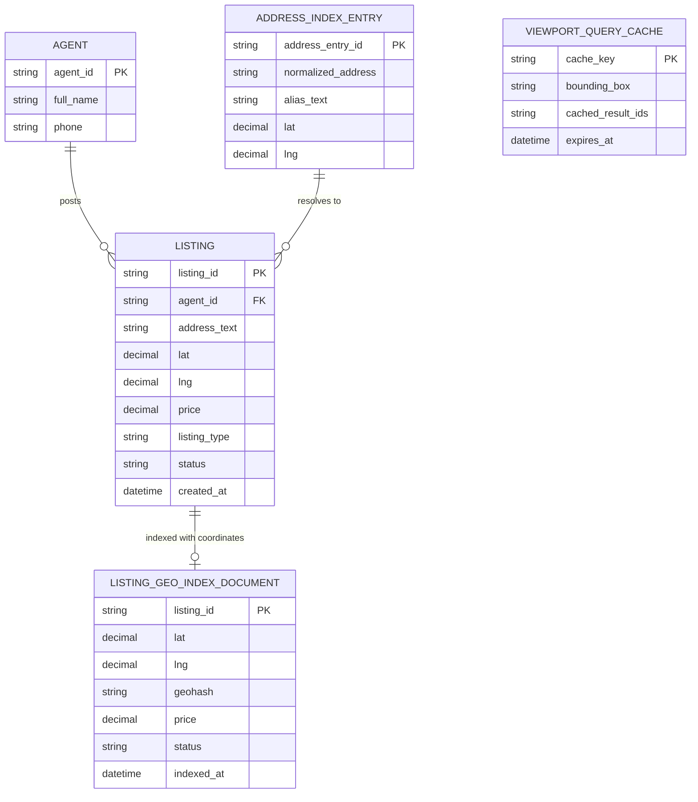
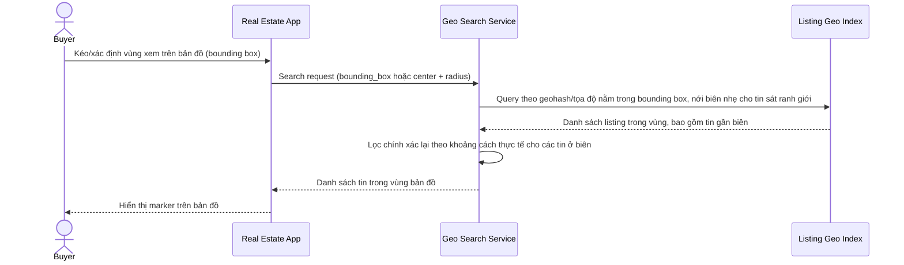
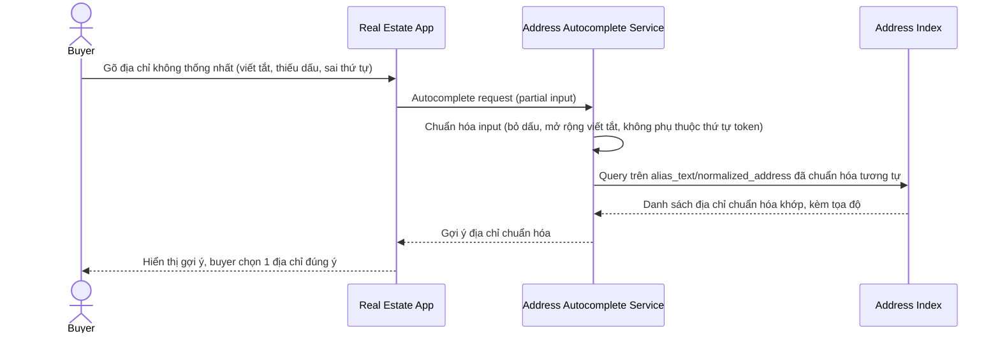
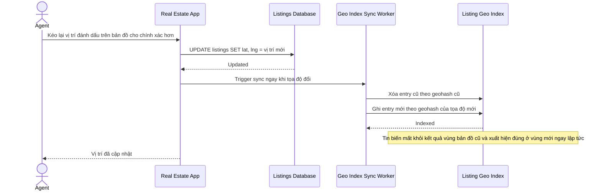
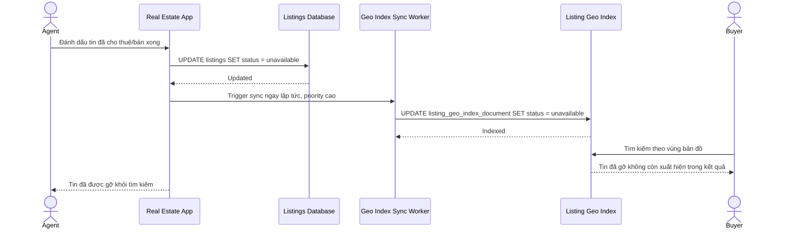

# Nền tảng bất động sản tìm kiếm theo bản đồ và autocomplete địa chỉ

**Hệ thống:** Một nền tảng đăng tin bất động sản cho phép người tìm mua/thuê tra cứu theo khu vực trên bản đồ kết hợp autocomplete gợi ý địa chỉ/khu vực.

**Vai trò của flow:** Lập chỉ mục tin bất động sản kèm dữ liệu địa lý (tọa độ, ranh giới khu vực), phục vụ tìm kiếm theo vùng bản đồ và autocomplete địa chỉ chính xác.

**Yêu cầu cụ thể:**
- Tìm kiếm theo vùng hiển thị trên bản đồ (bounding box/bán kính từ một điểm) phải trả đúng và đủ các tin nằm trong vùng đó, xử lý chính xác các trường hợp tin ở biên giới vùng (gần đúng ranh giới quận/khu vực).
- Autocomplete địa chỉ phải xử lý được cách viết địa chỉ không thống nhất (viết tắt, thiếu dấu, thứ tự phường/quận/thành phố khác nhau) và gợi ý đúng địa chỉ chuẩn hóa, không yêu cầu người dùng gõ chính xác định dạng địa chỉ đầy đủ.
- Khi người đăng tin cập nhật tọa độ/vị trí của bất động sản (ví dụ sửa lại vị trí đánh dấu trên bản đồ cho chính xác hơn), index phải cập nhật ngay để tin xuất hiện đúng ở kết quả tìm kiếm theo vùng bản đồ mới, biến mất khỏi vùng cũ.
- Tin đã cho thuê/bán xong phải được gỡ khỏi kết quả tìm kiếm theo bản đồ ngay lập tức, tránh người tìm liên hệ vào tin không còn hiệu lực gây trải nghiệm xấu.
- Khi người dùng zoom/pan bản đồ liên tục để khám sát khu vực, hệ thống phải trả kết quả tìm kiếm theo vùng mới với độ trễ thấp cho từng lần thay đổi vùng nhìn, không tính toán lại toàn bộ từ đầu mỗi lần một cách tốn kém tài nguyên.

---

# ERD — Base (trước khi có tìm kiếm theo bản đồ)

Đây là **base**: mô hình dữ liệu suy luận cho nền tảng bất động sản *trước khi* có tìm kiếm theo bản đồ/autocomplete địa chỉ. Đề bài mô tả toàn bộ khả năng bản đồ/autocomplete là nội dung của enhance, nên base được suy luận là trạng thái trước đó: tin đăng chỉ có địa chỉ dạng text tự do, tìm kiếm theo bộ lọc cơ bản (giá, loại tin), chưa có tọa độ hay index địa lý.

---

# Sequence Diagram — Base: Search Listing

Đây là **base**, flow "tìm tin bất động sản" bằng bộ lọc cơ bản (giá, loại tin, khớp chuỗi địa chỉ text) — tiền đề cho thấy hạn chế: không có khả năng tìm theo vùng bản đồ hay autocomplete địa chỉ chuẩn hóa, phải gõ đúng định dạng địa chỉ mới ra kết quả.

---

# ERD — Enhance (sau khi có tìm kiếm theo bản đồ)

Đây là **enhance**: `LISTING` được bổ sung tọa độ `lat`/`lng`, thêm `LISTING_GEO_INDEX_DOCUMENT` phục vụ query vùng bản đồ hiệu quả, `ADDRESS_INDEX_ENTRY` phục vụ autocomplete địa chỉ chuẩn hóa, và `VIEWPORT_QUERY_CACHE` để trả kết quả nhanh khi zoom/pan liên tục. So với base, tìm kiếm không còn dựa trên `address_text` khớp chuỗi mà dựa trên tọa độ và index địa lý chuyên dụng.

---

# Sequence Diagram — Enhance: Search by Map Region

Đây là **enhance**, flow hoàn toàn mới: tìm kiếm theo vùng hiển thị trên bản đồ (bounding box/bán kính), trả đúng và đủ tin trong vùng kể cả các tin ở gần đúng ranh giới quận/khu vực.

---

# Sequence Diagram — Enhance: Autocomplete Address

Đây là **enhance**, flow hoàn toàn mới: autocomplete xử lý địa chỉ viết tắt/thiếu dấu/thứ tự phường-quận-thành phố khác nhau, gợi ý đúng địa chỉ chuẩn hóa mà không cần người dùng gõ chính xác định dạng đầy đủ.

---

# Sequence Diagram — Enhance: Update Listing Location

Đây là **enhance**, flow hoàn toàn mới: khi người đăng tin sửa lại tọa độ/vị trí trên bản đồ cho chính xác hơn, index phải cập nhật ngay để tin xuất hiện đúng vùng mới và biến mất khỏi vùng cũ.

---

# Sequence Diagram — Enhance: Mark Listing Unavailable

Đây là **enhance**, flow hoàn toàn mới: tin đã cho thuê/bán xong phải bị gỡ khỏi kết quả tìm kiếm theo bản đồ ngay lập tức, tránh người tìm liên hệ vào tin không còn hiệu lực.

