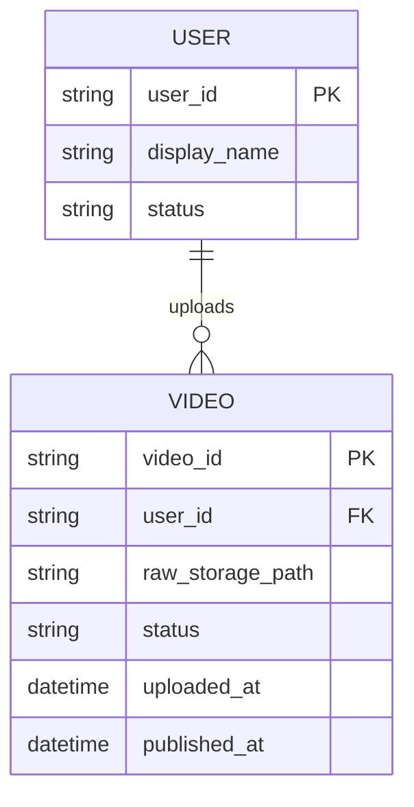
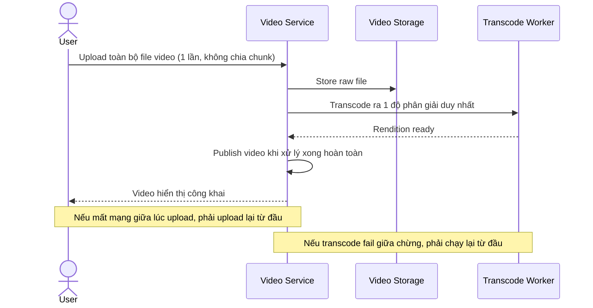
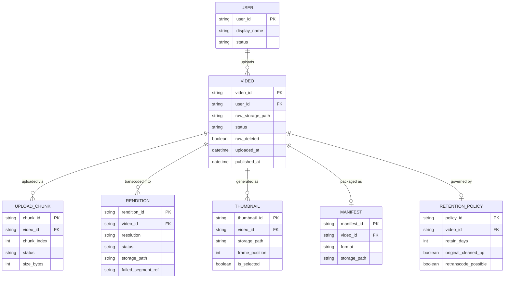
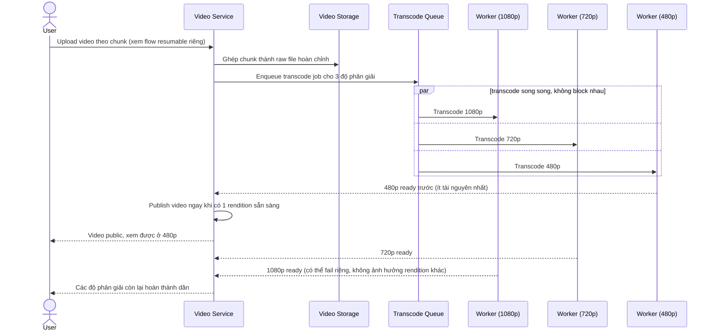
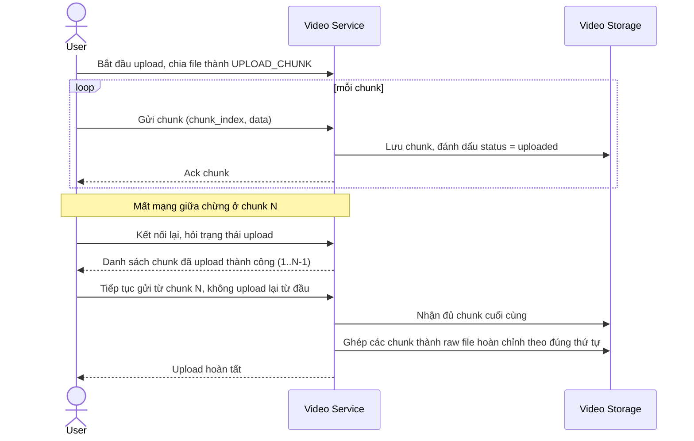
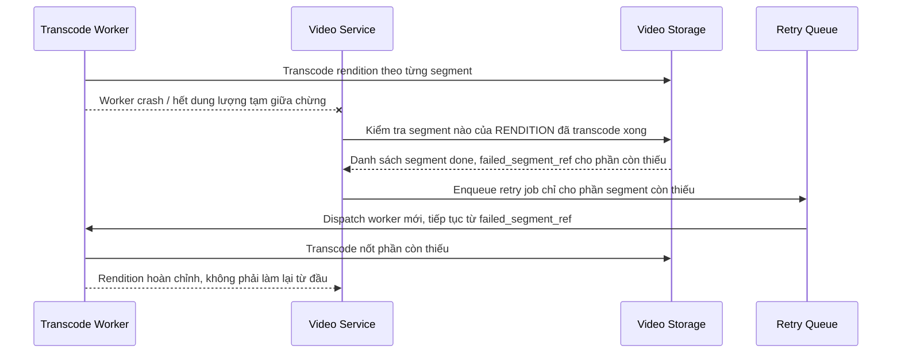
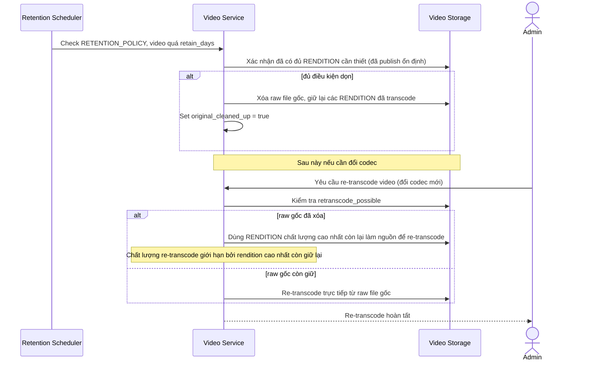

# Nền tảng chia sẻ video kiểu YouTube

**Hệ thống:** Một nền tảng cho phép user upload video và người khác xem lại (video-on-demand), quy mô hàng triệu video.

**Vai trò của flow:** Nhận file video gốc từ user, transcode ra nhiều độ phân giải/bitrate và đóng gói HLS/DASH để phát trên mọi thiết bị.

**Yêu cầu cụ thể:**
- Upload phải hỗ trợ file lớn (nhiều GB) bằng chunked/resumable upload, tiếp tục được nếu mất mạng giữa chừng.
- Sau khi upload xong, đưa vào hàng đợi transcode ra tối thiểu 3 độ phân giải (ví dụ 1080p/720p/480p) chạy song song, không block nhau nếu một rendition lỗi.
- Sinh thumbnail tự động (nhiều frame để user chọn) và file manifest HLS/DASH tương ứng.
- Nếu job transcode fail giữa chừng (worker crash, hết dung lượng tạm), phải retry lại đúng phần việc còn thiếu, không transcode lại từ đầu toàn bộ video.
- Video chỉ hiển thị "public" sau khi tối thiểu 1 rendition sẵn sàng; các rendition còn lại có thể hoàn thành dần (progressive availability).
- Có cơ chế dọn file gốc/file tạm sau X ngày để tối ưu chi phí storage, nhưng vẫn giữ được khả năng re-transcode nếu cần đổi codec sau này.

---

# ERD — Base (trước khi có pipeline transcode đa độ phân giải)

Đây là **base**: mô hình dữ liệu suy luận cho nền tảng chia sẻ video *trước khi* có pipeline upload resumable, multi-resolution, progressive availability. Đề bài giả định nền tảng đã cho user upload và xem lại video ở dạng đơn giản — nếu không có sẵn User/Video thì các yêu cầu về chunked upload, retry, cleanup sẽ không có nghĩa. ERD chỉ dựng phần lõi phục vụ upload + phát video, không suy diễn thêm subscription, comment, recommendation...

Ghi chú giả định: base là dạng upload nguyên khối (không resumable) và transcode 1 độ phân giải duy nhất, publish chỉ khi xử lý xong hoàn toàn — đây là điểm khởi đầu hợp lý nhất để so sánh với các yêu cầu nâng cấp toàn diện của đề bài.

---

# Sequence Diagram — Base: Upload and Publish Video

Đây là **base**, flow upload và publish đơn giản (nguyên khối, 1 độ phân giải, publish khi xong toàn bộ) — tiền đề bắt buộc mà enhance sẽ nâng cấp thành resumable/multi-resolution/progressive.

---

# ERD — Enhance (sau khi có pipeline transcode đa độ phân giải)

Đây là **enhance**: ERD base cộng với các entity phục vụ đúng 6 yêu cầu của đề bài — resumable upload theo chunk, transcode song song nhiều độ phân giải, sinh thumbnail + manifest HLS/DASH, retry đúng phần thiếu, progressive availability, và cleanup có khả năng re-transcode. So với base, `VIDEO` không còn gắn 1 file kết quả duy nhất mà tách thành nhiều `RENDITION` độc lập, publish được ngay khi có rendition đầu tiên thay vì chờ toàn bộ.

---

# Sequence Diagram — Enhance: Upload and Publish Video

Đây là **enhance**, flow đã thay đổi so với base ([2-base-upload-and-publish-video-sqd.md](#2-base-upload-and-publish-video-sqd)): upload nay chia chunk (xem chi tiết resume ở [5-enhance-resumable-chunked-upload-sqd.md](#5-enhance-resumable-chunked-upload-sqd)), transcode nhiều độ phân giải song song không chặn nhau, và video publish ngay khi có rendition đầu tiên thay vì chờ toàn bộ như base.

---

# Sequence Diagram — Enhance: Resumable Chunked Upload

Đây là **enhance**, flow mới hoàn toàn phục vụ yêu cầu upload file lớn (nhiều GB) bằng chunked/resumable upload, tiếp tục được nếu mất mạng giữa chừng — chưa tồn tại ở base vì base upload nguyên khối.

---

# Sequence Diagram — Enhance: Retry Failed Transcode

Đây là **enhance**, flow mới xử lý yêu cầu "nếu job transcode fail giữa chừng, phải retry đúng phần việc còn thiếu, không transcode lại từ đầu toàn bộ video".

---

# Sequence Diagram — Enhance: Cleanup and Retranscode Original

Đây là **enhance**, flow mới xử lý yêu cầu dọn file gốc/file tạm sau X ngày để tối ưu chi phí lưu trữ, nhưng vẫn giữ khả năng re-transcode nếu cần đổi codec sau này.

